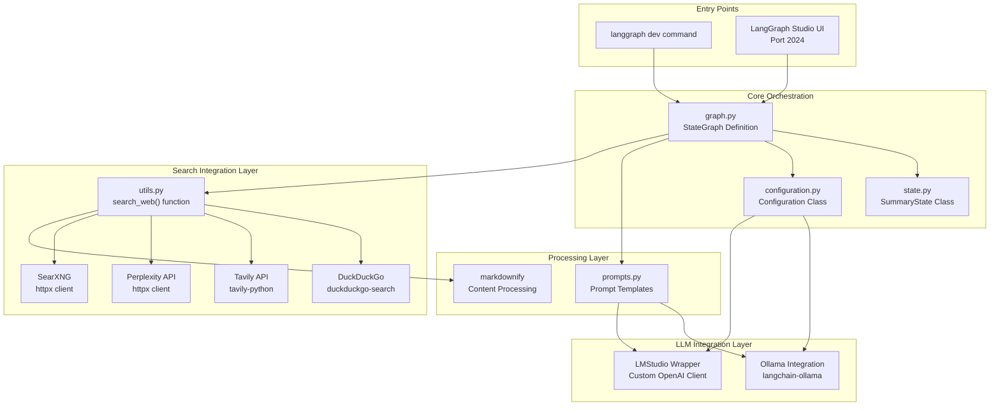
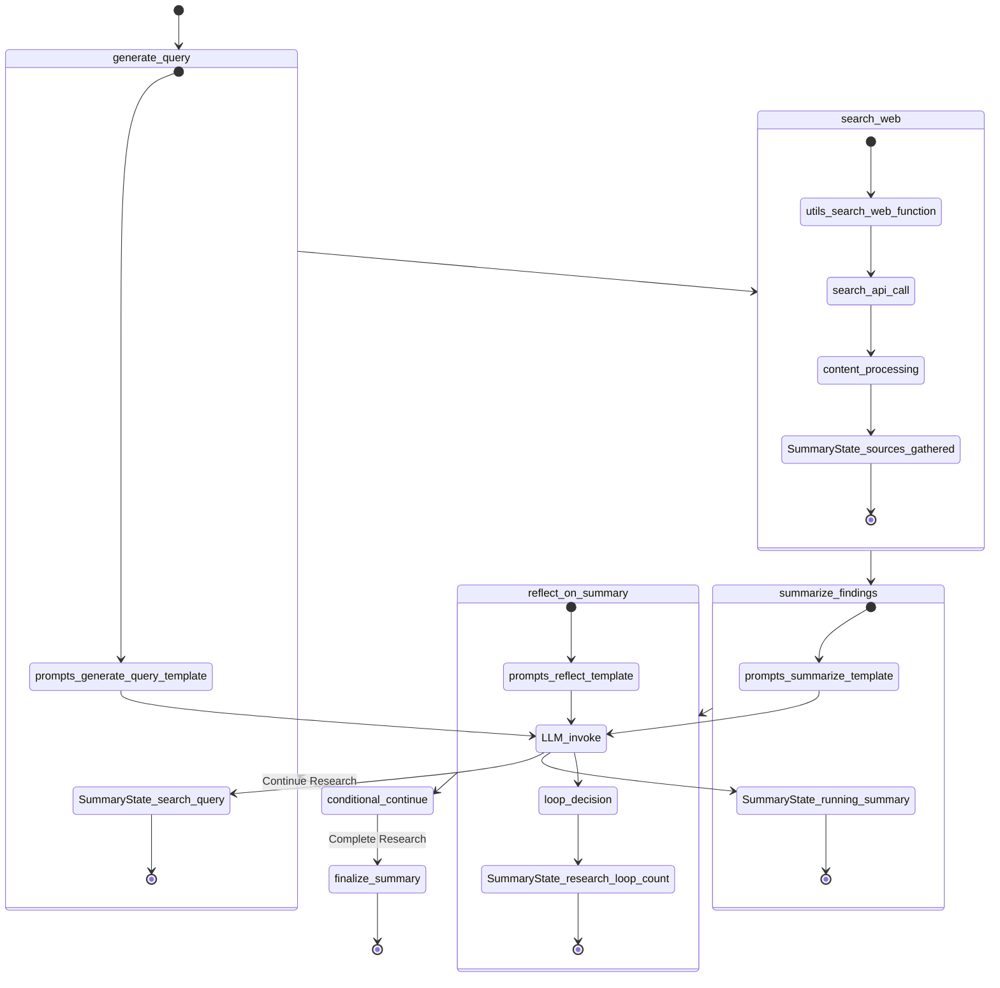
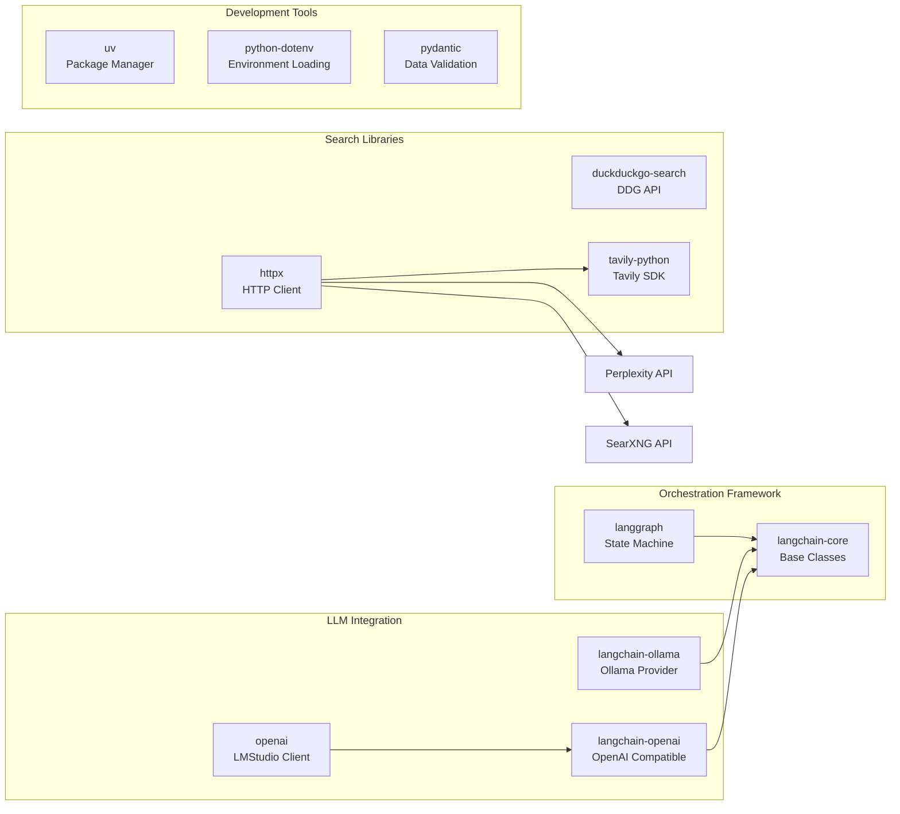

<!-- source: DeepWiki mcp.deepwiki.com · repo langchain-ai/local-deep-researcher · page 1 Overview · fetched 2026-10-26 -->

# Overview

Relevant source files

The following files were used as context for generating this wiki page:

- [README.md](README.md)

## Purpose and Scope

Local Deep Researcher is a LangGraph-orchestrated web research assistant that uses local LLMs to conduct iterative, autonomous research on user-provided topics. The system integrates with local LLM providers (Ollama, LMStudio) and multiple search APIs to generate comprehensive research summaries with citations.

This document provides a high-level technical overview of the system architecture, core components, and capabilities. For detailed project structure and dependencies, see [Project Structure](#1.1). For comprehensive deployment information, see [Deployment](#5). For step-by-step usage instructions, see [Usage Guide](#6).

## System Architecture

The Local Deep Researcher implements a state machine-driven research workflow using LangGraph to orchestrate interactions between LLM providers, search APIs, and content processing components.

### Core Architecture Components

**Sources:** [README.md:1-221](), [langgraph.json](), [pyproject.toml]()

### Research Workflow State Machine

**Sources:** [README.md:165-172](), [graph.py](), [state.py](), [prompts.py](), [utils.py]()

## Core Workflow Process

The system implements an iterative research methodology inspired by IterDRAG, using a configurable loop to progressively build comprehensive research summaries.

### Research Loop Components

| Component | Code Location | Purpose |
|-----------|---------------|---------|
| Query Generation | `prompts.py` templates | Convert research topic into targeted search queries |
| Web Search | `utils.py:search_web()` | Execute searches across configured APIs |
| Content Summarization | `prompts.py` templates | Extract relevant information from search results |
| Gap Analysis | `prompts.py` reflection templates | Identify knowledge gaps for follow-up research |
| State Management | `state.py:SummaryState` | Track progress and accumulate findings |

### Configuration-Driven Behavior

The system uses a three-tier configuration hierarchy:

1. **Environment Variables** (highest priority) - [.env file]()
2. **LangGraph Studio Configuration** - Runtime UI settings  
3. **Default Values** - [`configuration.py:Configuration`]() class defaults

Key configuration parameters include:

- `LLM_PROVIDER`: Selection between `ollama` and `lmstudio`
- `SEARCH_API`: Choice of `duckduckgo`, `tavily`, `perplexity`, or `searxng`
- `MAX_WEB_RESEARCH_LOOPS`: Iteration limit (default: 3)
- `FETCH_FULL_PAGE`: Content depth control for DuckDuckGo searches

**Sources:** [README.md:30-82](), [README.md:135-141](), [configuration.py]()

## Technology Stack

### Core Framework Dependencies

**Sources:** [pyproject.toml](), [README.md:96-98](), [README.md:116-119]()

## Key Capabilities

### Multi-Provider LLM Support

The system supports both local and cloud-based LLM providers through standardized interfaces:

- **Ollama Integration**: Direct connection to local Ollama service at `http://localhost:11434`
- **LMStudio Integration**: OpenAI-compatible API wrapper for LMStudio at `http://localhost:1234/v1`
- **Fallback Mechanisms**: Automatic handling of models with limited JSON support

### Search API Abstraction

Unified search interface supporting multiple providers:

- **DuckDuckGo**: No API key required, optional full-page content fetching
- **Tavily**: Commercial search API with structured results
- **Perplexity**: AI-powered search with Sonar API integration  
- **SearXNG**: Self-hosted metasearch engine support

### Deployment Flexibility

- **Development Mode**: `langgraph dev` command with hot reload
- **Production Deployment**: Multi-architecture Docker containers
- **CI/CD Pipeline**: Automated GitHub Actions workflows for container builds

**Sources:** [README.md:35-82](), [README.md:193-221](), [Dockerfile](), [.github/workflows/docker-image.yml]()

---

