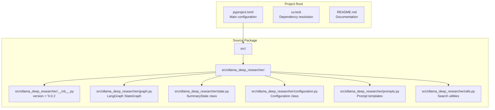
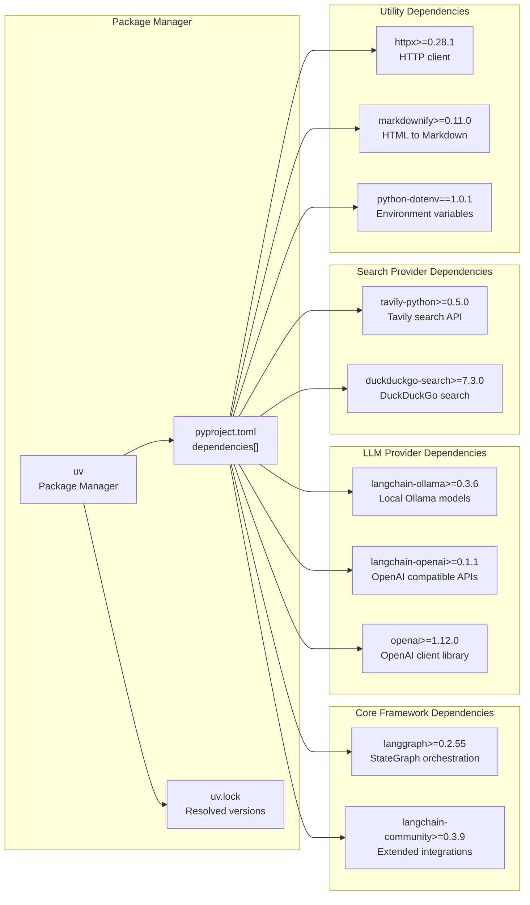
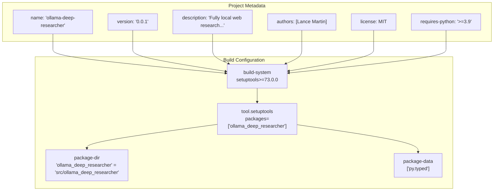

<!-- source: DeepWiki mcp.deepwiki.com · repo langchain-ai/local-deep-researcher · page 1.1 Project Structure · fetched 2026-10-26 -->

# Project Structure

<details>
<summary>Relevant source files</summary>

The following files were used as context for generating this wiki page:

- [pyproject.toml](pyproject.toml)
- [src/ollama_deep_researcher/__init__.py](src/ollama_deep_researcher/__init__.py)
- [uv.lock](uv.lock)

</details>


This page documents the Python package structure, dependency management, and development setup for the Local Deep Researcher project. For information about the overall system architecture and component interactions, see [System Architecture](#2). For deployment configuration details, see [Configuration](#4).

## Package Organization

The Local Deep Researcher is structured as a standard Python package using modern packaging practices with `pyproject.toml` configuration and `uv` for dependency management.

### Directory Structure



**Package Configuration**
The project uses `setuptools` as the build backend with the package located at `src/ollama_deep_researcher`. The package name is `ollama-deep-researcher` while the Python module is `ollama_deep_researcher`.

Sources: [pyproject.toml:32-39]()

## Dependencies Overview

The project has a focused set of dependencies organized around LangGraph orchestration, LLM integrations, and web search capabilities.

### Core Dependency Categories

| Category | Purpose | Key Packages |
|----------|---------|--------------|
| **Orchestration** | Workflow management and state handling | `langgraph>=0.2.55` |
| **LLM Integration** | Local and cloud LLM providers | `langchain-ollama>=0.3.6`, `langchain-openai>=0.1.1` |
| **Search APIs** | Web search capabilities | `tavily-python>=0.5.0`, `duckduckgo-search>=7.3.0` |
| **Community Tools** | Extended LangChain functionality | `langchain-community>=0.3.9` |
| **HTTP Client** | Web requests and content processing | `httpx>=0.28.1`, `markdownify>=0.11.0` |
| **Configuration** | Environment management | `python-dotenv==1.0.1` |

### Dependency Resolution Architecture



Sources: [pyproject.toml:11-23](), [uv.lock:1-10]()

## Development Environment Setup

The project uses `uv` as the primary package manager for fast dependency resolution and environment management.

### Development Dependencies

Development tools are specified in the optional dependencies section:

```python
[project.optional-dependencies]
dev = ["mypy>=1.11.1", "ruff>=0.6.1"]
```

Additional development dependencies are managed through dependency groups:

```python
[dependency-groups]
dev = ["ruff>=0.12.7"]
```

### Code Quality Configuration

The project includes comprehensive linting and formatting configuration through `ruff`:

- **Selected Rules**: `E` (pycodestyle), `F` (pyflakes), `I` (isort), `D` (pydocstyle), `T201`, `UP`
- **Documentation Style**: Google convention docstrings
- **Import Sorting**: Automatic import organization
- **Type Checking**: MyPy integration for static analysis

Sources: [pyproject.toml:25-26](), [pyproject.toml:41-68]()

## Build System Configuration

### Package Metadata



The build system uses `setuptools>=73.0.0` with `wheel` for distribution. The package includes type hints (`py.typed` marker file) for static analysis support.

### Python Version Compatibility

The project requires Python 3.9 or higher, ensuring compatibility with modern Python features while maintaining reasonable backward compatibility.

Sources: [pyproject.toml:1-10](), [pyproject.toml:28-39]()

## Lock File Management

The `uv.lock` file provides deterministic dependency resolution across environments:

- **Lock Version**: 1, Revision 3
- **Python Compatibility**: Supports Python 3.9+ with resolution markers for different versions
- **Resolved Dependencies**: 122 packages with exact version pins and cryptographic hashes
- **Platform Support**: Multi-platform wheels for macOS, Linux (various architectures), Windows, and Muslim Linux distributions

The lock file ensures reproducible builds by pinning all transitive dependencies to specific versions with integrity verification.

Sources: [uv.lock:1-10](), [uv.lock:11-121]()

---

