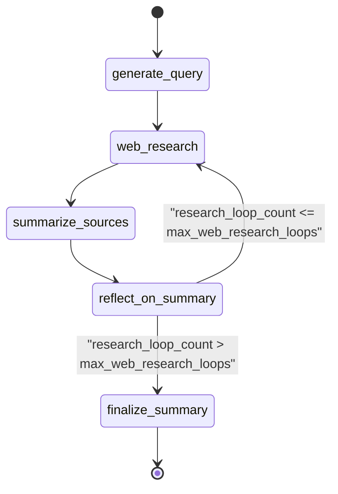
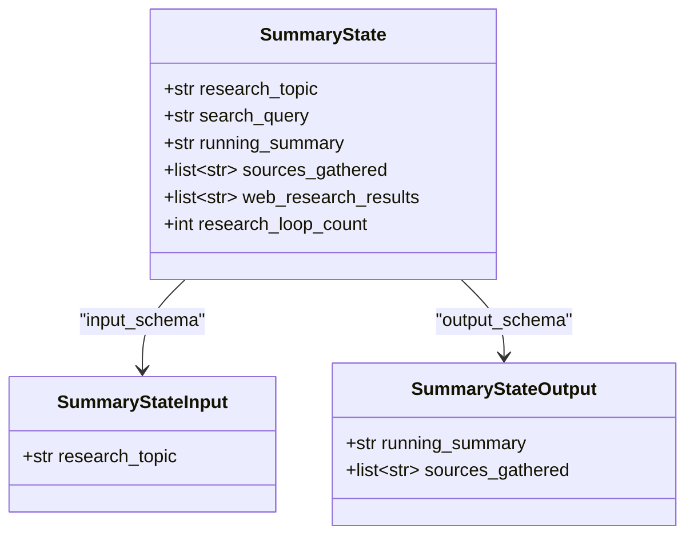
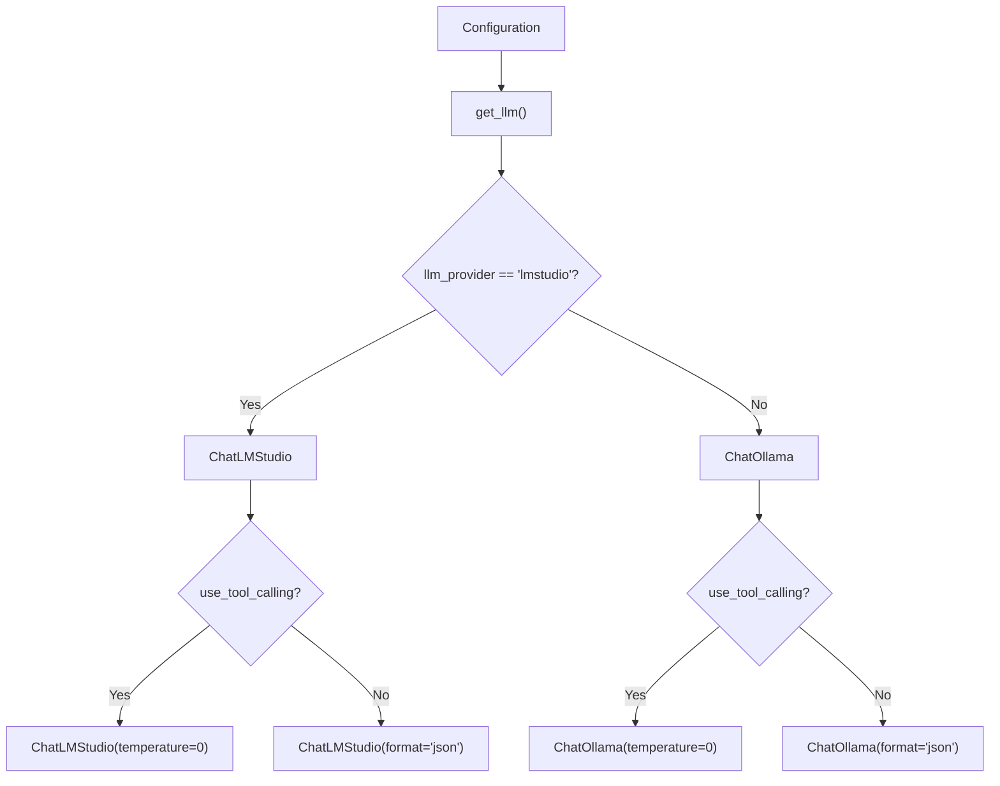
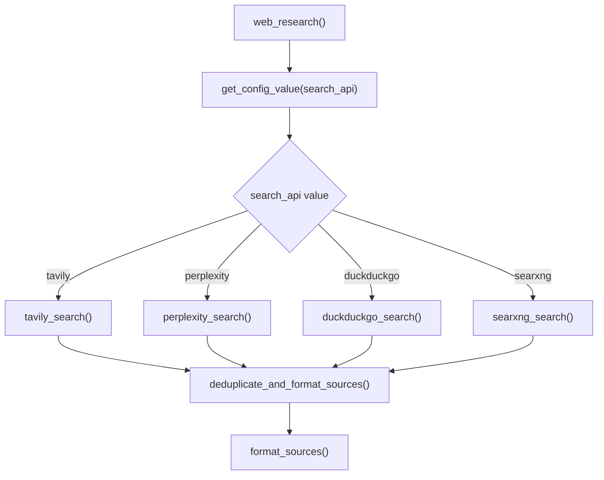
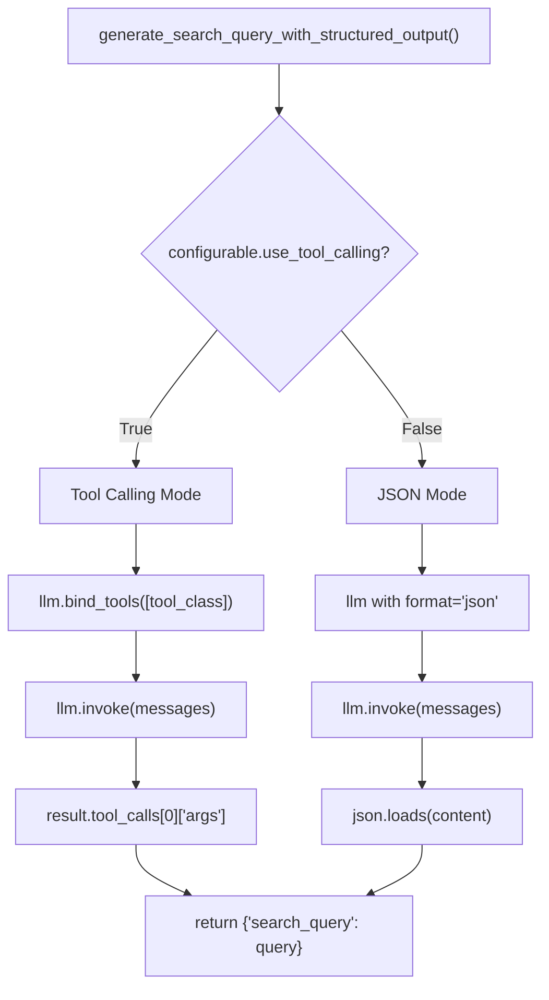
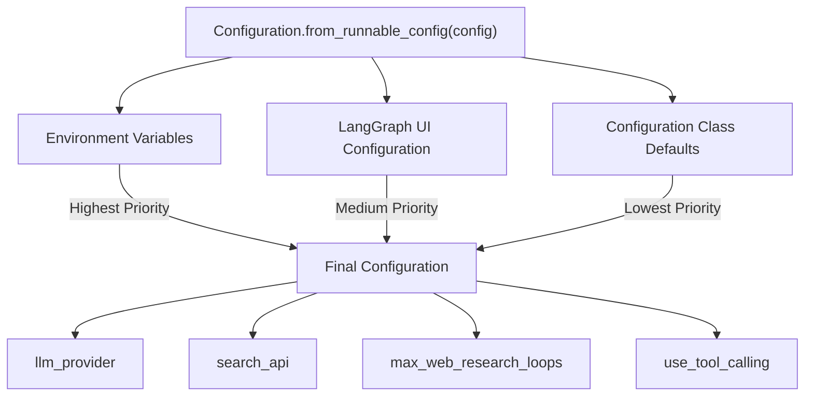
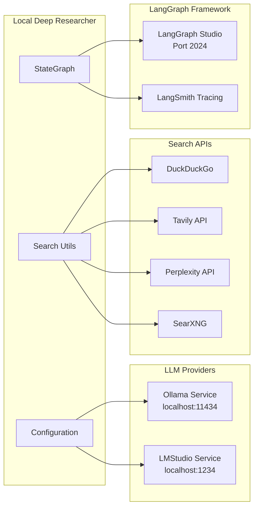

<!-- source: DeepWiki mcp.deepwiki.com · repo langchain-ai/local-deep-researcher · page 2 System Architecture · fetched 2026-10-26 -->

# System Architecture

Relevant source files

The following files were used as context for generating this wiki page:

- [README.md](README.md)
- [src/ollama_deep_researcher/graph.py](src/ollama_deep_researcher/graph.py)

This document describes the overall system architecture of the Local Deep Researcher, focusing on the LangGraph-orchestrated research workflow, component interactions, and integration patterns. For specific implementation details of individual components, see [Core Components](#3). For configuration details, see [Configuration](#4). For deployment architecture, see [Deployment](#5).

The Local Deep Researcher implements an iterative web research system built on LangGraph's state machine framework. The architecture coordinates between local LLM providers, multiple search APIs, and a configurable workflow engine to produce comprehensive research summaries with proper citations.

## LangGraph State Machine Architecture

The core system is implemented as a LangGraph StateGraph that orchestrates the research workflow through a series of connected nodes. Each node represents a distinct phase in the research process.

### Research Workflow State Machine

**LangGraph Node Implementation**

The StateGraph is defined in [src/ollama_deep_researcher/graph.py:445-465]() with the following node structure:

| Node | Function | Purpose |
|------|----------|---------|
| `generate_query` | [graph.py:138-189]() | Generates initial search query using LLM |
| `web_research` | [graph.py:192-262]() | Executes web search using configured API |
| `summarize_sources` | [graph.py:265-328]() | Creates/updates running summary with LLM |
| `reflect_on_summary` | [graph.py:331-384]() | Identifies knowledge gaps and generates follow-up queries |
| `finalize_summary` | [graph.py:387-418]() | Formats final output with deduplicated sources |

Sources: [src/ollama_deep_researcher/graph.py:445-465](), [src/ollama_deep_researcher/graph.py:138-418]()

### State Management Schema

The state management system tracks research progress and accumulated data across the iterative workflow. The `SummaryState` class maintains all necessary context between node executions.

Sources: [src/ollama_deep_researcher/state.py]()

## Component Integration Architecture

The system integrates multiple external services through a configuration-driven abstraction layer that allows runtime selection of LLM providers and search APIs.

### LLM Provider Integration

The `get_llm()` function [graph.py:97-135]() provides a unified interface for LLM instantiation, supporting both structured output modes (JSON format and tool calling) across different providers.

Sources: [src/ollama_deep_researcher/graph.py:97-135](), [src/ollama_deep_researcher/lmstudio.py]()

### Search API Integration

The search integration layer [graph.py:192-262]() provides a unified interface for multiple search APIs, with consistent result formatting and deduplication across all providers.

Sources: [src/ollama_deep_researcher/graph.py:192-262](), [src/ollama_deep_researcher/utils.py]()

## Structured Output Architecture

The system supports two modes for extracting structured data from LLMs: tool calling and JSON mode. This dual approach ensures compatibility across different model capabilities.

### Structured Output Flow

The `generate_search_query_with_structured_output()` function [graph.py:44-95]() handles both output modes with fallback mechanisms for failed extractions.

Sources: [src/ollama_deep_researcher/graph.py:44-95]()

## Configuration Integration Architecture

The system implements a three-tier configuration hierarchy that allows flexible deployment while maintaining reasonable defaults.

### Configuration Resolution Flow

The configuration system allows runtime customization through multiple channels while ensuring the system remains functional with minimal setup.

Sources: [src/ollama_deep_researcher/configuration.py](), [README.md:135-141]()

## System Boundaries and External Dependencies

The Local Deep Researcher maintains clear boundaries between internal orchestration logic and external service dependencies.

### External Service Integration

The architecture maintains loose coupling with external services through configuration-driven service selection and standardized interfaces.

Sources: [src/ollama_deep_researcher/graph.py](), [src/ollama_deep_researcher/utils.py](), [src/ollama_deep_researcher/configuration.py]()

---

