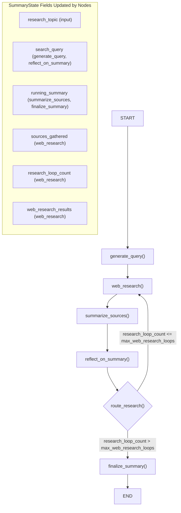
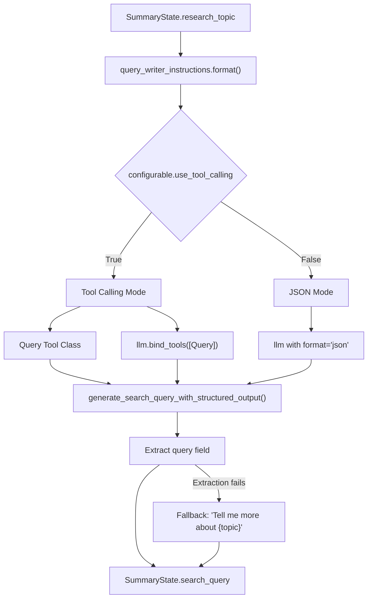
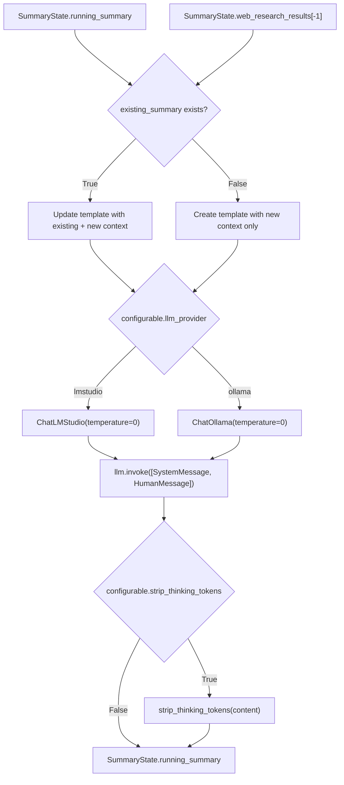
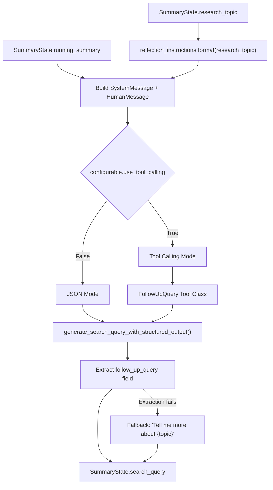
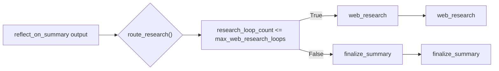
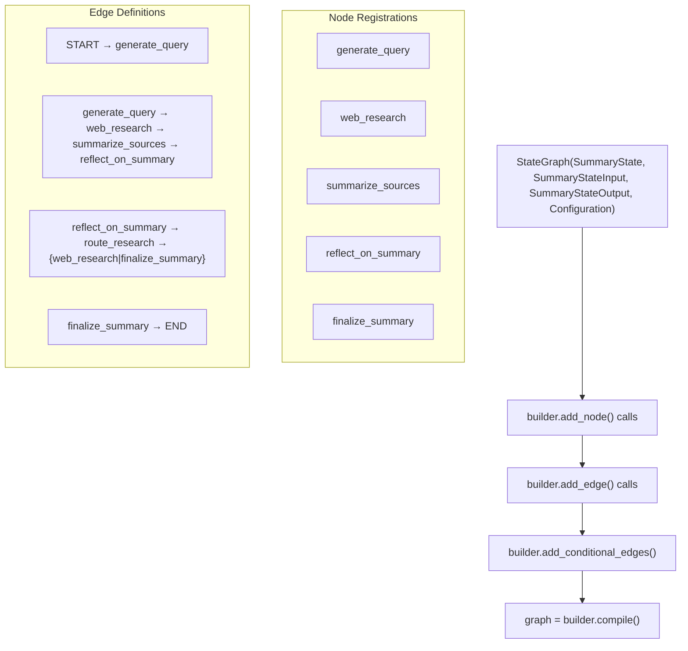

<!-- source: DeepWiki mcp.deepwiki.com · repo langchain-ai/local-deep-researcher · page 2.1 Research Workflow · fetched 2026-10-26 -->

# Research Workflow

Relevant source files

The following files were used as context for generating this wiki page:

- [src/ollama_deep_researcher/graph.py](src/ollama_deep_researcher/graph.py)
- [src/ollama_deep_researcher/prompts.py](src/ollama_deep_researcher/prompts.py)

This document explains the iterative research workflow implemented by the Local Deep Researcher system. The workflow orchestrates web search, summarization, and reflection using a LangGraph StateGraph to progressively build comprehensive research summaries on any given topic.

For information about the underlying state management data structures, see [State Management](#2.2). For details about LLM and search API integrations used within this workflow, see [LLM Integration](#3.1) and [Search API Integration](#3.2).

## Workflow Overview

The research workflow implements an iterative research process using a `StateGraph` from LangGraph. The system starts with a user-provided research topic and progressively builds a comprehensive summary through cycles of query generation, web research, summarization, and reflection.

### Core Workflow Graph

**Node Function Mapping**

| Node Name | Function | Primary State Updates |
|-----------|----------|----------------------|
| `generate_query` | `generate_query()` | `search_query` |
| `web_research` | `web_research()` | `sources_gathered`, `research_loop_count`, `web_research_results` |
| `summarize_sources` | `summarize_sources()` | `running_summary` |
| `reflect_on_summary` | `reflect_on_summary()` | `search_query` |
| `finalize_summary` | `finalize_summary()` | `running_summary` (final format) |

Sources: [src/ollama_deep_researcher/graph.py:444-465]()

## Node Implementation Details

### Query Generation Node

The `generate_query` function transforms the research topic into an optimized web search query using structured output from the LLM. It supports both tool calling and JSON mode depending on configuration.

**Query Generation with Structured Output**

**Query Tool Definition**

The function dynamically creates a `Query` tool class with the following structure:
- `query: str` - The actual search query string
- `rationale: str` - Brief explanation of query relevance

The helper function `generate_search_query_with_structured_output` handles both output modes:
- **Tool Calling**: Uses `llm.bind_tools()` and extracts from `result.tool_calls[0]["args"]`
- **JSON Mode**: Uses `format="json"` and parses `json.loads(result.content)`

Sources: [src/ollama_deep_researcher/graph.py:44-96](), [src/ollama_deep_researcher/graph.py:138-189](), [src/ollama_deep_researcher/prompts.py:9-42]()

### Web Research Node

The `web_research` function executes web searches using the configured search API and processes the results for summarization.

| Search API | Function | Max Results | Full Page Support |
|-----------|----------|-------------|------------------|
| `tavily` | `tavily_search()` | 1 | Yes |
| `perplexity` | `perplexity_search()` | Varies | Yes |
| `duckduckgo` | `duckduckgo_search()` | 3 | Yes |
| `searxng` | `searxng_search()` | 3 | Yes |

The node updates three state fields:
- `sources_gathered`: Formatted source citations using `format_sources()`
- `research_loop_count`: Incremented counter for tracking iterations
- `web_research_results`: Deduplicated and formatted search content using `deduplicate_and_format_sources()`

Sources: [src/ollama_deep_researcher/graph.py:76-112](), [src/ollama_deep_researcher/utils.py:49-110]()

### Summarization Node

The `summarize_sources` function integrates new research results with the existing summary using LLM-based summarization. Unlike other nodes, this always uses regular mode (no structured output) since it generates prose content.

**Summarization Process**

**Message Template Construction**

The function builds different human message content based on context:

| Scenario | Template Structure |
|----------|-------------------|
| **Existing Summary** | `<Existing Summary>` + `<New Context>` + Update instruction |
| **New Summary** | `<Context>` + Create instruction |

Both templates reference `SummaryState.research_topic` and use `summarizer_instructions` as the system message.

Sources: [src/ollama_deep_researcher/graph.py:265-328](), [src/ollama_deep_researcher/prompts.py:44-72]()

### Reflection Node

The `reflect_on_summary` function analyzes the current summary to identify knowledge gaps and generates follow-up search queries using structured output.

**Reflection with Structured Output**

**FollowUpQuery Tool Definition**

The function creates a `FollowUpQuery` tool class with:
- `follow_up_query: str` - Specific question to address knowledge gap
- `knowledge_gap: str` - Description of missing information

The reflection uses different prompt instructions based on the output mode:
- **Tool Calling**: `tool_calling_reflection_instructions`
- **JSON Mode**: `json_mode_reflection_instructions`

Both modes analyze the existing summary content and generate targeted follow-up queries to address identified knowledge gaps.

Sources: [src/ollama_deep_researcher/graph.py:331-384](), [src/ollama_deep_researcher/prompts.py:74-112]()

## State Flow and Routing Logic

### Loop Control Mechanism

The `route_research` function controls the iterative research process by comparing the current loop count against the configured maximum.

The routing function returns a `Literal["finalize_summary", "web_research"]` type to ensure type safety in the graph execution.

Sources: [src/ollama_deep_researcher/graph.py:262-280]()

### Summary Finalization

The `finalize_summary` node processes the accumulated research data into a final formatted output with deduplicated sources.

The function implements source deduplication by:
1. Creating a `seen_sources` set to track processed sources
2. Splitting each source string into individual lines
3. Adding only unique, non-empty lines to `unique_sources`
4. Formatting the final output with a structured markdown format

Sources: [src/ollama_deep_researcher/graph.py:231-260]()

## Graph Compilation and Configuration

The workflow graph is built using the `StateGraph` builder pattern with the following configuration:

The graph uses:
- `SummaryState` as the state schema
- `SummaryStateInput` for input validation
- `SummaryStateOutput` for output formatting
- `Configuration` as the config schema for runtime configuration

Sources: [src/ollama_deep_researcher/graph.py:283-298]()

---

