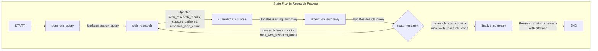
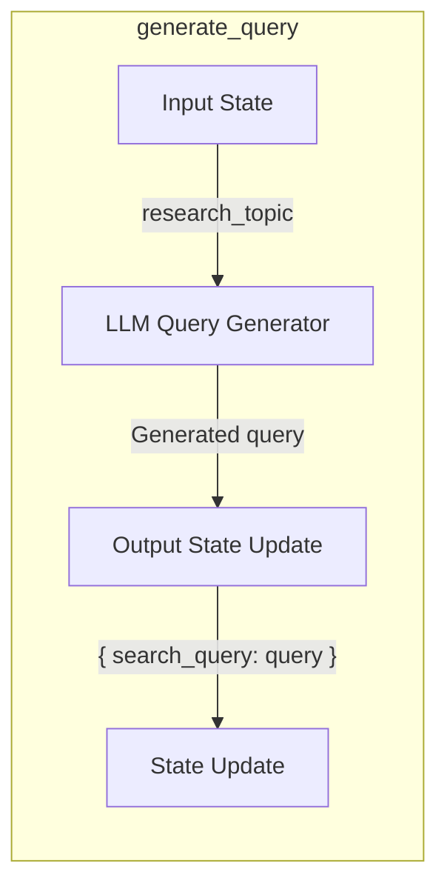
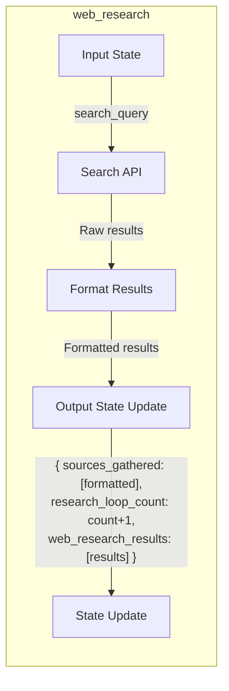
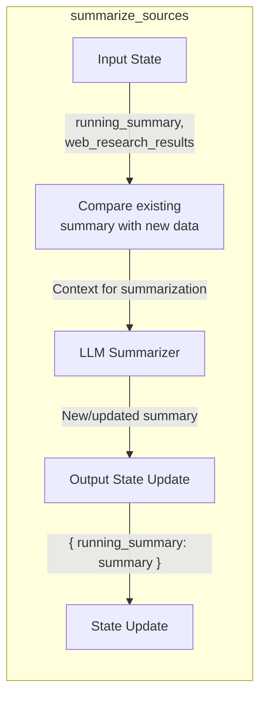
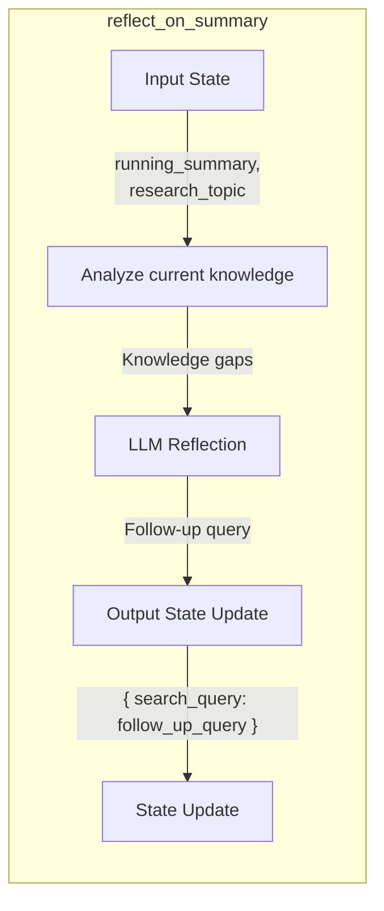
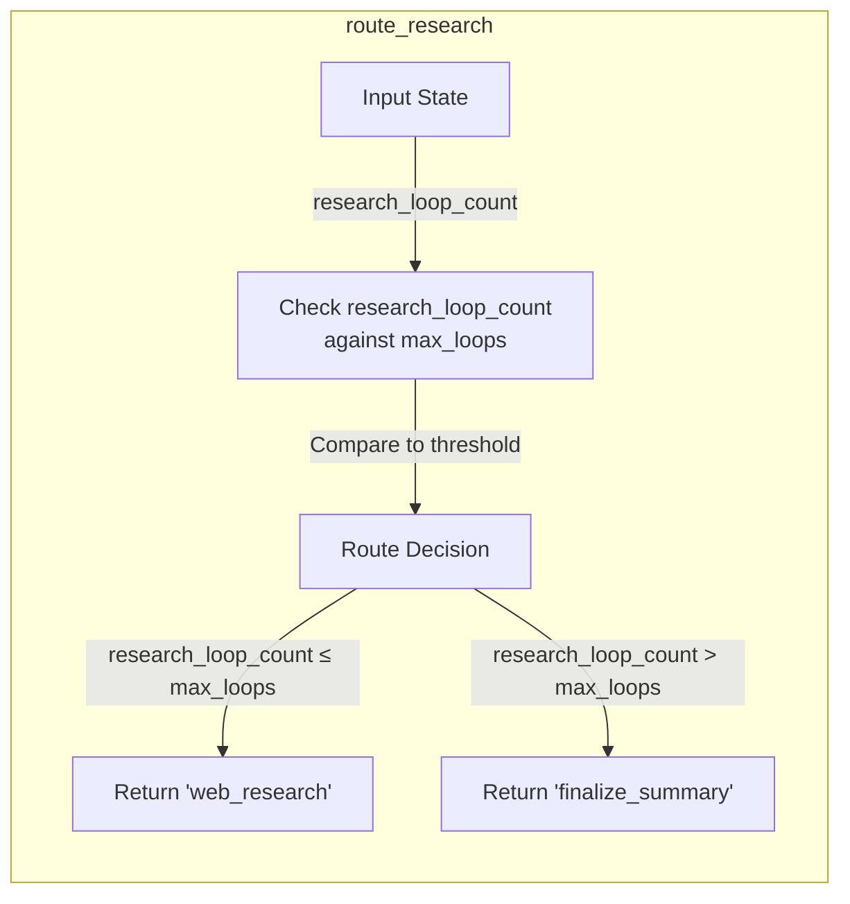
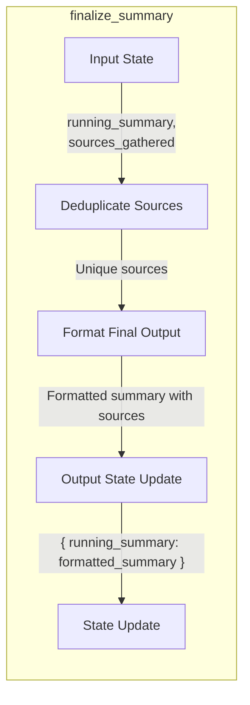

<!-- source: DeepWiki mcp.deepwiki.com · repo langchain-ai/local-deep-researcher · page 2.2 State Management · fetched 2026-10-26 -->

# State Management

<details>
<summary>Relevant source files</summary>

The following files were used as context for generating this wiki page:

- [src/ollama_deep_researcher/graph.py](src/ollama_deep_researcher/graph.py)
- [src/ollama_deep_researcher/state.py](src/ollama_deep_researcher/state.py)

</details>


This page documents how the Local Deep Researcher maintains and updates its research state throughout the iterative research process. State management is a critical component that enables the system to track progress, accumulate findings, and make decisions about the research flow. For information about the overall research workflow logic, see [Research Workflow](#2.1).

## State Structure

The Local Deep Researcher uses a dedicated state class that contains all necessary information to track a research session. The state acts as both data storage and a control mechanism for the iterative research process.

```mermaid
classDiagram
    class "SummaryState" {
        +research_topic: str
        +search_query: str
        +web_research_results: list
        +sources_gathered: list
        +research_loop_count: int
        +running_summary: str
    }

    class "SummaryStateInput" {
        +research_topic: str
    }

    class "SummaryStateOutput" {
        +running_summary: str
    }

    SummaryStateInput --> SummaryState: initializes
    SummaryState --> SummaryStateOutput: produces
```

Sources: [src/ollama_deep_researcher/state.py:6-20]()

### State Components

The `SummaryState` class has the following components:

| Field | Type | Purpose | Accumulation Method |
|-------|------|---------|---------------------|
| `research_topic` | str | The user-provided research topic | Set once at initialization |
| `search_query` | str | Current search query | Updated each research iteration |
| `web_research_results` | list | Search results from each iteration | Accumulates via `operator.add` |
| `sources_gathered` | list | Formatted sources for citation | Accumulates via `operator.add` |
| `research_loop_count` | int | Number of research iterations completed | Incremented after each search |
| `running_summary` | str | Current research summary | Updated with new findings each iteration |

The `operator.add` annotation on list fields enables automatic list merging when the state is updated, allowing search results and sources to accumulate throughout multiple research iterations.

Sources: [src/ollama_deep_researcher/state.py:6-12]()

## State Flow in the Research Graph

The state flows through a directed graph implemented using LangGraph's `StateGraph`. Each node in the graph receives the current state, performs specific operations, and returns state updates which are merged with the main state.



Sources: [src/ollama_deep_researcher/graph.py:282-297]()

## State Updates by Node

Each node in the graph modifies specific parts of the state:

### 1. Generate Query Node

The `generate_query` node updates the `search_query` field based on the research topic:



Sources: [src/ollama_deep_researcher/graph.py:17-74]()

### 2. Web Research Node

The `web_research` node executes the search query and updates three state fields:



Sources: [src/ollama_deep_researcher/graph.py:76-112]()

### 3. Summarize Sources Node

The `summarize_sources` node updates the running summary with new findings:



Sources: [src/ollama_deep_researcher/graph.py:114-175]()

### 4. Reflect on Summary Node

The `reflect_on_summary` node generates a new search query based on identified knowledge gaps:



Sources: [src/ollama_deep_researcher/graph.py:177-229]()

### 5. Route Research Decision

The `route_research` function uses the state to decide whether to continue research or finalize:



Sources: [src/ollama_deep_researcher/graph.py:262-280]()

### 6. Finalize Summary Node

The `finalize_summary` node prepares the final output by formatting the running summary with citations:



Sources: [src/ollama_deep_researcher/graph.py:231-260]()

## State Integration with LangGraph

The Local Deep Researcher uses LangGraph's `StateGraph` to manage state transitions between nodes. The state class is registered with the graph during initialization, along with input and output schemas:

```mermaid
flowchart TB
    subgraph "LangGraph State Integration"
        SState["SummaryState"]
        SInput["SummaryStateInput"]
        SOutput["SummaryStateOutput"]
        Config["Configuration"]
        Builder["StateGraph Builder"]
        CompiledGraph["Compiled Graph"]
        
        SState --> Builder
        SInput --> Builder
        SOutput --> Builder
        Config --> Builder
        
        Builder -->|"compile()"| CompiledGraph
        
        subgraph "Graph Definition"
            Nodes["Add Nodes"]
            Edges["Add Edges"]
            
            Nodes --> Edges
        end
        
        Graph Definition --> Builder
    end
```

Sources: [src/ollama_deep_researcher/graph.py:283-297]()

## State Reset and Initialization

For each new research session, a fresh `SummaryState` instance is created with only the `research_topic` field populated from the `SummaryStateInput`. All other fields are initialized to their default values:

- `search_query`: None
- `web_research_results`: Empty list
- `sources_gathered`: Empty list
- `research_loop_count`: 0
- `running_summary`: None

This ensures that each research session starts with a clean state.

Sources: [src/ollama_deep_researcher/state.py:6-20]()

## Data Accumulation Patterns

The state uses two primary accumulation patterns:

1. **List Accumulation**: The `web_research_results` and `sources_gathered` fields are annotated with `operator.add`, which means when these fields are updated, the new items are appended to the existing lists rather than replacing them.

2. **Progressive Refinement**: The `running_summary` field is repeatedly updated with more comprehensive information as research progresses. Each update to this field replaces the previous value, but incorporates knowledge from earlier iterations.

Sources: [src/ollama_deep_researcher/state.py:6-12](), [src/ollama_deep_researcher/graph.py:114-175]()

## Conclusion

The state management system in Local Deep Researcher enables:

1. Tracking the progress of research through multiple iterations
2. Accumulating and organizing research findings
3. Making decisions about when to continue research vs. finalize results
4. Providing context for each step in the research process
5. Ensuring a cohesive and progressive development of the final research output

The system's use of LangGraph for state management provides a structured way to handle the complex, iterative nature of the automated research process.

---

