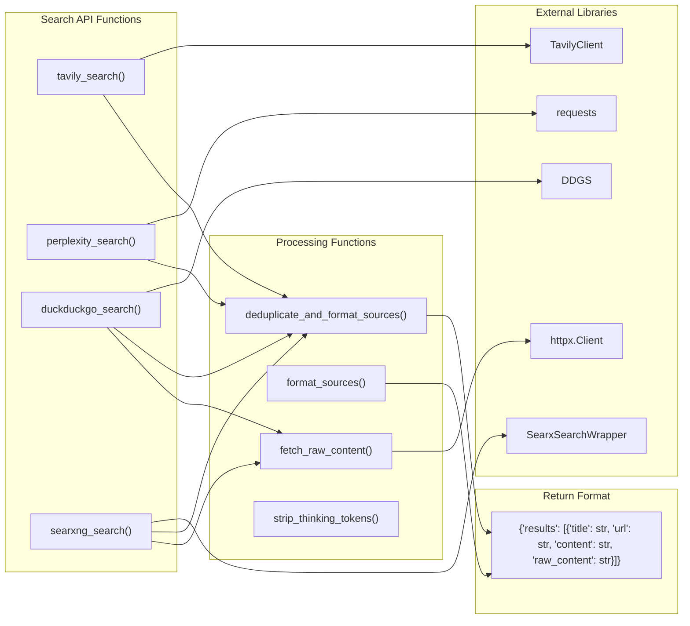
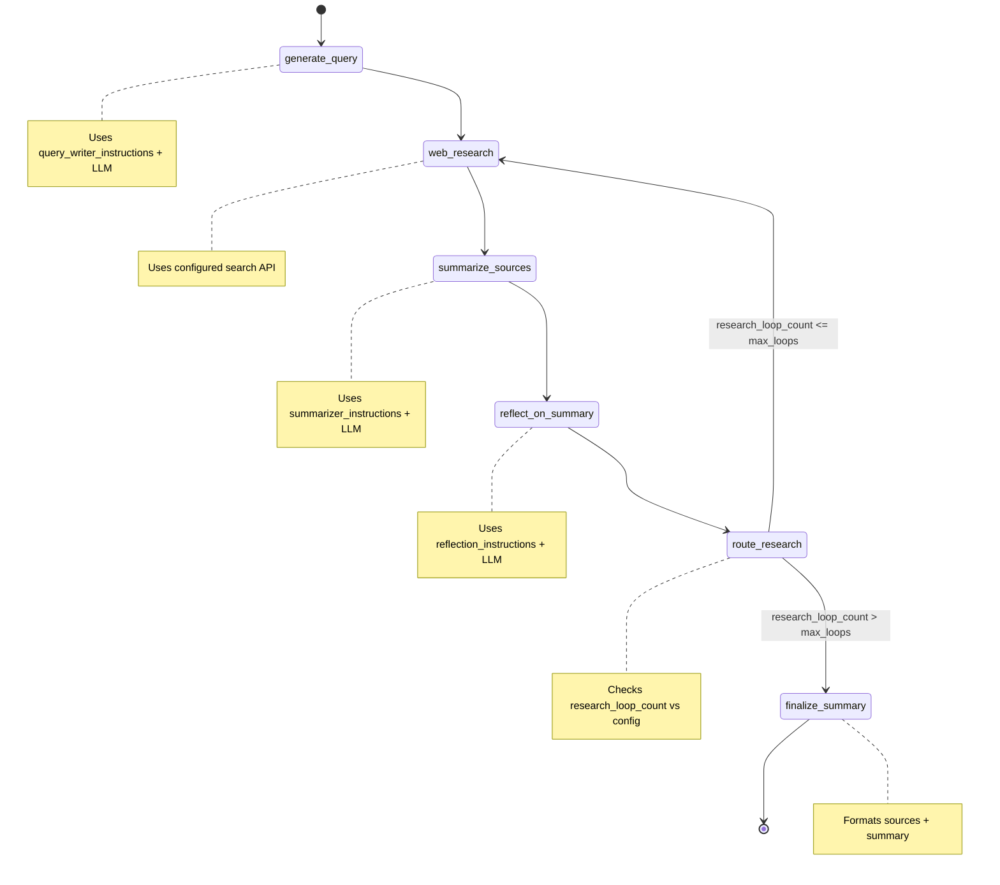
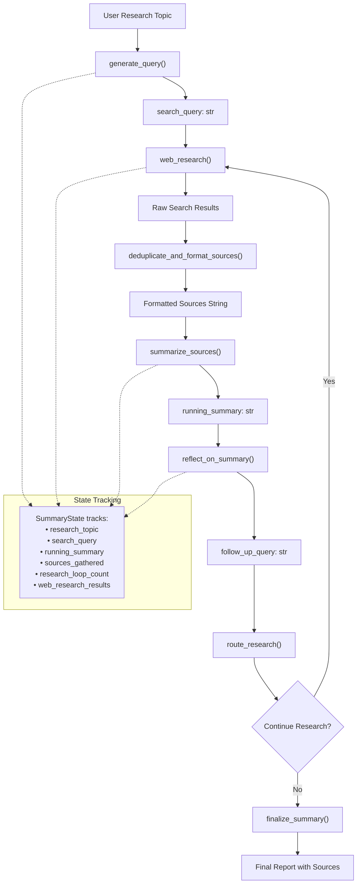

<!-- source: DeepWiki mcp.deepwiki.com · repo langchain-ai/local-deep-researcher · page 3 Core Components · fetched 2026-10-26 -->

# Core Components

Relevant source files

The following files were used as context for generating this wiki page:

- [src/ollama_deep_researcher/graph.py](src/ollama_deep_researcher/graph.py)
- [src/ollama_deep_researcher/utils.py](src/ollama_deep_researcher/utils.py)

This document provides an overview of the main functional components that enable the Local Deep Researcher's LLM-driven research capabilities. It covers the three primary component layers: LLM integration, search API integration, and prompt engineering systems that work together within the LangGraph orchestration framework.

For detailed information about specific LLM provider configurations, see [LLM Integration](#3.1). For search API implementation details, see [Search API Integration](#3.2). For prompt template specifications, see [Prompt Engineering](#3.3).

## Architecture Overview

The Local Deep Researcher is built around three core functional layers that integrate within a LangGraph state machine to provide automated research capabilities.

```mermaid
graph TB
    subgraph "LangGraph Orchestration Layer"
        GQ["generate_query()"]
        WR["web_research()"] 
        SS["summarize_sources()"]
        ROS["reflect_on_summary()"]
        FS["finalize_summary()"]
        RR["route_research()"]
    end
    
    subgraph "LLM Integration Layer"
        GLM["get_llm()"]
        CO["ChatOllama"]
        CLM["ChatLMStudio"]
        GSQSO["generate_search_query_with_structured_output()"]
    end
    
    subgraph "Search Integration Layer"  
        TS["tavily_search()"]
        PS["perplexity_search()"]
        DS["duckduckgo_search()"]
        SS_SEARCH["searxng_search()"]
        DAFS["deduplicate_and_format_sources()"]
        FRC["fetch_raw_content()"]
    end
    
    subgraph "Prompt Engineering Layer"
        QWI["query_writer_instructions"]
        SI["summarizer_instructions"] 
        RI["reflection_instructions"]
        JMQI["json_mode_query_instructions"]
        TCQI["tool_calling_query_instructions"]
    end
    
    subgraph "Configuration & State"
        CONFIG["Configuration"]
        STATE["SummaryState"]
        GCV["get_config_value()"]
    end
    
    GQ --> GLM
    GQ --> QWI
    GQ --> GSQSO
    WR --> TS
    WR --> PS  
    WR --> DS
    WR --> SS_SEARCH
    WR --> DAFS
    SS --> GLM
    SS --> SI
    ROS --> GLM
    ROS --> RI
    ROS --> GSQSO
    
    GLM --> CO
    GLM --> CLM
    
    TS --> FRC
    DS --> FRC
    SS_SEARCH --> FRC
    
    CONFIG --> GCV
    STATE --> CONFIG
```

**Sources:** [src/ollama_deep_researcher/graph.py:1-466](), [src/ollama_deep_researcher/utils.py:1-388]()

## LLM Integration Components

The system provides a unified interface for interacting with local LLM providers through the `get_llm()` function, which abstracts the differences between Ollama and LMStudio configurations.

| Component | Purpose | Key Methods |
|-----------|---------|-------------|
| `get_llm()` | LLM provider factory | Returns configured `ChatOllama` or `ChatLMStudio` |
| `ChatOllama` | Ollama integration | Standard LangChain Ollama wrapper |
| `ChatLMStudio` | LMStudio integration | Custom wrapper for LMStudio API |
| `generate_search_query_with_structured_output()` | Structured output handler | Manages tool calling vs JSON mode |

The LLM integration supports two operational modes:
- **Tool Calling Mode**: Uses LangChain's tool binding for structured outputs
- **JSON Mode**: Uses format="json" parameter for models without tool calling support

**Sources:** [src/ollama_deep_researcher/graph.py:97-136](), [src/ollama_deep_researcher/graph.py:44-96]()

## Search Integration Components

The search layer provides a unified interface across multiple web search APIs, with consistent result formatting and optional full-page content fetching.

Each search function returns a standardized dictionary format with `results` containing title, URL, content snippet, and optional raw content from full page fetches.

**Sources:** [src/ollama_deep_researcher/utils.py:165-388](), [src/ollama_deep_researcher/utils.py:55-121]()

## Prompt Engineering Components

The prompt system uses template-based instructions that adapt based on the LLM's capabilities (tool calling vs JSON mode).

| Template | Purpose | Mode Support |
|----------|---------|--------------|
| `query_writer_instructions` | Initial search query generation | Both |
| `summarizer_instructions` | Content summarization | Text only |
| `reflection_instructions` | Knowledge gap analysis | Both |
| `json_mode_query_instructions` | JSON format guidance | JSON mode |
| `tool_calling_query_instructions` | Tool calling guidance | Tool calling |

The system dynamically selects appropriate instruction templates based on the `use_tool_calling` configuration flag and appends mode-specific formatting instructions.

**Sources:** [src/ollama_deep_researcher/graph.py:28-37](), [src/ollama_deep_researcher/graph.py:172-178]()

## LangGraph Orchestration Layer

The core research workflow is implemented as LangGraph nodes that coordinate between the component layers to execute the iterative research process.

Each node operates on the `SummaryState` object and uses the `Configuration` to determine which components to invoke for LLM and search operations.

**Sources:** [src/ollama_deep_researcher/graph.py:138-465](), [src/ollama_deep_researcher/graph.py:421-442]()

## Data Processing Pipeline

The system processes research data through a standardized pipeline that maintains consistency across different search APIs and LLM providers.

The pipeline maintains state consistency through the `SummaryState` object, which accumulates research progress and enables the iterative refinement process.

**Sources:** [src/ollama_deep_researcher/graph.py:192-262](), [src/ollama_deep_researcher/graph.py:265-328](), [src/ollama_deep_researcher/utils.py:55-121]()

---

