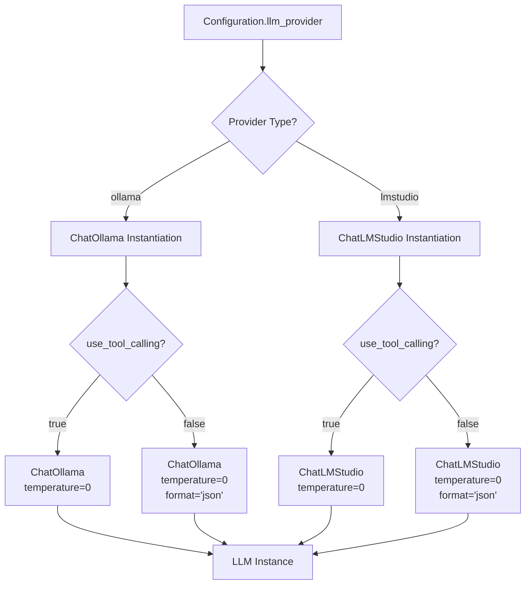
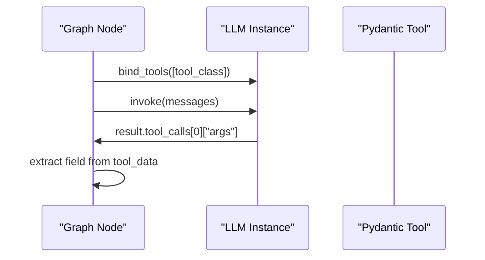
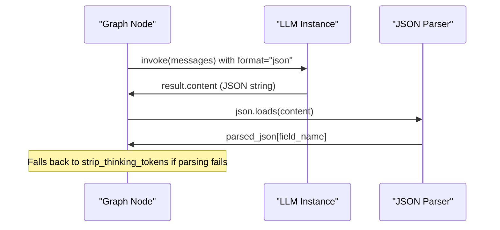
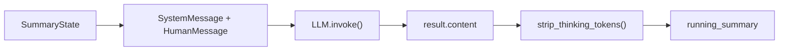

<!-- source: DeepWiki mcp.deepwiki.com · repo langchain-ai/local-deep-researcher · page 3.1 LLM Integration · fetched 2026-10-26 -->

# LLM Integration

<details>
<summary>Relevant source files</summary>

The following files were used as context for generating this wiki page:

- [src/ollama_deep_researcher/configuration.py](src/ollama_deep_researcher/configuration.py)
- [src/ollama_deep_researcher/graph.py](src/ollama_deep_researcher/graph.py)
- [src/ollama_deep_researcher/lmstudio.py](src/ollama_deep_researcher/lmstudio.py)

</details>


The LLM Integration component manages the system's integration with local Large Language Model providers, specifically Ollama and LMStudio. This module handles LLM instantiation, configuration-based provider selection, and structured output generation using either JSON mode or tool calling approaches.

For information about how LLMs are used within the research workflow, see [Research Workflow](#2.1). For prompt engineering and templates, see [Prompt Engineering](#3.3).

## LLM Provider Architecture

The system supports two local LLM providers through a unified interface, allowing runtime selection based on configuration. Both providers use standardized LangChain chat interfaces while maintaining provider-specific optimizations.

### Provider Selection Flow



Sources: [src/ollama_deep_researcher/graph.py:97-135]()

### Configuration Parameters

The LLM integration is controlled by several configuration parameters that determine provider selection and behavior:

| Parameter | Type | Default | Description |
|-----------|------|---------|-------------|
| `llm_provider` | Literal["ollama", "lmstudio"] | "ollama" | Selects the LLM provider |
| `local_llm` | str | "llama3.2" | Model name to use |
| `ollama_base_url` | str | "http://localhost:11434/" | Ollama API endpoint |
| `lmstudio_base_url` | str | "http://localhost:1234/v1" | LMStudio API endpoint |
| `use_tool_calling` | bool | False | Enables tool calling vs JSON mode |

Sources: [src/ollama_deep_researcher/configuration.py:24-61]()

## Provider Implementation Details

### Ollama Integration

The Ollama integration uses the `ChatOllama` class from the `langchain-ollama` package, providing direct integration with Ollama's native API. The system configures temperature to 0 for deterministic outputs and conditionally enables JSON mode.

```mermaid
classDiagram
    class ChatOllama {
        +base_url: str
        +model: str
        +temperature: int
        +format: Optional[str]
        +invoke(messages)
    }
    
    class get_llm {
        +configurable: Configuration
        +returns: ChatOllama | ChatLMStudio
    }
    
    get_llm --> ChatOllama : "instantiates when llm_provider='ollama'"
    ChatOllama --> "Ollama API" : "communicates via base_url"
```

Sources: [src/ollama_deep_researcher/graph.py:122-135]()

### LMStudio Integration

The LMStudio integration uses a custom `ChatLMStudio` class that wraps `ChatOpenAI` to work with LMStudio's OpenAI-compatible API. This wrapper adds JSON mode support and response cleaning functionality.

```mermaid
classDiagram
    class ChatOpenAI {
        +base_url: str
        +model: str
        +temperature: float
        +api_key: str
        +_generate(messages)
    }
    
    class ChatLMStudio {
        +format: Optional[str]
        +__init__(base_url, model, temperature, format, api_key)
        +_generate(messages, stop, run_manager, kwargs)
    }
    
    ChatLMStudio --|> ChatOpenAI : "inherits from"
    ChatLMStudio --> "LMStudio API" : "communicates via OpenAI-compatible endpoint"
```

The `ChatLMStudio` class provides several key features:

- **JSON Mode Support**: Automatically sets `response_format` to `{"type": "json_object"}` when `format="json"`
- **Response Cleaning**: Extracts valid JSON from model responses that may contain additional text
- **Error Handling**: Falls back to original response if JSON extraction fails
- **Logging**: Provides detailed logging for debugging JSON parsing issues

Sources: [src/ollama_deep_researcher/lmstudio.py:19-98]()

## Structured Output Generation

The system supports two approaches for generating structured output from LLMs, with runtime selection based on the `use_tool_calling` configuration parameter.

### Tool Calling Mode

When `use_tool_calling=True`, the system uses LangChain's tool calling capabilities with Pydantic models to define the expected output structure:



Sources: [src/ollama_deep_researcher/graph.py:65-77]()

### JSON Mode

When `use_tool_calling=False`, the system uses JSON mode with manual parsing:



Sources: [src/ollama_deep_researcher/graph.py:79-95]()

## Usage in Research Workflow

The LLM integration is used throughout the research workflow in three main contexts, each with different requirements for structured output:

### Query Generation

Uses structured output to generate search queries with rationale:

- **Tool Calling**: Uses `Query` tool with `query` and `rationale` fields
- **JSON Mode**: Expects JSON with `query` field
- **Fallback**: Returns default query based on research topic

Sources: [src/ollama_deep_researcher/graph.py:138-189]()

### Source Summarization

Uses unstructured output for natural language summary generation. Always uses regular mode (no JSON/tool calling) regardless of configuration:



Sources: [src/ollama_deep_researcher/graph.py:265-328]()

### Reflection and Follow-up

Uses structured output to identify knowledge gaps and generate follow-up queries:

- **Tool Calling**: Uses `FollowUpQuery` tool with `follow_up_query` and `knowledge_gap` fields  
- **JSON Mode**: Expects JSON with `follow_up_query` field
- **Fallback**: Returns default query for continued research

Sources: [src/ollama_deep_researcher/graph.py:331-384]()

## Configuration Integration

The LLM integration seamlessly integrates with the system's three-tier configuration approach:

1. **Environment Variables**: Override via `LLM_PROVIDER`, `LOCAL_LLM`, `OLLAMA_BASE_URL`, etc.
2. **LangGraph Configuration**: Set via the configurable fields in LangGraph Studio
3. **Defaults**: Fallback to sensible defaults in the `Configuration` class

The `Configuration.from_runnable_config()` method handles this precedence and provides the configuration to the `get_llm()` function for provider instantiation.

Sources: [src/ollama_deep_researcher/configuration.py:63-81](), [src/ollama_deep_researcher/graph.py:97-135]()

---

