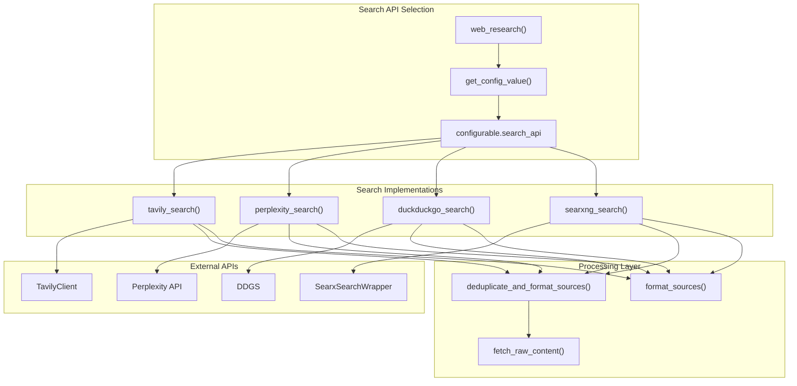
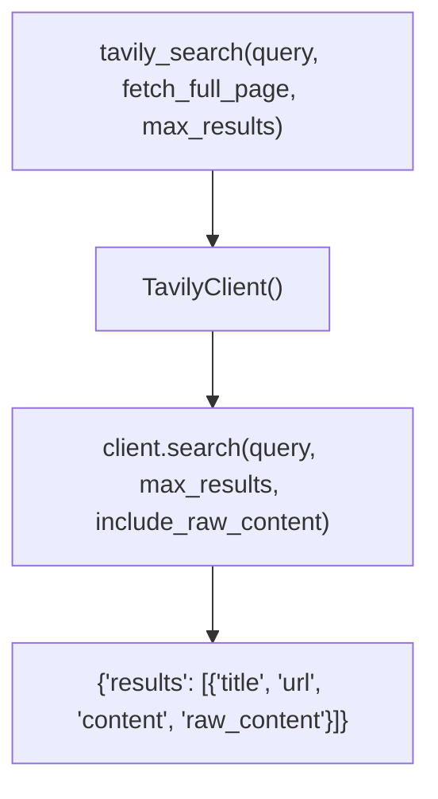
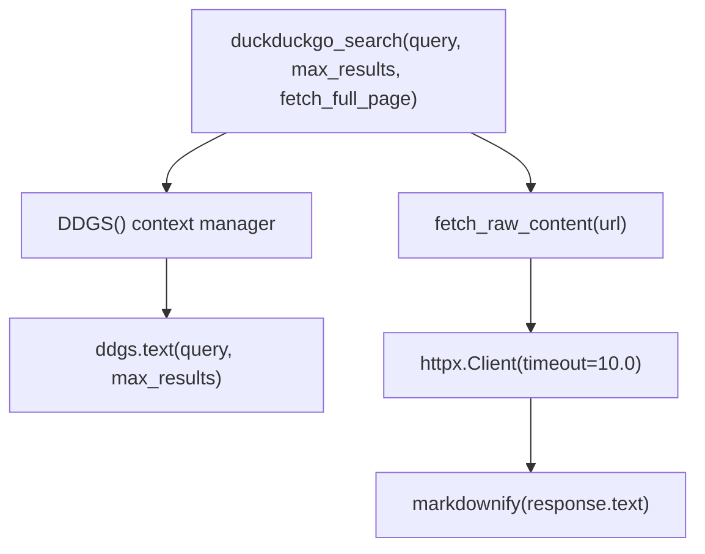
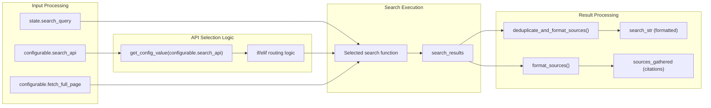
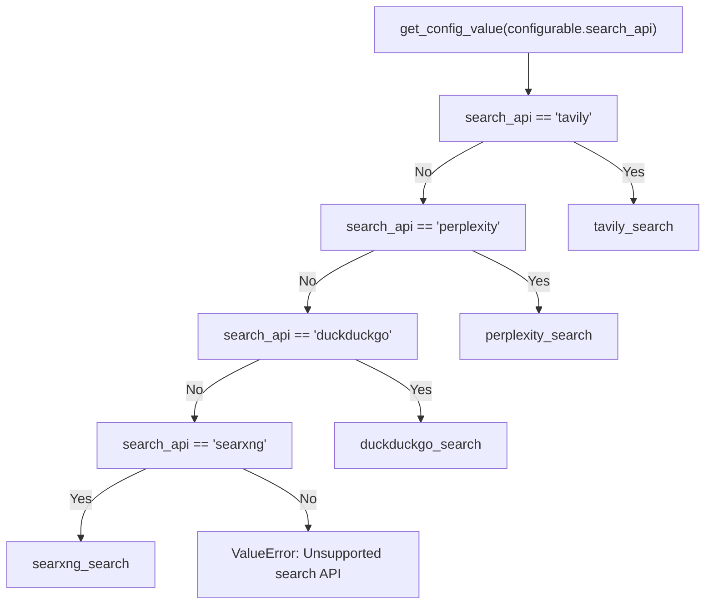
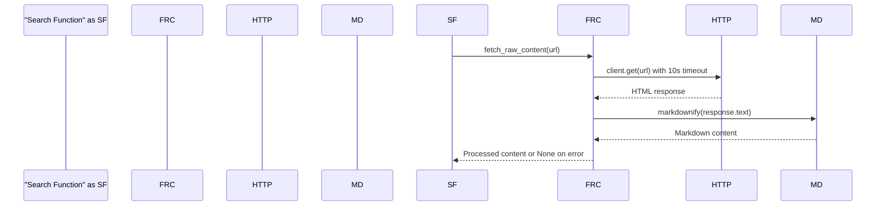

<!-- source: DeepWiki mcp.deepwiki.com · repo langchain-ai/local-deep-researcher · page 3.2 Search API Integration · fetched 2026-10-26 -->

# Search API Integration

<details>
<summary>Relevant source files</summary>

The following files were used as context for generating this wiki page:

- [src/ollama_deep_researcher/graph.py](src/ollama_deep_researcher/graph.py)
- [src/ollama_deep_researcher/utils.py](src/ollama_deep_researcher/utils.py)

</details>


## Purpose and Scope

This document covers the search API integration layer of the Local Deep Researcher system, which provides a unified abstraction for querying multiple web search services. The system supports DuckDuckGo, Tavily, Perplexity, and SearXNG APIs through a common interface that standardizes search results and content processing.

For information about how search results are processed within the research workflow, see [Research Workflow](#2.1). For configuration of search API credentials and settings, see [Environment Variables](#4.1).

## Search API Architecture

The search integration layer implements a pluggable architecture where different search providers can be selected at runtime through configuration. All search APIs return results in a standardized format that enables consistent processing downstream.



**Sources:** [src/ollama_deep_researcher/graph.py:192-262](), [src/ollama_deep_researcher/utils.py:17-33]()

## Search API Implementations

### Tavily Search

The `tavily_search()` function provides integration with the Tavily API, which specializes in AI-optimized web search with built-in content extraction capabilities.

| Feature | Implementation | Configuration |
|---------|---------------|---------------|
| API Client | `TavilyClient` | Requires `TAVILY_API_KEY` environment variable |
| Content Extraction | Built-in raw content support | `include_raw_content` parameter |
| Result Limit | Configurable via `max_results` | Default: 3 results |
| Timeout | Handled by Tavily client | N/A |



**Sources:** [src/ollama_deep_researcher/utils.py:277-306]()

### DuckDuckGo Search  

The `duckduckgo_search()` function uses the `DDGS` library to perform privacy-focused web searches without requiring API keys.

| Feature | Implementation | Configuration |
|---------|---------------|---------------|
| API Client | `DDGS` from `duckduckgo-search` | No API key required |
| Content Extraction | Manual via `fetch_raw_content()` | Optional full page fetching |
| Result Limit | Configurable via `max_results` | Default: 3 results |
| Timeout | 10 seconds via `httpx.Client` | Hardcoded in `fetch_raw_content()` |



**Sources:** [src/ollama_deep_researcher/utils.py:165-220](), [src/ollama_deep_researcher/utils.py:141-163]()

### Perplexity Search

The `perplexity_search()` function integrates with Perplexity's `sonar-pro` model for AI-enhanced search with automatic summarization.

| Feature | Implementation | Configuration |
|---------|---------------|---------------|
| API Client | Direct HTTP requests via `requests` | Requires `PERPLEXITY_API_KEY` environment variable |
| Content Format | AI-generated summary with citations | Fixed system prompt |
| Result Structure | Single content with multiple citations | Loop count tracking for source labeling |
| Error Handling | `response.raise_for_status()` | HTTP error exceptions |

**Sources:** [src/ollama_deep_researcher/utils.py:309-387]()

### SearXNG Search

The `searxng_search()` function connects to self-hosted SearXNG instances for privacy-focused metasearch capabilities.

| Feature | Implementation | Configuration |
|---------|---------------|---------------|
| API Client | `SearxSearchWrapper` from LangChain | `SEARXNG_URL` environment variable |
| Default Host | `http://localhost:8888` | Configurable via environment |
| Content Extraction | Manual via `fetch_raw_content()` | Optional full page fetching |
| Result Processing | Similar to DuckDuckGo pattern | Standard result format |

**Sources:** [src/ollama_deep_researcher/utils.py:222-274]()

## Unified Data Flow

The search integration layer provides a consistent data flow regardless of which search API is selected. All search functions return results in the same standardized format.



**Sources:** [src/ollama_deep_researcher/graph.py:206-262]()

## Standardized Result Format

All search APIs return results conforming to a common data structure that enables consistent downstream processing.

### Standard Result Schema

```python
{
    "results": [
        {
            "title": str,        # Title of the search result
            "url": str,          # URL of the source
            "content": str,      # Summary/snippet content  
            "raw_content": str   # Full page content (optional)
        }
    ]
}
```

### Content Processing Pipeline

The `deduplicate_and_format_sources()` function processes search results through several stages:

| Stage | Function | Purpose |
|-------|----------|---------|
| Input Normalization | Type checking and conversion | Handle both single dict and list inputs |
| Deduplication | URL-based uniqueness | Remove duplicate sources across searches |
| Content Limiting | Token-based truncation | Limit content to `max_tokens_per_source` |
| Formatting | Structured output | Create consistent text format for LLM processing |

**Sources:** [src/ollama_deep_researcher/utils.py:55-121]()

## Configuration and API Selection

The search API selection is controlled through the configuration system, with runtime routing handled by the `web_research()` node in the LangGraph workflow.

### API Selection Logic



### Configuration Parameters

| Parameter | Type | Default | Purpose |
|-----------|------|---------|---------|
| `search_api` | `SearchAPI` enum | Set via configuration | Selects which search provider to use |
| `fetch_full_page` | `bool` | `False` | Controls whether to fetch complete page content |
| `max_results` | `int` | Varies by API | Limits number of search results returned |

**Sources:** [src/ollama_deep_researcher/graph.py:206-256](), [src/ollama_deep_researcher/utils.py:17-33]()

## Content Fetching and Processing

The system provides optional full-page content fetching for enhanced research depth, implemented through the `fetch_raw_content()` function.

### Content Fetching Features

- **Timeout Management**: 10-second timeout prevents hanging on slow sites
- **Markdown Conversion**: HTML content converted via `markdownify` library  
- **Error Handling**: Graceful degradation when content fetching fails
- **Token Limiting**: Content truncated based on `max_tokens_per_source` configuration

### Content Processing Flow



**Sources:** [src/ollama_deep_researcher/utils.py:141-163]()

---

