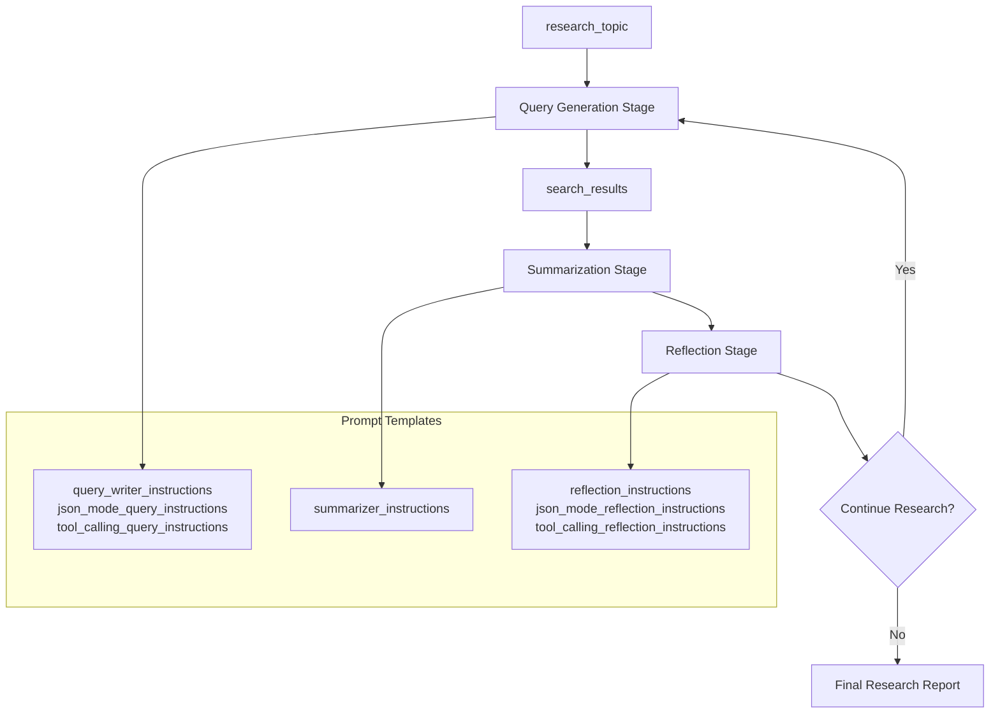
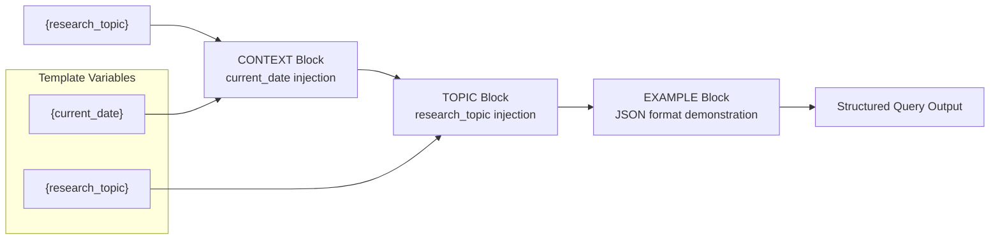
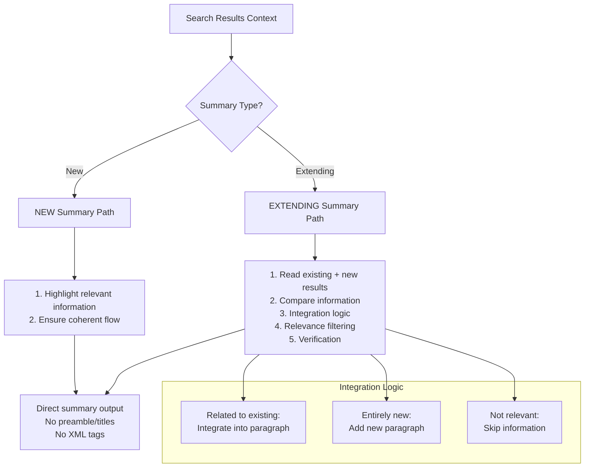
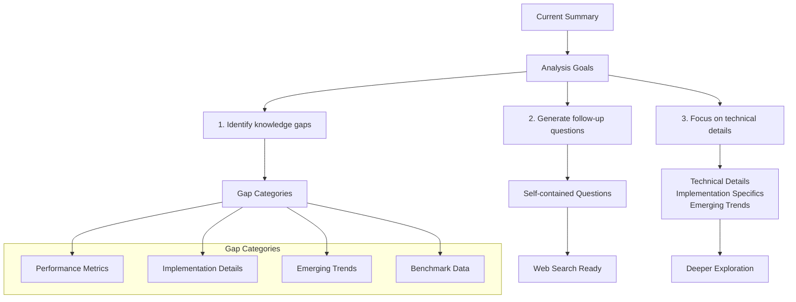
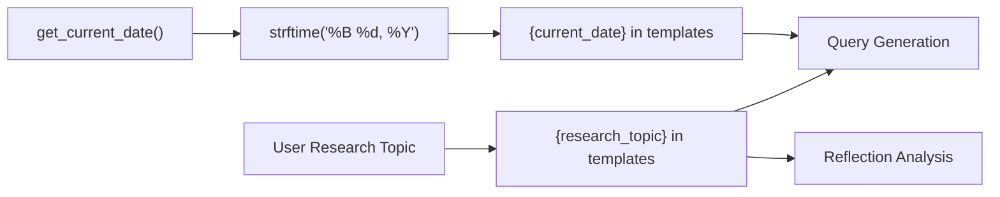

<!-- source: DeepWiki mcp.deepwiki.com · repo langchain-ai/local-deep-researcher · page 3.3 Prompt Engineering · fetched 2026-10-26 -->

# Prompt Engineering

Relevant source files

The following files were used as context for generating this wiki page:

- [src/ollama_deep_researcher/prompts.py](src/ollama_deep_researcher/prompts.py)

This document covers the prompt templates and engineering strategies used throughout the Local Deep Researcher system. The prompts coordinate with LLM providers to generate structured outputs for query generation, content summarization, and research reflection. For information about LLM provider integration, see [LLM Integration](#3.1). For details on the overall research workflow that utilizes these prompts, see [Research Workflow](#2.1).

## Prompt Architecture Overview

The Local Deep Researcher employs a three-stage prompt engineering approach aligned with its iterative research workflow. Each stage uses specialized prompt templates designed to produce structured outputs that drive the research process forward.

**Sources:** [src/ollama_deep_researcher/prompts.py:1-112]()

## Query Generation Prompts

The query generation stage transforms research topics into targeted web search queries using contextual prompts that account for current dates and provide clear formatting expectations.

### Base Query Instructions

The `query_writer_instructions` template provides the foundational structure for query generation:

| Component | Purpose | Implementation |
|-----------|---------|----------------|
| Context Block | Provides current date awareness | Uses `get_current_date()` function |
| Topic Block | Injects research topic | Template variable `{research_topic}` |
| Example Block | Demonstrates expected output format | JSON structure with `query` and `rationale` |

**Sources:** [src/ollama_deep_researcher/prompts.py:9-26](), [src/ollama_deep_researcher/prompts.py:4-6]()

### Output Formatting Strategies

The system supports two output formatting approaches for query generation:

#### JSON Mode Approach
The `json_mode_query_instructions` template enforces strict JSON formatting with explicit key requirements:

- Requires exact keys: `query` and `rationale`
- Provides clear FORMAT section with specifications
- Ends with explicit JSON format request

#### Tool Calling Approach  
The `tool_calling_query_instructions` template leverages LLM tool calling capabilities:

- References a "Query tool" for structured output
- Uses INSTRUCTIONS block format
- Delegates formatting to tool calling mechanism

**Sources:** [src/ollama_deep_researcher/prompts.py:28-42]()

## Summarization Prompts

The `summarizer_instructions` template handles both initial summary creation and iterative summary extension throughout the research process.

### Summary Generation Logic

### Key Summarization Requirements

The summarization prompts enforce specific quality and formatting standards:

| Requirement Category | Specifications |
|---------------------|----------------|
| Content Integration | Compare new vs existing information, integrate related content, add new paragraphs for novel information |
| Relevance Filtering | Skip irrelevant information, ensure all additions relate to user topic |
| Output Verification | Ensure final output differs from input summary |
| Formatting Rules | Start directly with summary, no preamble or titles, no XML tags in output |

**Sources:** [src/ollama_deep_researcher/prompts.py:44-72]()

## Reflection Prompts

The reflection stage analyzes summaries to identify knowledge gaps and generate follow-up research questions. The `reflection_instructions` template focuses on technical depth and emerging trends.

### Reflection Analysis Framework

### Reflection Output Formats

Similar to query generation, reflection supports dual formatting approaches:

#### JSON Mode Reflection
The `json_mode_reflection_instructions` template produces structured analysis:

- `knowledge_gap`: Describes missing information
- `follow_up_query`: Provides specific question to address gaps
- Includes example output for guidance

#### Tool Calling Reflection  
The `tool_calling_reflection_instructions` template uses a "FollowUpQuery tool":

- Delegates structure to tool calling mechanism
- Maintains same output field requirements
- Follows INSTRUCTIONS block pattern

**Sources:** [src/ollama_deep_researcher/prompts.py:74-112]()

## Template Variable System

The prompt system uses a consistent variable injection approach across all templates:

| Variable | Usage | Purpose |
|----------|-------|---------|
| `{current_date}` | Query generation | Ensures time-aware search queries |
| `{research_topic}` | Query and reflection | Maintains topic focus throughout workflow |

The `get_current_date()` function provides formatted date strings for context injection, ensuring search queries account for temporal relevance.

**Sources:** [src/ollama_deep_researcher/prompts.py:4-6](), [src/ollama_deep_researcher/prompts.py:12](), [src/ollama_deep_researcher/prompts.py:17](), [src/ollama_deep_researcher/prompts.py:74]()

## Prompt Engineering Patterns

The Local Deep Researcher employs consistent prompt engineering patterns across all templates:

### Structural Patterns
- **Section Headers**: Use XML-style tags (`<GOAL>`, `<REQUIREMENTS>`, `<FORMAT>`) for clear organization
- **Task Blocks**: Explicit `<Task>` sections that define expected actions
- **Example Provision**: Concrete examples demonstrating expected output format

### Content Patterns  
- **Context Awareness**: Date injection and topic maintenance across research loops
- **Incremental Processing**: Support for both new creation and iterative extension
- **Quality Assurance**: Verification requirements and relevance filtering

### Output Formatting Flexibility
- **Dual Format Support**: Both JSON mode and tool calling approaches for LLM compatibility
- **Structured Keys**: Consistent field naming across output formats
- **Format Enforcement**: Explicit formatting instructions and examples

**Sources:** [src/ollama_deep_researcher/prompts.py:1-112]()

---

