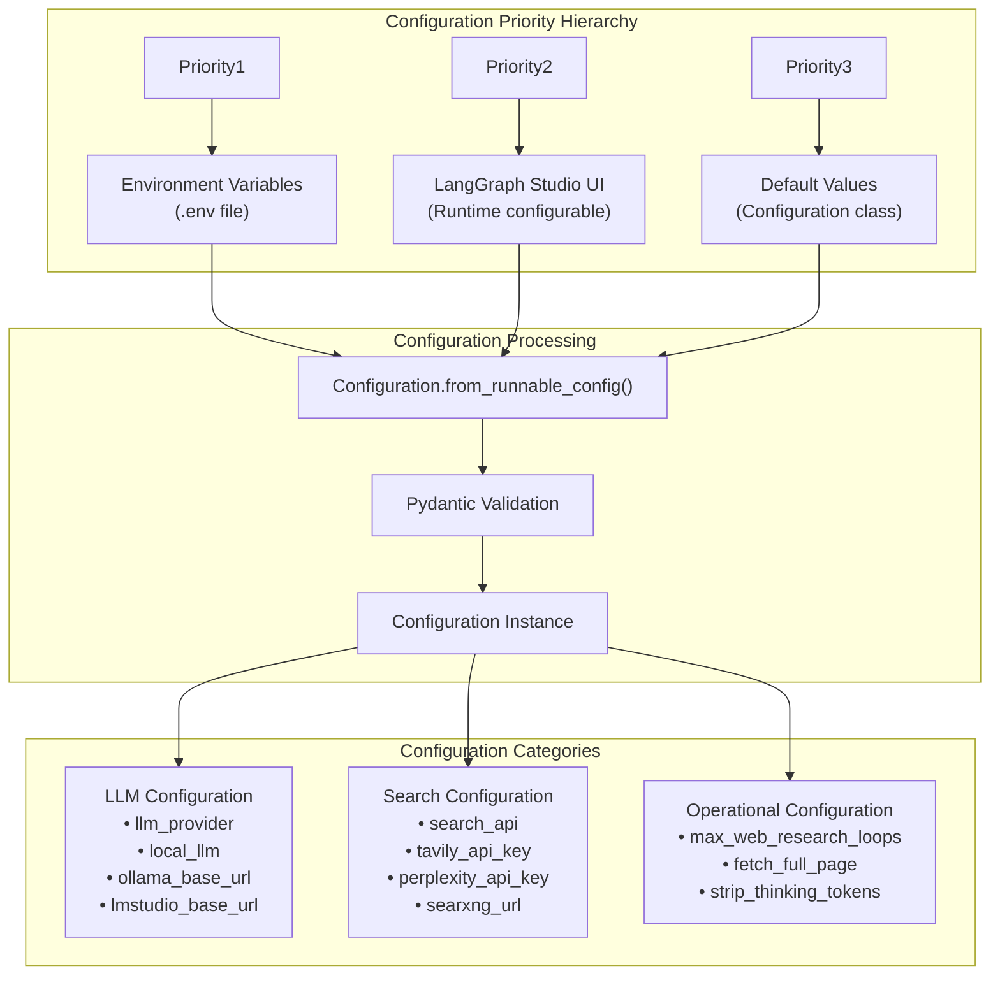
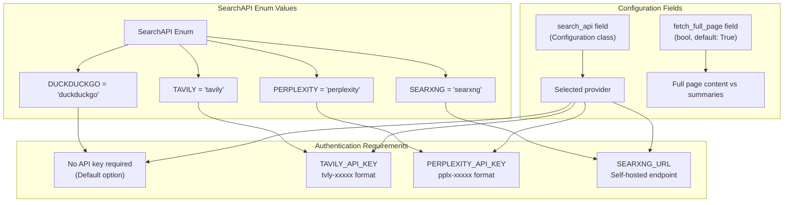
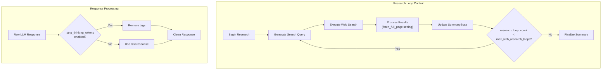
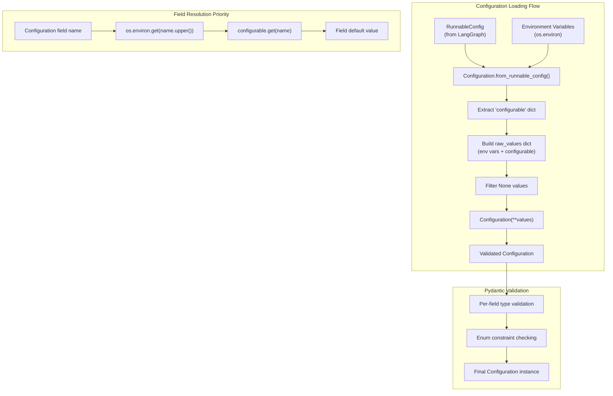

<!-- source: DeepWiki mcp.deepwiki.com · repo langchain-ai/local-deep-researcher · page 4 Configuration · fetched 2026-10-26 -->

# Configuration

Relevant source files

The following files were used as context for generating this wiki page:

- [README.md](README.md)
- [src/ollama_deep_researcher/configuration.py](src/ollama_deep_researcher/configuration.py)

This document covers the configuration system for the Local Deep Researcher, including all available configuration options, their sources, and how they are processed by the system. This includes LLM provider settings, search API configuration, and operational parameters that control the research workflow behavior.

For deployment-specific configuration, see [Deployment](#5). For LangGraph framework configuration details, see [LangGraph Configuration](#4.2).

## Configuration Sources and Priority

The Local Deep Researcher uses a hierarchical configuration system with three primary sources, processed in order of priority:

The configuration system loads values using the `Configuration.from_runnable_config()` method, which checks environment variables first, then configurable parameters from the LangGraph runtime, and finally falls back to default values defined in the `Configuration` class.

**Sources:** [src/ollama_deep_researcher/configuration.py:58-76](), [.env.example:1-17]()

## LLM Provider Configuration

The system supports two local LLM providers with distinct configuration requirements:

| Configuration Field | Type | Default | Description |
|---------------------|------|---------|-------------|
| `llm_provider` | `"ollama"` \| `"lmstudio"` | `"ollama"` | LLM service provider |
| `local_llm` | `str` | `"llama3.2"` | Model name in the provider |
| `ollama_base_url` | `str` | `"http://localhost:11434/"` | Ollama API endpoint |
| `lmstudio_base_url` | `str` | `"http://localhost:1234/v1"` | LMStudio OpenAI-compatible API |
| `strip_thinking_tokens` | `bool` | `true` | Remove `` tags are removed from model responses, which is particularly useful for reasoning models that output their thought process.

**Sources:** [src/ollama_deep_researcher/configuration.py:22-31](), [src/ollama_deep_researcher/configuration.py:42-56](), [.env.example:10-14]()

## Search API Configuration

The system integrates with multiple web search providers through a unified configuration interface:

| Provider | Configuration | Authentication | Default URL |
|----------|---------------|----------------|-------------|
| DuckDuckGo | `search_api="duckduckgo"` | None required | Built-in |
| Tavily | `search_api="tavily"` | `TAVILY_API_KEY` | `https://api.tavily.com` |
| Perplexity | `search_api="perplexity"` | `PERPLEXITY_API_KEY` | `https://api.perplexity.ai` |
| SearXNG | `search_api="searxng"` | `SEARXNG_URL` | `http://localhost:8888` |

The `fetch_full_page` parameter determines whether the system retrieves complete webpage content or just summaries from search results, affecting both research depth and processing time.

**Sources:** [src/ollama_deep_researcher/configuration.py:8-12](), [src/ollama_deep_researcher/configuration.py:32-41](), [.env.example:1-8]()

## Operational Parameters

Core operational settings control the research workflow behavior:

| Parameter | Type | Default | Environment Variable | Description |
|-----------|------|---------|---------------------|-------------|
| `max_web_research_loops` | `int` | `3` | `MAX_WEB_RESEARCH_LOOPS` | Research iteration limit |
| `fetch_full_page` | `bool` | `true` | `FETCH_FULL_PAGE` | Retrieve complete page content |
| `strip_thinking_tokens` | `bool` | `true` | `STRIP_THINKING_TOKENS` | Remove thinking tags from responses |

These parameters directly control the research workflow execution, with `max_web_research_loops` preventing infinite research cycles and `fetch_full_page` balancing research depth against processing speed.

**Sources:** [src/ollama_deep_researcher/configuration.py:17-21](), [src/ollama_deep_researcher/configuration.py:37-41](), [src/ollama_deep_researcher/configuration.py:52-56](), [.env.example:16-17]()

## Configuration Loading Process

The configuration system uses Pydantic for validation and type safety, with a custom loading mechanism that handles environment variables and runtime configuration:

The loading process follows this sequence:

1. **Extract values**: For each field in `Configuration.model_fields`, check environment variables using uppercase field names
2. **Runtime override**: Check the `configurable` dictionary from `RunnableConfig` for runtime values
3. **Filter and construct**: Remove `None` values and construct the `Configuration` instance
4. **Validate**: Pydantic validates types, constraints, and enum values

**Sources:** [src/ollama_deep_researcher/configuration.py:58-76](), [src/ollama_deep_researcher/configuration.py:14-56]()

---

