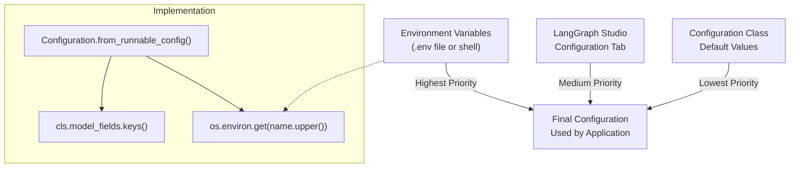
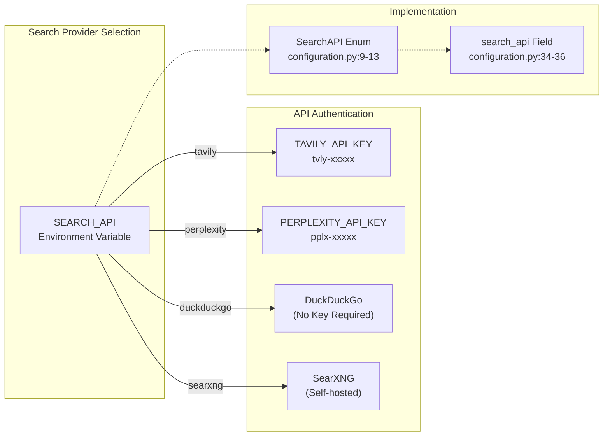
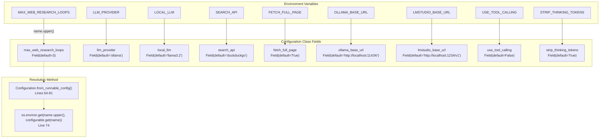

<!-- source: DeepWiki mcp.deepwiki.com · repo langchain-ai/local-deep-researcher · page 4.1 Environment Variables · fetched 2026-10-26 -->

# Environment Variables

<details>
<summary>Relevant source files</summary>

The following files were used as context for generating this wiki page:

- [.env.example](.env.example)
- [src/ollama_deep_researcher/configuration.py](src/ollama_deep_researcher/configuration.py)

</details>


This document covers all environment variables available in the Local Deep Researcher system, their purposes, default values, and configuration examples. Environment variables provide the highest priority configuration method in the three-tier configuration hierarchy.

For information about the overall configuration system architecture, see [Configuration](#4). For LangGraph-specific configuration options, see [LangGraph Configuration](#4.2).

## Configuration Hierarchy

Environment variables sit at the top of the configuration precedence chain, overriding both LangGraph Studio configuration and default values defined in the `Configuration` class.

### Configuration Precedence Flow



**Environment Variable Resolution Process**

The system resolves configuration values through the `Configuration.from_runnable_config()` method, which implements the following precedence logic:

- **Environment Variables**: Read using `os.environ.get(name.upper())` format
- **Runtime Configuration**: Values passed via LangGraph Studio
- **Default Values**: Defined in `Configuration` class field definitions

Sources: [src/ollama_deep_researcher/configuration.py:63-81]()

## Core System Variables

### Research Behavior Configuration

| Variable | Type | Default | Description |
|----------|------|---------|-------------|
| `MAX_WEB_RESEARCH_LOOPS` | `int` | `3` | Number of research iterations to perform |
| `FETCH_FULL_PAGE` | `bool` | `True` | Include full page content in search results |
| `USE_TOOL_CALLING` | `bool` | `False` | Use tool calling instead of JSON mode for structured output |
| `STRIP_THINKING_TOKENS` | `bool` | `True` | Whether to strip `<think>` tokens from model responses |

Sources: [src/ollama_deep_researcher/configuration.py:19-61](), [.env.example:16-17]()

### LLM Provider Configuration

| Variable | Type | Default | Description |
|----------|------|---------|-------------|
| `LLM_PROVIDER` | `Literal["ollama", "lmstudio"]` | `"ollama"` | Provider for the LLM service |
| `LOCAL_LLM` | `str` | `"llama3.2"` | Name of the LLM model to use |
| `OLLAMA_BASE_URL` | `str` | `"http://localhost:11434/"` | Base URL for Ollama API |
| `LMSTUDIO_BASE_URL` | `str` | `"http://localhost:1234/v1"` | Base URL for LMStudio OpenAI-compatible API |

Sources: [src/ollama_deep_researcher/configuration.py:24-51](), [.env.example:10-14]()

### Search API Configuration

| Variable | Type | Default | Description |
|----------|------|---------|-------------|
| `SEARCH_API` | `Literal["perplexity", "tavily", "duckduckgo", "searxng"]` | `"duckduckgo"` | Web search API to use |
| `SEARXNG_URL` | `str` | `None` | SearXNG instance URL (defaults to `http://localhost:8888`) |

Sources: [src/ollama_deep_researcher/configuration.py:34-36](), [.env.example:1-4]()

## API Authentication Variables

### Search API Keys



| Variable | Required | Format | Provider |
|----------|----------|--------|----------|
| `TAVILY_API_KEY` | When using Tavily | `tvly-xxxxx` | Get key at https://tavily.com |
| `PERPLEXITY_API_KEY` | When using Perplexity | `pplx-xxxxx` | Get key at https://www.perplexity.ai |

**Note**: DuckDuckGo and SearXNG do not require API keys. DuckDuckGo is the default search provider when no API keys are configured.

Sources: [.env.example:6-8](), [src/ollama_deep_researcher/configuration.py:9-13]()

## Environment Variable to Code Mapping

### Configuration Class Integration



The environment variable resolution follows a consistent pattern where each `Configuration` class field maps to an uppercase environment variable name. The `from_runnable_config()` method iterates through all model fields and attempts to resolve values from environment variables first.

Sources: [src/ollama_deep_researcher/configuration.py:19-61](), [src/ollama_deep_researcher/configuration.py:73-76]()

## Configuration Examples

### Basic Setup (.env file)

```bash
# Basic configuration for local development
SEARCH_API=duckduckgo
LLM_PROVIDER=ollama
LOCAL_LLM=llama3.2
MAX_WEB_RESEARCH_LOOPS=3
FETCH_FULL_PAGE=true
```

### Production Setup with API Keys

```bash
# Production configuration with external APIs
SEARCH_API=tavily
TAVILY_API_KEY=tvly-your-api-key-here
LLM_PROVIDER=lmstudio
LOCAL_LLM=qwen_qwq-32b
LMSTUDIO_BASE_URL=http://localhost:1234/v1
MAX_WEB_RESEARCH_LOOPS=5
FETCH_FULL_PAGE=true
USE_TOOL_CALLING=true
```

### Self-hosted SearXNG Setup

```bash
# Configuration for self-hosted search
SEARCH_API=searxng
SEARXNG_URL=http://localhost:8888
LLM_PROVIDER=ollama
LOCAL_LLM=llama3.2
OLLAMA_BASE_URL=http://localhost:11434
```

### Advanced Research Configuration

```bash
# Advanced configuration for detailed research
MAX_WEB_RESEARCH_LOOPS=7
FETCH_FULL_PAGE=true
USE_TOOL_CALLING=true
STRIP_THINKING_TOKENS=false
SEARCH_API=perplexity
PERPLEXITY_API_KEY=pplx-your-api-key-here
```

Sources: [.env.example:1-17]()

## Environment Variable Validation

The system uses Pydantic for configuration validation, ensuring that environment variables conform to expected types and constraints. Invalid values will raise validation errors during application startup.

### Type Enforcement

- **Boolean values**: Accepts `true`/`false`, `1`/`0`, `yes`/`no`
- **Integer values**: Must be valid integers (e.g., `MAX_WEB_RESEARCH_LOOPS`)
- **Literal types**: Must match exactly (e.g., `LLM_PROVIDER` must be `"ollama"` or `"lmstudio"`)
- **URL values**: Should be valid HTTP/HTTPS URLs with appropriate ports

### Common Validation Errors

1. **Invalid LLM Provider**: `LLM_PROVIDER` must be exactly `"ollama"` or `"lmstudio"`
2. **Invalid Search API**: `SEARCH_API` must be one of `"perplexity"`, `"tavily"`, `"duckduckgo"`, or `"searxng"`
3. **Invalid URL Format**: Base URLs must include protocol and valid port numbers
4. **Type Mismatches**: Boolean and integer fields must have valid values

Sources: [src/ollama_deep_researcher/configuration.py:16-61]()

---

