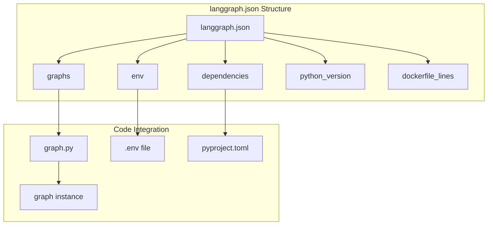
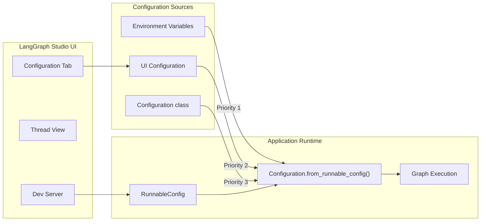
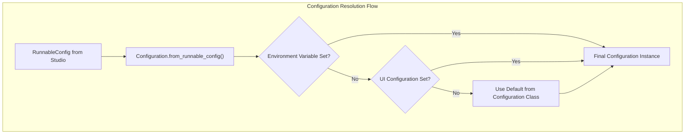

<!-- source: DeepWiki mcp.deepwiki.com · repo langchain-ai/local-deep-researcher · page 4.2 LangGraph Configuration · fetched 2026-10-26 -->

# LangGraph Configuration

Relevant source files

The following files were used as context for generating this wiki page:

- [README.md](README.md)
- [langgraph.json](langgraph.json)
- [src/ollama_deep_researcher/configuration.py](src/ollama_deep_researcher/configuration.py)

This document explains the LangGraph-specific configuration mechanisms, including the `langgraph.json` manifest file and runtime configuration within LangGraph Studio UI. For information about environment variables and the `.env` file configuration, see [Environment Variables](#4.1). For broader configuration system architecture, see [Configuration](#4).

## LangGraph Manifest File

The `langgraph.json` file serves as the primary manifest that defines how LangGraph Studio discovers and runs the Local Deep Researcher application. This file establishes the connection between the LangGraph runtime and the application code.

### Manifest Structure

The manifest defines several key components:

| Field | Purpose | Value |
|-------|---------|-------|
| `graphs` | Maps graph names to their implementation | `"ollama_deep_researcher": "./src/ollama_deep_researcher/graph.py:graph"` |
| `dependencies` | Specifies package dependencies | `["."]` (current package) |
| `env` | Points to environment variables file | `"./.env"` |
| `python_version` | Required Python version | `"3.11"` |
| `dockerfile_lines` | Additional Docker configuration | `[]` (empty) |

Sources: [langgraph.json:1-11]()

## LangGraph Studio Runtime Configuration

LangGraph Studio provides a web-based configuration interface that allows real-time modification of application settings without requiring environment variable changes or application restarts.

### Configuration Interface Architecture

The Studio UI provides direct access to all configurable fields defined in the `Configuration` class, allowing users to modify research behavior in real-time.

Sources: [README.md:135-141](), [configuration.py:63-81]()

## Configuration Priority System

LangGraph Studio implements a three-tier configuration priority system that determines how configuration values are resolved:

The priority order ensures that:
1. **Environment variables** (highest priority) - Values from `.env` file or system environment
2. **LangGraph UI configuration** (medium priority) - Values set in Studio configuration tab  
3. **Default values** (lowest priority) - Values defined in `Configuration` class defaults

Sources: [README.md:137-141](), [configuration.py:63-81]()

## Available Configuration Fields

LangGraph Studio exposes all fields defined in the `Configuration` class through its configuration interface:

### Core Research Parameters

| Field | Type | Default | Description |
|-------|------|---------|-------------|
| `max_web_research_loops` | `int` | `3` | Number of research iterations |
| `search_api` | `Literal` | `"duckduckgo"` | Web search API selection |
| `fetch_full_page` | `bool` | `True` | Include full page content |

### LLM Provider Configuration

| Field | Type | Default | Description |
|-------|------|---------|-------------|
| `llm_provider` | `Literal` | `"ollama"` | LLM provider selection |
| `local_llm` | `str` | `"llama3.2"` | Model name |
| `ollama_base_url` | `str` | `"http://localhost:11434/"` | Ollama API endpoint |
| `lmstudio_base_url` | `str` | `"http://localhost:1234/v1"` | LMStudio API endpoint |

### Advanced Options

| Field | Type | Default | Description |
|-------|------|---------|-------------|
| `strip_thinking_tokens` | `bool` | `True` | Remove thinking tokens from responses |
| `use_tool_calling` | `bool` | `False` | Use tool calling vs JSON mode |

Sources: [configuration.py:16-61]()

## Development Server Integration

The LangGraph development server integrates with the configuration system through the `langgraph dev` command, which:

1. Loads the `langgraph.json` manifest
2. Discovers the graph implementation at `./src/ollama_deep_researcher/graph.py:graph`
3. Reads environment variables from `./.env` file
4. Starts the Studio interface at `http://127.0.0.1:2024`
5. Provides the configuration tab for runtime parameter adjustment

The development workflow allows immediate testing of configuration changes without application restarts, enabling rapid iteration during research workflow development.

Sources: [README.md:95-99](), [README.md:126-134](), [langgraph.json:1-11]()

---

