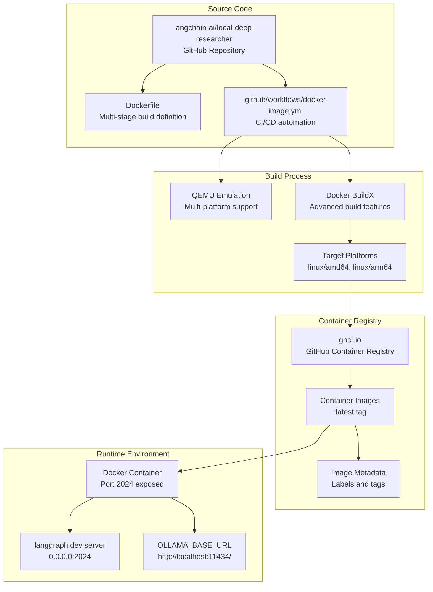
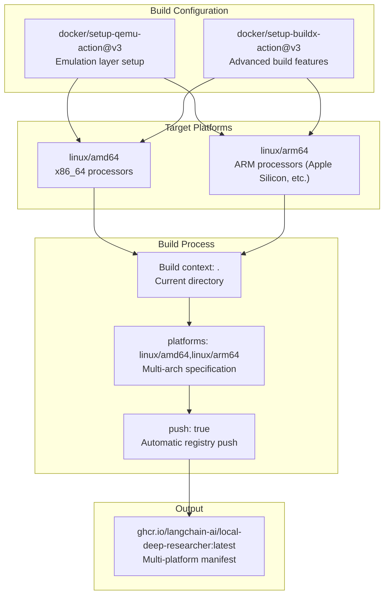

<!-- source: DeepWiki mcp.deepwiki.com · repo langchain-ai/local-deep-researcher · page 5 Deployment · fetched 2026-10-26 -->

# Deployment

Relevant source files

The following files were used as context for generating this wiki page:

- [.github/workflows/docker-image.yml](.github/workflows/docker-image.yml)
- [Dockerfile](Dockerfile)

This document covers the deployment architecture and automation processes for the Local Deep Researcher system. It explains how the system is containerized using Docker, automated through GitHub Actions CI/CD pipelines, and distributed as multi-platform container images. For specific Docker configuration details, see [Docker Deployment](#5.1). For CI/CD implementation specifics, see [CI/CD Pipeline](#5.2).

## Deployment Architecture Overview

The Local Deep Researcher uses a containerized deployment strategy with automated CI/CD processes to ensure consistent deployment across different platforms and environments.

Sources: [Dockerfile:1-39](), [.github/workflows/docker-image.yml:1-64]()

## Container Build Strategy

The system uses a sophisticated Docker build process that leverages modern containerization practices and multi-platform support.

```mermaid
graph LR
    subgraph "Base Image"
        PYTHON["python:3.11-slim<br/>Debian-based runtime"]
        BUILDPLATFORM["--platform=$BUILDPLATFORM<br/>Cross-compilation support"]
    end
    
    subgraph "Build Dependencies"
        APT_DEPS["System packages<br/>curl, ca-certificates<br/>build-essential, python3-dev<br/>libssl-dev, libffi-dev<br/>rustc, cargo"]
        UV_INSTALL["uv package manager<br/>pip install uv"]
        PATH_ENV["PATH environment<br/>/root/.local/bin"]
    end
    
    subgraph "Application Setup"
        COPY_CODE["COPY . /app<br/>Repository content"]
        ENV_VARS["Environment Variables<br/>OLLAMA_BASE_URL"]
        EXPOSE_PORT["EXPOSE 2024<br/>LangGraph dev server"]
    end
    
    subgraph "Runtime Command"
        UVX_CMD["uvx command<br/>--refresh --from langgraph-cli[inmem]<br/>--with-editable . --python 3.11<br/>langgraph dev --host 0.0.0.0"]
    end
    
    PYTHON --> BUILDPLATFORM
    BUILDPLATFORM --> APT_DEPS
    APT_DEPS --> UV_INSTALL
    UV_INSTALL --> PATH_ENV
    PATH_ENV --> COPY_CODE
    COPY_CODE --> ENV_VARS
    ENV_VARS --> EXPOSE_PORT
    EXPOSE_PORT --> UVX_CMD
```

Sources: [Dockerfile:1-39]()

## CI/CD Pipeline Structure

The GitHub Actions workflow provides automated building and publishing of container images with comprehensive multi-platform support.

| Pipeline Stage | Purpose | Key Actions |
|---|---|---|
| **Checkout** | Source code retrieval | `actions/checkout@v4` |
| **Multi-platform Setup** | Cross-architecture build preparation | `docker/setup-qemu-action@v3`, `docker/setup-buildx-action@v3` |
| **Authentication** | Registry access | `docker/login-action@v3` with `ghcr.io` |
| **Metadata Extraction** | Image tagging and labeling | `docker/metadata-action@v5` |
| **Build and Push** | Container creation and publication | `docker/build-push-action@v5` |

The workflow triggers on pushes to the `main` branch and pull requests, ensuring continuous integration and delivery.

Sources: [.github/workflows/docker-image.yml:3-7](), [.github/workflows/docker-image.yml:15-64]()

## Multi-Platform Support

The deployment system builds container images for multiple CPU architectures to ensure broad compatibility:

Sources: [.github/workflows/docker-image.yml:23-32](), [.github/workflows/docker-image.yml:56-62]()

## Runtime Configuration

The container deployment includes several key configuration elements that ensure proper system operation:

### Environment Variables
- `OLLAMA_BASE_URL`: Set to `http://localhost:11434/` by default, configuring the expected Ollama service endpoint
- `PATH`: Extended to include `/root/.local/bin` for uv package manager access

### Port Exposure
- Port `2024`: Exposed for the LangGraph development server interface
- Host binding: `0.0.0.0` ensures the service is accessible from outside the container

### Command Structure
The container runs using the `uvx` command with specific parameters:
- `--refresh`: Ensures fresh package installation
- `--from "langgraph-cli[inmem]"`: Specifies the LangGraph CLI with in-memory backend
- `--with-editable .`: Includes the current directory as an editable package
- `--python 3.11`: Enforces Python version compatibility
- `langgraph dev --host 0.0.0.0`: Starts the development server with external access

Sources: [Dockerfile:23-39]()

## Service Dependencies

The deployment architecture assumes certain external services are available:

### Required External Services
- **Ollama Service**: Expected at `localhost:11434` for local LLM inference
- **Search APIs**: Various web search services (configured via environment variables)
- **Container Registry**: GitHub Container Registry for image distribution

### Network Configuration
The container exposes port 2024 and expects to communicate with external services on standard ports. The default configuration assumes Ollama is running on the same host or accessible via `localhost:11434`.

Sources: [Dockerfile:25](), [Dockerfile:28](), [.github/workflows/docker-image.yml:9-13]()

---

