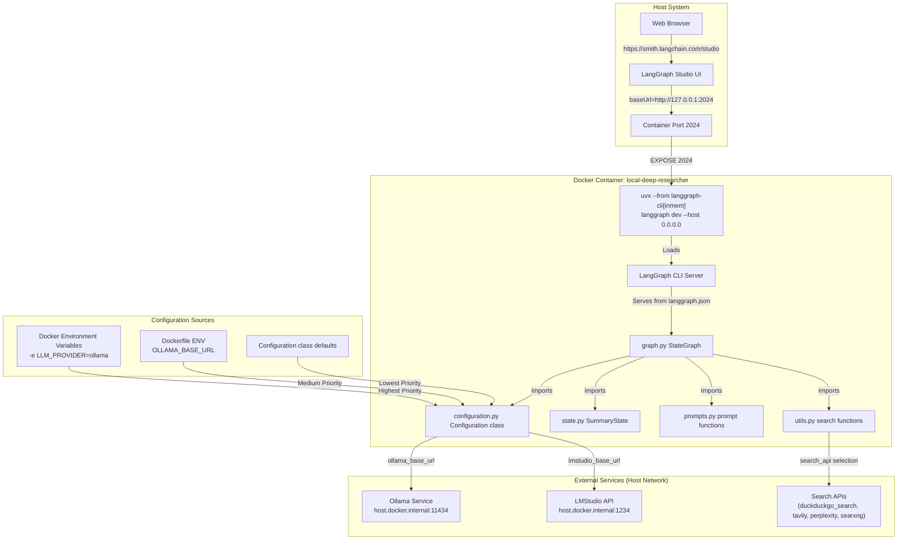
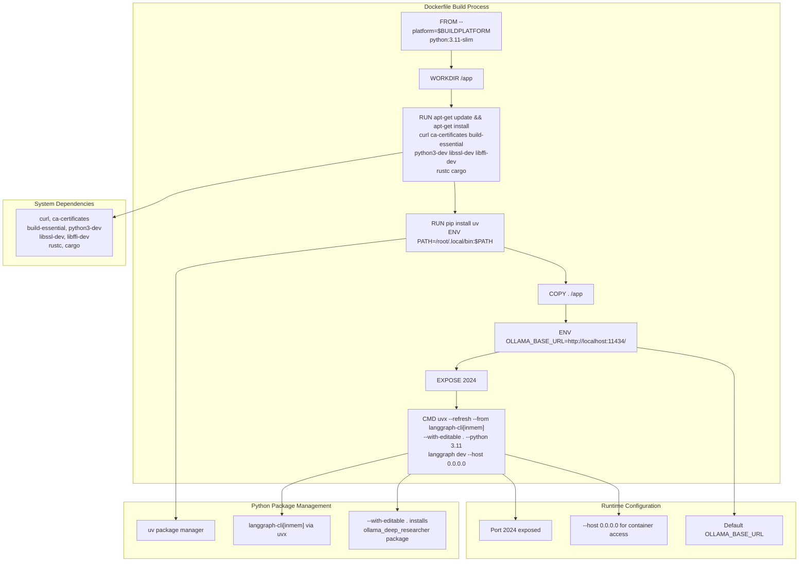
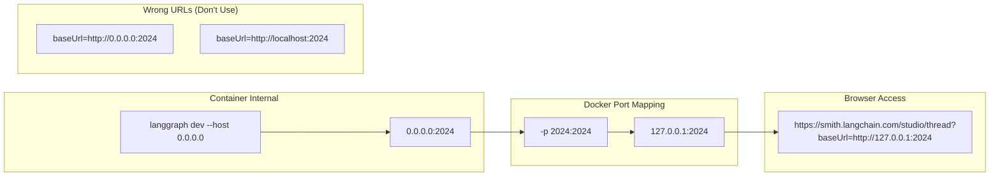

<!-- source: DeepWiki mcp.deepwiki.com · repo langchain-ai/local-deep-researcher · page 5.1 Docker Deployment · fetched 2026-10-26 -->

# Docker Deployment

<details>
<summary>Relevant source files</summary>

The following files were used as context for generating this wiki page:

- [Dockerfile](Dockerfile)
- [README.md](README.md)

</details>


This document provides detailed instructions for deploying Local Deep Researcher using Docker. It covers building and running the Docker container, configuring environment variables, and accessing the containerized application through the LangGraph Studio UI.

The Docker deployment described here containerizes the LangGraph Studio and Local Deep Researcher application but does not include the LLM provider (Ollama or LMStudio) within the container. For general deployment options beyond Docker, see [Deployment Options](#5).

## Docker Architecture Overview

The Docker deployment packages the `langgraph dev` server and `ollama_deep_researcher` Python package while connecting to external LLM and search services.

Docker Container Runtime Architecture


Sources: [README.md:187-215](), [Dockerfile:1-39](), [Dockerfile:32-39]()
</thinking>

## Docker Image Structure

The `Dockerfile` creates a multi-layer image optimized for running the `langgraph dev` server with the research assistant.

Docker Image Layers and Components
```mermaid
classDiagram
    class DockerfileStructure {
        +FROM "python:3.11-slim"
        +WORKDIR "/app"
        +RUN "apt-get install build deps"
        +RUN "pip install uv"
        +COPY ". /app"
        +ENV "OLLAMA_BASE_URL=http://localhost:11434/"
        +EXPOSE "2024"
        +CMD "uvx langgraph dev --host 0.0.0.0"
    }
    
    class SystemDependencies {
        +curl
        +ca_certificates
        +build_essential
        +python3_dev
        +libssl_dev
        +libffi_dev
        +rustc
        +cargo
    }
    
    class PythonPackages {
        +uv "package manager"
        +langgraph_cli_inmem "from uvx command"
        +ollama_deep_researcher "via --with-editable ."
    }
    
    class RuntimeConfiguration {
        +OLLAMA_BASE_URL "http://localhost:11434/"
        +PORT "2024"
        +HOST "0.0.0.0"
        +PATH "/root/.local/bin:${PATH}"
    }
    
    DockerfileStructure --> SystemDependencies : "installs via apt-get"
    DockerfileStructure --> PythonPackages : "installs via uv/uvx"
    DockerfileStructure --> RuntimeConfiguration : "configures environment"
```

Sources: [Dockerfile:1-39]()
</old_str>
<new_str>
## Docker Image Structure

The `Dockerfile` creates a multi-layer image optimized for running the `langgraph dev` server with the research assistant.

Docker Image Layers and Components
```mermaid
classDiagram
    class DockerfileStructure {
        +FROM "python:3.11-slim"
        +WORKDIR "/app"
        +RUN "apt-get install build deps"
        +RUN "pip install uv"
        +COPY ". /app"
        +ENV "OLLAMA_BASE_URL=http://localhost:11434/"
        +EXPOSE "2024"
        +CMD "uvx langgraph dev --host 0.0.0.0"
    }
    
    class SystemDependencies {
        +curl
        +ca_certificates
        +build_essential
        +python3_dev
        +libssl_dev
        +libffi_dev
        +rustc
        +cargo
    }
    
    class PythonPackages {
        +uv "package manager"
        +langgraph_cli_inmem "from uvx command"
        +ollama_deep_researcher "via --with-editable ."
    }
    
    class RuntimeConfiguration {
        +OLLAMA_BASE_URL "http://localhost:11434/"
        +PORT "2024"
        +HOST "0.0.0.0"
        +PATH "/root/.local/bin:${PATH}"
    }
    
    DockerfileStructure --> SystemDependencies : "installs via apt-get"
    DockerfileStructure --> PythonPackages : "installs via uv/uvx"
    DockerfileStructure --> RuntimeConfiguration : "configures environment"
```

Sources: [Dockerfile:1-39]()

## Prerequisites

Before proceeding with Docker deployment, ensure you have:

1. Docker installed on your system
2. An LLM provider (Ollama or LMStudio) running and accessible from your Docker host
3. API keys for any non-default search providers (if using Tavily, Perplexity, or other services that require authentication)

The Docker container requires external access to an LLM provider:
- **Ollama**: Must be running and accessible from the Docker container (typically at `http://host.docker.internal:11434`)
- **LMStudio**: Must be running with the OpenAI-compatible API enabled (typically at `http://host.docker.internal:1234/v1`)

Sources: [README.md:29-64]()

## Dockerfile Structure and Multi-Platform Support

The Dockerfile creates a multi-architecture image that can run on both AMD64 and ARM64 platforms, as supported by the CI/CD pipeline.

Dockerfile Build Stages and Components


The Dockerfile uses the `--platform=$BUILDPLATFORM` argument for multi-architecture builds, allowing the same image to run on different CPU architectures. The CI/CD pipeline in `.github/workflows/docker-image.yml` builds for both `linux/amd64` and `linux/arm64` platforms.

Sources: [Dockerfile:1-39]()

## Building the Docker Image

### Local Build

To build the Docker image locally:

1. Clone the repository:
   ```bash
   git clone https://github.com/langchain-ai/local-deep-researcher.git
   cd local-deep-researcher
   ```

2. Build the Docker image:
   ```bash
   docker build -t local-deep-researcher .
   ```

### Multi-Platform Build

For multi-platform support (matching the CI/CD pipeline):

```bash
docker buildx build --platform linux/amd64,linux/arm64 -t local-deep-researcher .
```

### Build Process Details

The build process executes these key steps:

| Build Stage | Action | Files/Commands Involved |
|-------------|--------|------------------------|
| Base Image | Pull Python 3.11 slim image | `FROM --platform=$BUILDPLATFORM python:3.11-slim` |
| System Dependencies | Install build tools and libraries | `apt-get install curl ca-certificates build-essential python3-dev libssl-dev libffi-dev rustc cargo` |
| Package Manager | Install uv for fast Python package management | `pip install uv` |
| Application Code | Copy entire repository | `COPY . /app` |
| Default Config | Set Ollama URL environment variable | `ENV OLLAMA_BASE_URL="http://localhost:11434/"` |
| Port Exposure | Expose LangGraph dev server port | `EXPOSE 2024` |
| Entry Point | Configure uvx command for LangGraph CLI | `CMD ["uvx", "--refresh", "--from", "langgraph-cli[inmem]", "--with-editable", ".", "--python", "3.11", "langgraph", "dev", "--host", "0.0.0.0"]` |

The Rust compiler installation (`rustc cargo`) is required for building Python cryptography packages that some dependencies require.

Sources: [README.md:191-193](), [Dockerfile:5-28](), [Dockerfile:32-39]()

## Running the Docker Container

After building the image, run the container with appropriate environment variables to configure the application.

### Basic Run Command

```
docker run --rm -it -p 2024:2024 local-deep-researcher
```

### Environment Variable Configuration

For full functionality, provide environment variables for LLM provider connection, search API selection, and research configuration.

Example with comprehensive configuration:

```bash
docker run --rm -it -p 2024:2024 \
  -e SEARCH_API="tavily" \
  -e TAVILY_API_KEY="tvly-***YOUR_KEY_HERE***" \
  -e LLM_PROVIDER="ollama" \
  -e OLLAMA_BASE_URL="http://host.docker.internal:11434/" \
  -e LOCAL_LLM="llama3.2" \
  -e MAX_WEB_RESEARCH_LOOPS="3" \
  local-deep-researcher
```

Environment variables mapped to `Configuration` class fields in `configuration.py`:

| Environment Variable | Description | Configuration Class Field | Default Value | Docker Example |
|---------------------|-------------|---------------------------|---------------|----------------|
| `LLM_PROVIDER` | LLM provider selection | `llm_provider` | `"ollama"` | `"ollama"` or `"lmstudio"` |
| `OLLAMA_BASE_URL` | Ollama service endpoint | `ollama_base_url` | `"http://localhost:11434"` | `"http://host.docker.internal:11434/"` |
| `LMSTUDIO_BASE_URL` | LMStudio API endpoint | `lmstudio_base_url` | `"http://localhost:1234/v1"` | `"http://host.docker.internal:1234/v1"` |
| `LOCAL_LLM` | Model name for local LLM | `local_llm` | `"llama3.2"` | `"deepseek-r1:8b"` |
| `SEARCH_API` | Search API backend | `search_api` | `"duckduckgo"` | `"tavily"`, `"perplexity"`, `"searxng"` |
| `TAVILY_API_KEY` | Tavily API authentication | `tavily_api_key` | `None` | `"tvly-xxxxxxxxxxxxx"` |
| `PERPLEXITY_API_KEY` | Perplexity API authentication | `perplexity_api_key` | `None` | `"pplx-xxxxxxxxxxxxx"` |
| `SEARXNG_URL` | SearXNG instance URL | `searxng_url` | `None` | `"http://host.docker.internal:8080"` |
| `MAX_WEB_RESEARCH_LOOPS` | Research iteration limit | `max_web_research_loops` | `3` | `"5"` |
| `FETCH_FULL_PAGE` | Full page content retrieval | `fetch_full_page` | `False` | `"true"` or `"false"` |
| `STRIP_THINKING_TOKENS` | Remove thinking tokens from output | `strip_thinking_tokens` | `True` | `"true"` or `"false"` |
| `USE_TOOL_CALLING` | Use tool calling instead of JSON mode | `use_tool_calling` | `False` | `"true"` or `"false"` |

**Note**: The `host.docker.internal` hostname allows Docker containers to access services running on the Docker host. This is essential for connecting to Ollama or LMStudio running outside the container.

Sources: [README.md:68-75](), [README.md:194-205](), [Dockerfile:25]()

## Accessing the LangGraph Studio UI

When running the Docker container, the LangGraph Studio UI is not automatically opened in your browser due to the containerized environment. You need to manually navigate to the correct URL.

### Accessing the UI

1. After starting the container, the `langgraph dev` server will output a log message like:
   ```
   2025-02-10T13:45:04.784915Z [info] 🎨 Opening Studio in your browser... [browser_opener]
   URL: https://smith.langchain.com/studio/?baseUrl=http://0.0.0.0:2024
   ```

2. **Important**: Do not use the URL from the container logs. Instead, access the UI at:
   ```
   https://smith.langchain.com/studio/thread?baseUrl=http://127.0.0.1:2024
   ```

The container binds to `0.0.0.0:2024` internally (via `--host 0.0.0.0` in the CMD), but you must access it through `127.0.0.1:2024` from your host browser.

### LangGraph Studio URL Structure



### Browser Compatibility Notes

When accessing the LangGraph Studio UI from a Docker deployment:
- Firefox is recommended for the best experience with mixed HTTPS/HTTP content
- Safari users may encounter security warnings due to mixed content (HTTPS LangGraph Studio accessing HTTP local API)
- Chrome users should disable strict site isolation if experiencing issues
- If you encounter issues, try using Firefox, disabling ad-blocking extensions, or checking browser console for specific error messages

Sources: [README.md:206-214](), [README.md:147-156](), [Dockerfile:32-39]()

## Common Configurations

### Different LLM Providers

#### Ollama Configuration
```bash
docker run --rm -it -p 2024:2024 \
  -e LLM_PROVIDER="ollama" \
  -e OLLAMA_BASE_URL="http://host.docker.internal:11434/" \
  -e LOCAL_LLM="llama3.2" \
  local-deep-researcher
```

#### LMStudio Configuration
```bash
docker run --rm -it -p 2024:2024 \
  -e LLM_PROVIDER="lmstudio" \
  -e LMSTUDIO_BASE_URL="http://host.docker.internal:1234/v1" \
  -e LOCAL_LLM="qwen_qwq-32b" \
  local-deep-researcher
```

#### DeepSeek R1 Model Configuration
```bash
docker run --rm -it -p 2024:2024 \
  -e LLM_PROVIDER="ollama" \
  -e OLLAMA_BASE_URL="http://host.docker.internal:11434/" \
  -e LOCAL_LLM="deepseek-r1:8b" \
  -e STRIP_THINKING_TOKENS="true" \
  local-deep-researcher
```

### Different Search APIs

#### DuckDuckGo (No API Key Required)
```bash
docker run --rm -it -p 2024:2024 \
  -e SEARCH_API="duckduckgo" \
  -e LLM_PROVIDER="ollama" \
  -e OLLAMA_BASE_URL="http://host.docker.internal:11434/" \
  local-deep-researcher
```

#### Tavily (Requires API Key)
```bash
docker run --rm -it -p 2024:2024 \
  -e SEARCH_API="tavily" \
  -e TAVILY_API_KEY="tvly-***YOUR_KEY_HERE***" \
  -e LLM_PROVIDER="ollama" \
  -e OLLAMA_BASE_URL="http://host.docker.internal:11434/" \
  local-deep-researcher
```

#### Perplexity (Requires API Key)
```bash
docker run --rm -it -p 2024:2024 \
  -e SEARCH_API="perplexity" \
  -e PERPLEXITY_API_KEY="pplx-***YOUR_KEY_HERE***" \
  -e LLM_PROVIDER="ollama" \
  -e OLLAMA_BASE_URL="http://host.docker.internal:11434/" \
  local-deep-researcher
```

#### SearXNG (Self-hosted)
```bash
docker run --rm -it -p 2024:2024 \
  -e SEARCH_API="searxng" \
  -e SEARXNG_URL="http://host.docker.internal:8080" \
  -e LLM_PROVIDER="ollama" \
  -e OLLAMA_BASE_URL="http://host.docker.internal:11434/" \
  local-deep-researcher
```

Sources: [README.md:29-75](), [README.md:194-205]()

## Troubleshooting

Common issues and solutions:

| Issue | Possible Cause | Solution |
|-------|---------------|----------|
| Cannot connect to Ollama | Incorrect OLLAMA_BASE_URL | Use `http://host.docker.internal:11434/` instead of `http://localhost:11434/` |
| UI not loading | Browser security settings | Try Firefox or disable ad blockers |
| API key not recognized | Incorrect environment variable format | Ensure no spaces after backslashes in docker run command |
| Model not found | Ollama model not pulled | Run `ollama pull <model-name>` on host before starting container |
| Container exits immediately | Configuration issue | Check logs with `docker logs <container-id>` |

### Configuration Priority

When deploying with Docker, be aware of the configuration priority order:

1. Environment variables passed to the Docker container (highest priority)
2. LangGraph UI configuration (when set via the UI after container startup)
3. Default values in the Configuration class (lowest priority)

This means any environment variables set when running the container will override defaults but can be overridden by settings changed in the LangGraph Studio UI after startup.

Sources: [README.md:129-135](), [README.md:147-156](), [README.md:206-214]()

---

