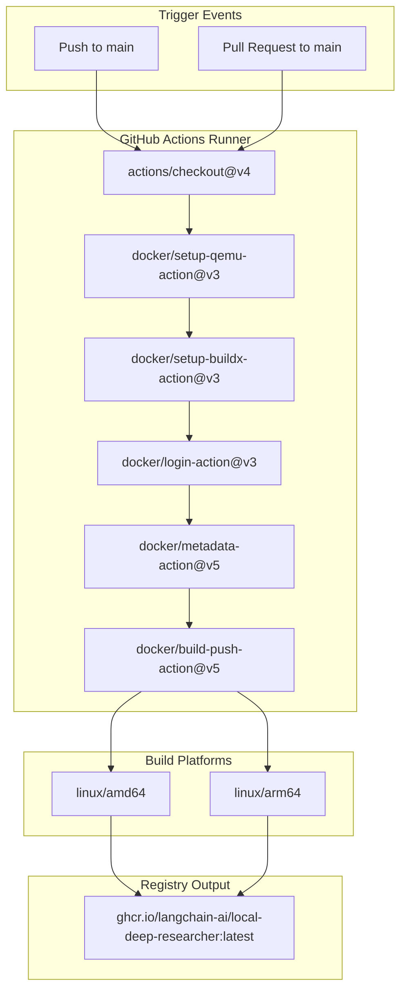
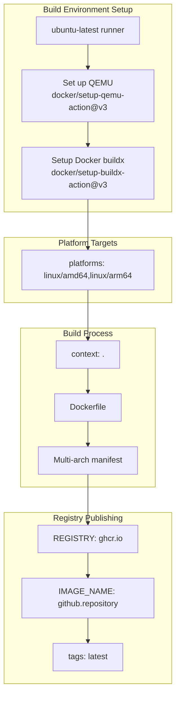
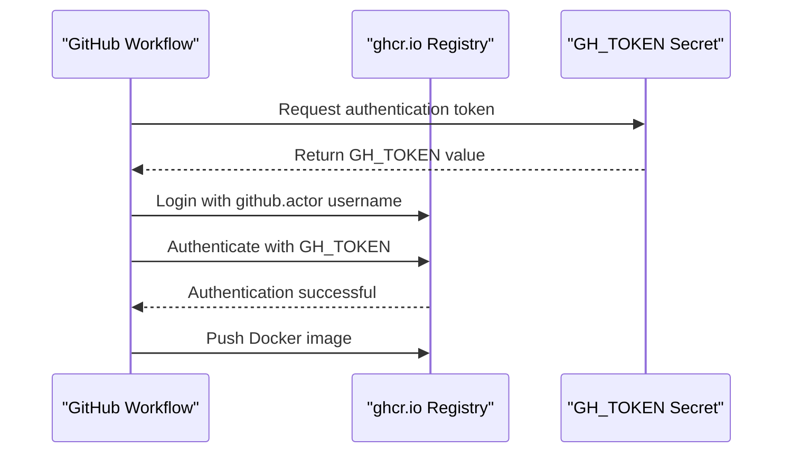

<!-- source: DeepWiki mcp.deepwiki.com · repo langchain-ai/local-deep-researcher · page 5.2 CI/CD Pipeline · fetched 2026-10-26 -->

# CI/CD Pipeline

<details>
<summary>Relevant source files</summary>

The following files were used as context for generating this wiki page:

- [.github/workflows/docker-image.yml](.github/workflows/docker-image.yml)

</details>


This document covers the automated Continuous Integration and Continuous Deployment (CI/CD) pipeline implemented using GitHub Actions. The pipeline automates Docker image building, multi-platform compilation, and publishing to GitHub Container Registry for the Local Deep Researcher system.

For information about Docker container configuration and local deployment, see [Docker Deployment](#5.1). For additional development automation workflows, see [Development Workflows](#5.3).

## Overview

The CI/CD pipeline is implemented as a single GitHub Actions workflow that provides automated Docker image builds with multi-platform support. The pipeline ensures consistent, reproducible deployments across different architectures while maintaining security best practices for registry authentication.

**Pipeline Components:**
| Component | Purpose | Implementation |
|-----------|---------|----------------|
| Trigger System | Automated builds on code changes | Push/PR to main branch |
| Multi-Platform Builder | Cross-architecture compilation | Docker Buildx with QEMU |
| Container Registry | Image distribution | GitHub Container Registry (ghcr.io) |
| Security Layer | Registry authentication | GitHub token-based auth |

Sources: [.github/workflows/docker-image.yml:1-64]()

## Workflow Architecture



The workflow implements a linear pipeline where each step depends on the successful completion of the previous step. The multi-platform build process runs in parallel for different architectures before combining results into a single manifest.

Sources: [.github/workflows/docker-image.yml:15-63]()

## Multi-Platform Build Configuration



The pipeline uses Docker Buildx with QEMU emulation to enable cross-platform builds from x86_64 runners. This allows the single workflow to produce images compatible with both Intel/AMD and ARM-based systems.

Sources: [.github/workflows/docker-image.yml:23-32](), [.github/workflows/docker-image.yml:56-62]()

## Environment and Security Configuration

The workflow uses several environment variables and security mechanisms to manage registry access and image naming:

**Environment Variables:**
| Variable | Value | Purpose |
|----------|--------|---------|
| `REGISTRY` | `ghcr.io` | GitHub Container Registry endpoint |
| `IMAGE_NAME` | `${{ github.repository }}` | Dynamic image naming based on repo |

**Authentication Flow:**


The authentication uses the `GH_TOKEN` secret with the `github.actor` username, providing secure access to the GitHub Container Registry without exposing credentials in the workflow file.

Sources: [.github/workflows/docker-image.yml:9-13](), [.github/workflows/docker-image.yml:36-41]()

## Build Triggers and Conditional Logic

The workflow implements intelligent triggering and conditional publishing logic:

**Trigger Configuration:**
```yaml
on:
  push:
    branches: [ "main" ]
  pull_request:
    branches: [ "main" ]
```

**Publishing Logic:**
- **Push to main**: Builds and pushes images to registry
- **Pull Request**: Builds images for validation but does not push
- **Other branches**: No workflow execution

This approach ensures that only validated code from the main branch results in published images, while still providing build verification for pull requests.

**Build Steps Breakdown:**
| Step | Action | Conditional Logic |
|------|--------|------------------|
| Repository Checkout | `actions/checkout@v4` | Always |
| QEMU Setup | `docker/setup-qemu-action@v3` | Always |
| Buildx Setup | `docker/setup-buildx-action@v3` | Always |
| Registry Login | `docker/login-action@v3` | Always |
| Metadata Extraction | `docker/metadata-action@v5` | Always |
| Build and Push | `docker/build-push-action@v5` | Push: true (always) |

Sources: [.github/workflows/docker-image.yml:3-7](), [.github/workflows/docker-image.yml:53-62]()

## Image Tagging and Metadata

The pipeline uses the `docker/metadata-action@v5` to automatically generate appropriate tags and labels for the Docker images:

**Tagging Strategy:**
- **Latest tag**: Always applied to images from main branch
- **Dynamic tags**: Generated based on Git metadata
- **Labels**: Extracted from repository metadata for image annotation

**Registry Output:**
- **Image Location**: `ghcr.io/langchain-ai/local-deep-researcher:latest`
- **Multi-platform**: Single manifest supporting multiple architectures
- **Public Access**: Images are publicly accessible from GitHub Container Registry

The metadata extraction step ensures consistent labeling and provides traceability from deployed images back to specific commits and builds.

Sources: [.github/workflows/docker-image.yml:43-49](), [.github/workflows/docker-image.yml:60-62]()

---

