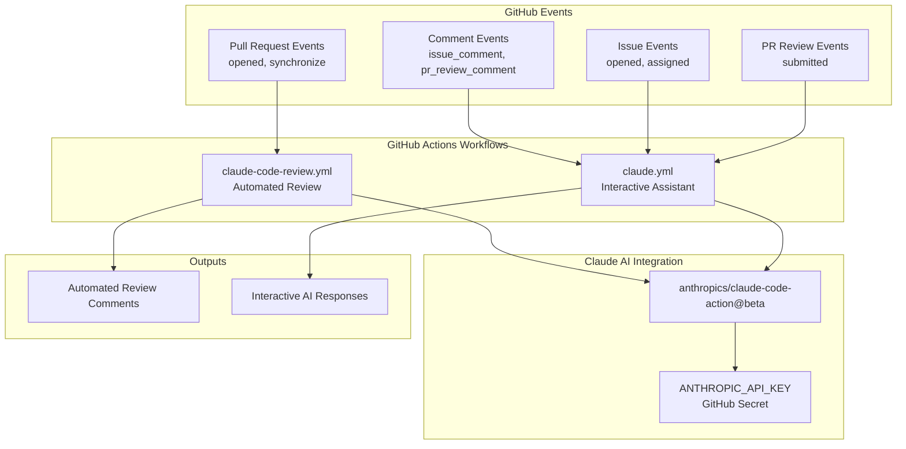
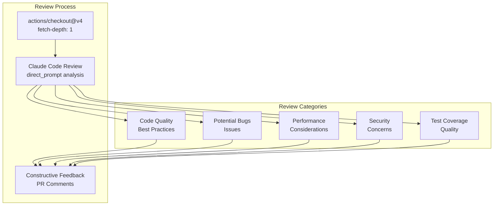
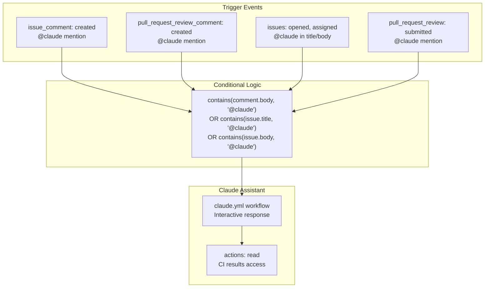
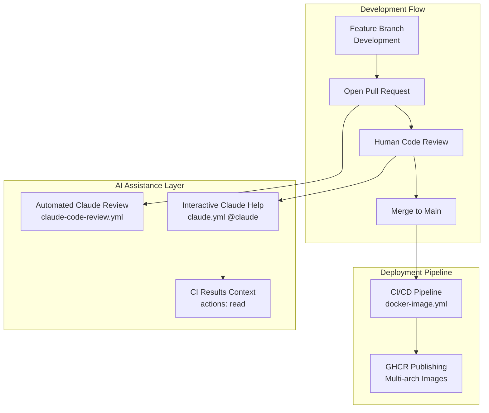

<!-- source: DeepWiki mcp.deepwiki.com · repo langchain-ai/local-deep-researcher · page 5.3 Development Workflows · fetched 2026-10-26 -->

# Development Workflows

Relevant source files

The following files were used as context for generating this wiki page:

- [.github/workflows/claude-code-review.yml](.github/workflows/claude-code-review.yml)
- [.github/workflows/claude.yml](.github/workflows/claude.yml)

This page covers the AI-assisted development workflows implemented through GitHub Actions in the Local Deep Researcher project. These workflows provide automated code review and interactive development assistance using Claude AI. For information about the main CI/CD deployment pipeline, see [CI/CD Pipeline](#5.2).

## Purpose and Scope

The development workflows enhance the development process through two main mechanisms:
- **Automated code review** that provides immediate feedback on pull requests
- **Interactive AI assistance** available on-demand through GitHub comments and issues

These workflows complement the core deployment automation by focusing on development-time assistance and code quality assurance.

## Workflow Architecture Overview

The development workflow system consists of two GitHub Actions workflows that integrate Claude AI into the development process:

**Sources:** [.github/workflows/claude-code-review.yml:1-79](), [.github/workflows/claude.yml:1-65]()

## Automated Code Review Workflow

The automated code review workflow provides immediate feedback on all pull requests without requiring manual intervention.

### Workflow Configuration

| Setting | Value | Purpose |
|---------|-------|---------|
| **Trigger** | `pull_request: [opened, synchronize]` | Runs on new PRs and updates |
| **Runner** | `ubuntu-latest` | Standard GitHub runner |
| **Action** | `anthropics/claude-code-action@beta` | Claude AI integration |
| **Permissions** | `contents: read, pull-requests: read, issues: read, id-token: write` | Required access levels |

### Review Focus Areas

The automated review analyzes code across multiple dimensions:

**Sources:** [.github/workflows/claude-code-review.yml:44-52]()

### Optional Configurations

The workflow includes several commented configuration options for customization:

- **File path filtering**: Restrict reviews to specific file patterns [.github/workflows/claude-code-review.yml:6-11]()
- **Author filtering**: Target specific contributors or first-time contributors [.github/workflows/claude-code-review.yml:15-19]()
- **Sticky comments**: Reuse the same comment thread across PR updates [.github/workflows/claude-code-review.yml:55]()
- **File-type specific prompts**: Customized review criteria by file extension [.github/workflows/claude-code-review.yml:57-63]()
- **Tool integration**: Allow Claude to run tests or linting commands [.github/workflows/claude-code-review.yml:72]()

## Interactive AI Assistant Workflow

The interactive workflow provides on-demand AI assistance through GitHub comments and issues.

### Trigger Mechanisms

**Sources:** [.github/workflows/claude.yml:4-19]()

### Enhanced Permissions

The interactive workflow includes additional permissions to provide comprehensive assistance:

| Permission | Purpose |
|------------|---------|
| `contents: read` | Access repository content |
| `pull-requests: read` | Read PR information |
| `issues: read` | Access issue details |
| `id-token: write` | Authentication |
| `actions: read` | Read CI results for context |

The `actions: read` permission enables Claude to understand the status of automated tests and builds when providing assistance on pull requests [.github/workflows/claude.yml:26]().

### Configuration Options

The interactive workflow provides extensive customization capabilities:

- **Model selection**: Optional upgrade to `claude-opus-4-20250514` [.github/workflows/claude.yml:44]()
- **Custom trigger phrase**: Alternative to `@claude` [.github/workflows/claude.yml:47]()
- **Assignee triggers**: Automatic activation when specific users are assigned [.github/workflows/claude.yml:50]()
- **Tool permissions**: Allow Claude to execute specific commands [.github/workflows/claude.yml:53]()
- **Custom instructions**: Project-specific behavior guidelines [.github/workflows/claude.yml:56-59]()
- **Environment variables**: Custom environment for Claude execution [.github/workflows/claude.yml:62-63]()

## Workflow Integration Patterns

Both workflows integrate seamlessly with the standard GitHub development process:

**Sources:** [.github/workflows/claude-code-review.yml:1-79](), [.github/workflows/claude.yml:1-65]()

## Security Considerations

Both workflows implement security best practices:

- **API key management**: The `ANTHROPIC_API_KEY` is stored as a GitHub secret and not exposed in workflow files
- **Minimal permissions**: Each workflow requests only the permissions required for its specific functionality
- **Repository access**: Limited to read-only access to repository content and metadata
- **No code execution**: The workflows do not execute arbitrary code from PRs by default

The optional `allowed_tools` configuration allows controlled command execution when explicitly configured [.github/workflows/claude.yml:53]().

## Usage Examples

### Requesting Interactive Help

Users can request AI assistance through several methods:

1. **Issue comments**: Comment `@claude help me debug this error` on any issue
2. **PR review comments**: Add `@claude what's the best practice here?` in code review
3. **Issue creation**: Include `@claude` in the issue title or description
4. **PR review submission**: Mention `@claude` in review feedback

### Automated Review Integration

The automated review workflow requires no user intervention but provides several integration points:

- Reviews appear as standard PR comments
- Feedback covers code quality, security, performance, and testing
- Optional sticky comments maintain conversation continuity
- Results integrate with existing PR review workflows

**Sources:** [.github/workflows/claude-code-review.yml:44-52](), [.github/workflows/claude.yml:15-19]()

---

