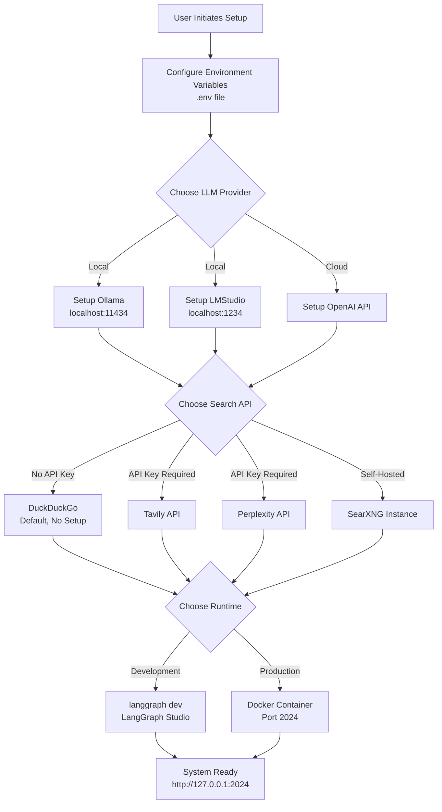
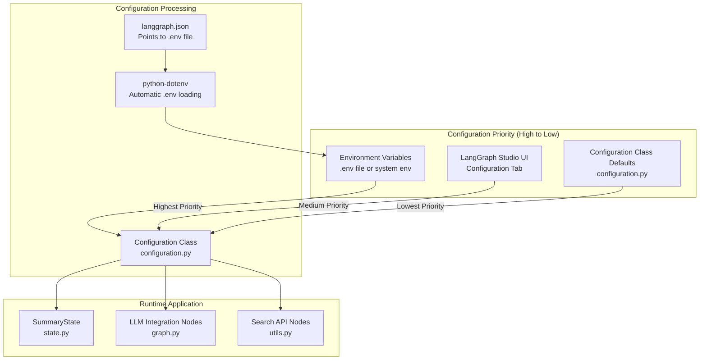
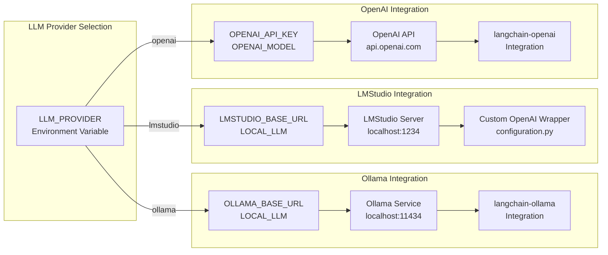
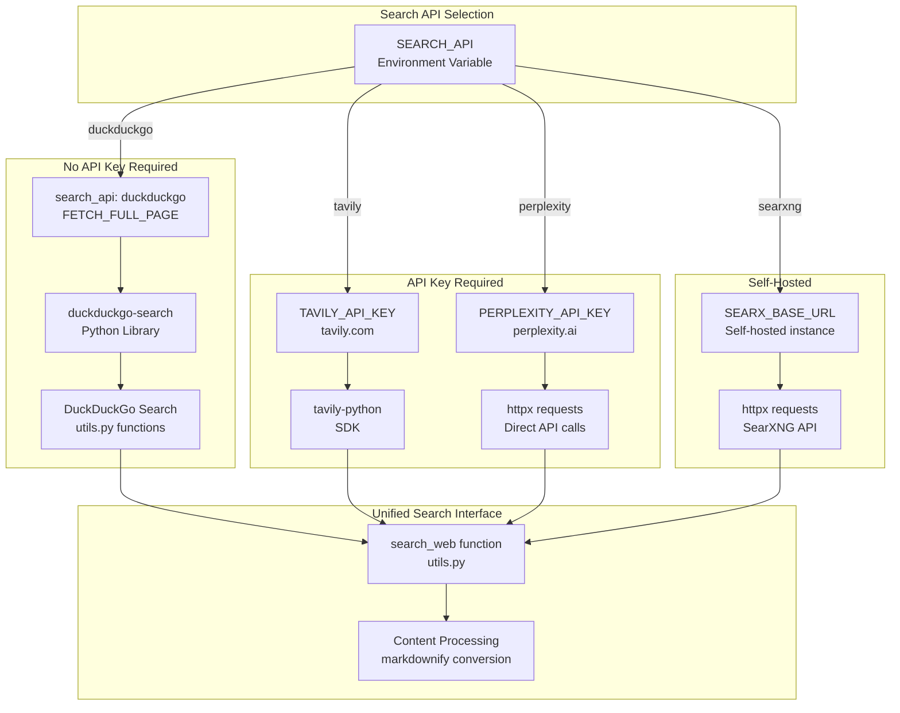
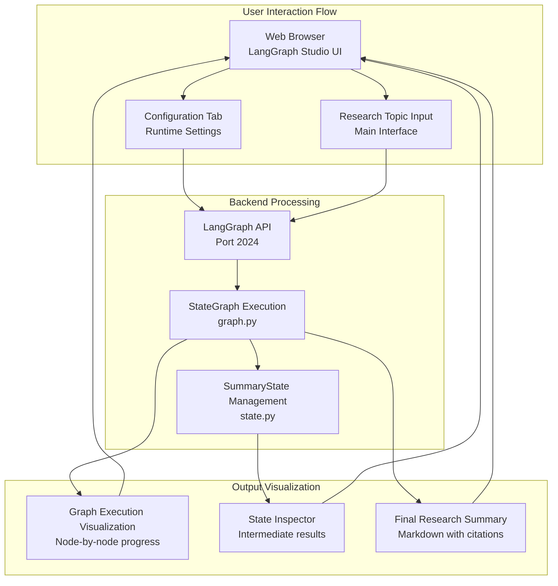

<!-- source: DeepWiki mcp.deepwiki.com · repo langchain-ai/local-deep-researcher · page 6 Usage Guide · fetched 2026-10-26 -->

# Usage Guide

<details>
<summary>Relevant source files</summary>

The following files were used as context for generating this wiki page:

- [README.md](README.md)

</details>


This document provides practical guidance for setting up and using the Local Deep Researcher system. It covers the essential setup steps, configuration options, and deployment methods needed to get the LLM-driven research assistant running in your environment.

For detailed step-by-step installation instructions, see [Quick Start](#6.1). For advanced configuration of specific components, see [Advanced Configuration](#6.2). For architectural details about how the system works internally, see [System Architecture](#2).

## Setup Overview

The Local Deep Researcher requires three main setup categories: LLM provider configuration, search API selection, and runtime environment setup. The system uses a hierarchical configuration approach where environment variables take precedence over UI settings, which take precedence over code defaults.



Sources: [README.md:22-221]()

## Configuration Hierarchy

The system implements a three-tier configuration priority system managed by the `Configuration` class. This hierarchy ensures predictable behavior across different deployment scenarios while maintaining flexibility.



Sources: [README.md:135-141](), [README.md:30-31]()

## LLM Provider Configuration

The system supports multiple LLM providers through a unified interface. The `LLM_PROVIDER` environment variable controls which provider to use, with provider-specific configuration handled through dedicated environment variables.

| Provider | Configuration Variables | Default Port | Notes |
|----------|------------------------|--------------|-------|
| `ollama` | `OLLAMA_BASE_URL`, `LOCAL_LLM` | 11434 | Requires Ollama service running |
| `lmstudio` | `LMSTUDIO_BASE_URL`, `LOCAL_LLM` | 1234 | Requires LMStudio server active |
| `openai` | `OPENAI_API_KEY`, `OPENAI_MODEL` | N/A | Cloud API, requires API key |



Sources: [README.md:35-70]()

## Search API Integration

The system provides a unified search interface that abstracts different search providers. Each provider has specific capabilities and requirements, with DuckDuckGo serving as the default option requiring no API keys.



Sources: [README.md:72-81]()

## Running the System

The primary method for running Local Deep Researcher is through LangGraph Studio, which provides both a development server and web-based user interface. The system also supports Docker deployment for production environments.

### LangGraph Studio Development

The `langgraph dev` command starts a local development server that hosts both the LangGraph API and serves the web UI. The system uses `uv` package manager for dependency management and supports both Unix and Windows environments.

```bash
# Install and run with uv (recommended)
uvx --refresh --from "langgraph-cli[inmem]" --with-editable . --python 3.11 langgraph dev

# Alternative installation method
pip install -e .
pip install -U "langgraph-cli[inmem]"
langgraph dev
```

### Docker Deployment

The included `Dockerfile` creates a containerized version of the system that runs LangGraph Studio as a service. The container exposes port 2024 and requires external LLM services to be configured via environment variables.

```bash
# Build container image
docker build -t local-deep-researcher .

# Run with environment configuration
docker run --rm -it -p 2024:2024 \
  -e SEARCH_API="tavily" \
  -e TAVILY_API_KEY="tvly-***" \
  -e LLM_PROVIDER=ollama \
  -e OLLAMA_BASE_URL="http://host.docker.internal:11434/" \
  -e LOCAL_LLM="llama3.2" \
  local-deep-researcher
```

Sources: [README.md:84-122](), [README.md:194-221]()

## System Access and Interface

Once running, the system provides multiple access points for interaction and monitoring. The LangGraph Studio UI serves as the primary interface for configuring parameters and visualizing the research process.

| Interface | URL | Purpose |
|-----------|-----|---------|
| LangGraph Studio UI | `https://smith.langchain.com/studio/?baseUrl=http://127.0.0.1:2024` | Main user interface |
| API Endpoint | `http://127.0.0.1:2024` | Direct API access |
| API Documentation | `http://127.0.0.1:2024/docs` | OpenAPI specification |

### Configuration Interface

The LangGraph Studio UI provides a configuration tab where runtime parameters can be adjusted without restarting the service. These settings have medium priority in the configuration hierarchy, below environment variables but above code defaults.



Sources: [README.md:124-148](), [README.md:174-183]()

## Troubleshooting Common Issues

### Model Compatibility

Some LLM models may have difficulty with structured JSON output requirements. The system includes fallback mechanisms for models that struggle with JSON mode formatting, particularly smaller or specialized models.

### Browser Compatibility

The LangGraph Studio UI works best with Firefox. Safari users may encounter security warnings due to mixed HTTPS/HTTP content. Alternative browsers or disabling ad-blocking extensions can resolve compatibility issues.

### Docker Networking

When running in Docker, the `OLLAMA_BASE_URL` must point to `host.docker.internal:11434` instead of `localhost:11434` to properly connect to Ollama running on the host system.

Sources: [README.md:149-162](), [README.md:194-221]()

---

