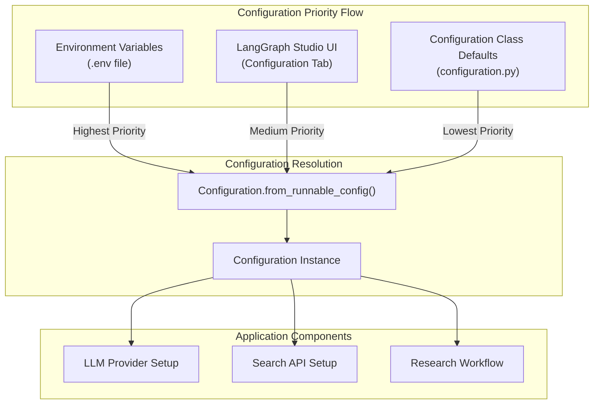
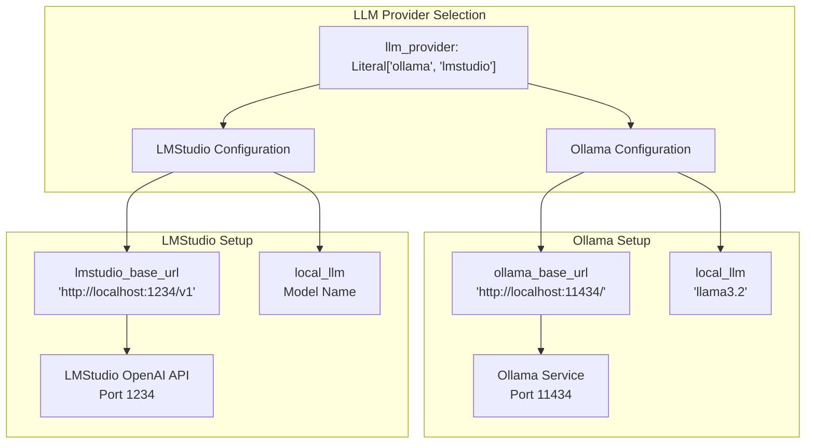
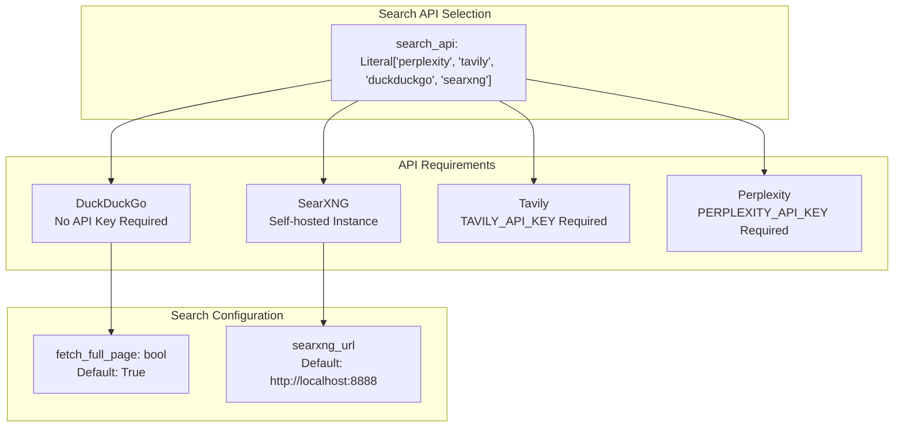
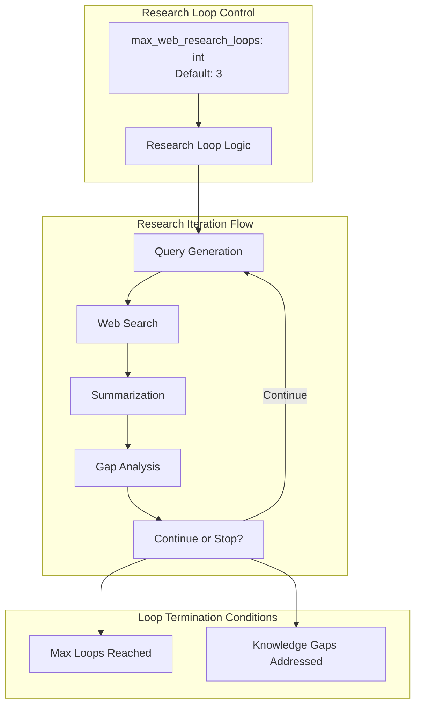
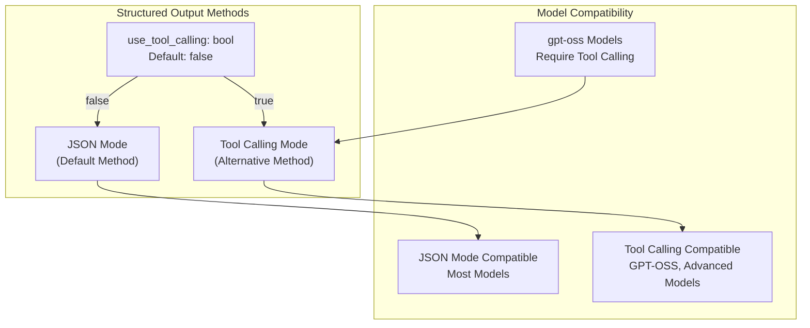
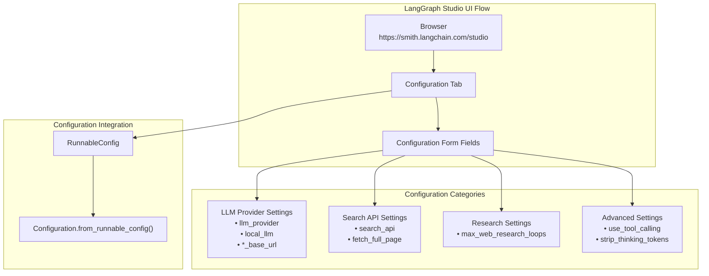

<!-- source: DeepWiki mcp.deepwiki.com · repo langchain-ai/local-deep-researcher · page 6.2 Advanced Configuration · fetched 2026-10-26 -->

# Advanced Configuration

<details>
<summary>Relevant source files</summary>

The following files were used as context for generating this wiki page:

- [.env.example](.env.example)
- [README.md](README.md)
- [src/ollama_deep_researcher/configuration.py](src/ollama_deep_researcher/configuration.py)

</details>


This page provides comprehensive guidance for customizing the Local Deep Researcher system beyond basic setup. It covers the three-tier configuration hierarchy, detailed parameter options for LLM providers and search APIs, research behavior tuning, and advanced feature toggles.

For basic setup instructions, see [Quick Start](#6.1). For deployment-specific configuration, see [Docker Deployment](#5.1).

## Configuration Architecture

The Local Deep Researcher implements a three-tier configuration system where values are resolved in priority order:



**Configuration Resolution Process**

Sources: [src/ollama_deep_researcher/configuration.py:63-81]()

The `Configuration.from_runnable_config()` method handles the resolution process:

| Priority | Source | Override Behavior |
|----------|--------|-------------------|
| 1 (Highest) | Environment Variables | Always takes precedence when set |
| 2 (Medium) | LangGraph Studio UI | Used when env var not present |
| 3 (Lowest) | Class Defaults | Fallback when neither above are set |

## LLM Provider Configuration

The system supports two local LLM providers with distinct configuration patterns:



Sources: [src/ollama_deep_researcher/configuration.py:24-51](), [.env.example:10-15]()

### Ollama Configuration

Set these environment variables for Ollama:

```bash
LLM_PROVIDER=ollama
OLLAMA_BASE_URL=http://localhost:11434
LOCAL_LLM=deepseek-r1:8b
```

The `ollama_base_url` field defaults to `http://localhost:11434/` and should point to your Ollama service endpoint. The `local_llm` field specifies the model name as it appears in your local Ollama installation.

### LMStudio Configuration

Set these environment variables for LMStudio:

```bash
LLM_PROVIDER=lmstudio
LMSTUDIO_BASE_URL=http://localhost:1234/v1
LOCAL_LLM=qwen_qwq-32b
```

The `lmstudio_base_url` field defaults to `http://localhost:1234/v1` and must include the `/v1` path for OpenAI compatibility. The `local_llm` field must match the exact model name displayed in LMStudio.

## Search API Configuration

The system provides a unified search interface supporting multiple search providers:



Sources: [src/ollama_deep_researcher/configuration.py:34-41](), [.env.example:1-8]()

### Search Provider Details

| Provider | API Key Required | Configuration |
|----------|------------------|---------------|
| `duckduckgo` | No | Set `FETCH_FULL_PAGE=true` for complete content |
| `searxng` | No | Requires `SEARXNG_URL` for self-hosted instance |
| `tavily` | Yes | Requires `TAVILY_API_KEY=tvly-xxxxx` |
| `perplexity` | Yes | Requires `PERPLEXITY_API_KEY=pplx-xxxxx` |

### Full Page Content Fetching

The `fetch_full_page` parameter controls content depth:
- `true`: Downloads complete page content for comprehensive analysis
- `false`: Uses search result snippets only for faster processing

This setting primarily affects DuckDuckGo searches and impacts both processing time and result quality.

## Research Behavior Settings

Configure the iterative research process parameters:



Sources: [src/ollama_deep_researcher/configuration.py:19-23](), [.env.example:16]()

### Research Depth Configuration

```bash
MAX_WEB_RESEARCH_LOOPS=5  # Increase for more thorough research
```

The `max_web_research_loops` parameter balances research thoroughness against execution time:
- Lower values (1-2): Fast, surface-level research
- Medium values (3-5): Balanced depth and speed
- Higher values (6+): Comprehensive research with longer execution time

## Advanced Options

### Structured Output Configuration

The system supports two approaches for structured LLM output:



Sources: [src/ollama_deep_researcher/configuration.py:57-61]()

Set `USE_TOOL_CALLING=true` when using models that don't support JSON mode, particularly GPT-OSS models in Ollama.

### Response Processing Options

```bash
STRIP_THINKING_TOKENS=true  # Remove <think> tokens from model responses
```

The `strip_thinking_tokens` parameter controls whether reasoning tokens are removed from final outputs. Enable this for cleaner responses from models that emit thinking tokens.

Sources: [src/ollama_deep_researcher/configuration.py:52-56]()

## LangGraph Studio Configuration Interface

LangGraph Studio provides a web-based configuration interface accessible at the Configuration tab:



Sources: [README.md:135-142](), [src/ollama_deep_researcher/configuration.py:64-81]()

The Studio interface allows real-time configuration changes without modifying environment files. Values set in the UI take precedence over class defaults but are overridden by environment variables.

### Configuration Field Mapping

| Studio Field | Environment Variable | Configuration Class Field |
|--------------|---------------------|---------------------------|
| LLM Provider | `LLM_PROVIDER` | `llm_provider` |
| LLM Model Name | `LOCAL_LLM` | `local_llm` |
| Search API | `SEARCH_API` | `search_api` |
| Research Depth | `MAX_WEB_RESEARCH_LOOPS` | `max_web_research_loops` |
| Fetch Full Page | `FETCH_FULL_PAGE` | `fetch_full_page` |

The Studio UI dynamically generates form fields based on the `Configuration` class field definitions, including titles and descriptions from the Pydantic field metadata.

---

