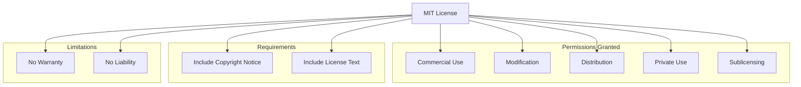
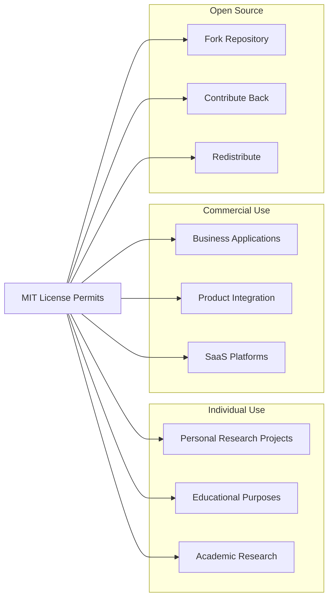

<!-- source: DeepWiki mcp.deepwiki.com · repo langchain-ai/local-deep-researcher · page 7 License · fetched 2026-10-26 -->

# License

<details>
<summary>Relevant source files</summary>

The following files were used as context for generating this wiki page:

- [LICENSE](LICENSE)

</details>


This document covers the licensing terms and usage rights for the Local Deep Researcher project. It details the MIT License under which the software is distributed and explains the permissions, limitations, and obligations for users and contributors.

## License Overview

The Local Deep Researcher project is released under the MIT License, one of the most permissive open-source licenses available. This license provides broad permissions for use, modification, and distribution while requiring minimal obligations from users.

### License Permissions and Requirements



Sources: [LICENSE:1-23]()

### Usage Scenarios



Sources: [LICENSE:1-23]()

## Full License Text

The complete MIT License text as it appears in the repository:

```
MIT License

Copyright (c) 2025 Lance Martin

Permission is hereby granted, free of charge, to any person obtaining a copy
of this software and associated documentation files (the "Software"), to deal
in the Software without restriction, including without limitation the rights
to use, copy, modify, merge, publish, distribute, sublicense, and/or sell
copies of the Software, and to permit persons to whom the Software is
furnished to do so, subject to the following conditions:

The above copyright notice and this permission notice shall be included in all
copies or substantial portions of the Software.

THE SOFTWARE IS PROVIDED "AS IS", WITHOUT WARRANTY OF ANY KIND, EXPRESS OR
IMPLIED, INCLUDING BUT NOT LIMITED TO THE WARRANTIES OF MERCHANTABILITY,
FITNESS FOR A PARTICULAR PURPOSE AND NONINFRINGEMENT. IN NO EVENT SHALL THE
AUTHORS OR COPYRIGHT HOLDERS BE LIABLE FOR ANY CLAIM, DAMAGES OR OTHER
LIABILITY, WHETHER IN AN ACTION OF CONTRACT, TORT OR OTHERWISE, ARISING FROM,
OUT OF OR IN CONNECTION WITH THE SOFTWARE OR THE USE OR OTHER DEALINGS IN THE
SOFTWARE.
```

Sources: [LICENSE:1-23]()

## Rights and Obligations

### What You Can Do

| Permission | Description | Commercial Use |
|------------|-------------|----------------|
| **Use** | Run the software for any purpose | ✅ Yes |
| **Modify** | Change the source code | ✅ Yes |
| **Distribute** | Share copies of the software | ✅ Yes |
| **Sublicense** | Grant rights to others | ✅ Yes |
| **Sell** | Distribute for profit | ✅ Yes |

### What You Must Do

| Requirement | Description | When Required |
|-------------|-------------|---------------|
| **Include Copyright** | Retain copyright notice | All distributions |
| **Include License** | Include full license text | All distributions |

### What the License Does Not Provide

| Limitation | Description |
|------------|-------------|
| **No Warranty** | Software provided "as is" without guarantees |
| **No Liability** | Authors not responsible for damages or issues |
| **No Support** | No obligation to provide maintenance or support |

Sources: [LICENSE:5-21]()

## Copyright Information

- **Copyright Holder**: Lance Martin
- **Copyright Year**: 2025
- **License File Location**: [LICENSE:1-23]()

The copyright notice and license text must be preserved in all copies or substantial portions of the software when redistributing or modifying the Local Deep Researcher project.

Sources: [LICENSE:3]()