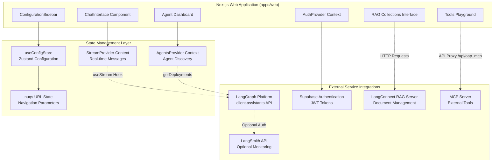
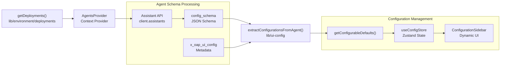
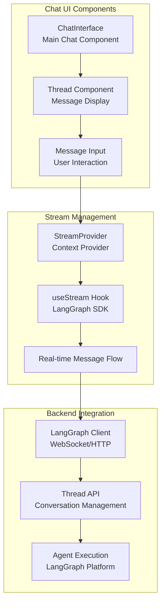
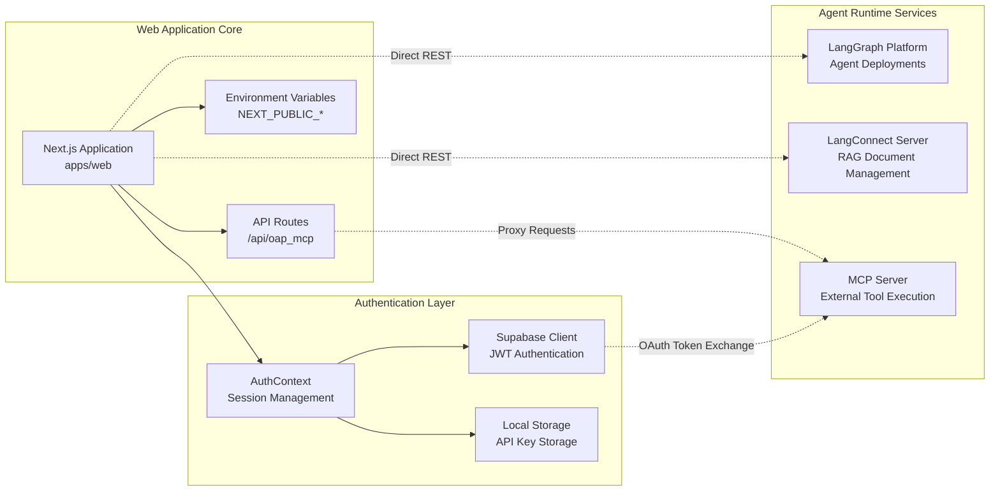
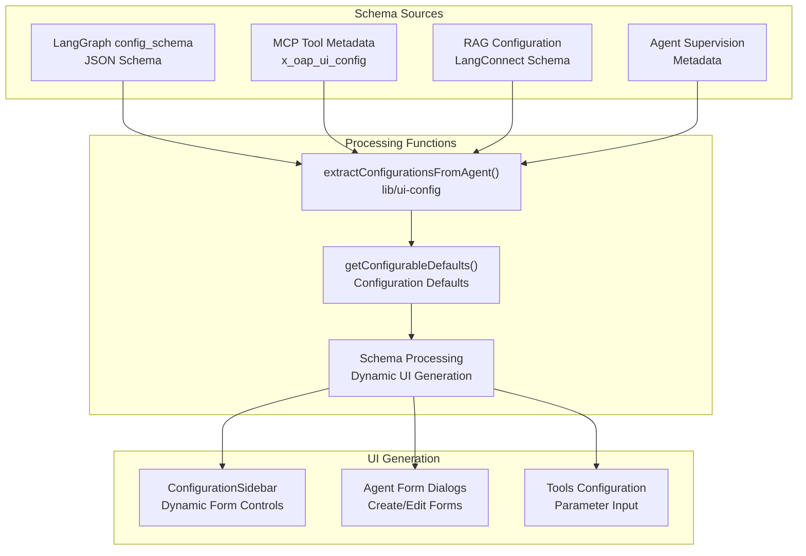

<!-- source: DeepWiki mcp.deepwiki.com · repo langchain-ai/open-agent-platform · page 1 Overview · fetched 2026-10-26 -->

# Overview

Relevant source files

The following files were used as context for generating this wiki page:

- [.yarnrc.yml](.yarnrc.yml)
- [README.md](README.md)
- [apps/web/scripts/update-agents-mcp-url.ts](apps/web/scripts/update-agents-mcp-url.ts)
- [package.json](package.json)

This document provides a comprehensive overview of the Open Agent Platform repository, its architecture, core systems, and how they integrate to provide a web-based platform for building and managing AI agents. The platform serves as a frontend orchestrator for multiple backend services, enabling users to create, configure, and interact with LangGraph agents through an intuitive interface.

For specific implementation details about individual subsystems, see [Core Platform Architecture](#2), [Agent Management](#3), [Chat Interface](#4), [RAG](#5), [Tools System](#6), and [UI Components](#8).

## Platform Purpose and Architecture

The Open Agent Platform is a no-code agent building platform that provides a modern, web-based interface for creating, managing, and interacting with LangGraph agents. The system is designed as a Next.js monorepo that orchestrates multiple external services rather than functioning as a standalone backend server.

### High-Level System Architecture

Sources: [README.md:1-68](), [package.json:1-24]()

## Core System Components

The platform consists of several interconnected systems that work together to provide a comprehensive agent management experience:

### Agent Management System

The agent management system handles the complete lifecycle of LangGraph agents, from discovery to configuration and deployment. The system uses the `getDeployments` function to discover available agents from LangGraph Platform deployments and presents them through the `AgentsProvider` context.

Sources: [apps/web/scripts/update-agents-mcp-url.ts:1-96]()

### Chat and Streaming System

The chat system provides real-time interaction with agents through WebSocket streaming. The `StreamProvider` context manages message flow and agent communication using the LangGraph SDK's `useStream` hook.

Sources: [README.md:13-18]()

## External Service Integration Architecture

The platform integrates with multiple external services to provide comprehensive agent capabilities:

### Service Integration Pattern

Sources: [README.md:46-50](), [apps/web/scripts/update-agents-mcp-url.ts:12-18]()

## Configuration and Schema System

The platform uses a sophisticated schema-driven configuration system that dynamically generates UI components based on agent metadata. This system processes LangGraph agent schemas and renders appropriate form controls.

### Schema Processing Pipeline

Sources: [apps/web/scripts/update-agents-mcp-url.ts:54-89](), [README.md:63-67]()

## Development Architecture

The codebase is structured as a Turbo monorepo with TypeScript support and modern development tooling. The build system uses Yarn 3 with workspaces for managing dependencies across multiple applications.

### Repository Structure

| Component | Location | Purpose |
|-----------|----------|---------|
| Web Application | `apps/web` | Main Next.js application |
| Package Management | `package.json` | Turbo monorepo configuration |
| Development Scripts | `apps/web/scripts/` | Utility scripts for agent management |
| Configuration | `.yarnrc.yml` | Yarn workspace configuration |

The platform is designed to be deployment-flexible, working without a standalone backend server as long as LangGraph Platform deployments are configured. Optional services like RAG (LangConnect) and MCP servers can be added as needed.

Sources: [package.json:1-24](), [.yarnrc.yml:1-3](), [README.md:45-48]()

---

