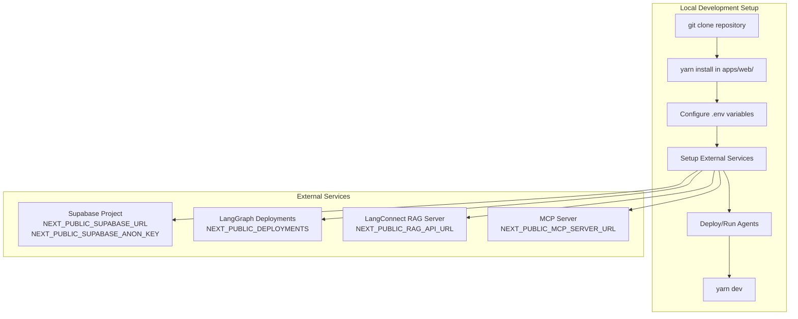
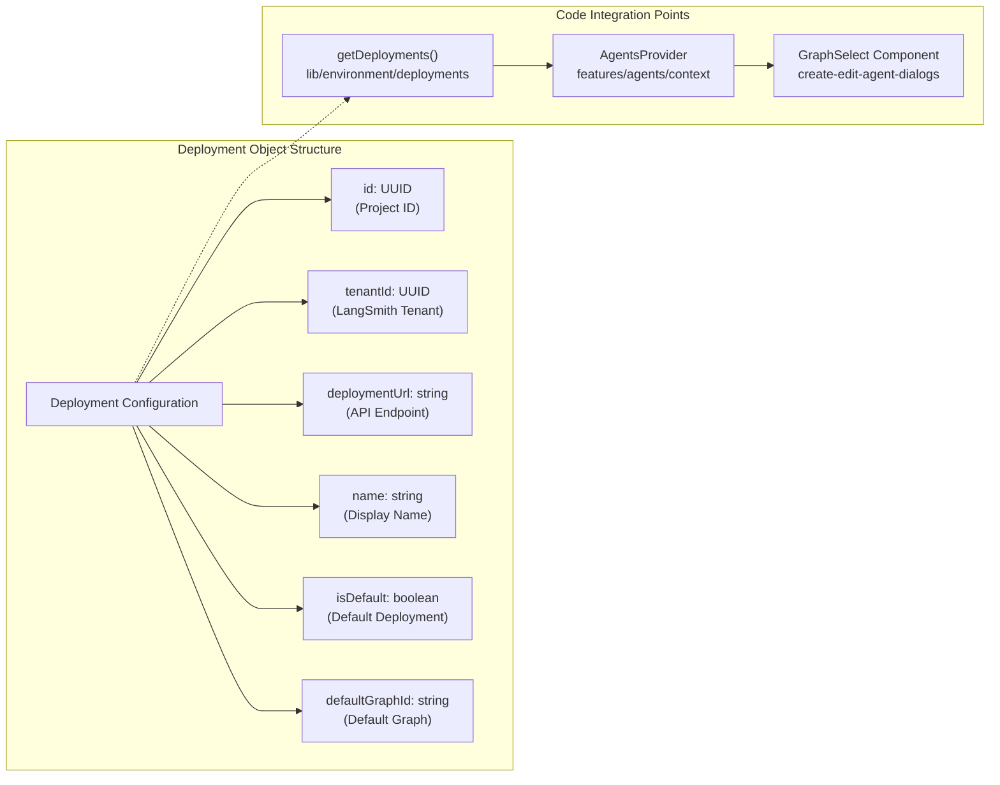
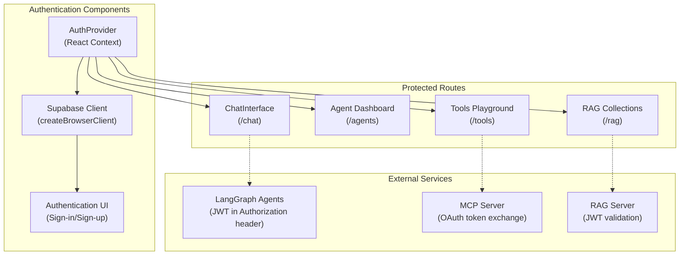
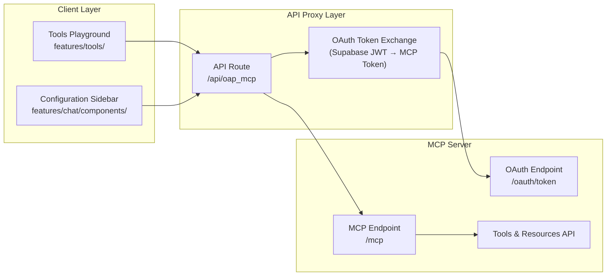
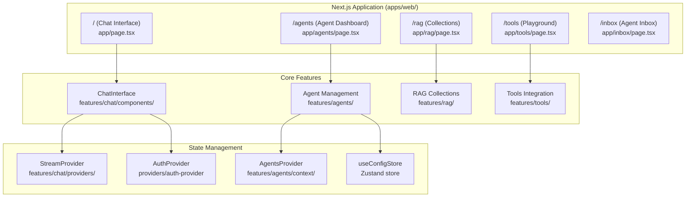

<!-- source: DeepWiki mcp.deepwiki.com · repo langchain-ai/open-agent-platform · page 1.1 Getting Started · fetched 2026-10-26 -->

# Getting Started

<details>
<summary>Relevant source files</summary>

The following files were used as context for generating this wiki page:

- [apps/docs/custom-agents/overview.mdx](apps/docs/custom-agents/overview.mdx)
- [apps/docs/index.mdx](apps/docs/index.mdx)
- [apps/docs/quickstart.mdx](apps/docs/quickstart.mdx)
- [apps/docs/setup/agents.mdx](apps/docs/setup/agents.mdx)
- [apps/docs/setup/authentication.mdx](apps/docs/setup/authentication.mdx)
- [apps/docs/setup/mcp-server.mdx](apps/docs/setup/mcp-server.mdx)
- [apps/docs/setup/rag-server.mdx](apps/docs/setup/rag-server.mdx)
- [apps/web/.env.example](apps/web/.env.example)
- [apps/web/src/features/agents/components/agent-card.tsx](apps/web/src/features/agents/components/agent-card.tsx)
- [apps/web/src/features/agents/components/create-edit-agent-dialogs/graph-select.tsx](apps/web/src/features/agents/components/create-edit-agent-dialogs/graph-select.tsx)
- [apps/web/src/features/agents/components/templates-list/agent-list.tsx](apps/web/src/features/agents/components/templates-list/agent-list.tsx)

</details>


This document provides a comprehensive guide for setting up and configuring your Open Agent Platform instance. It covers all required dependencies, environment configuration, agent deployment setup, and external service integration needed to get the platform running locally or in a production environment.

For information about the overall platform architecture, see [Core Platform Architecture](#2). For details about building custom agents, see [Custom Agents Overview](#9).

## Prerequisites and Dependencies

Before setting up the Open Agent Platform, ensure you have the following accounts and services ready:

| Service | Purpose | Required |
|---------|---------|----------|
| [LangSmith Account](https://smith.langchain.com/) | Agent monitoring and API management | Yes |
| [Supabase Account](https://supabase.com/) | Authentication and user management | Yes |
| MCP Server (e.g., [Arcade](https://arcade-ai.com/)) | External tool integration | Optional |
| LLM API Key | Model access (OpenAI, Anthropic, Google) | Yes |

The platform requires Node.js and Yarn for local development. Clone the repository from https://github.com/langchain-ai/open-agent-platform.

**Setup Flow Overview**



Sources: [apps/docs/quickstart.mdx:1-131](), [apps/web/.env.example:1-30]()

## Environment Configuration

The platform uses environment variables defined in `apps/web/.env.example` for configuration. Create a `.env.local` file in the `apps/web/` directory with the following structure:

**Core Configuration Variables**

| Variable | Purpose | Example |
|----------|---------|---------|
| `NEXT_PUBLIC_BASE_API_URL` | Platform API base URL | `http://localhost:3000/api` |
| `LANGSMITH_API_KEY` | LangSmith authentication | `lsv2_...` |
| `NEXT_PUBLIC_USE_LANGSMITH_AUTH` | Use LangSmith vs Supabase auth | `false` |

**Authentication Configuration**

```bash
# Supabase Authentication
NEXT_PUBLIC_SUPABASE_URL="https://your-project.supabase.co"
NEXT_PUBLIC_SUPABASE_ANON_KEY="eyJ..."
NEXT_PUBLIC_GOOGLE_AUTH_DISABLED="false"
```

**Service Integration Configuration**

```bash
# Agent Deployments (JSON array)
NEXT_PUBLIC_DEPLOYMENTS='[{"id":"uuid","deploymentUrl":"http://localhost:2024",...}]'

# RAG Server
NEXT_PUBLIC_RAG_API_URL="http://localhost:8080"

# MCP Server
NEXT_PUBLIC_MCP_SERVER_URL="https://api.example.com/v1/mcps/server"
NEXT_PUBLIC_MCP_AUTH_REQUIRED="true"
```

Sources: [apps/web/.env.example:1-30](), [apps/docs/quickstart.mdx:24-32]()

## Agent Deployment Configuration

The platform connects to LangGraph agents through the `NEXT_PUBLIC_DEPLOYMENTS` environment variable. This JSON array defines available agent deployments and their configuration.

**Pre-built Agent Repositories**

The platform provides three pre-built agents optimized for Open Agent Platform integration:

- [Tools Agent](https://github.com/langchain-ai/oap-langgraph-tools-agent) - MCP tool integration
- [Supervisor Agent](https://github.com/langchain-ai/oap-agent-supervisor) - Multi-agent orchestration  
- [Deep Research Agent](https://github.com/langchain-ai/oap-deep-researcher) - Research workflows

**Deployment Configuration Schema**



**Example Deployment Configuration**

```json
[
  {
    "id": "bf63dc89-1de7-4a65-8336-af9ecda479d6",
    "tenantId": "42d732b3-1324-4226-9fe9-513044dceb58",
    "deploymentUrl": "http://localhost:2024",
    "name": "Local Development",
    "isDefault": true,
    "defaultGraphId": "agent"
  }
]
```

For local development using `langgraph dev`, both `id` and `tenantId` should be valid UUID v4 values. Each graph requires a unique `id`, while all graphs in the same environment share the same `tenantId`.

Sources: [apps/docs/quickstart.mdx:53-77](), [apps/docs/setup/agents.mdx:36-65](), [apps/web/src/features/agents/components/create-edit-agent-dialogs/graph-select.tsx:19-46]()

## Authentication Setup

The platform uses Supabase for user authentication by default, with support for both email/password and Google OAuth authentication.

**Supabase Configuration Steps**

1. Create a new Supabase project at https://supabase.com/
2. Navigate to Settings > API to find your project URL and anonymous key
3. Configure the environment variables:

```bash
NEXT_PUBLIC_SUPABASE_URL="https://your-project-id.supabase.co"  
NEXT_PUBLIC_SUPABASE_ANON_KEY="eyJhbGciOiJIUzI1NiIsInR5cCI6IkpXVCJ9..."
```

4. Enable Google authentication in Supabase Dashboard > Authentication > Providers
5. Optionally disable Google auth in UI: `NEXT_PUBLIC_GOOGLE_AUTH_DISABLED="true"`

**Authentication Flow Integration**



The authentication system passes Supabase JWT tokens to external services for user-scoped access control. LangGraph agents receive the token via the `Authorization` header, while MCP servers use an OAuth token exchange flow.

Sources: [apps/docs/setup/authentication.mdx:8-17](), [apps/docs/quickstart.mdx:15-33](), [apps/docs/setup/authentication.mdx:20-26]()

## External Service Integration

### RAG Server Setup (LangConnect)

The platform integrates with LangConnect for Retrieval Augmented Generation capabilities:

1. Deploy LangConnect following the [repository instructions](https://github.com/langchain-ai/langconnect)
2. Configure the RAG server URL:

```bash
NEXT_PUBLIC_RAG_API_URL="http://localhost:8080"
```

### MCP Server Setup

MCP (Model Context Protocol) servers extend agent capabilities with external tools:

**For Unauthenticated MCP Servers:**
```bash
NEXT_PUBLIC_MCP_SERVER_URL="https://api.example.com/v1/mcps/server"
# Do not include /mcp suffix - it's automatically appended
```

**For Authenticated MCP Servers:**
```bash
NEXT_PUBLIC_MCP_SERVER_URL="https://api.example.com/v1/mcps/server" 
NEXT_PUBLIC_MCP_AUTH_REQUIRED="true"
```

**MCP Integration Architecture**



When `NEXT_PUBLIC_MCP_AUTH_REQUIRED="true"`, requests flow through `/api/oap_mcp` proxy route for authentication. The proxy exchanges Supabase JWT tokens for MCP access tokens, then forwards requests with proper authorization headers.

Sources: [apps/docs/setup/mcp-server.mdx:8-22](), [apps/docs/setup/mcp-server.mdx:24-31](), [apps/docs/setup/rag-server.mdx:12-19]()

## Running the Platform

Once all configuration is complete, start the development server:

```bash
# Navigate to web application directory
cd apps/web

# Install dependencies  
yarn install

# Start development server
yarn dev
```

The platform will be available at http://localhost:3000.

**Verification Steps**

1. **Authentication**: Visit the homepage and verify Supabase authentication works
2. **Agent Connection**: Check that configured agents appear in the Agent Dashboard at `/agents`
3. **Chat Interface**: Test agent communication through the chat interface at `/`
4. **RAG Integration**: If configured, verify document upload works at `/rag`
5. **Tools Integration**: If MCP server is configured, test tools at `/tools`

**Platform Component Structure**



This structure shows how the main application routes connect to feature components and state management systems.

Sources: [apps/docs/quickstart.mdx:115-131](), [apps/web/src/features/agents/components/agent-card.tsx:144-152](), [apps/web/src/features/agents/components/templates-list/agent-list.tsx:32-51]()

## Next Steps

After successfully running the platform:

1. **Create Your First Agent**: Use the Agent Dashboard to create a new agent or interact with pre-configured ones
2. **Upload RAG Documents**: If RAG is configured, create collections and upload documents at `/rag` 
3. **Explore Tools**: Test available MCP tools through the Tools Playground at `/tools`
4. **Configure API Keys**: Set up model API keys through the settings interface for full functionality
5. **Build Custom Agents**: Follow the custom agent development guide to create specialized agents

For detailed information about agent configuration and management, see [Agent Management](#3). For chat interface usage, see [Chat Interface](#4).

Sources: [apps/docs/quickstart.mdx:1-131](), [apps/docs/setup/agents.mdx:21-33]()

---

