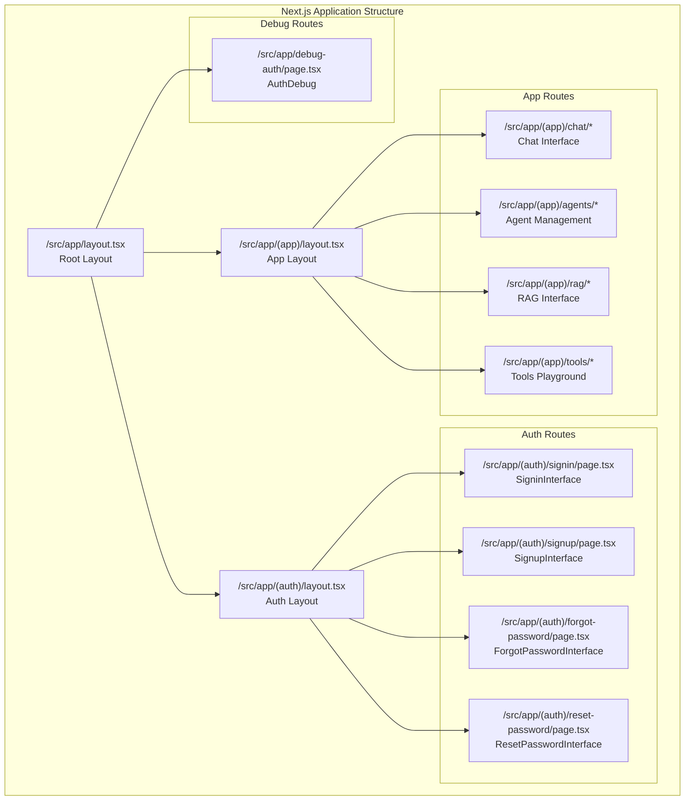
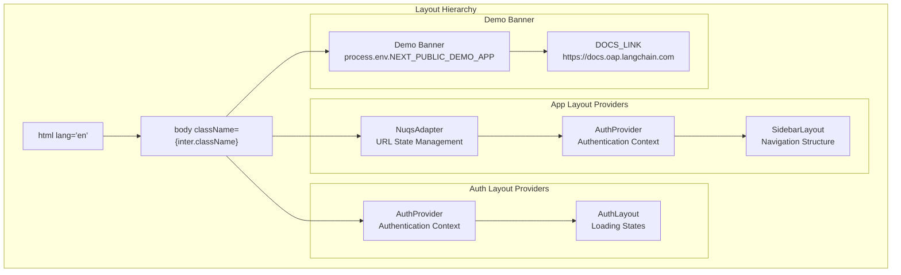
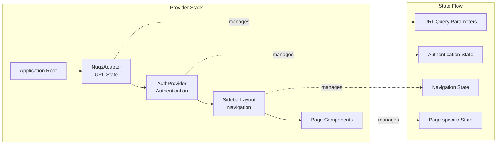
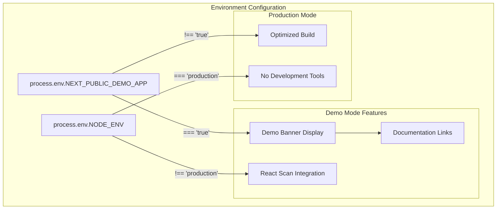
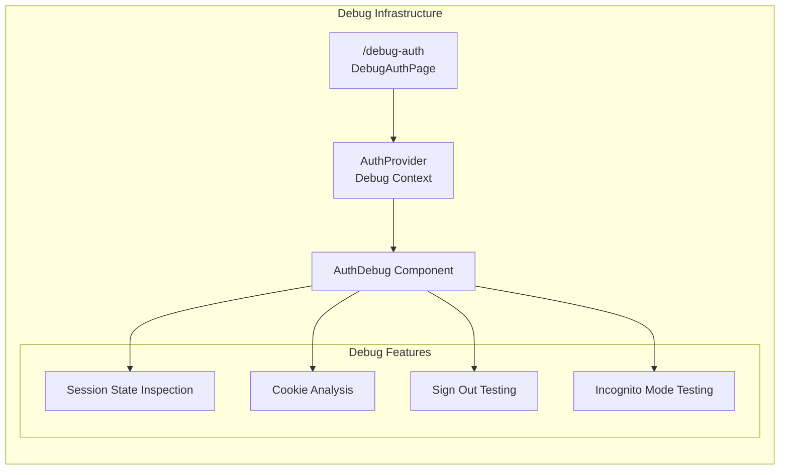

<!-- source: DeepWiki mcp.deepwiki.com · repo langchain-ai/open-agent-platform · page 2 Core Platform Architecture · fetched 2026-10-26 -->

# Core Platform Architecture

<details>
<summary>Relevant source files</summary>

The following files were used as context for generating this wiki page:

- [apps/web/src/app/(app)/layout.tsx](apps/web/src/app/(app)/layout.tsx)
- [apps/web/src/app/(auth)/auth-layout.tsx](apps/web/src/app/(auth)/auth-layout.tsx)
- [apps/web/src/app/(auth)/forgot-password/page.tsx](apps/web/src/app/(auth)/forgot-password/page.tsx)
- [apps/web/src/app/(auth)/layout.tsx](apps/web/src/app/(auth)/layout.tsx)
- [apps/web/src/app/(auth)/reset-password/page.tsx](apps/web/src/app/(auth)/reset-password/page.tsx)
- [apps/web/src/app/(auth)/signin/page.tsx](apps/web/src/app/(auth)/signin/page.tsx)
- [apps/web/src/app/(auth)/signup/page.tsx](apps/web/src/app/(auth)/signup/page.tsx)
- [apps/web/src/app/debug-auth/page.tsx](apps/web/src/app/debug-auth/page.tsx)
- [apps/web/src/app/layout.tsx](apps/web/src/app/layout.tsx)
- [apps/web/src/components/ui/resizable.tsx](apps/web/src/components/ui/resizable.tsx)
- [apps/web/src/constants.ts](apps/web/src/constants.ts)

</details>


This document explains the fundamental architectural patterns and systems that power the Open Agent Platform. It covers the overall application structure, layout hierarchy, provider system, state management patterns, and integration points with external services.

For detailed information about specific subsystems, see [Authentication System](#2.1), [Agent Configuration System](#2.2), and [MCP Integration System](#2.3).

## Application Structure Overview

The Open Agent Platform is built as a Next.js application using the App Router pattern. The core architecture follows a layered approach with clear separation between layout concerns, authentication, and business logic.



**Sources:** [apps/web/src/app/layout.tsx:1-30](), [apps/web/src/app/(app)/layout.tsx:1-61](), [apps/web/src/app/(auth)/layout.tsx:1-50]()

## Layout Hierarchy and Provider Composition

The platform uses a nested layout system where each level adds specific functionality through React providers and layout components.



**Sources:** [apps/web/src/app/(app)/layout.tsx:26-60](), [apps/web/src/app/(auth)/layout.tsx:25-49](), [apps/web/src/constants.ts:1-4]()

## Provider Architecture Pattern

The platform extensively uses React Context providers to manage application-wide state and functionality. Each provider serves a specific architectural concern.

| Provider | Purpose | Location | Key Features |
|----------|---------|----------|--------------|
| `AuthProvider` | Authentication state management | `@/providers/Auth` | Session management, user context |
| `NuqsAdapter` | URL state synchronization | `nuqs/adapters/next/app` | Query parameter state management |
| `SidebarLayout` | Navigation and layout structure | `@/components/sidebar` | Responsive sidebar, navigation state |



**Sources:** [apps/web/src/app/(app)/layout.tsx:52-56](), [apps/web/src/app/(auth)/layout.tsx:43-45]()

## Environment Configuration and Deployment Modes

The platform supports different deployment modes through environment variables, with special handling for demo applications.



The demo mode implementation includes:
- Top banner notification with documentation links
- Development tool integration (React Scan)
- Special styling and messaging for demo users

**Sources:** [apps/web/src/app/(app)/layout.tsx:26-51](), [apps/web/src/app/(auth)/layout.tsx:25-42](), [apps/web/src/constants.ts:2]()

## Font and Asset Optimization

The platform uses Next.js font optimization with the Inter font family configured for optimal loading performance.

```typescript
const inter = Inter({
  subsets: ["latin"],
  preload: true,
  display: "swap",
});
```

This configuration is applied consistently across all layout levels to ensure typography consistency and performance optimization.

**Sources:** [apps/web/src/app/layout.tsx:6-10](), [apps/web/src/app/(app)/layout.tsx:10-14](), [apps/web/src/app/(auth)/layout.tsx:9-13]()

## Development and Debug Infrastructure

The platform includes specialized debug routes and development-time tooling for troubleshooting authentication and system state.



The debug page provides testing tips and tools for developers working with the authentication system, including inspection of Supabase cookies (prefixed with `sb-`) and session management utilities.

**Sources:** [apps/web/src/app/debug-auth/page.tsx:6-33]()

## Metadata and SEO Configuration

The platform uses consistent metadata configuration across all layout levels for proper SEO and social media integration.

| Layout Level | Title | Description |
|--------------|-------|-------------|
| Root | "Open Agent Platform" | "Open Agent Platform by LangChain" |
| App | "Open Agent Platform" | "Open Agent Platform by LangChain" |
| Auth | "Open Agent Platform - Auth" | "Open Agent Platform by LangChain" |

**Sources:** [apps/web/src/app/layout.tsx:12-15](), [apps/web/src/app/(app)/layout.tsx:16-19](), [apps/web/src/app/(auth)/layout.tsx:15-18]()

---

