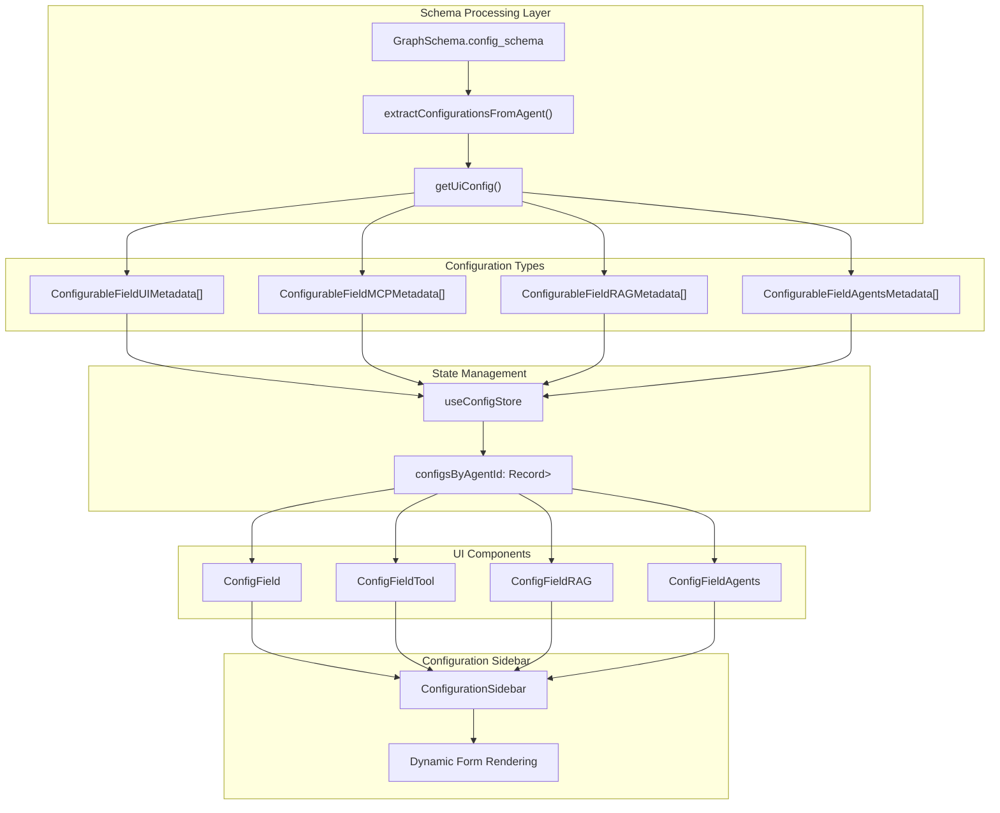
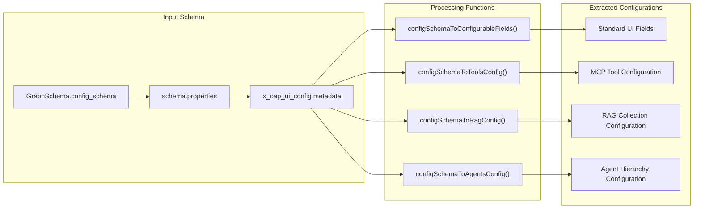
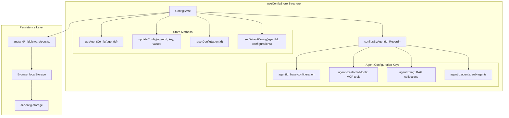
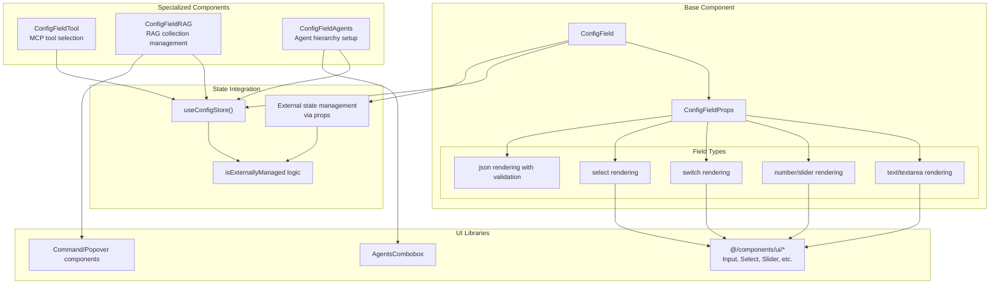
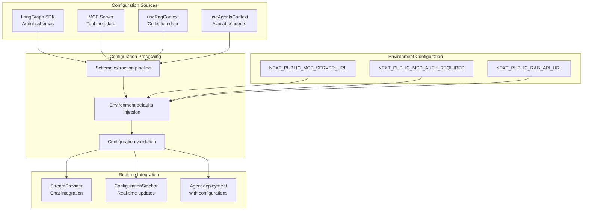
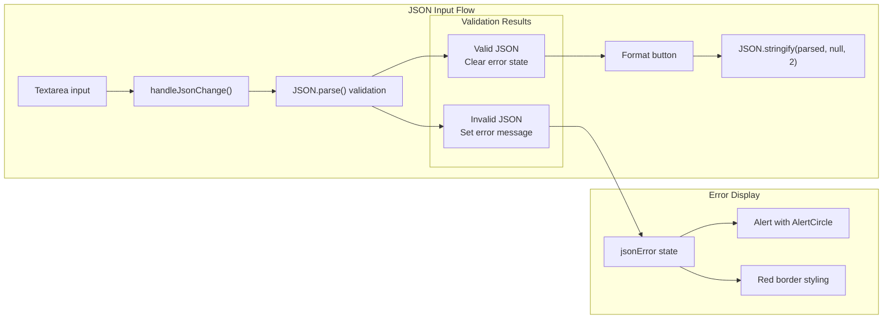

<!-- source: DeepWiki mcp.deepwiki.com · repo langchain-ai/open-agent-platform · page 2.2 Agent Configuration System · fetched 2026-10-26 -->

# Agent Configuration System

Relevant source files

The following files were used as context for generating this wiki page:

- [apps/web/eslint.config.js](apps/web/eslint.config.js)
- [apps/web/src/components/agent-inbox/utils/logger.ts](apps/web/src/components/agent-inbox/utils/logger.ts)
- [apps/web/src/components/ui/sidebar.tsx](apps/web/src/components/ui/sidebar.tsx)
- [apps/web/src/features/chat/components/configuration-sidebar/config-field.tsx](apps/web/src/features/chat/components/configuration-sidebar/config-field.tsx)
- [apps/web/src/features/chat/components/thread/messages/tool-calls.tsx](apps/web/src/features/chat/components/thread/messages/tool-calls.tsx)
- [apps/web/src/features/chat/hooks/use-config-store.tsx](apps/web/src/features/chat/hooks/use-config-store.tsx)
- [apps/web/src/lib/ui-config.ts](apps/web/src/lib/ui-config.ts)
- [apps/web/src/types/configurable.ts](apps/web/src/types/configurable.ts)

## Purpose and Scope

The Agent Configuration System provides dynamic UI generation and state management for agent parameters based on LangGraph schemas. This system automatically processes agent configuration metadata and renders appropriate form controls, enabling real-time configuration of AI agents without manual UI development.

This document covers the schema processing pipeline, configuration field types, state management, and UI components. For information about the chat interface that uses these configurations, see [Chat Interface](#4). For agent deployment and management workflows, see [Agent Management](#3).

## System Architecture

The Agent Configuration System operates through a schema-driven pipeline that transforms LangGraph configuration schemas into interactive UI components:

Sources: [apps/web/src/lib/ui-config.ts:179-260](), [apps/web/src/features/chat/hooks/use-config-store.tsx:28-102](), [apps/web/src/features/chat/components/configuration-sidebar/config-field.tsx:75-332]()

## Schema Processing Pipeline

The system processes LangGraph configuration schemas through a series of extraction functions that identify and categorize different configuration field types:

### Schema Extraction Process

The `getUiConfig` function examines each schema property for the `x_oap_ui_config` metadata field, which contains type information and UI rendering hints. Properties without this metadata default to text input fields.

Sources: [apps/web/src/lib/ui-config.ts:10-41](), [apps/web/src/lib/ui-config.ts:57-87](), [apps/web/src/lib/ui-config.ts:89-122]()

### Configuration Field Types

The system supports multiple configuration field types, each mapped to specific UI components:

| Field Type | UI Component | Use Case | Metadata Requirements |
|------------|--------------|----------|----------------------|
| `text` | `Input` | String values, API keys | Optional placeholder |
| `textarea` | `Textarea` | Multi-line text, prompts | Optional placeholder |
| `number` | `Input[type="number"]` | Numeric parameters | Optional min/max/step |
| `switch` | `Switch` | Boolean toggles | None |
| `slider` | `Slider` | Ranged numeric values | Required min/max, optional step |
| `select` | `Select` | Dropdown choices | Required options array |
| `json` | `Textarea` with validation | Complex object configuration | JSON parsing/formatting |
| `mcp` | `ConfigFieldTool` | MCP tool selection | Tool metadata |
| `rag` | `ConfigFieldRAG` | RAG collection selection | Collection metadata |
| `agents` | `ConfigFieldAgents` | Agent hierarchy setup | Agent metadata |

Sources: [apps/web/src/types/configurable.ts:3-10](), [apps/web/src/types/configurable.ts:23-69]()

## State Management Architecture

The configuration state is managed through a Zustand store that provides persistent storage and multi-agent configuration support:

### ConfigStore Structure

The store uses namespaced keys to separate different configuration types for each agent, enabling complex multi-layered configuration management.

Sources: [apps/web/src/features/chat/hooks/use-config-store.tsx:12-26](), [apps/web/src/features/chat/hooks/use-config-store.tsx:33-47]()

## Dynamic UI Component System

The `ConfigField` component serves as the primary interface for rendering configuration fields, with specialized variants for complex configuration types:

### ConfigField Component Hierarchy

Each component supports both internal state management through `useConfigStore` and external state management via props, enabling flexible integration patterns.

Sources: [apps/web/src/features/chat/components/configuration-sidebar/config-field.tsx:51-107](), [apps/web/src/features/chat/components/configuration-sidebar/config-field.tsx:334-415]()

## Integration with External Systems

The configuration system integrates with multiple external services and data sources to provide comprehensive agent configuration capabilities:

### External Service Integration

The system automatically injects environment-specific defaults and validates configurations against service requirements before deployment.

Sources: [apps/web/src/lib/ui-config.ts:103-108](), [apps/web/src/lib/ui-config.ts:216-233](), [apps/web/src/features/chat/components/configuration-sidebar/config-field.tsx:428-443]()

### JSON Configuration Handling

The system provides sophisticated JSON configuration support with real-time validation and formatting:

The JSON handling includes automatic formatting, validation feedback, and error recovery mechanisms to ensure robust configuration input.

Sources: [apps/web/src/features/chat/components/configuration-sidebar/config-field.tsx:109-145](), [apps/web/src/features/chat/components/configuration-sidebar/config-field.tsx:279-329]()

---

