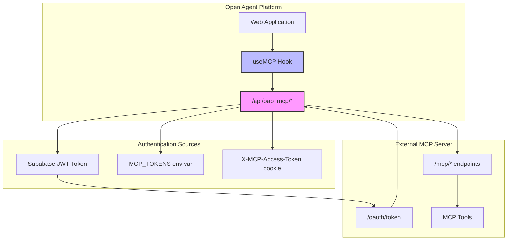
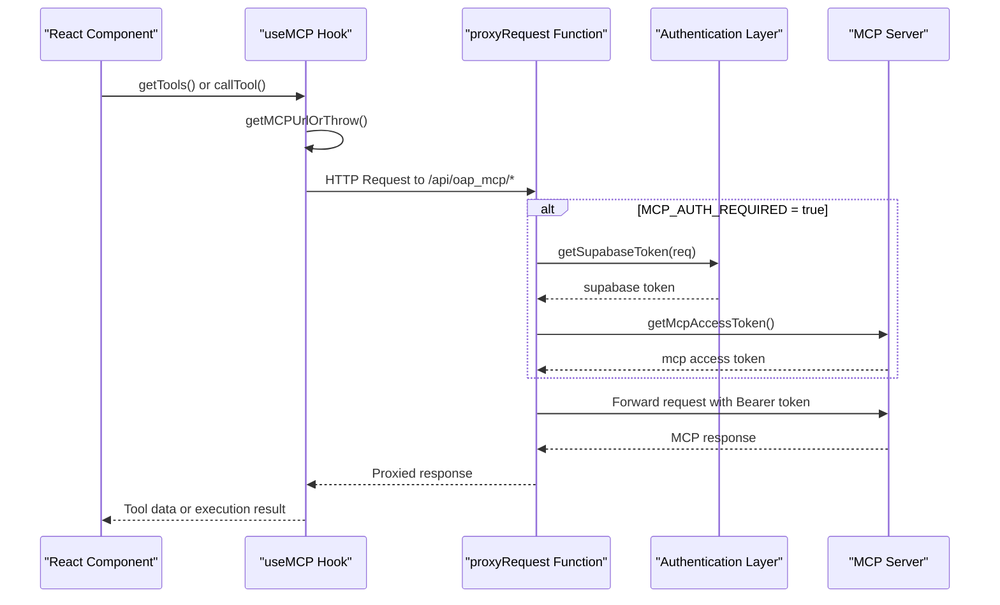
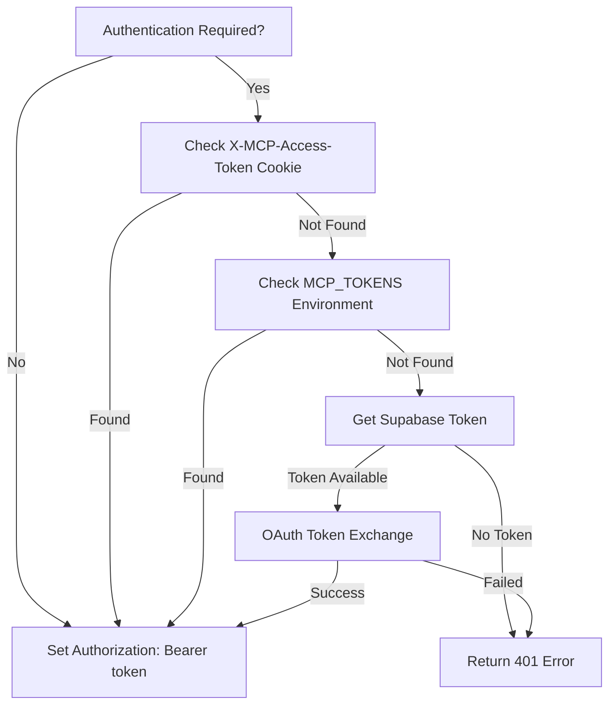
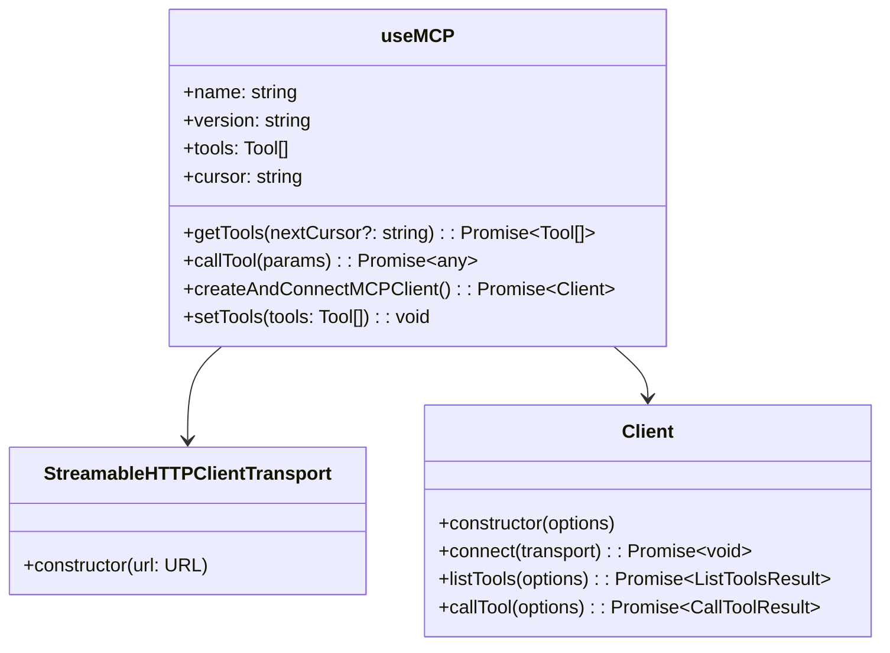

<!-- source: DeepWiki mcp.deepwiki.com · repo langchain-ai/open-agent-platform · page 2.3 MCP Integration System · fetched 2026-10-26 -->

# MCP Integration System

<details>
<summary>Relevant source files</summary>

The following files were used as context for generating this wiki page:

- [apps/web/src/app/api/oap_mcp/proxy-request.ts](apps/web/src/app/api/oap_mcp/proxy-request.ts)
- [apps/web/src/hooks/use-mcp.tsx](apps/web/src/hooks/use-mcp.tsx)

</details>


This document covers the Model Context Protocol (MCP) integration system within the Open Agent Platform. The MCP integration enables the platform to connect with external MCP servers to access and execute external tools, extending agent capabilities beyond the core platform features.

The system implements a proxy-based architecture that handles authentication, request forwarding, and tool execution between the web application and external MCP servers. For information about the broader tool management interface, see [Tools System](#6). For details about how MCP tools are configured within agents, see [Agent Configuration System](#2.2).

## Architecture Overview

The MCP integration consists of three main components: a Next.js API proxy route, a React hook for client-side MCP interactions, and an authentication flow that supports multiple token sources.

### MCP Integration Architecture



Sources: [apps/web/src/app/api/oap_mcp/proxy-request.ts:1-242](), [apps/web/src/hooks/use-mcp.tsx:1-103]()

### MCP Request Flow



Sources: [apps/web/src/hooks/use-mcp.tsx:38-48](), [apps/web/src/app/api/oap_mcp/proxy-request.ts:91-241]()

## Proxy System Implementation

The MCP proxy is implemented as a Next.js API route that forwards requests from the client to external MCP servers while handling authentication and request transformation.

### Proxy Route Configuration

The proxy system uses several environment variables for configuration:

| Variable | Purpose | Required |
|----------|---------|----------|
| `MCP_SERVER_URL` | Target MCP server URL | Yes |
| `NEXT_PUBLIC_MCP_SERVER_URL` | Public MCP server URL for direct access | Optional |
| `MCP_TOKENS` | JSON object containing access tokens | Optional |
| `NEXT_PUBLIC_MCP_AUTH_REQUIRED` | Enable authentication requirement | Optional |

The `proxyRequest` function extracts the path after `/api/oap_mcp/` and constructs the target URL by appending `/mcp` to the configured MCP server URL.

Sources: [apps/web/src/app/api/oap_mcp/proxy-request.ts:5-7](), [apps/web/src/app/api/oap_mcp/proxy-request.ts:102-110]()

### Request Transformation

The proxy performs several transformations on incoming requests:

1. **Path Rewriting**: Removes `/api/oap_mcp` prefix and prepends `/mcp` to the target URL
2. **Header Forwarding**: Copies all headers except `host` to avoid routing conflicts
3. **Body Forwarding**: Preserves request body for POST, PUT, PATCH, and DELETE methods
4. **Response Cloning**: Creates new responses while preserving status codes and headers

Sources: [apps/web/src/app/api/oap_mcp/proxy-request.ts:104-120](), [apps/web/src/app/api/oap_mcp/proxy-request.ts:171-210]()

## Authentication Flow

The MCP integration supports multiple authentication mechanisms with a defined priority order to accommodate different deployment scenarios.

### Authentication Priority Order



Sources: [apps/web/src/app/api/oap_mcp/proxy-request.ts:122-167]()

### Token Exchange Implementation

The `getMcpAccessToken` function implements OAuth 2.0 token exchange to convert Supabase JWT tokens into MCP-specific access tokens:

- **Grant Type**: `urn:ietf:params:oauth:grant-type:token-exchange`
- **Client ID**: `mcp_default`
- **Subject Token Type**: `urn:ietf:params:oauth:token-type:access_token`
- **Resource**: The MCP server URL with `/mcp` suffix

The exchanged token is cached as an HTTP-only cookie with a 1-hour expiration for subsequent requests.

Sources: [apps/web/src/app/api/oap_mcp/proxy-request.ts:44-80](), [apps/web/src/app/api/oap_mcp/proxy-request.ts:212-226]()

## Client-Side Integration

The `useMCP` hook provides React components with methods to interact with MCP servers through the proxy architecture.

### Hook Interface



Sources: [apps/web/src/hooks/use-mcp.tsx:20-102]()

### MCP Client Creation

The `createAndConnectMCPClient` function establishes connections to MCP servers using the `@modelcontextprotocol/sdk`:

1. Constructs the MCP URL using `getMCPUrlOrThrow()` which builds the proxy URL
2. Creates a `StreamableHTTPClientTransport` with the proxy endpoint
3. Initializes a `Client` with the provided name and version
4. Connects the client to the transport

Sources: [apps/web/src/hooks/use-mcp.tsx:38-48](), [apps/web/src/hooks/use-mcp.tsx:6-14]()

## Tool Execution Flow

The MCP integration supports both tool discovery and execution through standardized MCP protocol methods.

### Tool Discovery Process

```mermaid
graph LR
    Component[React Component]
    GetTools[getTools Function]
    McpClient[MCP Client]
    ListTools[listTools Method]
    ToolsArray[Tool[] Response]
    
    Component --> GetTools
    GetTools --> McpClient
    McpClient --> ListTools
    ListTools --> ToolsArray
    ToolsArray --> Component
    
    GetTools -.->|Pagination| GetTools
```

The `getTools` function supports pagination through cursor-based iteration:
- Accepts optional `nextCursor` parameter for pagination
- Updates internal cursor state for subsequent requests
- Returns array of `Tool` objects with metadata

Sources: [apps/web/src/hooks/use-mcp.tsx:58-67]()

### Tool Execution Process

The `callTool` function executes specific tools on the MCP server:

**Parameters:**
- `name`: Tool identifier
- `args`: Argument object for tool parameters  
- `version`: Optional tool version specification

**Process:**
1. Creates new MCP client connection
2. Calls `mcp.callTool()` with structured parameters
3. Returns raw response from MCP server

Sources: [apps/web/src/hooks/use-mcp.tsx:76-92]()

### Error Handling

The system implements comprehensive error handling at multiple levels:

- **Proxy Level**: Returns 500/502 errors for server/configuration issues
- **Authentication Level**: Returns 401 errors for authentication failures  
- **Client Level**: Throws exceptions for connection and protocol errors
- **Transport Level**: Handles network failures and timeouts

Sources: [apps/web/src/app/api/oap_mcp/proxy-request.ts:229-241](), [apps/web/src/app/api/oap_mcp/proxy-request.ts:92-100](), [apps/web/src/app/api/oap_mcp/proxy-request.ts:156-163]()

---

