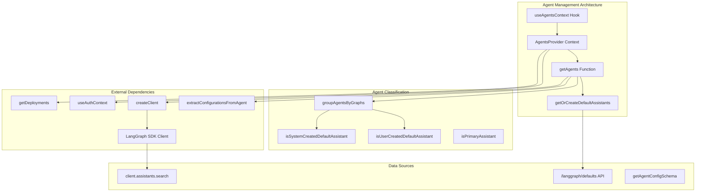
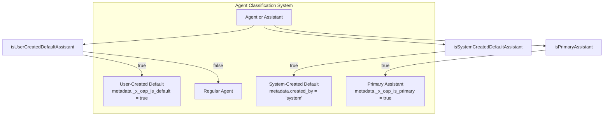
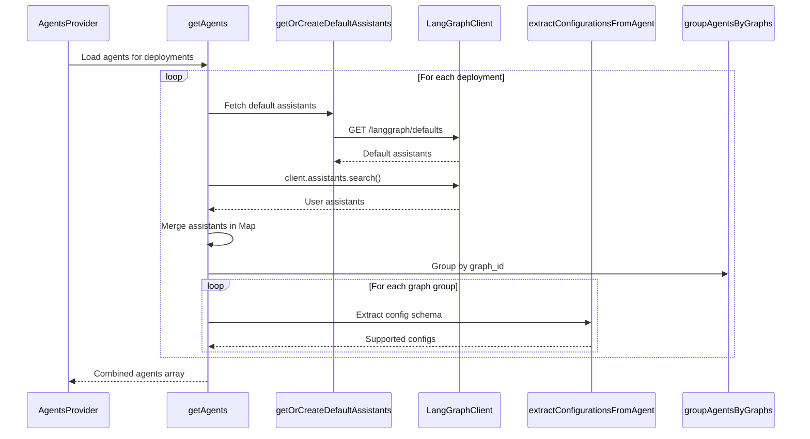
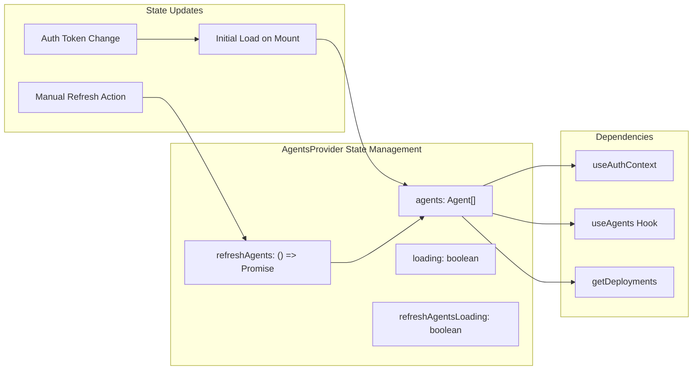
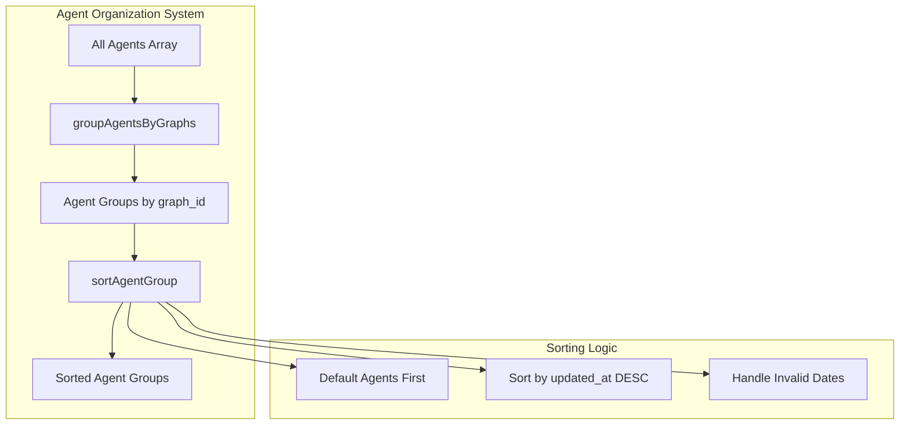
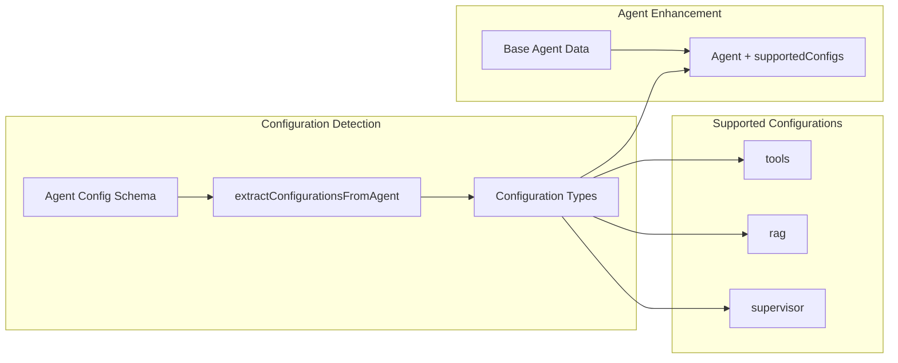
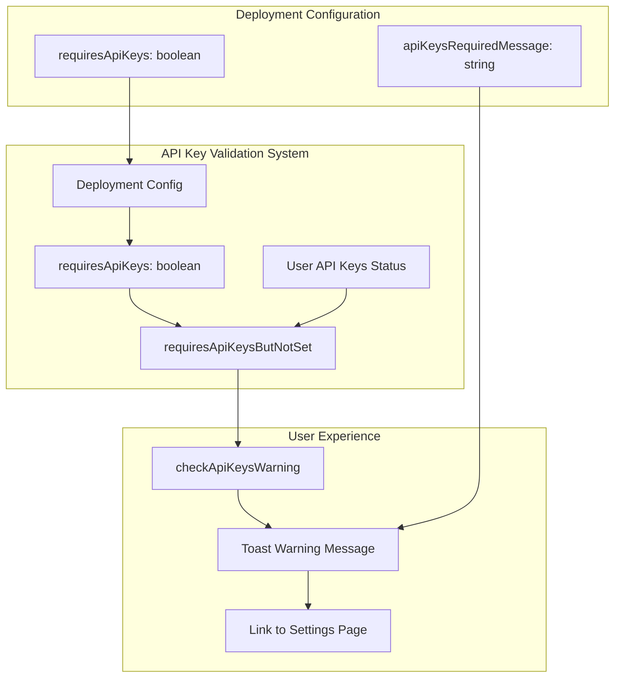

<!-- source: DeepWiki mcp.deepwiki.com · repo langchain-ai/open-agent-platform · page 3 Agent Management · fetched 2026-10-26 -->

# Agent Management

Relevant source files

The following files were used as context for generating this wiki page:

- [apps/web/src/lib/agent-utils.ts](apps/web/src/lib/agent-utils.ts)
- [apps/web/src/providers/Agents.tsx](apps/web/src/providers/Agents.tsx)
- [apps/web/src/types/deployment.ts](apps/web/src/types/deployment.ts)

This document covers the comprehensive agent lifecycle management system in the Open Agent Platform, including agent discovery, classification, loading, and state management. The system handles multiple agent types across different deployments and provides a unified interface for managing AI agents.

For information about the agent dashboard interface, see [Agent Dashboard](#3.1). For details about agent configuration forms, see [Agent Forms and Dialogs](#3.2). For information about the chat interface with agents, see [Chat Interface](#4).

## Core Architecture

The agent management system consists of several key components that work together to provide agent discovery, classification, and state management across multiple deployments.

The system provides a React context-based architecture for managing agent state across the application, with automatic loading, classification, and configuration detection.

**Sources:** [apps/web/src/providers/Agents.tsx:1-245](), [apps/web/src/lib/agent-utils.ts:1-172]()

## Agent Types and Classification

The platform distinguishes between several types of agents based on their origin, purpose, and role within the system.

| Agent Type | Identifier Function | Description | Visibility |
|------------|-------------------|-------------|------------|
| User-Created Default | `isUserCreatedDefaultAssistant` | Default agent created by users for a specific graph | Visible to users |
| System-Created Default | `isSystemCreatedDefaultAssistant` | Platform-generated default agents | Hidden from users |
| Primary Assistant | `isPrimaryAssistant` | The main default assistant across all graphs | Special designation |

The classification system uses metadata fields to determine agent types and controls their visibility and behavior in the user interface.

**Sources:** [apps/web/src/lib/agent-utils.ts:18-55]()

## Agent Discovery and Loading Process

The agent loading process involves fetching agents from multiple deployments, combining different assistant types, and extracting configuration capabilities.

The loading process handles multiple deployments concurrently and ensures proper merging of default and user-created assistants while avoiding duplicates.

**Sources:** [apps/web/src/providers/Agents.tsx:67-146](), [apps/web/src/providers/Agents.tsx:26-65]()

## Agent State Management

The `AgentsProvider` component manages global agent state using React Context and provides methods for loading and refreshing agent data.

The context provides reactive state management with automatic loading on authentication changes and manual refresh capabilities for real-time updates.

**Sources:** [apps/web/src/providers/Agents.tsx:148-168](), [apps/web/src/providers/Agents.tsx:170-243]()

## Agent Grouping and Organization

Agents are organized by their `graph_id` and sorted within groups to prioritize default agents and recent updates.

The grouping system ensures that related agents (same graph) are organized together, with default agents prominently displayed and recent updates prioritized.

**Sources:** [apps/web/src/lib/agent-utils.ts:104-117](), [apps/web/src/lib/agent-utils.ts:76-97]()

## Configuration Schema Integration

The agent management system integrates with the configuration system to determine which features each agent supports based on its schema.

Each agent is enhanced with a `supportedConfigs` array that indicates which configuration panels should be available in the user interface.

**Sources:** [apps/web/src/providers/Agents.tsx:114-138]()

## API Key Management Integration

The system includes validation for deployments that require API keys and provides user warnings when keys are missing.

The validation system helps ensure users are properly configured before attempting to use agents that require external API access.

**Sources:** [apps/web/src/lib/agent-utils.ts:125-171](), [apps/web/src/types/deployment.ts:30-37]()

---

