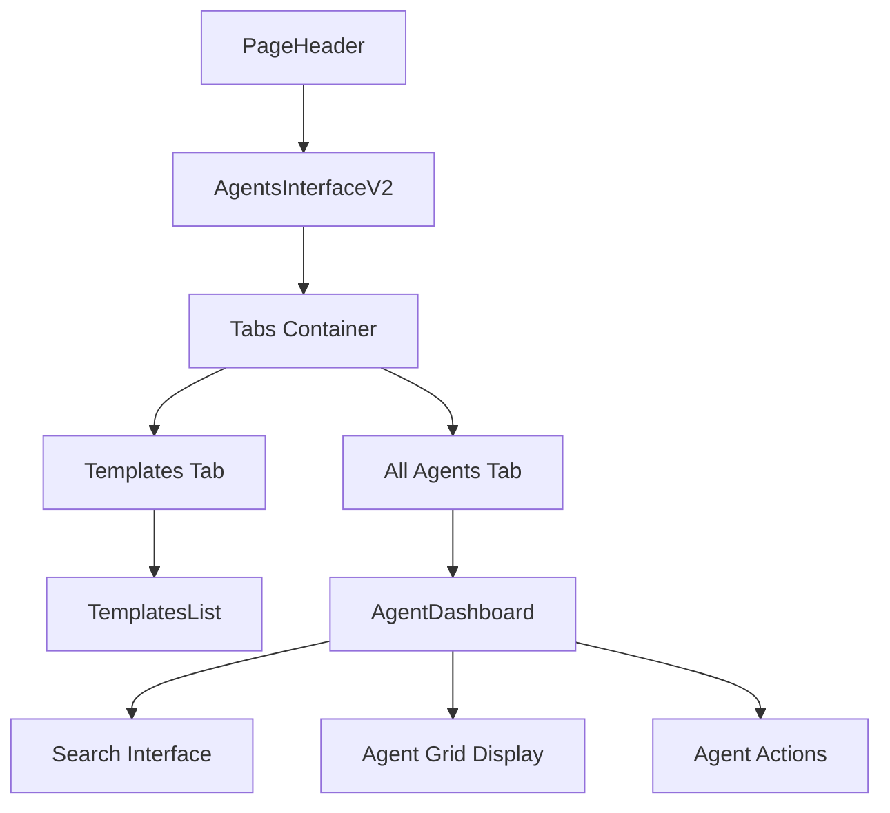
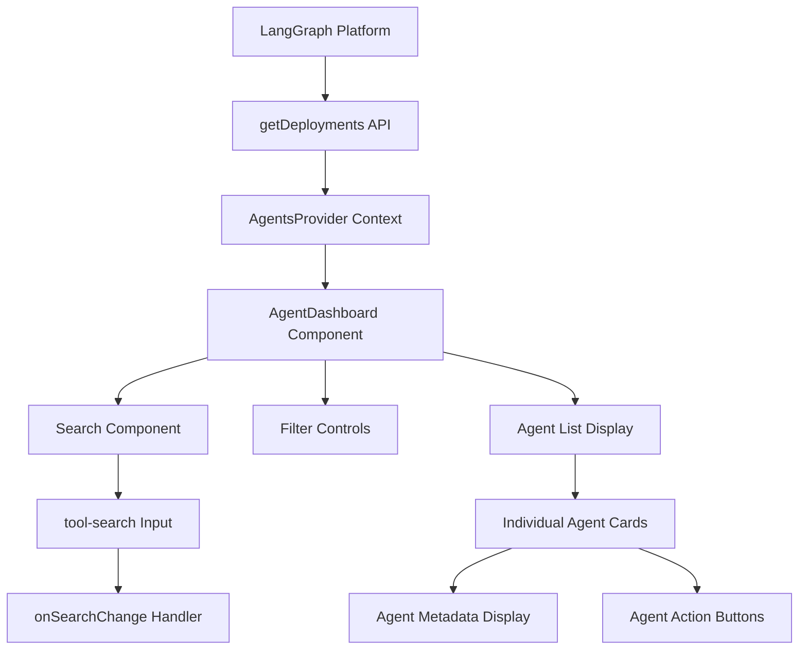
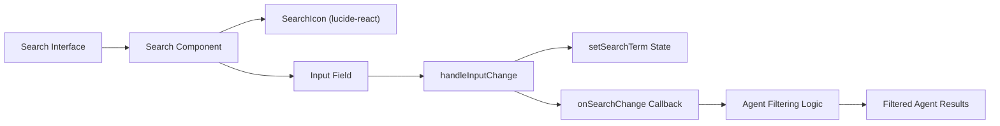
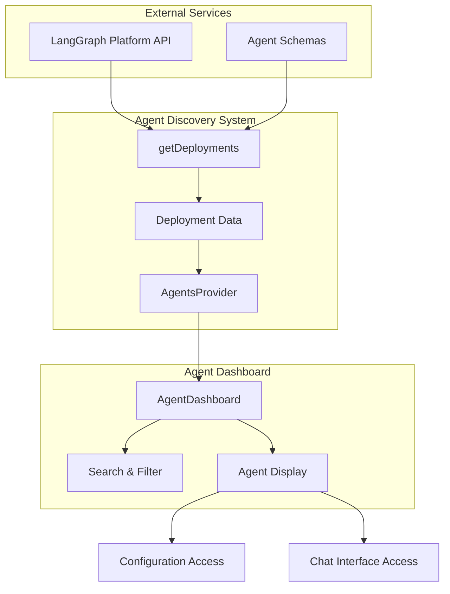
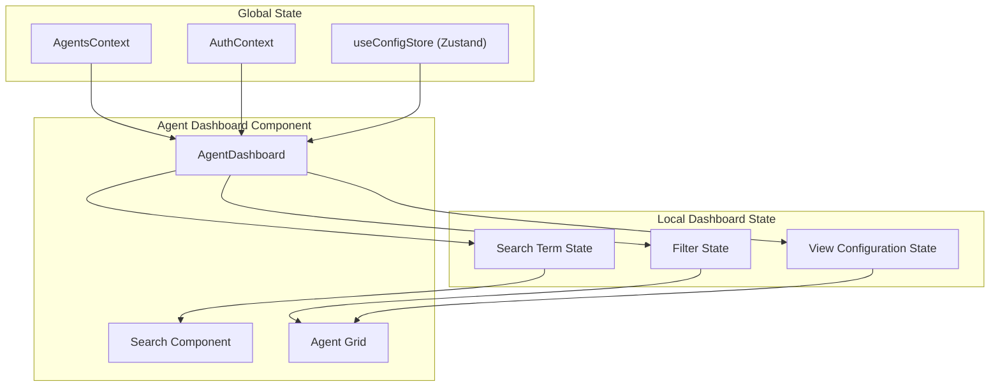

<!-- source: DeepWiki mcp.deepwiki.com · repo langchain-ai/open-agent-platform · page 3.1 Agent Dashboard · fetched 2026-10-26 -->

# Agent Dashboard

Relevant source files

The following files were used as context for generating this wiki page:

- [apps/web/src/components/ui/tool-search.tsx](apps/web/src/components/ui/tool-search.tsx)
- [apps/web/src/features/agents/index.tsx](apps/web/src/features/agents/index.tsx)

The Agent Dashboard provides the primary interface for browsing, searching, and managing all available agents within the Open Agent Platform. This system serves as the central hub where users can view deployed agents, search through available options, and access agent management functions.

This page covers the dashboard interface specifically. For information about creating and editing agents through forms and dialogs, see [Agent Forms and Dialogs](#3.2). For details about the underlying agent configuration system, see [Agent Configuration System](#2.2).

## Overview

The Agent Dashboard is implemented as part of a tabbed interface within the agents feature, providing users with a comprehensive view of all deployed agents. It operates as the "All Agents" view, distinct from the templates-focused interface, and integrates directly with the LangGraph Platform to display real-time agent deployment information.

**Agent Interface Structure**

Sources: [apps/web/src/features/agents/index.tsx:1-44]()

## Component Architecture

The Agent Dashboard is structured as a React component that leverages the platform's agent management infrastructure. The dashboard integrates with the `AgentsProvider` context to access deployment data and provides a user interface for agent discovery and management.

**Component Hierarchy and Data Flow**

Sources: [apps/web/src/features/agents/index.tsx:37-39]()

## Search and Filtering System

The dashboard incorporates a search interface that allows users to filter and locate specific agents efficiently. The search functionality is built using a reusable search component that provides real-time filtering capabilities.

**Search Component Implementation**

The search component implements the following key features:

| Feature | Implementation | Purpose |
|---------|---------------|---------|
| Real-time Search | `handleInputChange` event handler | Provides immediate feedback as users type |
| Search State | `useState` hook for `searchTerm` | Maintains current search input |
| Callback Integration | `onSearchChange` prop | Allows parent components to handle search logic |
| Visual Feedback | Search icon and styled input | Clear visual indication of search functionality |

Sources: [apps/web/src/components/ui/tool-search.tsx:1-41]()

## Integration with Agent Management

The Agent Dashboard integrates with the broader agent management system through several key interfaces and data sources. This integration ensures that the dashboard displays current deployment status and provides access to agent management functions.

**Agent Management Integration**

## Dashboard State Management

The Agent Dashboard maintains its state through a combination of React context providers and local component state. This architecture ensures efficient data flow and responsive user interactions while maintaining consistency with the broader application state.

**State Management Architecture**

The dashboard coordinates with several state management systems:

- **Global Agent State**: Accessed through `AgentsProvider` for deployment information
- **Authentication State**: Used for access control and user-specific agent visibility
- **Configuration State**: Integrates with the configuration system for agent parameters
- **Local Search State**: Maintains search terms and filter criteria locally

Sources: [apps/web/src/features/agents/index.tsx:7-44](), [apps/web/src/components/ui/tool-search.tsx:12-23]()

---

