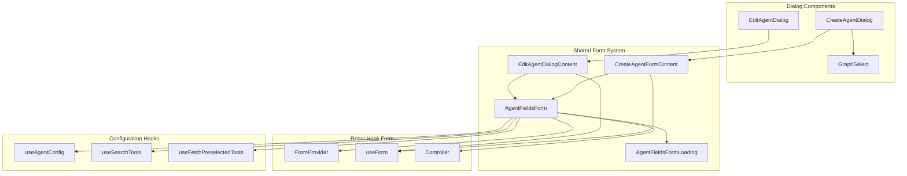
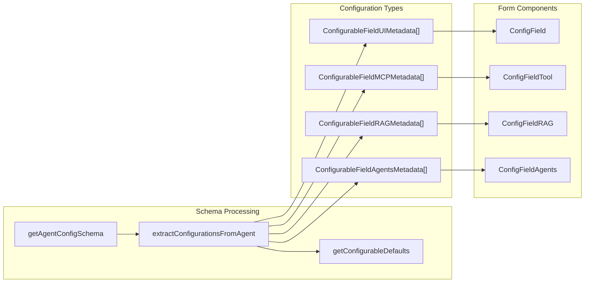
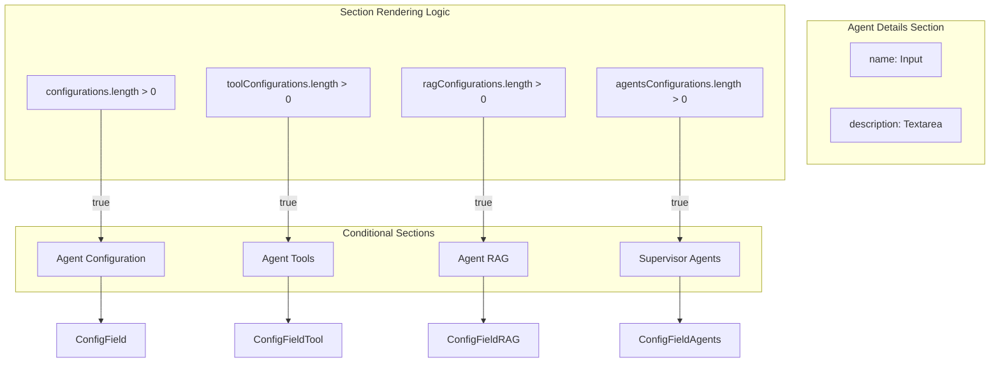
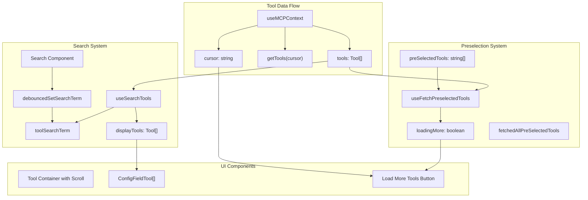
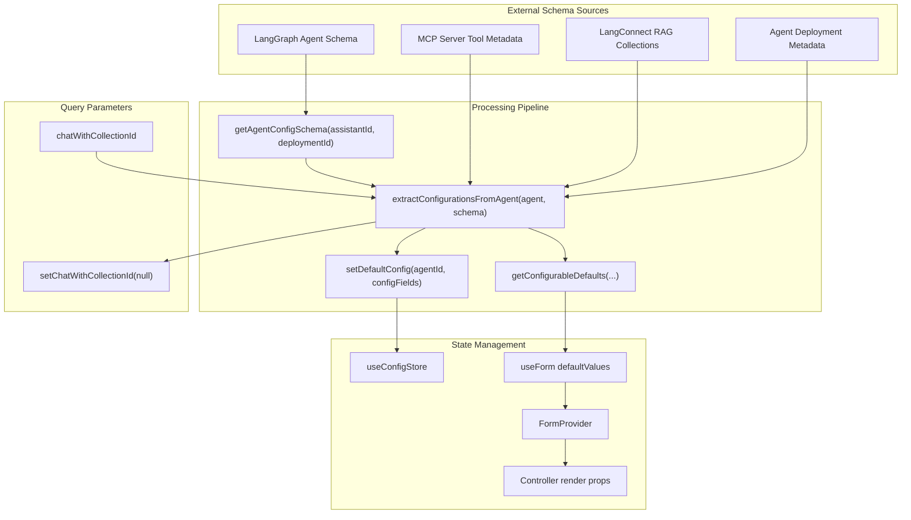

<!-- source: DeepWiki mcp.deepwiki.com · repo langchain-ai/open-agent-platform · page 3.2 Agent Forms and Dialogs · fetched 2026-10-26 -->

# Agent Forms and Dialogs

Relevant source files

The following files were used as context for generating this wiki page:

- [apps/web/src/features/agents/components/create-edit-agent-dialogs/agent-form.tsx](apps/web/src/features/agents/components/create-edit-agent-dialogs/agent-form.tsx)
- [apps/web/src/features/agents/components/create-edit-agent-dialogs/create-agent-dialog.tsx](apps/web/src/features/agents/components/create-edit-agent-dialogs/create-agent-dialog.tsx)
- [apps/web/src/features/agents/components/create-edit-agent-dialogs/edit-agent-dialog.tsx](apps/web/src/features/agents/components/create-edit-agent-dialogs/edit-agent-dialog.tsx)
- [apps/web/src/hooks/use-agent-config.tsx](apps/web/src/hooks/use-agent-config.tsx)
- [apps/web/src/hooks/use-fetch-preselected-tools.tsx](apps/web/src/hooks/use-fetch-preselected-tools.tsx)
- [apps/web/src/hooks/use-search-tools.tsx](apps/web/src/hooks/use-search-tools.tsx)
- [apps/web/src/types/agent.ts](apps/web/src/types/agent.ts)

This document covers the dynamic form system that enables creation and editing of AI agents through schema-driven configuration dialogs. The system automatically generates form interfaces based on agent schemas, supporting various configuration types including UI parameters, tool selection, RAG collections, and supervisor agent relationships.

For information about the broader agent management dashboard, see [Agent Dashboard](#3.1). For details about the configuration system used during chat interactions, see [Configuration Sidebar](#4.2).

## Dialog Components Architecture

The agent forms system consists of two primary dialog components that share a common form infrastructure:

Sources: [apps/web/src/features/agents/components/create-edit-agent-dialogs/create-agent-dialog.tsx:1-242](), [apps/web/src/features/agents/components/create-edit-agent-dialogs/edit-agent-dialog.tsx:1-193](), [apps/web/src/features/agents/components/create-edit-agent-dialogs/agent-form.tsx:1-265]()

Both dialogs follow a consistent pattern where the main dialog component handles state management and routing, while delegating form rendering to shared content components that utilize the `AgentFieldsForm`.

## Dynamic Form Generation System

The form generation system processes agent schemas to create dynamic configuration interfaces:

Sources: [apps/web/src/hooks/use-agent-config.tsx:51-133](), [apps/web/src/features/agents/components/create-edit-agent-dialogs/agent-form.tsx:50-264]()

The `useAgentConfig` hook orchestrates this process through its `getSchemaAndUpdateConfig` method, which fetches the agent schema and transforms it into typed configuration metadata that drives form field generation.

## Configuration Field Types

The system supports four distinct configuration categories, each with specialized form components:

| Configuration Type | Component | Purpose | Schema Source |
|-------------------|-----------|---------|---------------|
| UI Parameters | `ConfigField` | Standard form inputs (text, number, boolean, select) | Agent schema configurable fields |
| Tool Selection | `ConfigFieldTool` | MCP tool selection with search and pagination | MCP server metadata |
| RAG Collections | `ConfigFieldRAG` | Document collection selection | LangConnect server |
| Supervisor Agents | `ConfigFieldAgents` | Agent-to-agent relationships | Agent deployment metadata |

The form dynamically renders these sections based on the presence of corresponding configuration metadata:

Sources: [apps/web/src/features/agents/components/create-edit-agent-dialogs/agent-form.tsx:78-264]()

## Tool Selection System

The tool selection system provides sophisticated search and pagination capabilities for MCP tool configuration:

Sources: [apps/web/src/features/agents/components/create-edit-agent-dialogs/agent-form.tsx:141-216](), [apps/web/src/hooks/use-search-tools.tsx:1-71](), [apps/web/src/hooks/use-fetch-preselected-tools.tsx:1-112]()

The tool selection interface includes:

- **Search Functionality**: Real-time filtering with debounced input at [apps/web/src/hooks/use-search-tools.tsx:14-17]()
- **Preselection Priority**: Tools specified in agent defaults are shown first at [apps/web/src/hooks/use-search-tools.tsx:42-51]()
- **Lazy Loading**: Automatic fetching of preselected tools and manual "Load More" pagination at [apps/web/src/hooks/use-fetch-preselected-tools.tsx:56-104]()

## Schema Processing and State Management

The system integrates with multiple external services to populate form fields with appropriate configuration options:

Sources: [apps/web/src/hooks/use-agent-config.tsx:51-133](), [apps/web/src/features/agents/components/create-edit-agent-dialogs/agent-form.tsx:106-137]()

The state management system handles:

- **Schema Fetching**: Retrieves configuration schema from LangGraph Platform at [apps/web/src/hooks/use-agent-config.tsx:63-66]()
- **Default Value Processing**: Populates form with schema-defined defaults at [apps/web/src/hooks/use-agent-config.tsx:116-121]()
- **Query Parameter Integration**: Pre-selects RAG collections from URL parameters at [apps/web/src/hooks/use-agent-config.tsx:97-104]()
- **Global State Synchronization**: Updates `useConfigStore` for consistency with chat configuration at [apps/web/src/hooks/use-agent-config.tsx:86-114]()

---

