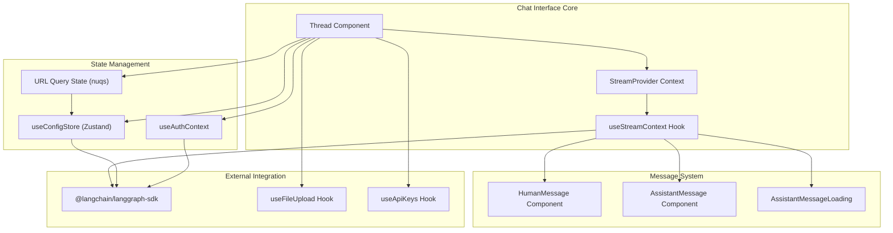
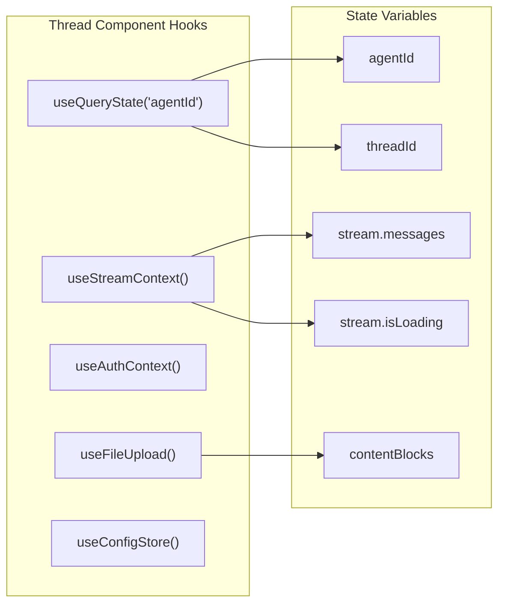
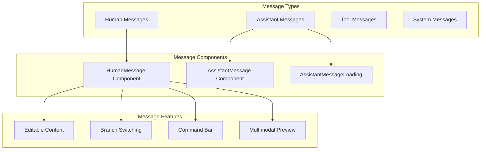
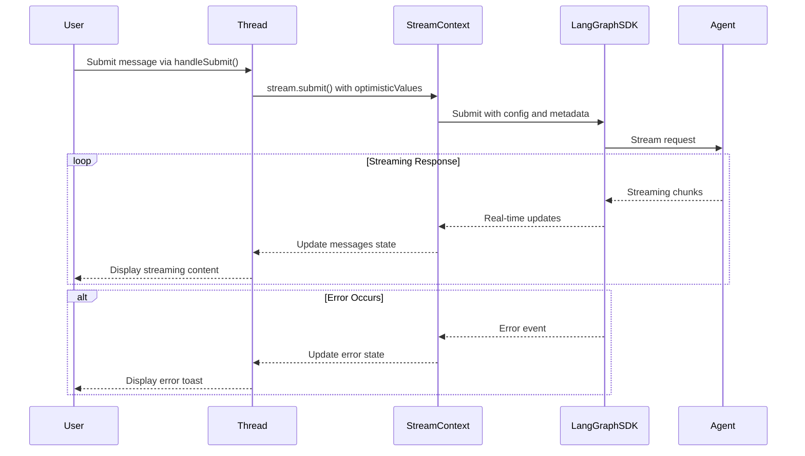
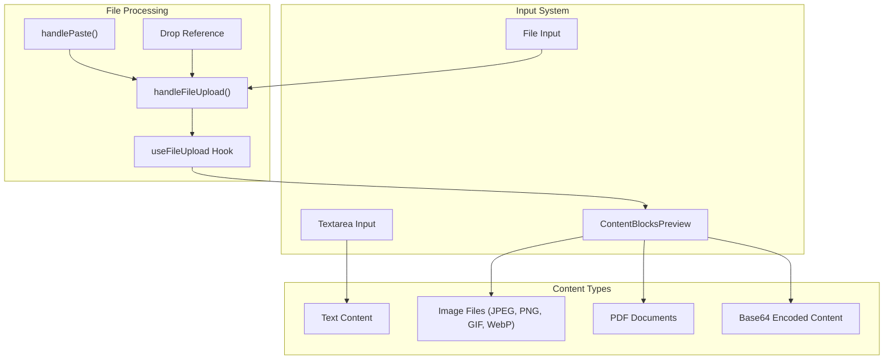
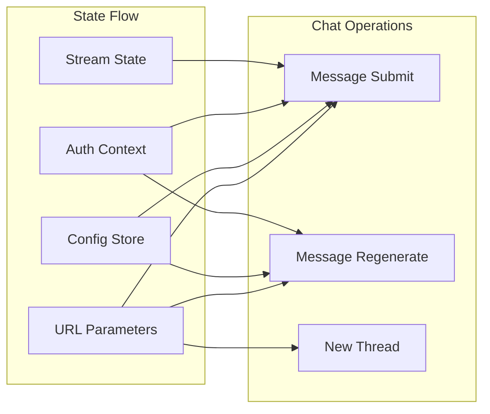
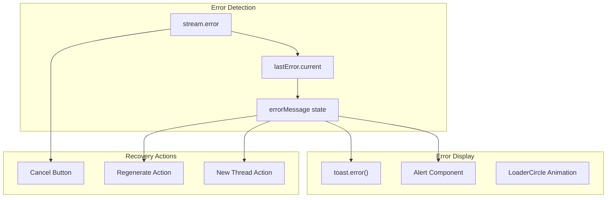

<!-- source: DeepWiki mcp.deepwiki.com · repo langchain-ai/open-agent-platform · page 4 Chat Interface · fetched 2026-10-26 -->

# Chat Interface

Relevant source files

The following files were used as context for generating this wiki page:

- [apps/docs/package.json](apps/docs/package.json)
- [apps/web/package.json](apps/web/package.json)
- [apps/web/src/features/chat/components/thread/index.tsx](apps/web/src/features/chat/components/thread/index.tsx)
- [apps/web/src/features/chat/components/thread/messages/human.tsx](apps/web/src/features/chat/components/thread/messages/human.tsx)
- [yarn.lock](yarn.lock)

The Chat Interface is the primary user interaction system for communicating with AI agents in the Open Agent Platform. It provides a real-time streaming chat experience with support for multimodal content, agent configuration, and conversation management through the `Thread` component and its associated message handling system.

For information about specific message types and thread management details, see [Thread and Messages](#4.1). For agent parameter configuration during chat, see [Configuration Sidebar](#4.2). For browsing previous conversations, see [Thread History Sidebar](#4.3).

## Architecture Overview

The Chat Interface is built around a central streaming architecture that connects user input to AI agents through the LangGraph SDK. The system maintains real-time bidirectional communication while managing conversation state, agent configuration, and multimodal content.

**Sources:** [apps/web/src/features/chat/components/thread/index.tsx:1-581](), [apps/web/src/features/chat/components/thread/messages/human.tsx:1-168]()

## Core Components

### Thread Component

The `Thread` component serves as the main orchestrator for chat functionality, managing message display, user input, and streaming communication with AI agents.

| Component | Purpose | Key Props/State |
|-----------|---------|-----------------|
| `Thread` | Main chat interface container | Messages, loading state, error handling |
| `StickyToBottomContent` | Scroll management wrapper | Content, footer, className |
| `NewThreadButton` | Agent selection and thread creation | hasMessages, agent selection |
| `ScrollToBottom` | Auto-scroll functionality | isAtBottom state |

The component uses several key hooks and contexts:

**Sources:** [apps/web/src/features/chat/components/thread/index.tsx:216-581]()

### Message Handling System

The chat interface supports multiple message types with different rendering strategies:

**Sources:** [apps/web/src/features/chat/components/thread/index.tsx:389-426](), [apps/web/src/features/chat/components/thread/messages/human.tsx:40-167]()

## Streaming Architecture

The chat interface implements real-time streaming through the LangGraph SDK with optimistic updates and error handling:

**Sources:** [apps/web/src/features/chat/components/thread/index.tsx:277-332](), [apps/web/src/features/chat/components/thread/index.tsx:334-359]()

## Input and File Handling

The chat interface supports rich input including text, file uploads, and multimodal content:

**Sources:** [apps/web/src/features/chat/components/thread/index.tsx:225-233](), [apps/web/src/features/chat/components/thread/index.tsx:451-513]()

## State Management Integration

The Chat Interface integrates with multiple state management systems to maintain consistency across the application:

| State System | Purpose | Key Values |
|--------------|---------|------------|
| URL Query State (`nuqs`) | Navigation and persistence | `agentId`, `threadId`, `deploymentId`, `hideToolCalls` |
| Config Store (`zustand`) | Agent configuration | `getAgentConfig()` method |
| Auth Context | User session | `session.accessToken` |
| Stream Context | Real-time messaging | `messages`, `isLoading`, `error`, `interrupt` |

**Sources:** [apps/web/src/features/chat/components/thread/index.tsx:217-223](), [apps/web/src/features/chat/components/thread/index.tsx:302-328]()

## Error Handling and Loading States

The chat interface implements comprehensive error handling with user feedback mechanisms:

**Sources:** [apps/web/src/features/chat/components/thread/index.tsx:244-275](), [apps/web/src/features/chat/components/thread/index.tsx:418-424]()

## Integration with External Services

The Chat Interface connects to multiple external services through standardized interfaces:

| Service | Integration Point | Configuration |
|---------|-------------------|---------------|
| LangGraph Platform | `@langchain/langgraph-sdk` | Agent deployment IDs |
| Supabase Auth | `session.accessToken` | User authentication |
| API Keys | `useApiKeys()` hook | Service-specific keys |
| MCP Tools | Agent configuration | Tool execution context |

**Sources:** [apps/web/package.json:17-18](), [apps/web/src/features/chat/components/thread/index.tsx:235-236](), [apps/web/src/features/chat/components/thread/index.tsx:317-324]()

---

