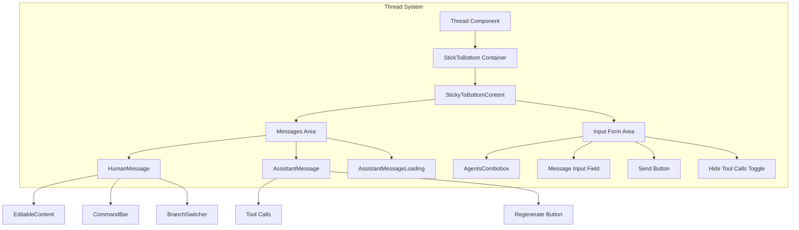
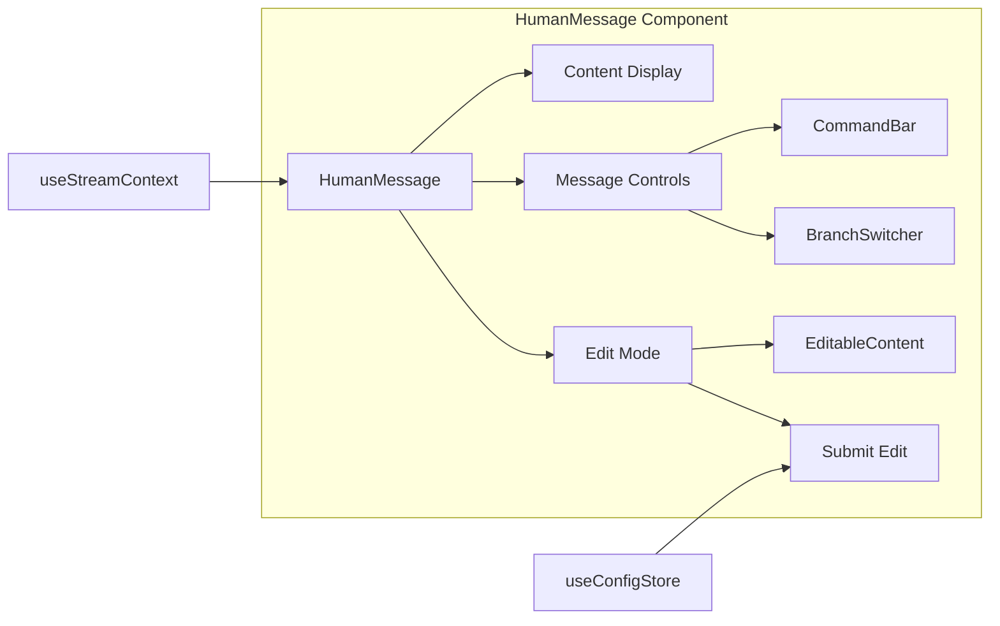
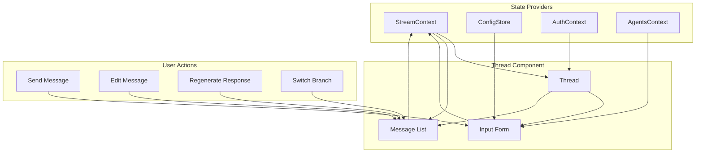

<!-- source: DeepWiki mcp.deepwiki.com · repo langchain-ai/open-agent-platform · page 4.1 Thread and Messages · fetched 2026-10-26 -->

# Thread and Messages

Relevant source files

The following files were used as context for generating this wiki page:

- [apps/docs/package.json](apps/docs/package.json)
- [apps/web/package.json](apps/web/package.json)
- [apps/web/src/features/chat/components/thread/index.tsx](apps/web/src/features/chat/components/thread/index.tsx)
- [apps/web/src/features/chat/components/thread/messages/human.tsx](apps/web/src/features/chat/components/thread/messages/human.tsx)
- [yarn.lock](yarn.lock)

This document covers the Thread and Messages system, which forms the core of the chat interface in the Open Agent Platform. It details how messages are rendered, how user interactions are processed, how the system handles streaming responses from agents, and how multimodal content is supported.

For information about configuring agents through the sidebar, see [Configuration Sidebar](#4.2).

## Overview

The Thread and Messages system provides a chat interface where users can send messages to agents and view responses. The system supports:

- Rendering both human and AI messages
- Streaming responses in real-time
- Editing and regenerating messages
- Managing tool calls and their responses
- Maintaining proper scroll behavior
- Creating new chat threads

### Thread Component Architecture

Sources: [apps/web/src/features/chat/components/thread/index.tsx:197-456](), [apps/web/src/features/chat/components/thread/messages/human.tsx:38-138]()

## Core Components

### Thread Component

The `Thread` component is the main container for the chat interface. It manages:

1. The message list
2. Input form for user messages
3. Streaming state management
4. Error handling
5. Scroll behavior

The component uses the `StickToBottom` library to ensure that the chat automatically scrolls to the newest messages, while allowing users to scroll up to review conversation history.

Sources: [apps/web/src/features/chat/components/thread/index.tsx:197-456]()

### Message Components

#### HumanMessage

The `HumanMessage` component renders messages from the user. Features include:

- Message content display
- Editable mode for modifying sent messages
- Branch switching for alternative conversation paths
- Command bar with actions

Sources: [apps/web/src/features/chat/components/thread/messages/human.tsx:38-138]()

#### AssistantMessage

The `AssistantMessage` component renders responses from AI agents. It supports:

- Streaming responses
- Tool call visualization
- Regenerating responses
- Error states

The component is referenced in the Thread component but not directly shown in the provided files.

Sources: [apps/web/src/features/chat/components/thread/index.tsx:354-359]()

### Navigation and Control Components

#### NewThreadButton

The `NewThreadButton` component allows users to start a new conversation. It integrates with the `AgentsCombobox` to allow selecting different agents for the new thread.

#### ScrollToBottom

The `ScrollToBottom` button appears when users have scrolled up in the conversation, allowing them to quickly return to the most recent messages.

Sources: [apps/web/src/features/chat/components/thread/index.tsx:61-75](), [apps/web/src/features/chat/components/thread/index.tsx:77-195]()

## Data Flow and State Management

The Thread system integrates with several state providers to manage data flow:

Sources: [apps/web/src/features/chat/components/thread/index.tsx:208-210](), [apps/web/src/features/chat/components/thread/messages/human.tsx:48-50]()

### Message Submission Process

When a user submits a message:

1. The form data is collected and validated
2. A new `Message` object is created with a unique ID
3. The message is submitted to the stream context
4. The stream context sends the message to the backend with agent configuration
5. The backend processes the message and begins streaming a response
6. The UI updates to show the streaming response

This process uses optimistic updates to immediately show the user's message in the UI before receiving confirmation from the backend.

Sources: [apps/web/src/features/chat/components/thread/index.tsx:256-299]()

### Message Regeneration

The Thread system supports regenerating AI responses from a specific checkpoint:

1. User clicks the regenerate button on an AI message
2. The system identifies the checkpoint to restore
3. The request is sent to the backend with the checkpoint identifier
4. The backend regenerates the response from that point
5. The new response replaces the previous one in the UI

Sources: [apps/web/src/features/chat/components/thread/index.tsx:302-325]()

## Message Format and Types

The Thread system works with the following message types:

| Message Type | Component       | Description                           |
|--------------|-----------------|---------------------------------------|
| human        | HumanMessage    | Messages from the user                |
| ai           | AssistantMessage| Responses from the AI agent           |
| tool         | (Internal)      | Tool call messages (can be hidden)    |

Each message includes:
- `id`: Unique identifier (UUID)
- `type`: Message type (human, ai, tool)
- `content`: The message content (text or structured content)

For assistant messages, additional properties may include tool calls and execution details.

Sources: [apps/web/src/features/chat/components/thread/index.tsx:269-273](), [apps/web/src/features/chat/components/thread/messages/human.tsx:61-62]()

## UI States and Interactions

### Loading States

The Thread system has several loading states:

1. Initial loading before any messages
2. Loading while waiting for the first token of a response
3. Streaming state as tokens are being received

These states control what UI elements are shown, such as loading indicators or cancel buttons.

Sources: [apps/web/src/features/chat/components/thread/index.tsx:203-204](), [apps/web/src/features/chat/components/thread/index.tsx:372]()

### Error Handling

The Thread system handles errors by:

1. Detecting errors from the stream context
2. Deduplicating errors to prevent multiple notifications
3. Displaying toast notifications with error details
4. Providing retry options through the regenerate functionality

Sources: [apps/web/src/features/chat/components/thread/index.tsx:212-240]()

### Keyboard Shortcuts

The Thread system supports keyboard shortcuts:

| Shortcut          | Action          | Component             |
|-------------------|-----------------|------------------------|
| Cmd/Ctrl+Shift+O  | New thread      | Thread                 |
| Enter             | Submit message  | Input form             |
| Shift+Enter       | New line        | Input form             |
| Cmd/Ctrl+Enter    | Submit edit     | EditableContent        |

Sources: [apps/web/src/features/chat/components/thread/index.tsx:94-108](), [apps/web/src/features/chat/components/thread/index.tsx:396-406](), [apps/web/src/features/chat/components/thread/messages/human.tsx:21-26]()

## Integration with Other Systems

The Thread system integrates with several other systems in the platform:

1. **Authentication System** - Uses `session` from `AuthContext` to include auth tokens in requests
2. **Agent Configuration** - Uses `ConfigStore` to fetch and include agent configurations
3. **Streaming** - Uses the `StreamContext` to manage message streaming
4. **Agents** - Uses the `AgentsContext` to provide agent selection

Sources: [apps/web/src/features/chat/components/thread/index.tsx:206](), [apps/web/src/features/chat/components/thread/index.tsx:276-296](), [apps/web/src/features/chat/components/thread/messages/human.tsx:45-46]()

## Configuration Options

The Thread system supports several configuration options:

| Option        | Purpose                                | Component             |
|---------------|----------------------------------------|------------------------|
| hideToolCalls | Toggle visibility of tool call details | Thread                 |
| agentId       | Selected agent for the conversation    | Thread, HumanMessage   |
| deploymentId  | Deployment version of the agent        | NewThreadButton        |
| threadId      | Identifier for the conversation thread | NewThreadButton        |

These options are managed through URL query parameters using the `nuqs` library.

Sources: [apps/web/src/features/chat/components/thread/index.tsx:198-202](), [apps/web/src/features/chat/components/thread/index.tsx:81-84]()

## Summary

The Thread and Messages system provides a robust, interactive chat interface for communicating with AI agents. It handles message rendering, streaming responses, user interactions, and integrates with other systems in the platform to provide a complete chat experience.

---

