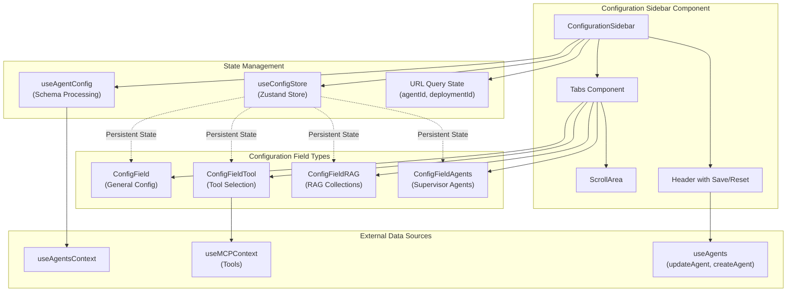
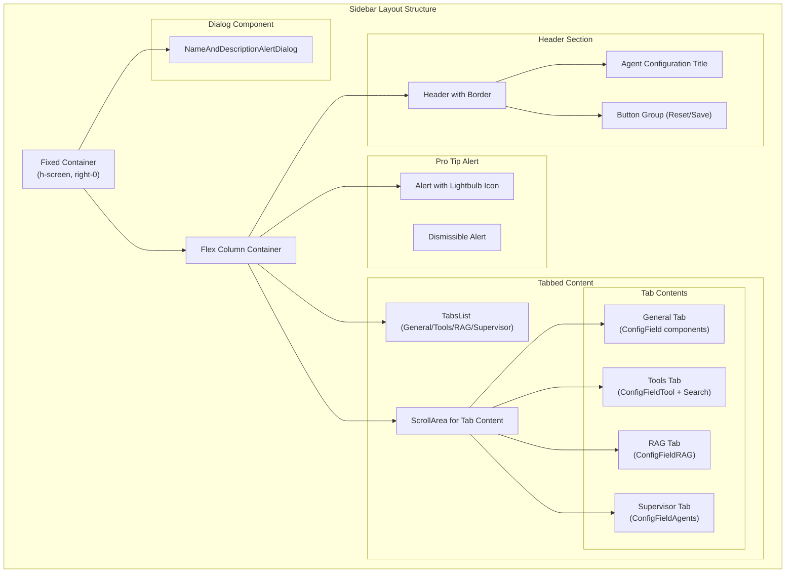
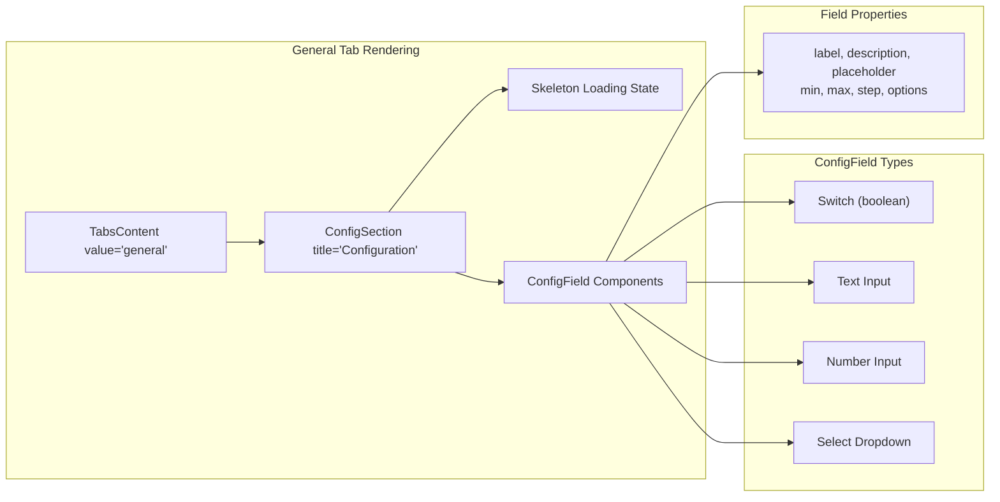
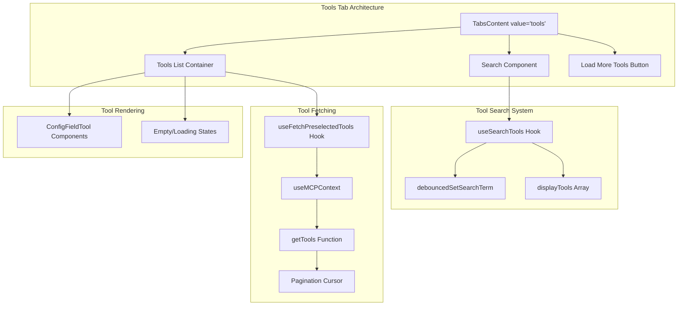
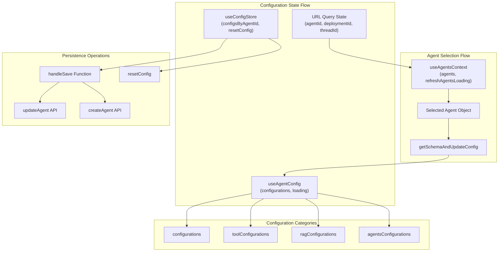
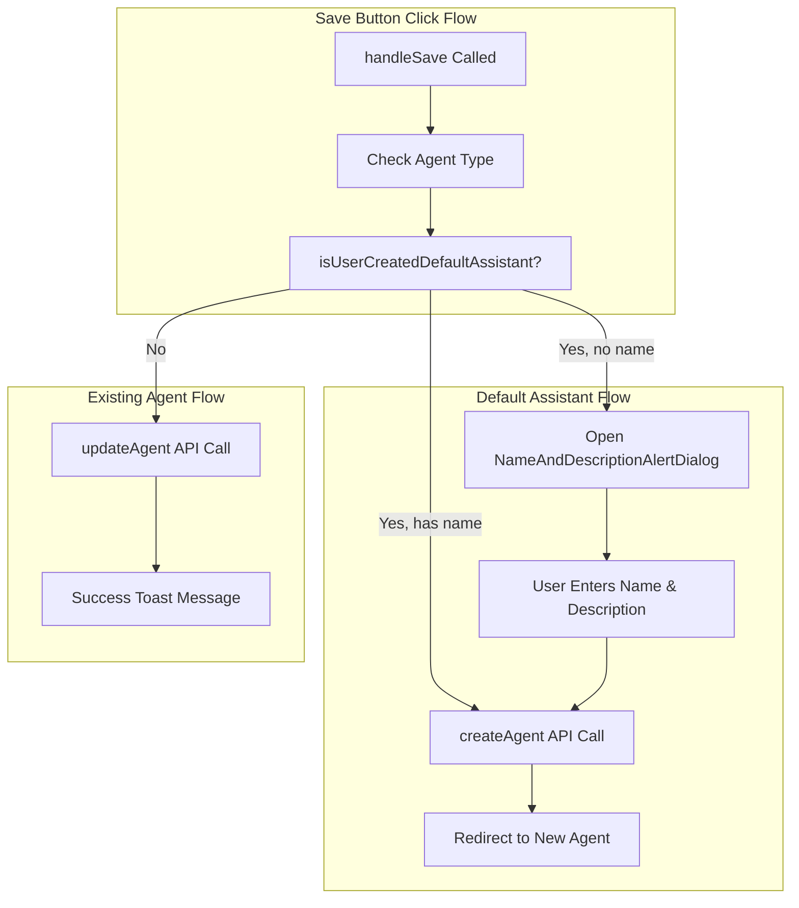
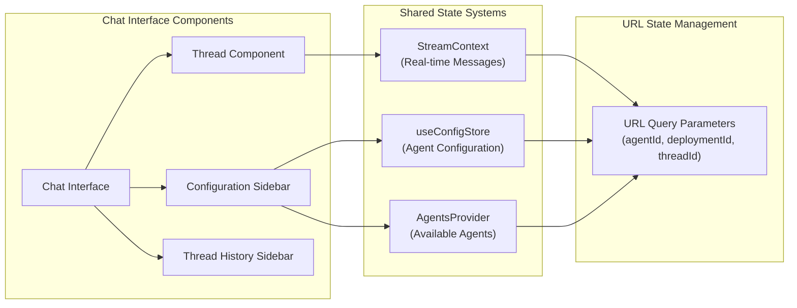

<!-- source: DeepWiki mcp.deepwiki.com · repo langchain-ai/open-agent-platform · page 4.2 Configuration Sidebar · fetched 2026-10-26 -->

# Configuration Sidebar

Relevant source files

The following files were used as context for generating this wiki page:

- [apps/web/src/components/ui/agents-combobox.tsx](apps/web/src/components/ui/agents-combobox.tsx)
- [apps/web/src/features/chat/components/chat-breadcrumb/index.tsx](apps/web/src/features/chat/components/chat-breadcrumb/index.tsx)
- [apps/web/src/features/chat/components/configuration-sidebar/index.tsx](apps/web/src/features/chat/components/configuration-sidebar/index.tsx)
- [apps/web/src/features/chat/components/thread/messages/ai.tsx](apps/web/src/features/chat/components/thread/messages/ai.tsx)
- [apps/web/src/features/chat/components/thread/messages/shared.tsx](apps/web/src/features/chat/components/thread/messages/shared.tsx)
- [apps/web/src/features/chat/providers/Stream.tsx](apps/web/src/features/chat/providers/Stream.tsx)

The Configuration Sidebar provides a dynamic, schema-driven interface for adjusting agent parameters in real-time during chat sessions. It generates UI components based on agent schemas and manages persistent configuration state across the application.

For information about the broader agent configuration system architecture, see [Agent Configuration System](#2.2). For details about chat interface components, see [Thread and Messages](#4.1).

## System Architecture

The Configuration Sidebar operates as a sliding panel that appears on the right side of the chat interface when activated. It dynamically generates configuration fields based on agent schemas and provides tabbed organization for different configuration categories.

Sources: [apps/web/src/features/chat/components/configuration-sidebar/index.tsx:1-481]()

## Component Structure and Layout

The `ConfigurationSidebar` component implements a fixed-position sliding panel with responsive width adjustments and organized tab-based navigation.

Sources: [apps/web/src/features/chat/components/configuration-sidebar/index.tsx:233-477]()

## Configuration Types and Tabs

The sidebar dynamically shows different tabs based on the `supportedConfigs` array returned by the `useAgentConfig` hook. Each tab renders specific configuration field types.

### General Configuration Tab

The General tab displays agent-specific parameters using the `ConfigField` component, which supports various input types:

Sources: [apps/web/src/features/chat/components/configuration-sidebar/index.tsx:323-355]()

### Tools Configuration Tab

The Tools tab provides searchable tool selection with pagination support:

Sources: [apps/web/src/features/chat/components/configuration-sidebar/index.tsx:357-428](), [apps/web/src/features/chat/components/configuration-sidebar/index.tsx:148-159]()

## State Management Integration

The Configuration Sidebar integrates with multiple state management systems to maintain configuration persistence and synchronization.

Sources: [apps/web/src/features/chat/components/configuration-sidebar/index.tsx:124-138](), [apps/web/src/features/chat/components/configuration-sidebar/index.tsx:166-185](), [apps/web/src/features/chat/components/configuration-sidebar/index.tsx:187-231]()

## User Interaction Patterns

### Save and Reset Operations

The sidebar header provides `Save` and `Reset` buttons with different behaviors based on agent type:

| Operation | Default Assistant | Custom Assistant | Result |
|-----------|------------------|------------------|---------|
| Save (new) | Opens name dialog | Updates existing | Creates new agent or updates config |
| Save (existing) | Updates config | Updates config | Saves to LangGraph Platform |
| Reset | Restores last saved | Restores last saved | Calls `resetConfig(agentId)` |

Sources: [apps/web/src/features/chat/components/configuration-sidebar/index.tsx:187-231](), [apps/web/src/features/chat/components/configuration-sidebar/index.tsx:253-256]()

### Agent Creation Flow

For user-created default assistants, the save operation triggers a specialized flow:

Sources: [apps/web/src/features/chat/components/configuration-sidebar/index.tsx:199-220](), [apps/web/src/features/chat/components/configuration-sidebar/index.tsx:50-113]()

## Integration with Chat Interface

The Configuration Sidebar operates within the broader chat interface ecosystem and coordinates with other UI components:

Sources: [apps/web/src/features/chat/components/configuration-sidebar/index.tsx:126-128](), [apps/web/src/features/chat/providers/Stream.tsx:79-92]()

---

