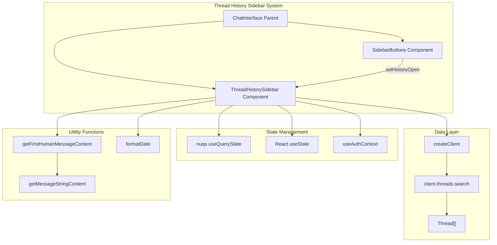
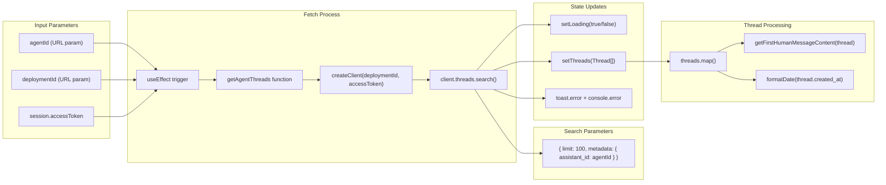
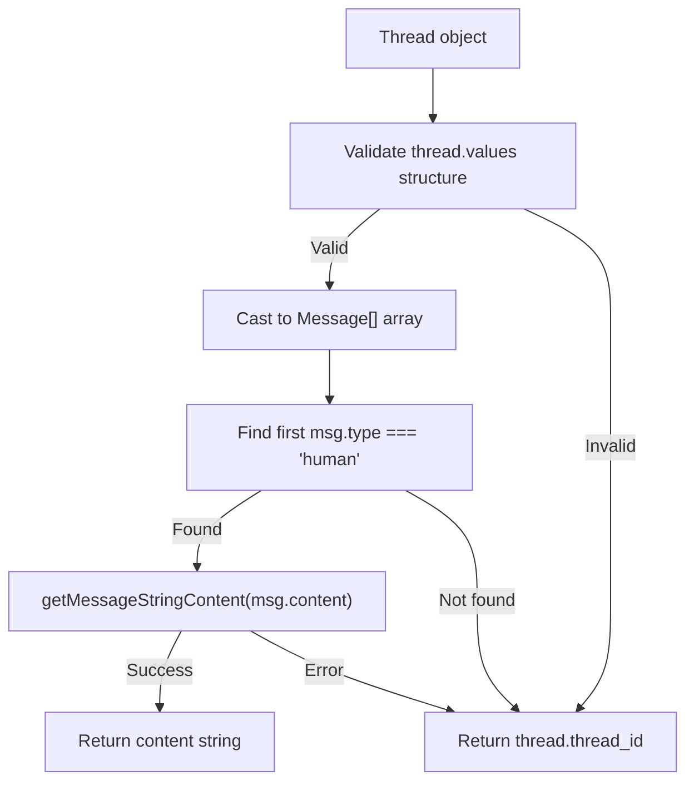
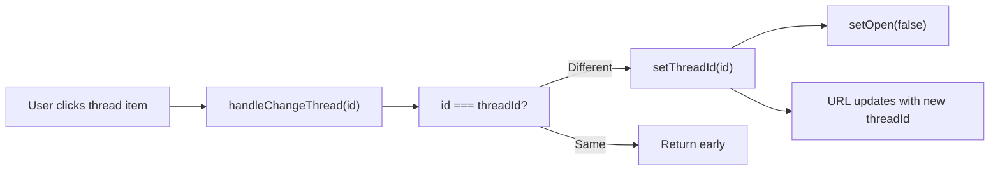
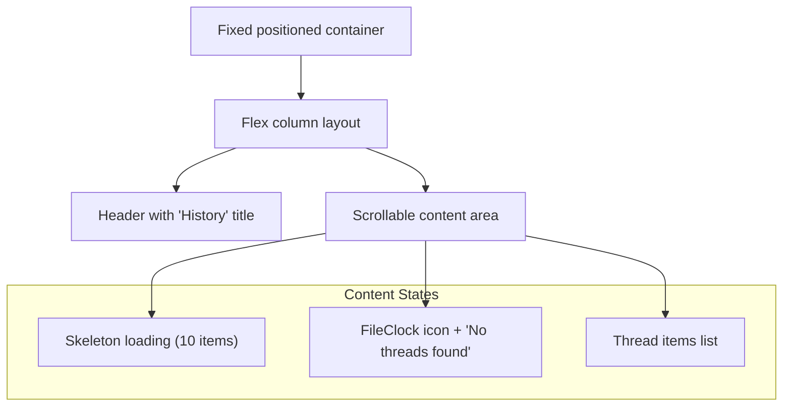
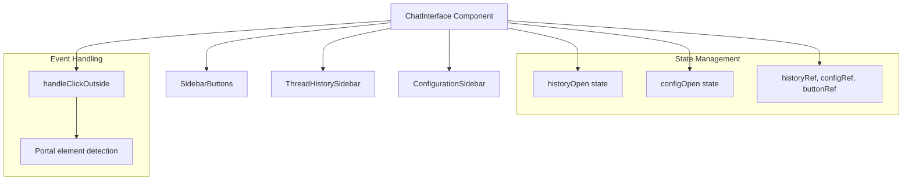
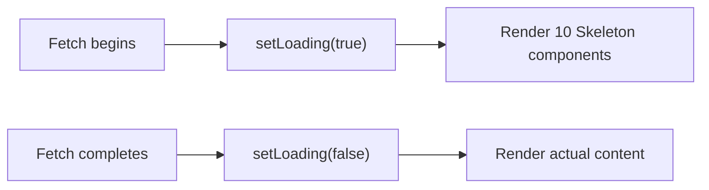

<!-- source: DeepWiki mcp.deepwiki.com · repo langchain-ai/open-agent-platform · page 4.3 Thread History Sidebar · fetched 2026-10-26 -->

# Thread History Sidebar

Relevant source files

The following files were used as context for generating this wiki page:

- [apps/web/src/features/chat/components/sidebar-buttons/index.tsx](apps/web/src/features/chat/components/sidebar-buttons/index.tsx)
- [apps/web/src/features/chat/components/thread-history-sidebar/index.tsx](apps/web/src/features/chat/components/thread-history-sidebar/index.tsx)
- [apps/web/src/features/chat/index.tsx](apps/web/src/features/chat/index.tsx)

This document covers the thread history sidebar system that allows users to browse and select previous chat conversations. The sidebar displays a chronological list of threads for the current agent, enabling users to switch between different conversation contexts.

For information about the main chat thread display, see [Thread and Messages](#4.1). For details about the configuration sidebar, see [Configuration Sidebar](#4.2).

## Purpose and Scope

The Thread History Sidebar provides a user interface for browsing historical chat threads associated with a specific agent. It fetches thread data from the LangGraph Platform, displays thread summaries with timestamps, and manages thread selection through URL query parameters. The system handles loading states, error conditions, and integrates with the platform's authentication and navigation systems.

## Architecture Overview

The thread history sidebar operates as a slide-out panel that fetches and displays thread data from the LangGraph Platform API.

Sources: [apps/web/src/features/chat/components/thread-history-sidebar/index.tsx:1-188](), [apps/web/src/features/chat/components/sidebar-buttons/index.tsx:1-115](), [apps/web/src/features/chat/index.tsx:1-108]()

## Data Flow and Thread Fetching

The sidebar implements a data fetching pipeline that retrieves thread information based on the current agent and deployment context.

Sources: [apps/web/src/features/chat/components/thread-history-sidebar/index.tsx:80-109](), [apps/web/src/features/chat/components/thread-history-sidebar/index.tsx:31-52](), [apps/web/src/features/chat/components/thread-history-sidebar/index.tsx:54-61]()

## Thread Content Processing

The system extracts meaningful display information from thread data using specialized utility functions.

| Function | Purpose | Input | Output |
|----------|---------|--------|--------|
| `getFirstHumanMessageContent` | Extracts first user message for thread title | `Thread` object | String content or thread ID fallback |
| `getMessageStringContent` | Converts message content to display string | `MessageContent` | Concatenated text content |
| `formatDate` | Formats creation timestamp | ISO date string | "MM/dd/yyyy - h:mm a" format |

The `getFirstHumanMessageContent` function implements error-safe message extraction:

Sources: [apps/web/src/features/chat/components/thread-history-sidebar/index.tsx:31-52](), [apps/web/src/features/chat/components/thread-history-sidebar/index.tsx:15-24](), [apps/web/src/features/chat/components/thread-history-sidebar/index.tsx:54-61]()

## State Management and Navigation

The sidebar uses a combination of URL query parameters and local component state for managing thread selection and UI visibility.

| State Variable | Type | Source | Purpose |
|----------------|------|--------|---------|
| `threadId` | string | URL query (`useQueryState`) | Currently selected thread |
| `agentId` | string | URL query (`useQueryState`) | Current agent context |
| `deploymentId` | string | URL query (`useQueryState`) | Current deployment context |
| `threads` | `Thread[]` | Local state (`useState`) | Fetched thread list |
| `loading` | boolean | Local state (`useState`) | Loading indicator |
| `open` | boolean | Props from parent | Sidebar visibility |

The thread selection process updates URL state and closes the sidebar:

Sources: [apps/web/src/features/chat/components/thread-history-sidebar/index.tsx:111-116](), [apps/web/src/features/chat/components/thread-history-sidebar/index.tsx:75-78]()

## User Interface Components

The sidebar renders as a fixed-position overlay with smooth animations and responsive design.

### Layout Structure

The component uses a three-tier layout hierarchy:

### Thread Item Display

Each thread item renders with the following structure:

| Element | Content | Styling |
|---------|---------|---------|
| Status dot | Gray circle indicator | `size-2 rounded-full bg-gray-200` |
| Title | First human message or thread ID | `line-clamp-1 truncate text-sm font-medium` |
| Timestamp | Formatted creation date | `text-sm text-gray-500` |
| Selection state | Background highlight | `bg-gray-100` when selected |

Sources: [apps/web/src/features/chat/components/thread-history-sidebar/index.tsx:117-184](), [apps/web/src/features/chat/components/thread-history-sidebar/index.tsx:132-148](), [apps/web/src/features/chat/components/thread-history-sidebar/index.tsx:149-178]()

## Integration with Chat System

The Thread History Sidebar integrates with the broader chat system through several key interfaces:

### Parent Component Integration

The `ChatInterface` component manages sidebar visibility and click-outside behavior:

### Button Control Integration

The `SidebarButtons` component manages mutual exclusivity between history and configuration sidebars:

| Action | History Sidebar | Config Sidebar | Button State |
|--------|----------------|----------------|--------------|
| History button click | Opens | Closes | Shows close chevron |
| Config button click | Closes | Opens | Shows close chevron |
| Close button click | Closes | Closes | Shows ellipsis |

Sources: [apps/web/src/features/chat/index.tsx:13-107](), [apps/web/src/features/chat/components/sidebar-buttons/index.tsx:21-112](), [apps/web/src/features/chat/components/sidebar-buttons/index.tsx:26-40]()

## Error Handling and Loading States

The system implements comprehensive error handling and user feedback mechanisms:

### Loading State Management

The component displays skeleton loaders during data fetching:

### Error Scenarios

| Error Type | Handling | User Feedback |
|------------|----------|---------------|
| Network failure | `console.error` + `toast.error` | "Failed to fetch threads" |
| Authentication failure | Implicit (no fetch attempted) | No threads displayed |
| Date formatting error | `console.error` + fallback | Empty date string |
| Message parsing error | `console.error` + fallback | Thread ID as title |

Sources: [apps/web/src/features/chat/components/thread-history-sidebar/index.tsx:88-105](), [apps/web/src/features/chat/components/thread-history-sidebar/index.tsx:132-140](), [apps/web/src/features/chat/components/thread-history-sidebar/index.tsx:45-51]()

---

