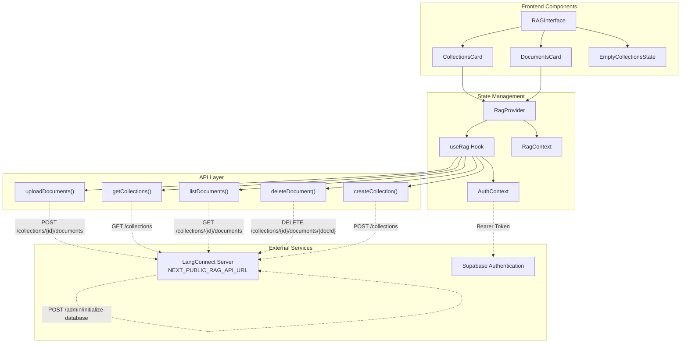
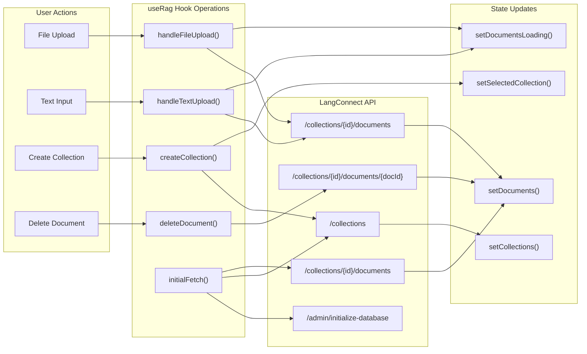

<!-- source: DeepWiki mcp.deepwiki.com · repo langchain-ai/open-agent-platform · page 5 RAG (Retrieval Augmented Generation) · fetched 2026-10-26 -->

# RAG (Retrieval Augmented Generation)

<details>
<summary>Relevant source files</summary>

The following files were used as context for generating this wiki page:

- [apps/web/src/features/rag/hooks/use-rag.tsx](apps/web/src/features/rag/hooks/use-rag.tsx)
- [apps/web/src/features/rag/index.tsx](apps/web/src/features/rag/index.tsx)
- [apps/web/src/features/rag/providers/RAG.tsx](apps/web/src/features/rag/providers/RAG.tsx)

</details>


The RAG system provides document management and retrieval capabilities for enhancing AI agent interactions with user-provided knowledge. This system enables users to upload, organize, and manage documents in collections that can be referenced by agents during conversations. The RAG implementation integrates with LangConnect as the backend server and provides a React-based frontend interface for document and collection management.

For detailed information about the UI components for managing collections and documents, see [Collections and Documents](#5.1). For backend integration and state management patterns, see [Collection Management](#5.2).

## System Architecture

The RAG system follows a client-server architecture where the Next.js frontend manages user interactions while LangConnect handles document processing, storage, and retrieval operations.



**Sources:** [apps/web/src/features/rag/index.tsx:1-61](), [apps/web/src/features/rag/hooks/use-rag.tsx:1-629](), [apps/web/src/features/rag/providers/RAG.tsx:1-36]()

## Data Flow and Operations

The RAG system manages two primary data entities: Collections and Documents. The data flow follows a typical CRUD pattern with authentication-protected API calls to the LangConnect backend.



**Sources:** [apps/web/src/features/rag/hooks/use-rag.tsx:308-383](), [apps/web/src/features/rag/hooks/use-rag.tsx:414-463](), [apps/web/src/features/rag/hooks/use-rag.tsx:274-306]()

## Core Components

### useRag Hook

The `useRag` hook serves as the central state management and API integration point for all RAG operations. It combines collection and document management into a single interface.

| Function | Purpose | Return Type |
|----------|---------|-------------|
| `initialFetch` | Loads initial collections and documents on authentication | `Promise<void>` |
| `getCollections` | Fetches all user collections from LangConnect | `Promise<Collection[]>` |
| `createCollection` | Creates new collection with validation | `Promise<Collection \| undefined>` |
| `updateCollection` | Updates collection name and metadata | `Promise<Collection \| undefined>` |
| `deleteCollection` | Removes collection and updates state | `Promise<string \| undefined>` |
| `listDocuments` | Fetches documents for a specific collection | `Promise<Document[]>` |
| `handleFileUpload` | Processes file uploads via FormData | `Promise<void>` |
| `handleTextUpload` | Creates document from text input | `Promise<void>` |
| `deleteDocument` | Removes document from collection | `Promise<void>` |

The hook maintains several key state variables:

```typescript
// Collection state
collections: Collection[]
selectedCollection: Collection | undefined
collectionsLoading: boolean

// Document state  
documents: Document[]
documentsLoading: boolean

// Initialization tracking
initialSearchExecuted: boolean
```

**Sources:** [apps/web/src/features/rag/hooks/use-rag.tsx:100-145](), [apps/web/src/features/rag/hooks/use-rag.tsx:151-162]()

### RAG Provider and Context

The `RagProvider` component wraps the `useRag` hook in a React context to provide global access to RAG functionality across the application.

```typescript
type RagContextType = ReturnType<typeof useRag>;
const RagContext = createContext<RagContextType | null>(null);
```

The provider automatically triggers `initialFetch` when a user session becomes available:

- Checks if collections are already loaded or initial search has been executed
- Calls `ragState.initialFetch(session?.accessToken)` on authentication
- Provides context value to all child components

**Sources:** [apps/web/src/features/rag/providers/RAG.tsx:6-8](), [apps/web/src/features/rag/providers/RAG.tsx:15-24]()

### Main RAG Interface

The `RAGInterface` component provides the main UI layout for the RAG system, organizing collections and documents into a responsive grid layout.

| Component | Purpose | Props |
|-----------|---------|--------|
| `CollectionsCard` | Displays collection list with selection | `collections`, `selectedCollection`, `setSelectedCollection` |
| `DocumentsCard` | Shows documents for selected collection | `selectedCollection`, `currentPage`, `setCurrentPage` |
| `EmptyCollectionsState` | Renders when no collections exist | None |
| `CollectionsCardLoading` | Loading state for collections | None |
| `DocumentsCardLoading` | Loading state for documents | None |

The interface uses conditional rendering based on `initialSearchExecuted` to show loading states during initial data fetching.

**Sources:** [apps/web/src/features/rag/index.tsx:16-27](), [apps/web/src/features/rag/index.tsx:29-60]()

## API Integration

### LangConnect Backend Integration

The RAG system integrates with LangConnect through RESTful API calls. The base URL is configured via the `NEXT_PUBLIC_RAG_API_URL` environment variable.

| Endpoint | Method | Purpose | Authentication |
|----------|--------|---------|----------------|
| `/collections` | GET | List all collections | Bearer token |
| `/collections` | POST | Create new collection | Bearer token |
| `/collections/{id}` | PATCH | Update collection | Bearer token |
| `/collections/{id}` | DELETE | Delete collection | Bearer token |
| `/collections/{id}/documents` | GET | List documents in collection | Bearer token |
| `/collections/{id}/documents` | POST | Upload documents to collection | Bearer token |
| `/collections/{id}/documents/{docId}` | DELETE | Delete specific document | Bearer token |
| `/admin/initialize-database` | POST | Initialize RAG database | Bearer token |

### Authentication Flow

All API requests require authentication through Supabase JWT tokens:

1. `useAuthContext` provides the current session
2. Access token is extracted from `session?.accessToken`
3. Token is included in `Authorization: Bearer {token}` header
4. Failed authentication triggers toast error messages

**Sources:** [apps/web/src/features/rag/hooks/use-rag.tsx:17-24](), [apps/web/src/features/rag/hooks/use-rag.tsx:387-412](), [apps/web/src/features/rag/hooks/use-rag.tsx:243-249]()

## File Upload Operations

### File Upload Processing

The `handleFileUpload` function processes file uploads through a multi-step workflow:

1. **Validation**: Checks for authenticated session and valid file selection
2. **Document Creation**: Creates `Document` objects with metadata for each file
3. **FormData Preparation**: Builds FormData with files and metadata JSON
4. **API Upload**: Sends POST request to `/collections/{id}/documents`
5. **State Update**: Adds new documents to local state

The `uploadDocuments` function handles the actual HTTP request with proper error handling and response parsing.

**Sources:** [apps/web/src/features/rag/hooks/use-rag.tsx:308-345](), [apps/web/src/features/rag/hooks/use-rag.tsx:41-95]()

### Text Input Processing

The `handleTextUpload` function converts text input into uploadable documents:

1. Creates a Blob from the text content
2. Generates a timestamped filename
3. Constructs a File object from the Blob
4. Builds metadata with size and creation timestamp
5. Uses the same `uploadDocuments` workflow as file uploads

**Sources:** [apps/web/src/features/rag/hooks/use-rag.tsx:347-383]()

### Default Collection Management

The system maintains a default collection for initial document uploads:

- `DEFAULT_COLLECTION_NAME` constant set to `"default_collection"`
- `getDefaultCollection` function finds or returns first available collection
- `getCollectionName` function provides display-friendly names (converts "default_collection" to "Default")

**Sources:** [apps/web/src/features/rag/hooks/use-rag.tsx:8-29]()

---

