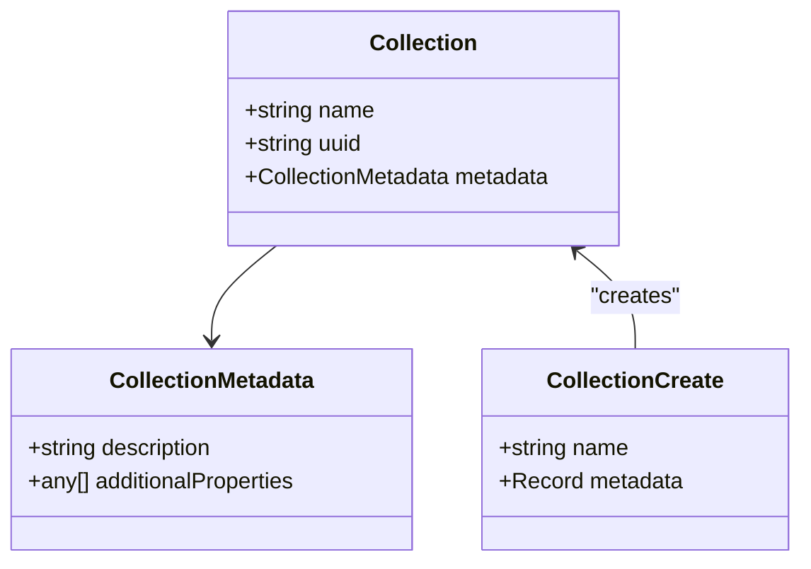
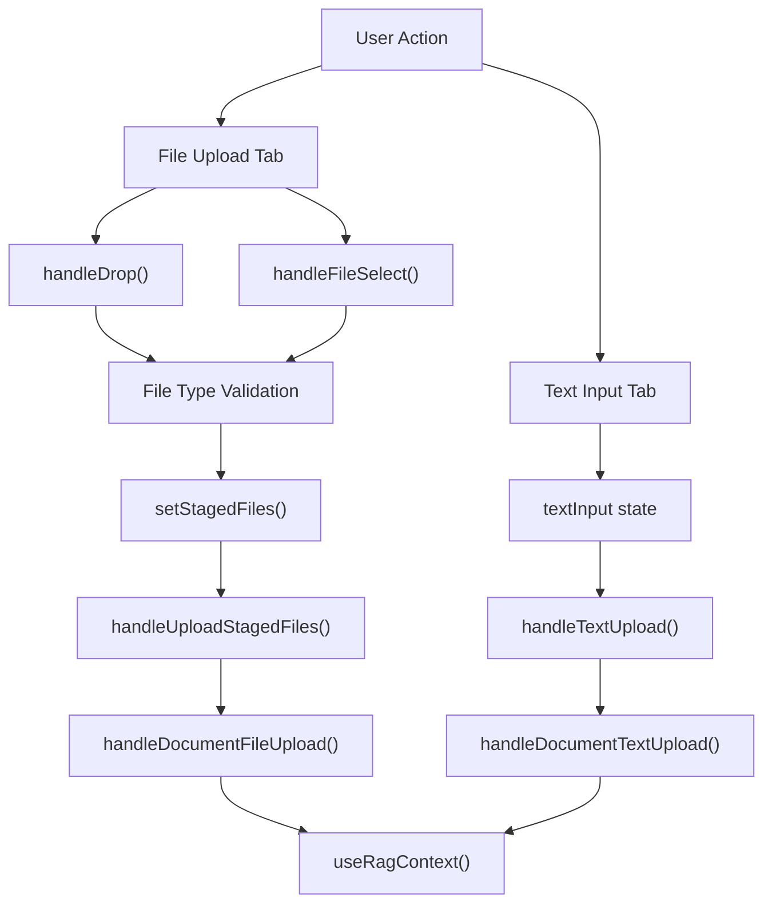
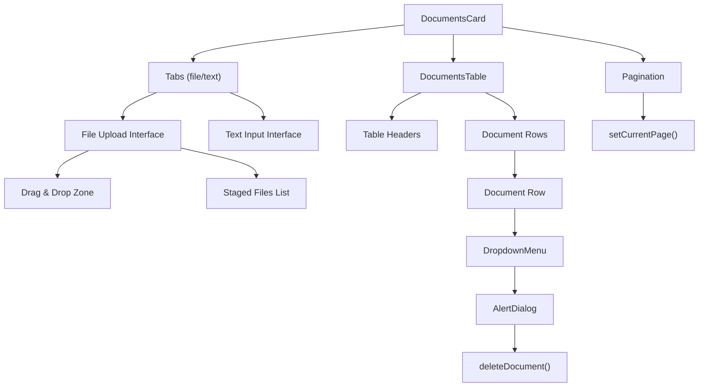
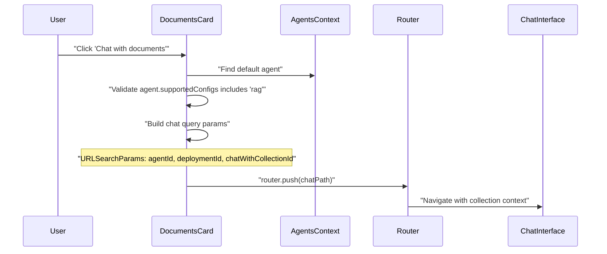
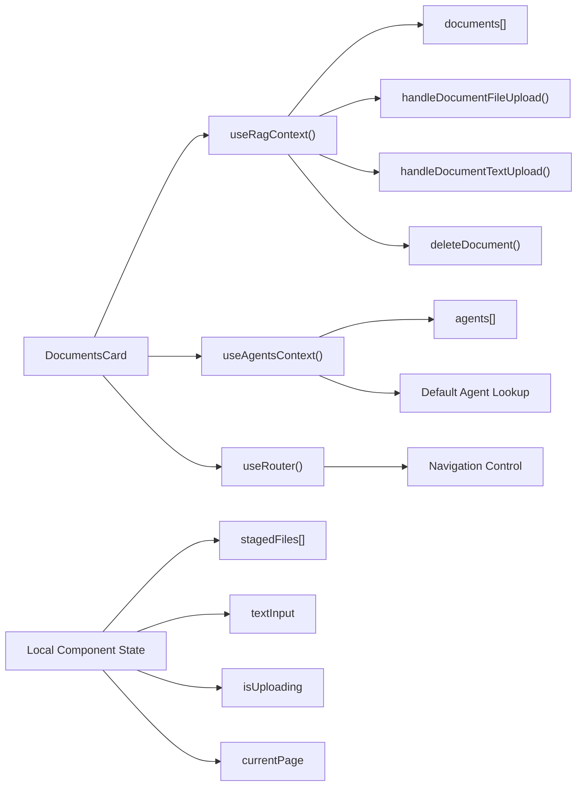

<!-- source: DeepWiki mcp.deepwiki.com · repo langchain-ai/open-agent-platform · page 5.1 Collections and Documents · fetched 2026-10-26 -->

# Collections and Documents

Relevant source files

The following files were used as context for generating this wiki page:

- [apps/web/src/features/rag/components/collections-list/index.tsx](apps/web/src/features/rag/components/collections-list/index.tsx)
- [apps/web/src/features/rag/components/documents-card/documents-table.tsx](apps/web/src/features/rag/components/documents-card/documents-table.tsx)
- [apps/web/src/features/rag/components/documents-card/index.tsx](apps/web/src/features/rag/components/documents-card/index.tsx)
- [apps/web/src/types/collection.ts](apps/web/src/types/collection.ts)

This document covers the document upload, organization, and display systems within RAG collections in the Open Agent Platform. It explains how users can upload files and text to collections, view and manage documents through tabular interfaces, and integrate document collections with chat agents for retrieval-augmented generation.

For information about collection creation and backend management, see [Collection Management](#5.2).

## Collection Structure

Collections serve as organizational containers for documents in the RAG system. Each collection has a unique identifier and can contain multiple documents of various types.

### Collection Data Types

The platform defines collections using a structured type system:

| Field | Type | Description |
|-------|------|-------------|
| `name` | string | Collection identifier |
| `uuid` | string | Unique collection identifier |
| `metadata` | object | Additional collection properties including description |

**Collection Data Structure**

Sources: [apps/web/src/types/collection.ts:1-14]()

## Document Upload System

The document upload system supports both file uploads and direct text input through a tabbed interface. The system includes drag-and-drop functionality, file staging, and validation.

### Supported File Types

The platform accepts the following file formats:
- PDF files (`.pdf`)
- Plain text files (`.txt`) 
- HTML files (`.html`)

File type validation occurs at multiple stages: during drag-and-drop operations and file selection.

**Document Upload Flow**

Sources: [apps/web/src/features/rag/components/documents-card/index.tsx:86-182]()

### File Staging System

The upload interface implements a staging system where files are temporarily held before upload:

1. **File Addition**: Files are added to `stagedFiles` state through drag-and-drop or file selection
2. **File Display**: Staged files appear in a list with removal options
3. **Batch Upload**: All staged files are uploaded simultaneously via `handleUploadStagedFiles()`
4. **Stage Clearing**: Successfully uploaded files are removed from staging

The staging system provides users with upload control and prevents accidental uploads.

Sources: [apps/web/src/features/rag/components/documents-card/index.tsx:149-182]()

## Document Management Interface

The document management interface consists of a paginated table displaying document metadata and providing action controls.

### DocumentsTable Component

The `DocumentsTable` component renders documents in a structured table format:

| Column | Data Source | Description |
|--------|-------------|-------------|
| Document Name | `doc.metadata.name` | Original filename or text identifier |
| Collection | `selectedCollection.name` | Collection badge display |
| Date Uploaded | `doc.metadata.created_at` | Formatted upload timestamp |
| Actions | Dropdown menu | Delete and other document operations |

**Documents Interface Architecture**

Sources: [apps/web/src/features/rag/components/documents-card/documents-table.tsx:44-141](), [apps/web/src/features/rag/components/documents-card/index.tsx:338-398]()

### Document Deletion

Document deletion is handled through a confirmation dialog system:

1. User clicks the actions dropdown menu
2. Delete option triggers an `AlertDialog`
3. Confirmation calls `deleteDocument()` with the document's `file_id`
4. The operation is disabled during upload states to prevent conflicts

Sources: [apps/web/src/features/rag/components/documents-card/documents-table.tsx:83-133]()

## Integration with Chat System

The documents interface provides direct integration with the chat system through the "Chat with your documents" functionality.

### Chat Integration Flow

The integration requires:
- A default agent that supports RAG configuration
- A selected collection with documents
- Proper URL parameter construction for chat context

Sources: [apps/web/src/features/rag/components/documents-card/index.tsx:205-229]()

## Data Flow and State Management

The documents system integrates with several context providers and state management systems to coordinate document operations.

### Context Dependencies

**State Management Architecture**

### Document Filtering and Pagination

The system implements client-side filtering and pagination:

1. **Filtering**: Documents are filtered by collection UUID using `documents.filter(doc => doc.metadata.collection === selectedCollection?.uuid)`
2. **Pagination**: Filtered documents are sliced based on `currentPage` and `itemsPerPage` (10 items per page)
3. **Page Calculation**: Total pages are calculated as `Math.ceil(filteredDocuments.length / itemsPerPage)`

Sources: [apps/web/src/features/rag/components/documents-card/index.tsx:66-83]()

### Loading States

The interface implements loading states and skeleton components to handle asynchronous operations:

- `DocumentsCardLoading` component provides skeleton placeholders
- Upload operations show loading toasts via the `sonner` toast system
- Actions are disabled during upload states to prevent conflicts

Sources: [apps/web/src/features/rag/components/documents-card/index.tsx:404-430]()

---

