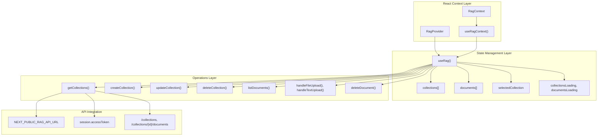
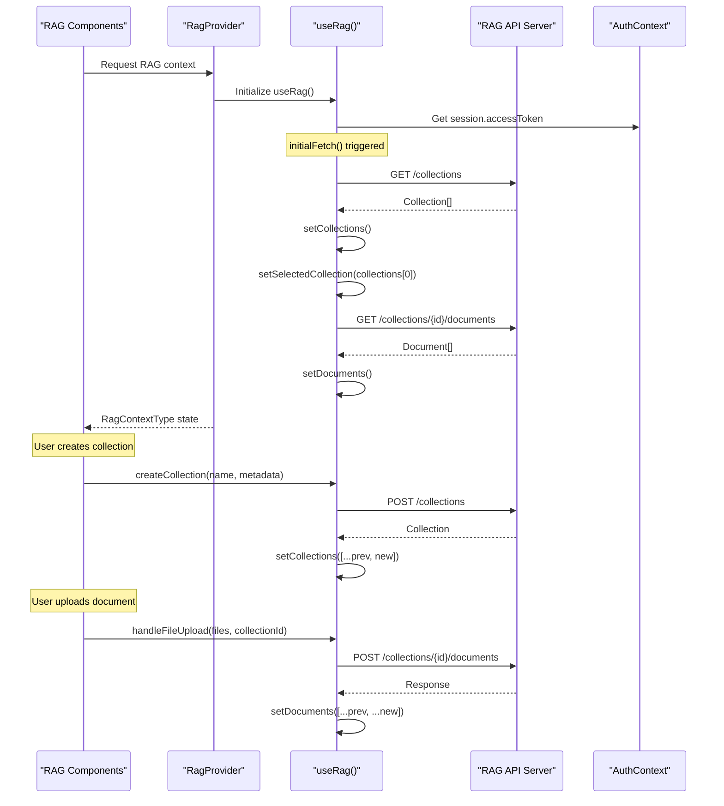

<!-- source: DeepWiki mcp.deepwiki.com · repo langchain-ai/open-agent-platform · page 5.2 Collection Management · fetched 2026-10-26 -->

# Collection Management

<details>
<summary>Relevant source files</summary>

The following files were used as context for generating this wiki page:

- [apps/web/src/features/rag/hooks/use-rag.tsx](apps/web/src/features/rag/hooks/use-rag.tsx)
- [apps/web/src/features/rag/index.tsx](apps/web/src/features/rag/index.tsx)
- [apps/web/src/features/rag/providers/RAG.tsx](apps/web/src/features/rag/providers/RAG.tsx)

</details>


This document covers the backend integration and state management systems for RAG collections and documents within the Open Agent Platform. It focuses on the React hooks, context providers, and API integration patterns that enable CRUD operations on collections and their associated documents. For information about the UI components that display collections and documents, see [Collections and Documents](#5.1).

## Architecture Overview

The collection management system is built around a centralized React hook (`useRag`) that provides both collection and document operations, wrapped in a context provider for global state access.

### Core Components Architecture



Sources: [apps/web/src/features/rag/hooks/use-rag.tsx:151-629](), [apps/web/src/features/rag/providers/RAG.tsx:1-36]()

### Data Flow and State Management



Sources: [apps/web/src/features/rag/providers/RAG.tsx:15-25](), [apps/web/src/features/rag/hooks/use-rag.tsx:165-204]()

## Collection State Management

The `useRag` hook manages collection state through several React state variables and provides a unified interface for all collection operations.

### State Structure

| State Variable | Type | Purpose |
|---|---|---|
| `collections` | `Collection[]` | Array of all available collections |
| `collectionsLoading` | `boolean` | Loading state for collection operations |
| `selectedCollection` | `Collection \| undefined` | Currently active collection |
| `initialSearchExecuted` | `boolean` | Tracks initial data fetch completion |

The `Collection` type includes `uuid`, `name`, and `metadata` fields, with the UUID serving as the primary identifier for API operations.

### Default Collection Handling

The system implements a special default collection concept through the `getDefaultCollection` function:

```typescript
export const DEFAULT_COLLECTION_NAME = "default_collection";

export function getDefaultCollection(collections: Collection[]): Collection {
  return (
    collections.find((c) => c.name === DEFAULT_COLLECTION_NAME) ??
    collections[0]
  );
}
```

Sources: [apps/web/src/features/rag/hooks/use-rag.tsx:8-15]()

## Collection CRUD Operations

### Collection Retrieval

The `getCollections` function fetches all collections from the RAG API server:

```typescript
const getCollections = useCallback(
  async (accessToken?: string): Promise<Collection[]> => {
    const url = getApiUrlOrThrow();
    url.pathname = "/collections";
    
    const response = await fetch(url.toString(), {
      headers: {
        Authorization: `Bearer ${accessToken || session?.accessToken}`,
      },
    });
    
    const data = await response.json();
    return data;
  },
  [session],
);
```

The function includes error handling for database initialization scenarios, automatically calling `initializeDatabase` if the collections endpoint fails.

Sources: [apps/web/src/features/rag/hooks/use-rag.tsx:387-412](), [apps/web/src/features/rag/hooks/use-rag.tsx:206-233]()

### Collection Creation

The `createCollection` function handles new collection creation with validation:

```typescript
const createCollection = useCallback(
  async (
    name: string,
    metadata: Record<string, any> = {},
    accessToken?: string,
  ): Promise<Collection | undefined> => {
    const trimmedName = name.trim();
    if (!trimmedName) {
      console.error("Collection name cannot be empty.");
      return undefined;
    }
    
    const nameExists = collections.some(
      (c) => c.name.toLowerCase() === trimmedName.toLowerCase(),
    );
    if (nameExists) {
      console.warn(`Collection with name "${trimmedName}" already exists.`);
      return undefined;
    }
    
    const newCollection: CollectionCreate = {
      name: trimmedName,
      metadata,
    };
    
    const response = await fetch(url.toString(), {
      method: "POST",
      headers: {
        "Content-Type": "application/json",
        Authorization: `Bearer ${accessToken || session?.accessToken}`,
      },
      body: JSON.stringify(newCollection),
    });
    
    const data = await response.json();
    setCollections((prevCollections) => [...prevCollections, data]);
    return data;
  },
  [collections, session],
);
```

Sources: [apps/web/src/features/rag/hooks/use-rag.tsx:414-465]()

### Collection Updates and Deletion

The `updateCollection` function supports name and metadata modifications with duplicate name validation. The `deleteCollection` function removes collections and updates the local state accordingly. Both operations use PATCH and DELETE HTTP methods respectively against the `/collections/{id}` endpoint.

Sources: [apps/web/src/features/rag/hooks/use-rag.tsx:467-554](), [apps/web/src/features/rag/hooks/use-rag.tsx:556-597]()

## Document Operations Within Collections

### Document Listing

The `listDocuments` function retrieves documents for a specific collection with pagination support:

```typescript
const listDocuments = useCallback(
  async (
    collectionId: string,
    args?: { limit?: number; offset?: number },
    accessToken?: string,
  ): Promise<Document[]> => {
    const url = getApiUrlOrThrow();
    url.pathname = `/collections/${collectionId}/documents`;
    if (args?.limit) {
      url.searchParams.set("limit", args.limit.toString());
    }
    if (args?.offset) {
      url.searchParams.set("offset", args.offset.toString());
    }
    
    const response = await fetch(url.toString(), {
      headers: {
        Authorization: `Bearer ${accessToken || session?.accessToken}`,
      },
    });
    
    const data = await response.json();
    return data;
  },
  [session],
);
```

Sources: [apps/web/src/features/rag/hooks/use-rag.tsx:237-272]()

### Document Upload Operations

The system supports two types of document uploads through dedicated handlers:

#### File Upload
The `handleFileUpload` function processes `FileList` objects and converts them to `FormData` for API transmission:

```typescript
const handleFileUpload = useCallback(
  async (files: FileList | null, collectionId: string) => {
    const newDocs: Document[] = Array.from(files).map((file) => {
      return new Document({
        id: uuidv4(),
        pageContent: `Content of ${file.name}`,
        metadata: {
          name: file.name,
          collection: collectionId,
          size: `${(file.size / (1024 * 1024)).toFixed(1)} MB`,
          created_at: new Date().toISOString(),
        },
      });
    });

    await uploadDocuments(
      collectionId,
      Array.from(files),
      session.accessToken,
      newDocs.map((d) => d.metadata),
    );
    setDocuments((prevDocs) => [...prevDocs, ...newDocs]);
  },
  [session],
);
```

#### Text Upload
The `handleTextUpload` function creates blob-based files from text input:

```typescript
const handleTextUpload = useCallback(
  async (textInput: string, collectionId: string) => {
    const textBlob = new Blob([textInput], { type: "text/plain" });
    const fileName = `Text Document ${new Date().toISOString().slice(0, 19).replace("T", " ")}.txt`;
    const textFile = new File([textBlob], fileName, { type: "text/plain" });
    
    await uploadDocuments(collectionId, [textFile], session.accessToken, [metadata]);
    setDocuments((prevDocs) => [...prevDocs, new Document({...})]);
  },
  [session],
);
```

Sources: [apps/web/src/features/rag/hooks/use-rag.tsx:308-345](), [apps/web/src/features/rag/hooks/use-rag.tsx:347-383]()

### Upload Implementation Details

The core `uploadDocuments` function handles the FormData construction and API communication:

```typescript
async function uploadDocuments(
  collectionId: string,
  files: File[],
  authorization: string,
  metadatas?: Record<string, any>[],
): Promise<any> {
  const url = `${getApiUrlOrThrow().href}collections/${encodeURIComponent(collectionId)}/documents`;
  
  const formData = new FormData();
  
  files.forEach((file) => {
    formData.append("files", file, file.name);
  });
  
  if (metadatas) {
    const metadatasJsonString = JSON.stringify(metadatas);
    formData.append("metadatas_json", metadatasJsonString);
  }
  
  const response = await fetch(url, {
    method: "POST",
    body: formData,
    headers: {
      Authorization: `Bearer ${authorization}`,
    },
  });
  
  return await response.json();
}
```

Sources: [apps/web/src/features/rag/hooks/use-rag.tsx:41-95]()

## API Integration and Configuration

### Environment Configuration

The system relies on the `NEXT_PUBLIC_RAG_API_URL` environment variable for API endpoint configuration. The `getApiUrlOrThrow` function provides centralized URL management with error handling:

```typescript
function getApiUrlOrThrow(): URL {
  if (!process.env.NEXT_PUBLIC_RAG_API_URL) {
    throw new Error(
      "Failed to upload documents: API URL not configured. Please set NEXT_PUBLIC_RAG_API_URL",
    );
  }
  return new URL(process.env.NEXT_PUBLIC_RAG_API_URL);
}
```

### Authentication Integration

All API operations integrate with the authentication system through the `useAuthContext` hook, using JWT tokens in Authorization headers. The system includes fallback patterns for both session-based and explicit token authentication.

### Error Handling Patterns

The collection management system implements consistent error handling with user-facing toast notifications through the `sonner` library. Database initialization failures trigger automatic retry patterns, while validation errors prevent invalid operations.

Sources: [apps/web/src/features/rag/hooks/use-rag.tsx:17-24](), [apps/web/src/features/rag/hooks/use-rag.tsx:1-7]()

---

