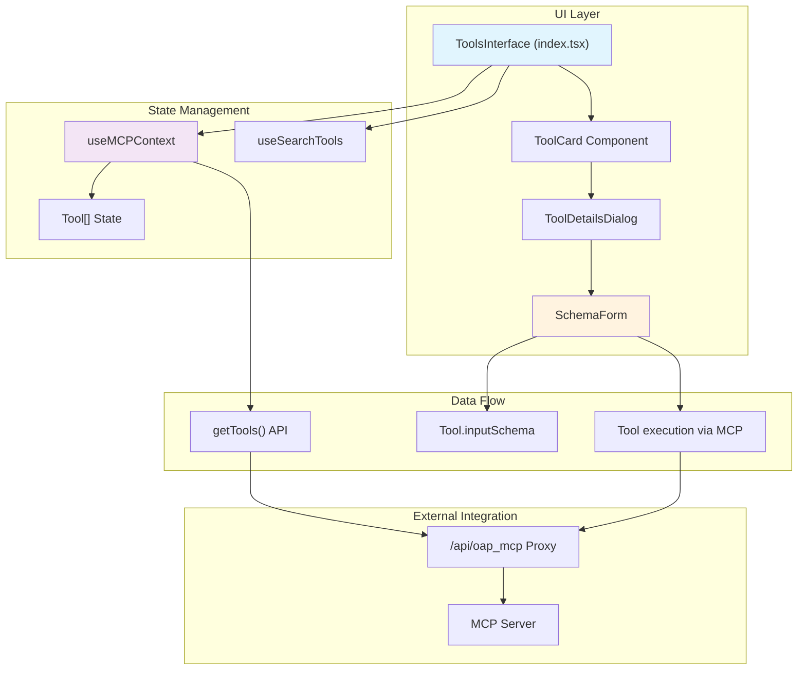
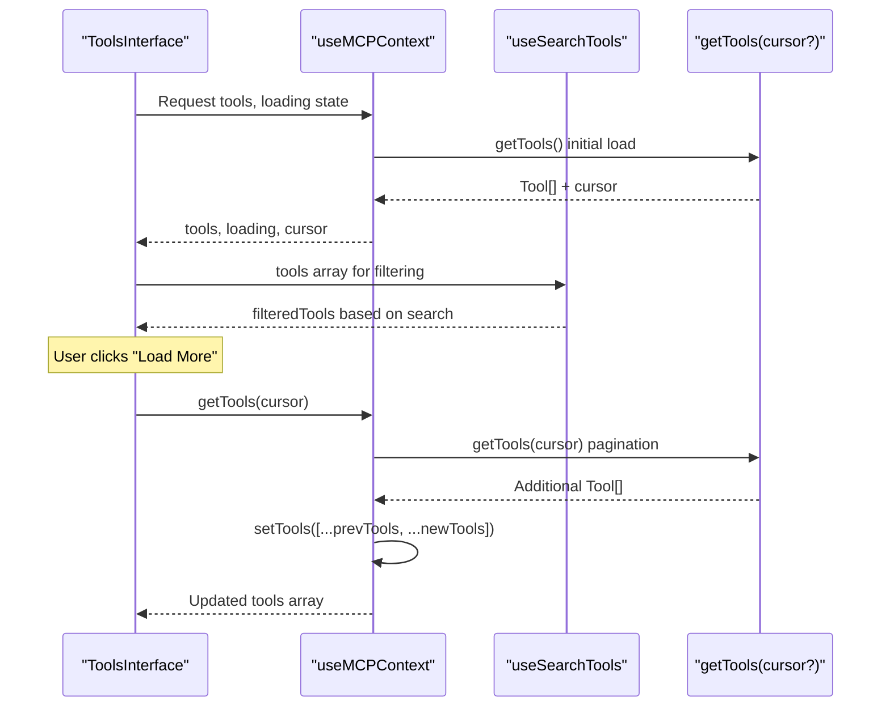
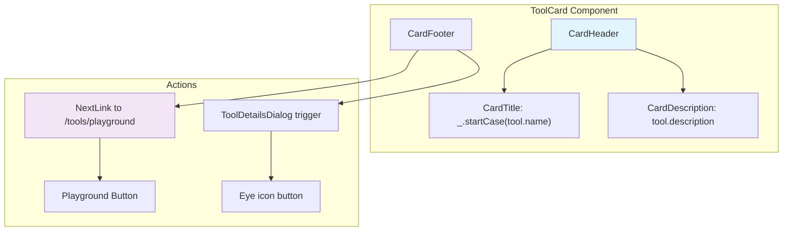
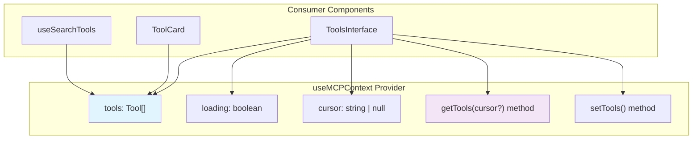

<!-- source: DeepWiki mcp.deepwiki.com · repo langchain-ai/open-agent-platform · page 6 Tools System · fetched 2026-10-26 -->

# Tools System

<details>
<summary>Relevant source files</summary>

The following files were used as context for generating this wiki page:

- [apps/web/src/features/tools/components/tool-card/index.tsx](apps/web/src/features/tools/components/tool-card/index.tsx)
- [apps/web/src/features/tools/components/tool-details-dialog/index.tsx](apps/web/src/features/tools/components/tool-details-dialog/index.tsx)
- [apps/web/src/features/tools/index.tsx](apps/web/src/features/tools/index.tsx)
- [apps/web/src/features/tools/playground/components/schema-form.tsx](apps/web/src/features/tools/playground/components/schema-form.tsx)

</details>


The Tools System provides external tool integration capabilities for AI agents through the Model Context Protocol (MCP). This system enables agents to discover, configure, and execute external tools by dynamically generating user interfaces based on tool schemas. The system consists of a tools listing interface, detailed tool inspection capabilities, and an interactive playground for testing tool execution.

For information about the interactive testing interface, see [Tool Playground](#6.1). For details about the broader MCP integration architecture, see [MCP Integration System](#2.3).

## Architecture Overview

The Tools System operates as a frontend orchestration layer that interfaces with MCP servers to provide tool discovery and execution capabilities. The system uses schema-driven UI generation to create dynamic forms for tool parameters.

### System Components Diagram



Sources: [apps/web/src/features/tools/index.tsx:1-131](), [apps/web/src/features/tools/components/tool-card/index.tsx:1-74](), [apps/web/src/features/tools/components/tool-details-dialog/index.tsx:1-49](), [apps/web/src/features/tools/playground/components/schema-form.tsx:1-201]()

## Tool Discovery and Listing

The primary tools interface provides a paginated grid view of available tools with search functionality. The `ToolsInterface` component manages tool loading, search filtering, and pagination state.

### Tool Loading Flow



Sources: [apps/web/src/features/tools/index.tsx:41-58]()

### Search and Filtering

The system implements debounced search functionality through the `useSearchTools` hook, which filters tools based on name and description matching.

| Component | Responsibility |
|-----------|---------------|
| `Search` | Input component with debounced onChange |
| `useSearchTools` | Filters tools array based on search term |
| `debouncedSetSearchTerm` | Prevents excessive filtering operations |

Sources: [apps/web/src/features/tools/index.tsx:42-43](), [apps/web/src/features/tools/index.tsx:74-78]()

## Tool Card System

Individual tools are displayed using the `ToolCard` component, which provides a standardized interface for tool information and actions.

### Tool Card Structure



Sources: [apps/web/src/features/tools/components/tool-card/index.tsx:23-53]()

The card footer contains two primary actions:
- **Playground Button**: Links to `/tools/playground?tool=${tool.name}` for interactive testing
- **Details Button**: Opens `ToolDetailsDialog` for schema inspection

## Schema Rendering System

The Tools System uses dynamic schema rendering to display tool input requirements and generate interactive forms.

### Schema Processing Flow

```mermaid
graph LR
    subgraph "Schema Input"
        ToolInputSchema["tool.inputSchema"]
        Properties["schema.properties"]
        Required["schema.required[]"]
    end
    
    subgraph "SchemaRenderer"
        SchemaRenderer["SchemaRenderer Component"]
        PropertyIteration["Object.entries() iteration"]
    end
    
    subgraph "Form Generation"
        SchemaForm["SchemaForm Component"]
        FieldRendering["renderField() function"]
        FormControls["Input/Select/Switch/Slider"]
    end
    
    ToolInputSchema --> SchemaRenderer
    Properties --> PropertyIteration
    Required --> PropertyIteration
    
    PropertyIteration --> SchemaForm
    SchemaForm --> FieldRendering
    FieldRendering --> FormControls
    
    style ToolInputSchema fill:#e1f5fe
    style SchemaForm fill:#f3e5f5
```

Sources: [apps/web/src/features/tools/components/tool-details-dialog/index.tsx:38-40](), [apps/web/src/features/tools/playground/components/schema-form.tsx:24-100]()

### Dynamic Form Field Types

The `SchemaForm` component supports multiple input types based on JSON schema properties:

| Schema Type | Component | Additional Logic |
|-------------|-----------|------------------|
| `string` | `Input` | Uses `property.example` as placeholder |
| `number`/`integer` | `Input` or `Slider` | Slider if min/max defined |
| `boolean` | `Switch` | Shows "Enabled"/"Disabled" labels |
| `enum` | `Select` | Dropdown with `property.enum` options |

The form automatically handles default values and required field validation:

```typescript
// Default value initialization
if (prop.default !== undefined && formValues[key] === undefined) {
  defaults[key] = prop.default;
}

// Required field indicator
const isRequired = schema.required?.includes(name);
```

Sources: [apps/web/src/features/tools/playground/components/schema-form.tsx:102-201](), [apps/web/src/features/tools/playground/components/schema-form.tsx:30-44](), [apps/web/src/features/tools/playground/components/schema-form.tsx:63-84]()

## Integration with MCP Context

The Tools System relies on the `useMCPContext` provider for tool data management and API interactions.

### MCP Context Interface



Sources: [apps/web/src/features/tools/index.tsx:41-41]()

The context provides pagination support through the `cursor` mechanism, enabling efficient loading of large tool collections through the "Load More Tools" functionality.

Sources: [apps/web/src/features/tools/index.tsx:46-58](), [apps/web/src/features/tools/index.tsx:106-118]()

---

