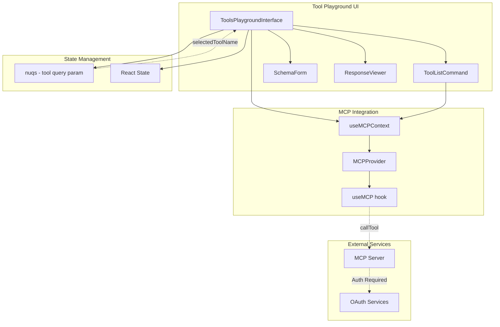
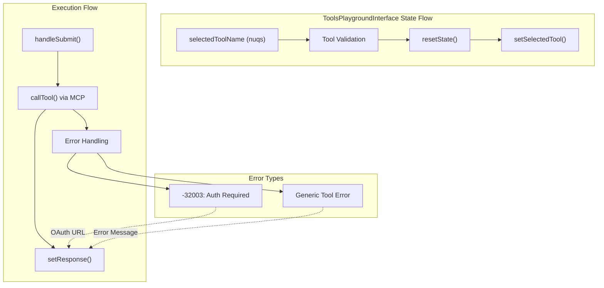
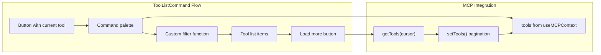
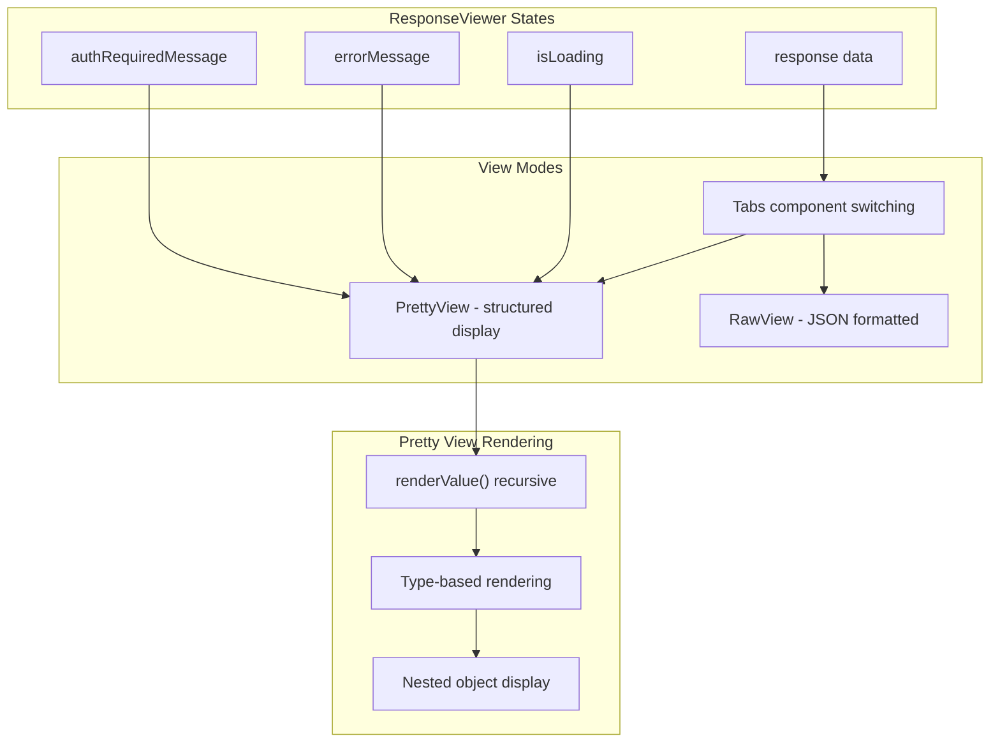
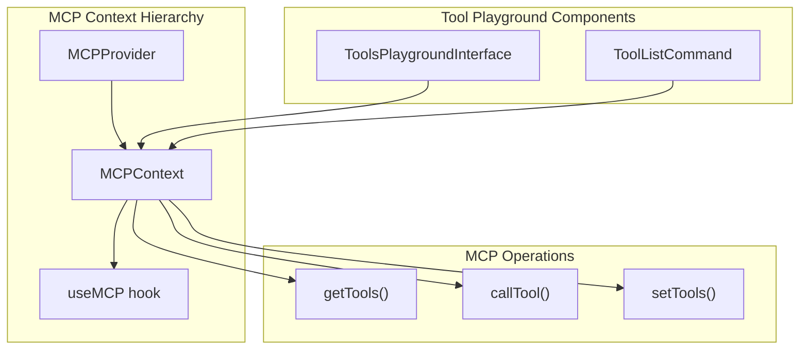

<!-- source: DeepWiki mcp.deepwiki.com · repo langchain-ai/open-agent-platform · page 6.1 Tool Playground · fetched 2026-10-26 -->

# Tool Playground

<details>
<summary>Relevant source files</summary>

The following files were used as context for generating this wiki page:

- [apps/web/src/features/tools/components/tool-list-command.tsx](apps/web/src/features/tools/components/tool-list-command.tsx)
- [apps/web/src/features/tools/playground/components/response-viewer.tsx](apps/web/src/features/tools/playground/components/response-viewer.tsx)
- [apps/web/src/features/tools/playground/index.tsx](apps/web/src/features/tools/playground/index.tsx)
- [apps/web/src/providers/MCP.tsx](apps/web/src/providers/MCP.tsx)

</details>


The Tool Playground provides an interactive interface for testing and executing individual external tools integrated through the Model Context Protocol (MCP). It allows developers and users to experiment with tool capabilities, validate input parameters, and inspect response formats before integrating tools into agent workflows.

For information about MCP integration architecture and proxy setup, see [MCP Integration System](#2.3). For general tools system overview, see [Tools System](#6).

## Overview

The Tool Playground is implemented as a split-pane interface where users can select tools, configure input parameters through dynamically generated forms, execute tools, and view formatted responses. The system handles authentication flows, error states, and provides both human-readable and raw JSON response formats.



Sources: [apps/web/src/features/tools/playground/index.tsx:1-194](), [apps/web/src/providers/MCP.tsx:1-47]()

## Core Components

### ToolsPlaygroundInterface

The main orchestrator component manages tool selection, form state, execution flow, and response handling. It uses URL query parameters to persist the selected tool and provides error handling for authentication and execution failures.

Key state management:
- `selectedToolName` - URL query parameter via `nuqs`
- `selectedTool` - Current tool object from MCP context
- `inputValues` - Form input state
- `response` - Tool execution response
- `isLoading` - Execution state
- `authRequiredMessage` - OAuth flow handling

The component handles tool selection validation and redirects users back to `/tools` if an invalid tool is specified in the URL.



Sources: [apps/web/src/features/tools/playground/index.tsx:21-194]()

### Tool Selection System

The `ToolListCommand` component provides a searchable command palette interface for tool selection with pagination support for large tool collections.

**Key Features:**
- Fuzzy search with `_.startCase` formatting
- Pagination via cursor-based loading
- Real-time loading states
- Custom filter function for name matching

The component integrates with the MCP context to fetch available tools and supports loading additional tools when a cursor is available for pagination.



Sources: [apps/web/src/features/tools/components/tool-list-command.tsx:1-122]()

## Dynamic Form Generation

The playground uses `SchemaForm` to dynamically generate input forms based on each tool's JSON schema definition. This allows tools to define their own parameter requirements and validation rules.

**Schema Processing:**
- JSON schema from `selectedTool.inputSchema` 
- Dynamic field rendering based on schema types
- Real-time validation and state updates
- Form state managed via `inputValues` object

The form system automatically handles different input types and validation constraints defined in the tool's schema, providing a consistent interface regardless of the underlying tool complexity.

Sources: [apps/web/src/features/tools/playground/index.tsx:169-173]()

## Response Handling

### ResponseViewer Component

The `ResponseViewer` handles multiple response states and provides formatted output options:

**Response States:**
- Loading with spinner animation
- Authentication required with OAuth URL
- Error messages with alert styling  
- Success responses with formatted output

**View Modes:**
- **Pretty View**: Structured, color-coded display with nested object rendering
- **Raw View**: JSON formatted with syntax highlighting



Sources: [apps/web/src/features/tools/playground/components/response-viewer.tsx:1-172]()

### Authentication Flow Handling

The playground provides special handling for tools requiring OAuth authentication:

**Authentication Error Code**: `-32003` with authentication URL
**User Experience**: 
- Clear authentication prompt with warning icon
- Direct link to OAuth provider
- Instructions to re-run tool after authentication
- Preserved form state during auth flow

```typescript
if (e.code === -32003 && e.data) {
  setAuthRequiredMessage(
    <div className="flex flex-col items-center justify-center rounded-md border border-blue-200 bg-blue-50 p-6 text-blue-700">
      <AlertTriangle className="mb-3 h-8 w-8 text-blue-500" />
      <p className="mb-1 text-center text-lg font-semibold">
        {e.data?.message?.text}
      </p>
      <p className="mb-2 text-center">
        After authenticating, please run the tool again.
      </p>
      <a href={e.data?.url} target="_blank" rel="noopener noreferrer">
        {e.data?.url}
      </a>
    </div>
  );
}
```

Sources: [apps/web/src/features/tools/playground/index.tsx:89-109]()

## MCP Context Integration

The playground relies on the `MCPProvider` context for tool management and execution:

**Context Capabilities:**
- `tools` - Available tool list
- `loading` - Initial load state
- `callTool()` - Tool execution function
- `getTools()` - Pagination support
- `cursor` - Pagination cursor for more tools

**Provider Initialization:**
The `MCPProvider` automatically fetches initial tools on mount and provides loading states for the UI components.



Sources: [apps/web/src/providers/MCP.tsx:15-39](), [apps/web/src/features/tools/playground/index.tsx:22]()

## User Interface Layout

The playground uses a resizable panel layout with header controls:

**Layout Structure:**
- Header with title and tool selector
- Tool information section with description and run button
- Resizable horizontal panels (50/50 default split)
- Left panel: Input form
- Right panel: Response viewer

**Interactive Elements:**
- `ResizablePanelGroup` for adjustable layout
- `ToolListCommand` for tool switching
- Run button with loading state
- Response tabs for view mode switching

The interface provides a clean separation between input configuration and output inspection, allowing users to efficiently test tools with different parameter combinations.

Sources: [apps/web/src/features/tools/playground/index.tsx:119-194]()

---

