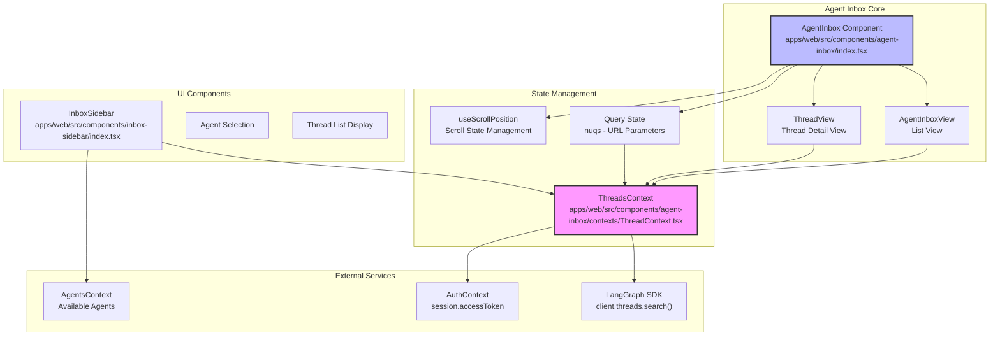
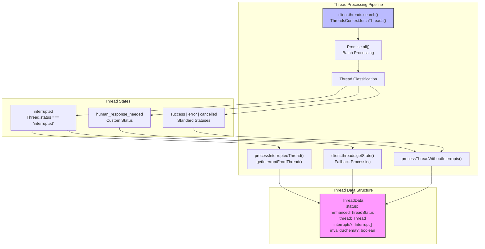
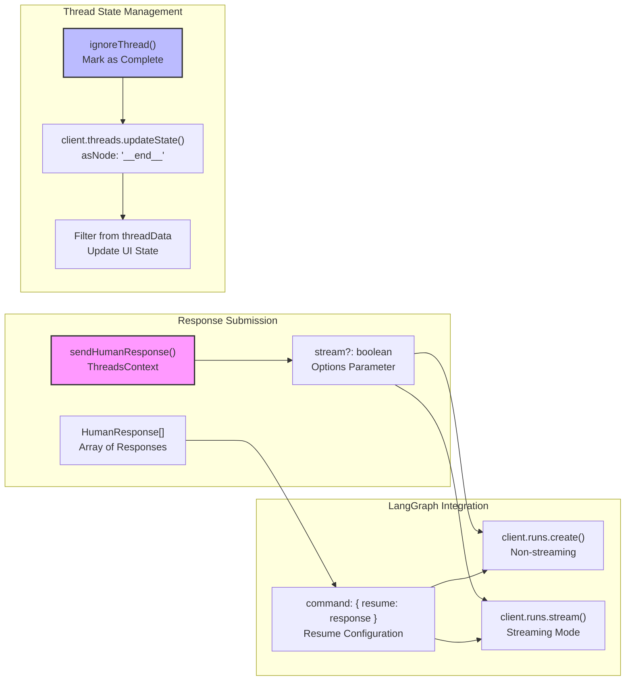
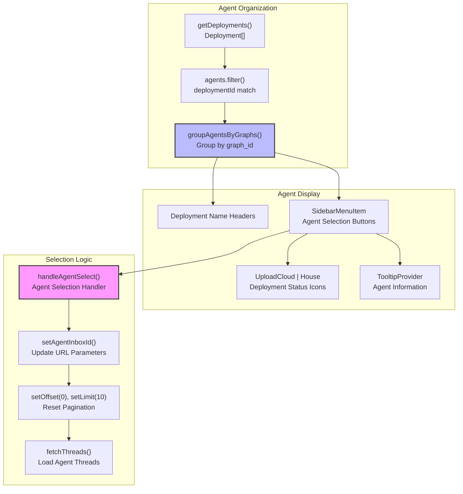
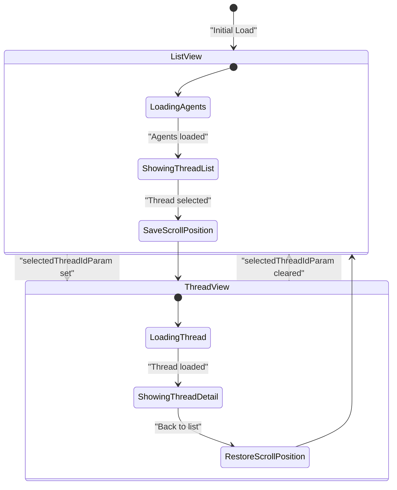

<!-- source: DeepWiki mcp.deepwiki.com · repo langchain-ai/open-agent-platform · page 7 Agent Inbox · fetched 2026-10-26 -->

# Agent Inbox

<details>
<summary>Relevant source files</summary>

The following files were used as context for generating this wiki page:

- [apps/web/src/components/agent-inbox/contexts/ThreadContext.tsx](apps/web/src/components/agent-inbox/contexts/ThreadContext.tsx)
- [apps/web/src/components/agent-inbox/index.tsx](apps/web/src/components/agent-inbox/index.tsx)
- [apps/web/src/components/inbox-sidebar/index.tsx](apps/web/src/components/inbox-sidebar/index.tsx)

</details>


The Agent Inbox is a system for managing agent threads that require human intervention. It provides a centralized interface for viewing, filtering, and responding to agent conversations that have been interrupted and are waiting for human input. This system handles the complete lifecycle of interrupted agent threads, from discovery through human response submission.

For information about the general chat interface with agents, see [Chat Interface](#4). For details about agent configuration and management, see [Agent Management](#3).

## System Architecture

The Agent Inbox consists of three main components that work together to provide thread management capabilities:



Sources: [apps/web/src/components/agent-inbox/index.tsx:1-210](), [apps/web/src/components/agent-inbox/contexts/ThreadContext.tsx:1-469](), [apps/web/src/components/inbox-sidebar/index.tsx:1-274]()

## Thread Management System

The thread management system handles the complete lifecycle of agent threads requiring human intervention. The system processes different thread statuses and manages their state transitions:



Sources: [apps/web/src/components/agent-inbox/contexts/ThreadContext.tsx:77-235](), [apps/web/src/components/agent-inbox/contexts/ThreadContext.tsx:138-215]()

### Thread Filtering and Pagination

The system supports multiple filtering modes for different thread states:

| Filter Type | Description | API Parameters |
|-------------|-------------|----------------|
| `interrupted` | Threads with status "interrupted" | `{ status: "interrupted" }` |
| `human_response_needed` | Custom filter for threads needing human input | No status filter, handled in processing |
| `all` | All threads regardless of status | No status filter |
| Other statuses | Standard LangGraph thread statuses | `{ status: <ThreadStatus> }` |

Query parameters control the filtering and pagination behavior through the `nuqs` library:

- `inbox`: Filter type (default: "interrupted")
- `offset`: Pagination offset (default: 0)  
- `limit`: Results per page (default: 10, max: 100)
- `agentInbox`: Selected agent ID in format "assistantId:deploymentId"

Sources: [apps/web/src/components/agent-inbox/contexts/ThreadContext.tsx:64-131](), [apps/web/src/components/agent-inbox/index.tsx:33-42]()

## Human Response System

The human response system enables users to provide input to interrupted agent threads and resume their execution:



The `sendHumanResponse` function supports both streaming and non-streaming modes:

```typescript
// Type signature from ThreadContext
sendHumanResponse: <TStream extends boolean = false>(
  _threadId: string,
  _response: HumanResponse[],
  _options?: { stream?: TStream; }
) => TStream extends true ? AsyncGenerator<...> : Promise<Run>
```

Sources: [apps/web/src/components/agent-inbox/contexts/ThreadContext.tsx:382-430](), [apps/web/src/components/agent-inbox/contexts/ThreadContext.tsx:341-380]()

## Agent Selection and Sidebar

The inbox sidebar provides agent selection functionality, organizing agents by deployment and allowing users to switch between different agent contexts:



The sidebar integrates with both the `AgentsContext` for available agents and the `ThreadsContext` for thread management operations.

Sources: [apps/web/src/components/inbox-sidebar/index.tsx:36-76](), [apps/web/src/components/inbox-sidebar/index.tsx:100-196]()

## State Management and Navigation

The Agent Inbox uses a sophisticated state management system that coordinates URL parameters, React context, and scroll position:

### Query Parameter Management

The system uses `nuqs` for URL-based state management with the following parameters:

| Parameter | Parser | Default | Purpose |
|-----------|--------|---------|---------|
| `agentInbox` | `parseAsString` | - | Selected agent (format: "assistantId:deploymentId") |
| `inbox` | `parseAsString` | "interrupted" | Thread filter type |
| `offset` | `parseAsInteger` | 0 | Pagination offset |
| `limit` | `parseAsInteger` | 10 | Results per page |
| `viewStateThread` | `parseAsString` | - | Selected thread ID for detail view |

### View State Transitions

The system manages transitions between list view and thread detail view with scroll position preservation:



Sources: [apps/web/src/components/agent-inbox/index.tsx:95-156](), [apps/web/src/components/agent-inbox/index.tsx:28-51]()

## Integration Points

The Agent Inbox integrates with several external systems and contexts:

### Authentication Integration

- Uses `useAuthContext()` to access `session.accessToken`
- All LangGraph API calls require valid authentication tokens
- Displays error messages when authentication is unavailable

### LangGraph SDK Integration

Key API endpoints used:

- `client.threads.search()`: Search for threads with filters
- `client.threads.get()`: Fetch individual thread details  
- `client.threads.getState()`: Get thread state for interrupt processing
- `client.threads.updateState()`: Update thread state (for ignoring threads)
- `client.runs.create()`: Create new runs to resume threads
- `client.runs.stream()`: Create streaming runs for real-time responses

### Agent Management Integration

- Integrates with `AgentsContext` for available agent list
- Uses `groupAgentsByGraphs()` utility for agent organization
- Supports both local and deployed agent types through deployment detection

Sources: [apps/web/src/components/agent-inbox/contexts/ThreadContext.tsx:59-95](), [apps/web/src/components/inbox-sidebar/index.tsx:28-40](), [apps/web/src/components/agent-inbox/contexts/ThreadContext.tsx:409-425]()

---

