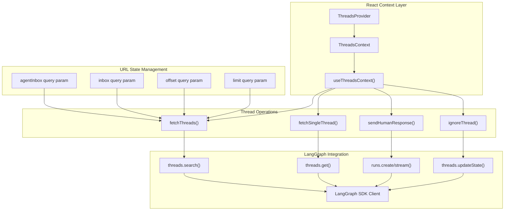
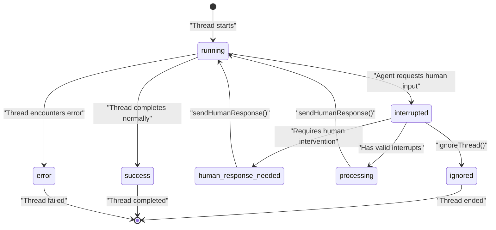
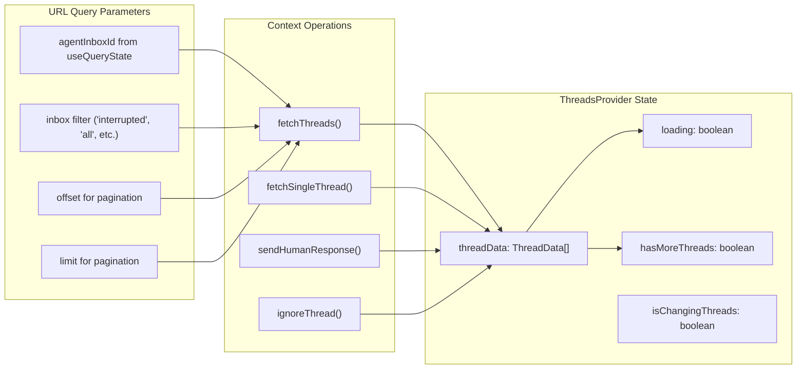
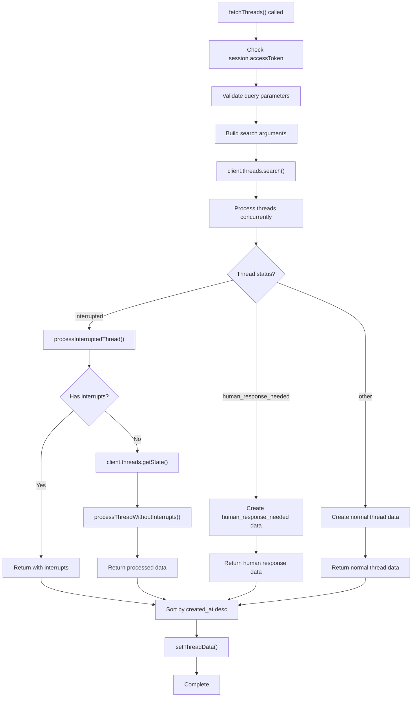
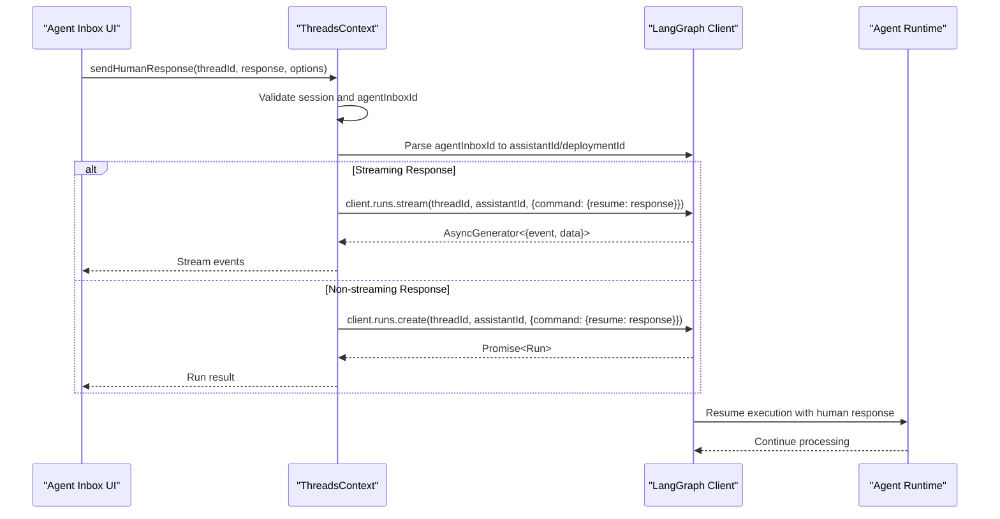
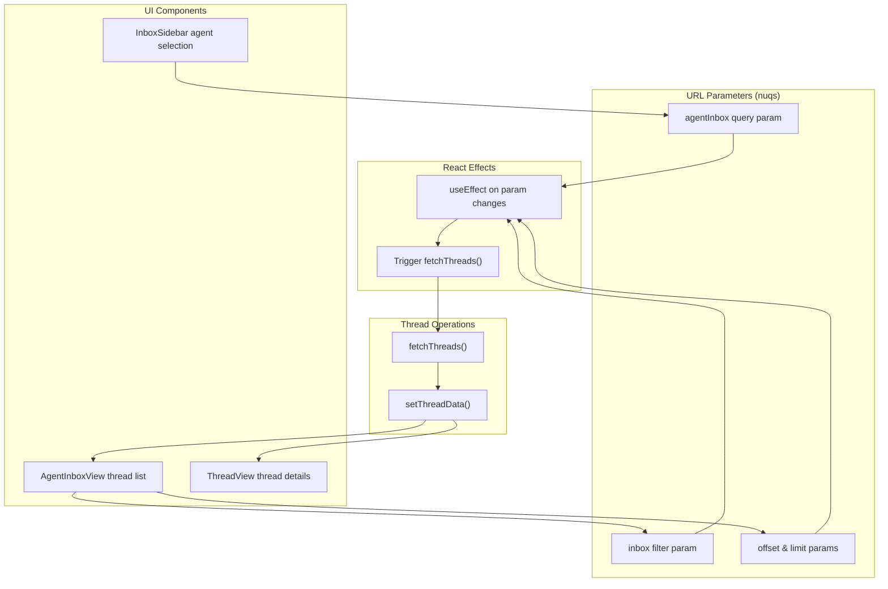
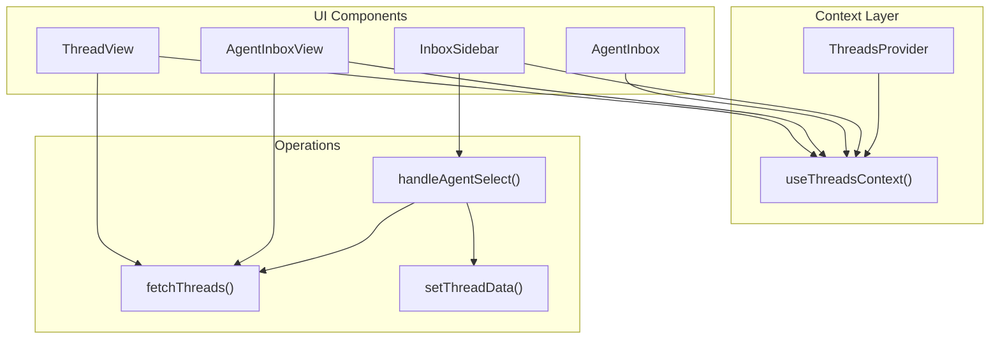

<!-- source: DeepWiki mcp.deepwiki.com · repo langchain-ai/open-agent-platform · page 7.1 Thread Management · fetched 2026-10-26 -->

# Thread Management

Relevant source files

The following files were used as context for generating this wiki page:

- [apps/web/src/components/agent-inbox/contexts/ThreadContext.tsx](apps/web/src/components/agent-inbox/contexts/ThreadContext.tsx)
- [apps/web/src/components/agent-inbox/index.tsx](apps/web/src/components/agent-inbox/index.tsx)
- [apps/web/src/components/inbox-sidebar/index.tsx](apps/web/src/components/inbox-sidebar/index.tsx)

This document covers the thread management system within the Agent Inbox, specifically how the platform manages agent threads that require human intervention, handles thread state, and coordinates between the UI and LangGraph Platform APIs. For information about general chat thread management in the main chat interface, see [Thread and Messages](#4.1).

## Architecture Overview

The thread management system is built around React Context providers that manage thread state, operations, and synchronization with URL parameters. The system primarily handles threads in "interrupted" and "human_response_needed" states that require human oversight or intervention.

### Thread Management Context Architecture

**Sources:** [apps/web/src/components/agent-inbox/contexts/ThreadContext.tsx:1-469]()

## Thread Data Structures

The system defines several key types for managing thread state and metadata:

### Core Thread Types

| Type | Purpose | Key Fields |
|------|---------|------------|
| `ThreadData<ThreadValues>` | Enhanced thread with processing metadata | `thread`, `status`, `interrupts`, `invalidSchema` |
| `EnhancedThreadStatus` | Extended status including custom states | `"interrupted"`, `"human_response_needed"`, standard LangGraph statuses |
| `HumanResponse` | Structure for human responses to interrupts | Response data for resuming interrupted threads |

### Thread Status Flow

**Sources:** [apps/web/src/components/agent-inbox/contexts/ThreadContext.tsx:3-7](), [apps/web/src/components/agent-inbox/contexts/ThreadContext.tsx:22-49]()

## ThreadsProvider Implementation

The `ThreadsProvider` manages thread state and operations through a React Context pattern:

### Context State Management

**Sources:** [apps/web/src/components/agent-inbox/contexts/ThreadContext.tsx:56-76](), [apps/web/src/components/agent-inbox/contexts/ThreadContext.tsx:432-448]()

## Thread Fetching and Processing

The system implements sophisticated thread fetching with filtering, pagination, and concurrent processing:

### Thread Search and Processing Pipeline

**Sources:** [apps/web/src/components/agent-inbox/contexts/ThreadContext.tsx:77-235](), [apps/web/src/components/agent-inbox/contexts/ThreadContext.tsx:137-225]()

## Human Response Handling

The system provides mechanisms for humans to respond to interrupted agent threads:

### Human Response Flow

**Sources:** [apps/web/src/components/agent-inbox/contexts/ThreadContext.tsx:382-430]()

## Thread State Synchronization

The system synchronizes thread state with URL parameters using the `nuqs` library:

### URL State Management

| Parameter | Type | Default | Purpose |
|-----------|------|---------|---------|
| `agentInbox` | string | - | Agent ID and deployment ID (`assistantId:deploymentId`) |
| `inbox` | string | `"interrupted"` | Thread filter type |
| `offset` | integer | `0` | Pagination offset |
| `limit` | integer | `10` | Results per page limit |

### State Synchronization Flow

**Sources:** [apps/web/src/components/agent-inbox/contexts/ThreadContext.tsx:60-69](), [apps/web/src/components/agent-inbox/contexts/ThreadContext.tsx:238-257]()

## Integration with Inbox Components

The thread management system integrates with UI components through context consumption:

### Component Integration Architecture

**Sources:** [apps/web/src/components/inbox-sidebar/index.tsx:33-76](), [apps/web/src/components/agent-inbox/index.tsx:24-209]()

## Error Handling and Validation

The system implements comprehensive error handling for thread operations:

### Error Handling Patterns

| Scenario | Handling Approach | User Feedback |
|----------|------------------|---------------|
| Missing access token | Early return with toast error | "No access token found" |
| Invalid query parameters | Validation with toast error | "Limit Exceeded", "Invalid parameters" |
| Thread fetch failure | Catch with logging and toast | "Failed to load threads" |
| State update failure | Catch with error logging | "Failed to ignore thread" |
| Network timeouts | SDK-level retry with user feedback | Context-specific error messages |

**Sources:** [apps/web/src/components/agent-inbox/contexts/ThreadContext.tsx:79-90](), [apps/web/src/components/agent-inbox/contexts/ThreadContext.tsx:226-232](), [apps/web/src/components/agent-inbox/contexts/ThreadContext.tsx:372-379]()

---

