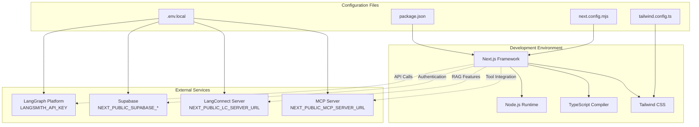
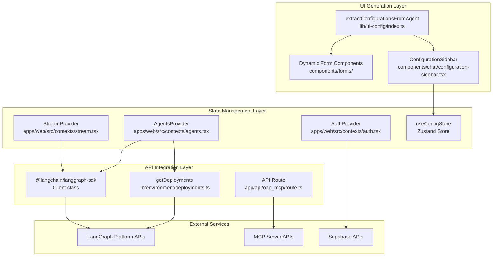
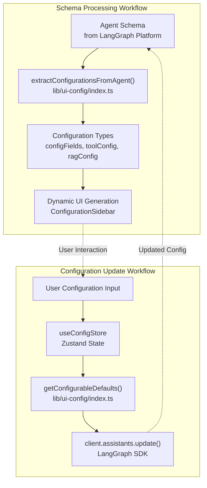
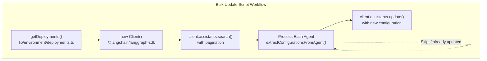

<!-- source: DeepWiki mcp.deepwiki.com · repo langchain-ai/open-agent-platform · page 9 Development Guide · fetched 2026-10-26 -->

# Development Guide

<details>
<summary>Relevant source files</summary>

The following files were used as context for generating this wiki page:

- [README.md](README.md)
- [apps/web/scripts/update-agents-mcp-url.ts](apps/web/scripts/update-agents-mcp-url.ts)

</details>


This document provides comprehensive guidance for developers working on the Open Agent Platform codebase. It covers development environment setup, code architecture patterns, key workflows, and best practices for contributing to the platform.

For information about the overall platform architecture, see [Core Platform Architecture](#2). For specific component documentation, see [UI Components](#8).

## Development Environment Setup

The Open Agent Platform is built as a Next.js application with TypeScript, requiring several external services for full functionality.

### Core Dependencies and Environment



**Environment Configuration Requirements**

| Variable | Purpose | Required |
|----------|---------|----------|
| `LANGSMITH_API_KEY` | LangGraph Platform authentication | Yes |
| `NEXT_PUBLIC_SUPABASE_URL` | Supabase project URL | Yes |
| `NEXT_PUBLIC_SUPABASE_ANON_KEY` | Supabase anonymous key | Yes |
| `NEXT_PUBLIC_LC_SERVER_URL` | LangConnect RAG server | Optional |
| `NEXT_PUBLIC_MCP_SERVER_URL` | MCP tools server | Optional |

Sources: [README.md:1-68]()

## Code Architecture Overview

The platform follows a modular React architecture with context-based state management and schema-driven UI generation.

### Core Development Patterns



**Key Development Entities**

| Entity | File Path | Purpose |
|--------|-----------|---------|
| `StreamProvider` | `apps/web/src/contexts/stream.tsx` | Real-time message streaming |
| `AgentsProvider` | `apps/web/src/contexts/agents.tsx` | Agent discovery and management |
| `extractConfigurationsFromAgent` | `lib/ui-config/index.ts` | Schema-to-UI transformation |
| `getDeployments` | `lib/environment/deployments.ts` | Deployment configuration loading |
| `Client` | `@langchain/langgraph-sdk` | LangGraph Platform SDK client |

Sources: [apps/web/scripts/update-agents-mcp-url.ts:1-96]()

## Development Workflows

### Agent Configuration Development

The platform uses a schema-driven approach for generating dynamic configuration UIs. The core workflow involves extracting configuration schemas from LangGraph agents and transforming them into React components.



**Schema Extraction Process**

The `extractConfigurationsFromAgent` function processes agent schemas to identify configurable fields with `x_oap_ui_config` metadata. This enables automatic UI generation for agent parameters.

**Configuration Update Pattern**

1. Extract current configuration using `getConfigurableDefaults`
2. Apply user changes to the configuration object
3. Update the agent using the LangGraph SDK `client.assistants.update` method

Sources: [apps/web/scripts/update-agents-mcp-url.ts:51-90]()

### Bulk Agent Management

The platform includes utilities for programmatic agent management, as demonstrated in the MCP URL update script.



**Pagination Pattern**

The script demonstrates proper pagination when working with large numbers of agents:

- Uses `pageSize = 100` for efficient batching
- Continues until `agents.length === 0`
- Updates `offset` for subsequent requests

**Configuration Validation**

Before updating agents, the script validates:
- Agent has MCP tool configuration support
- Current MCP URL differs from target URL
- Preserves existing configuration while updating specific fields

Sources: [apps/web/scripts/update-agents-mcp-url.ts:29-92]()

## Configuration Management

### Environment-Based Configuration

The platform uses a flexible deployment configuration system that supports multiple LangGraph Platform instances.

### Schema-Driven UI Configuration

Agent configuration UIs are generated dynamically based on agent schemas with `x_oap_ui_config` metadata. This enables:

- Type-safe configuration fields
- Custom UI components for different field types
- Validation and default value handling
- Real-time configuration updates

**Configuration Field Types**

The `extractConfigurationsFromAgent` function identifies several configuration categories:
- `configFields`: General agent parameters
- `toolConfig`: MCP server tool configurations
- `ragConfig`: RAG/LangConnect settings
- `agentsConfig`: Agent supervision settings

Sources: [apps/web/scripts/update-agents-mcp-url.ts:58-76]()

## Testing and Debugging

### Development Server Setup

For local development, the platform requires:
1. Next.js development server
2. Proper environment variable configuration
3. Access to external services (LangGraph Platform, Supabase)

### Agent Configuration Debugging

Common configuration issues and debugging approaches:

**Agent Schema Issues**
- Verify `x_oap_ui_config` metadata is present
- Ensure LangGraph Zod schema usage (for TypeScript agents)
- Check LangGraph version compatibility

**Configuration UI Problems**
- Validate schema extraction with `extractConfigurationsFromAgent`
- Verify configuration defaults with `getConfigurableDefaults`
- Check React component rendering in `ConfigurationSidebar`

Sources: [README.md:63-67]()

## Deployment and Scripts

### Utility Scripts

The platform includes maintenance scripts for common administrative tasks:

**MCP URL Update Script** - `apps/web/scripts/update-agents-mcp-url.ts`
- Updates MCP server URLs across all agents
- Handles pagination for large agent collections
- Preserves existing configuration while updating specific fields
- Validates agent compatibility before updates

**Script Execution Pattern**

```typescript
// Environment setup
import "dotenv/config";

// Core functionality imports
import { getDeployments } from "@/lib/environment/deployments";
import { Client } from "@langchain/langgraph-sdk";
import { extractConfigurationsFromAgent, getConfigurableDefaults } from "@/lib/ui-config";

// Main execution with error handling
main().catch(console.error);
```

### Authentication Configuration

The platform supports multiple authentication schemes:
- Default: Supabase-based authentication
- LangSmith API key authentication for backend operations
- Configurable authentication headers for different deployment scenarios

Sources: [apps/web/scripts/update-agents-mcp-url.ts:1-96](), [README.md:55-57]()