# Page: Overview

# Overview

<details>
<summary>Relevant source files</summary>

The following files were used as context for generating this wiki page:

- [.yarnrc.yml](.yarnrc.yml)
- [README.md](README.md)
- [apps/web/scripts/update-agents-mcp-url.ts](apps/web/scripts/update-agents-mcp-url.ts)
- [package.json](package.json)

</details>


This document provides a comprehensive overview of the Open Agent Platform repository, its architecture, core systems, and how they integrate to provide a web-based platform for building and managing AI agents. The platform serves as a frontend orchestrator for multiple backend services, enabling users to create, configure, and interact with LangGraph agents through an intuitive interface.

For specific implementation details about individual subsystems, see [Core Platform Architecture](#2), [Agent Management](#3), [Chat Interface](#4), [RAG](#5), [Tools System](#6), and [UI Components](#8).

## Platform Purpose and Architecture

The Open Agent Platform is a no-code agent building platform that provides a modern, web-based interface for creating, managing, and interacting with LangGraph agents. The system is designed as a Next.js monorepo that orchestrates multiple external services rather than functioning as a standalone backend server.

### High-Level System Architecture

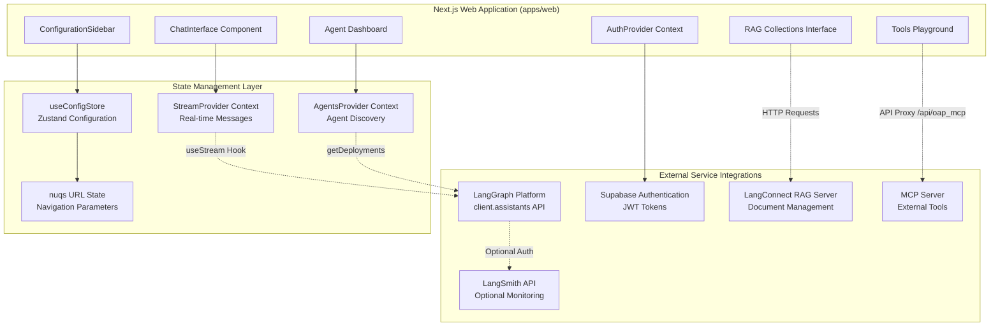

Sources: [README.md:1-68](), [package.json:1-24]()

## Core System Components

The platform consists of several interconnected systems that work together to provide a comprehensive agent management experience:

### Agent Management System

The agent management system handles the complete lifecycle of LangGraph agents, from discovery to configuration and deployment. The system uses the `getDeployments` function to discover available agents from LangGraph Platform deployments and presents them through the `AgentsProvider` context.

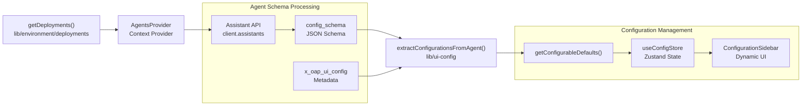

Sources: [apps/web/scripts/update-agents-mcp-url.ts:1-96]()

### Chat and Streaming System

The chat system provides real-time interaction with agents through WebSocket streaming. The `StreamProvider` context manages message flow and agent communication using the LangGraph SDK's `useStream` hook.

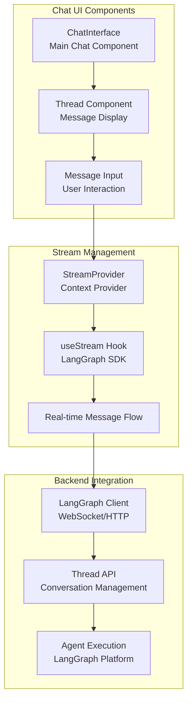

Sources: [README.md:13-18]()

## External Service Integration Architecture

The platform integrates with multiple external services to provide comprehensive agent capabilities:

### Service Integration Pattern

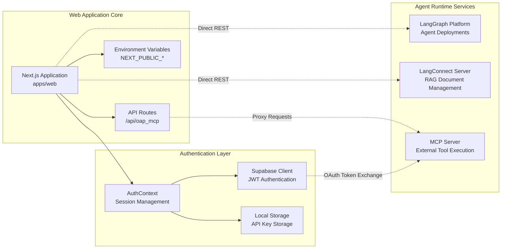

Sources: [README.md:46-50](), [apps/web/scripts/update-agents-mcp-url.ts:12-18]()

## Configuration and Schema System

The platform uses a sophisticated schema-driven configuration system that dynamically generates UI components based on agent metadata. This system processes LangGraph agent schemas and renders appropriate form controls.

### Schema Processing Pipeline

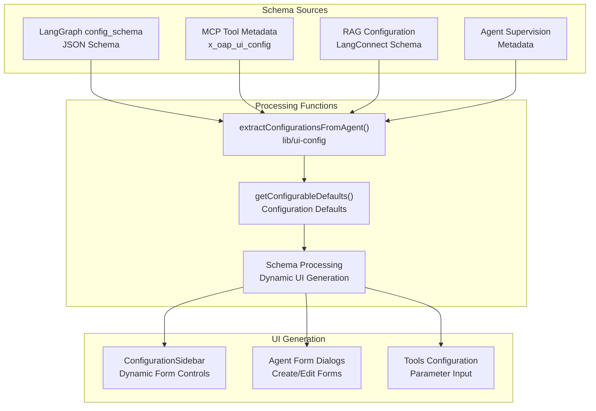

Sources: [apps/web/scripts/update-agents-mcp-url.ts:54-89](), [README.md:63-67]()

## Development Architecture

The codebase is structured as a Turbo monorepo with TypeScript support and modern development tooling. The build system uses Yarn 3 with workspaces for managing dependencies across multiple applications.

### Repository Structure

| Component | Location | Purpose |
|-----------|----------|---------|
| Web Application | `apps/web` | Main Next.js application |
| Package Management | `package.json` | Turbo monorepo configuration |
| Development Scripts | `apps/web/scripts/` | Utility scripts for agent management |
| Configuration | `.yarnrc.yml` | Yarn workspace configuration |

The platform is designed to be deployment-flexible, working without a standalone backend server as long as LangGraph Platform deployments are configured. Optional services like RAG (LangConnect) and MCP servers can be added as needed.

Sources: [package.json:1-24](), [.yarnrc.yml:1-3](), [README.md:45-48]()

---

# Page: Getting Started

# Getting Started

<details>
<summary>Relevant source files</summary>

The following files were used as context for generating this wiki page:

- [apps/docs/custom-agents/overview.mdx](apps/docs/custom-agents/overview.mdx)
- [apps/docs/index.mdx](apps/docs/index.mdx)
- [apps/docs/quickstart.mdx](apps/docs/quickstart.mdx)
- [apps/docs/setup/agents.mdx](apps/docs/setup/agents.mdx)
- [apps/docs/setup/authentication.mdx](apps/docs/setup/authentication.mdx)
- [apps/docs/setup/mcp-server.mdx](apps/docs/setup/mcp-server.mdx)
- [apps/docs/setup/rag-server.mdx](apps/docs/setup/rag-server.mdx)
- [apps/web/.env.example](apps/web/.env.example)
- [apps/web/src/features/agents/components/agent-card.tsx](apps/web/src/features/agents/components/agent-card.tsx)
- [apps/web/src/features/agents/components/create-edit-agent-dialogs/graph-select.tsx](apps/web/src/features/agents/components/create-edit-agent-dialogs/graph-select.tsx)
- [apps/web/src/features/agents/components/templates-list/agent-list.tsx](apps/web/src/features/agents/components/templates-list/agent-list.tsx)

</details>


This document provides a comprehensive guide for setting up and configuring your Open Agent Platform instance. It covers all required dependencies, environment configuration, agent deployment setup, and external service integration needed to get the platform running locally or in a production environment.

For information about the overall platform architecture, see [Core Platform Architecture](#2). For details about building custom agents, see [Custom Agents Overview](#9).

## Prerequisites and Dependencies

Before setting up the Open Agent Platform, ensure you have the following accounts and services ready:

| Service | Purpose | Required |
|---------|---------|----------|
| [LangSmith Account](https://smith.langchain.com/) | Agent monitoring and API management | Yes |
| [Supabase Account](https://supabase.com/) | Authentication and user management | Yes |
| MCP Server (e.g., [Arcade](https://arcade-ai.com/)) | External tool integration | Optional |
| LLM API Key | Model access (OpenAI, Anthropic, Google) | Yes |

The platform requires Node.js and Yarn for local development. Clone the repository from https://github.com/langchain-ai/open-agent-platform.

**Setup Flow Overview**

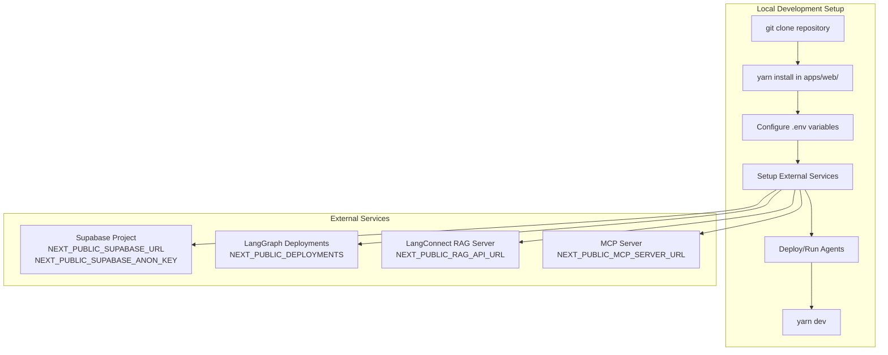

Sources: [apps/docs/quickstart.mdx:1-131](), [apps/web/.env.example:1-30]()

## Environment Configuration

The platform uses environment variables defined in `apps/web/.env.example` for configuration. Create a `.env.local` file in the `apps/web/` directory with the following structure:

**Core Configuration Variables**

| Variable | Purpose | Example |
|----------|---------|---------|
| `NEXT_PUBLIC_BASE_API_URL` | Platform API base URL | `http://localhost:3000/api` |
| `LANGSMITH_API_KEY` | LangSmith authentication | `lsv2_...` |
| `NEXT_PUBLIC_USE_LANGSMITH_AUTH` | Use LangSmith vs Supabase auth | `false` |

**Authentication Configuration**

```bash
# Supabase Authentication
NEXT_PUBLIC_SUPABASE_URL="https://your-project.supabase.co"
NEXT_PUBLIC_SUPABASE_ANON_KEY="eyJ..."
NEXT_PUBLIC_GOOGLE_AUTH_DISABLED="false"
```

**Service Integration Configuration**

```bash
# Agent Deployments (JSON array)
NEXT_PUBLIC_DEPLOYMENTS='[{"id":"uuid","deploymentUrl":"http://localhost:2024",...}]'

# RAG Server
NEXT_PUBLIC_RAG_API_URL="http://localhost:8080"

# MCP Server
NEXT_PUBLIC_MCP_SERVER_URL="https://api.example.com/v1/mcps/server"
NEXT_PUBLIC_MCP_AUTH_REQUIRED="true"
```

Sources: [apps/web/.env.example:1-30](), [apps/docs/quickstart.mdx:24-32]()

## Agent Deployment Configuration

The platform connects to LangGraph agents through the `NEXT_PUBLIC_DEPLOYMENTS` environment variable. This JSON array defines available agent deployments and their configuration.

**Pre-built Agent Repositories**

The platform provides three pre-built agents optimized for Open Agent Platform integration:

- [Tools Agent](https://github.com/langchain-ai/oap-langgraph-tools-agent) - MCP tool integration
- [Supervisor Agent](https://github.com/langchain-ai/oap-agent-supervisor) - Multi-agent orchestration  
- [Deep Research Agent](https://github.com/langchain-ai/oap-deep-researcher) - Research workflows

**Deployment Configuration Schema**

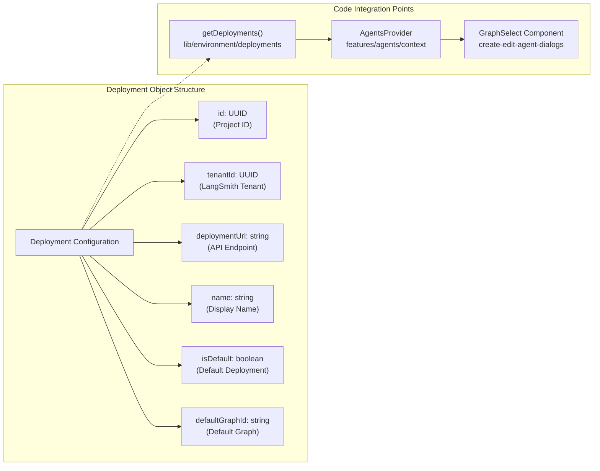

**Example Deployment Configuration**

```json
[
  {
    "id": "bf63dc89-1de7-4a65-8336-af9ecda479d6",
    "tenantId": "42d732b3-1324-4226-9fe9-513044dceb58",
    "deploymentUrl": "http://localhost:2024",
    "name": "Local Development",
    "isDefault": true,
    "defaultGraphId": "agent"
  }
]
```

For local development using `langgraph dev`, both `id` and `tenantId` should be valid UUID v4 values. Each graph requires a unique `id`, while all graphs in the same environment share the same `tenantId`.

Sources: [apps/docs/quickstart.mdx:53-77](), [apps/docs/setup/agents.mdx:36-65](), [apps/web/src/features/agents/components/create-edit-agent-dialogs/graph-select.tsx:19-46]()

## Authentication Setup

The platform uses Supabase for user authentication by default, with support for both email/password and Google OAuth authentication.

**Supabase Configuration Steps**

1. Create a new Supabase project at https://supabase.com/
2. Navigate to Settings > API to find your project URL and anonymous key
3. Configure the environment variables:

```bash
NEXT_PUBLIC_SUPABASE_URL="https://your-project-id.supabase.co"  
NEXT_PUBLIC_SUPABASE_ANON_KEY="eyJhbGciOiJIUzI1NiIsInR5cCI6IkpXVCJ9..."
```

4. Enable Google authentication in Supabase Dashboard > Authentication > Providers
5. Optionally disable Google auth in UI: `NEXT_PUBLIC_GOOGLE_AUTH_DISABLED="true"`

**Authentication Flow Integration**

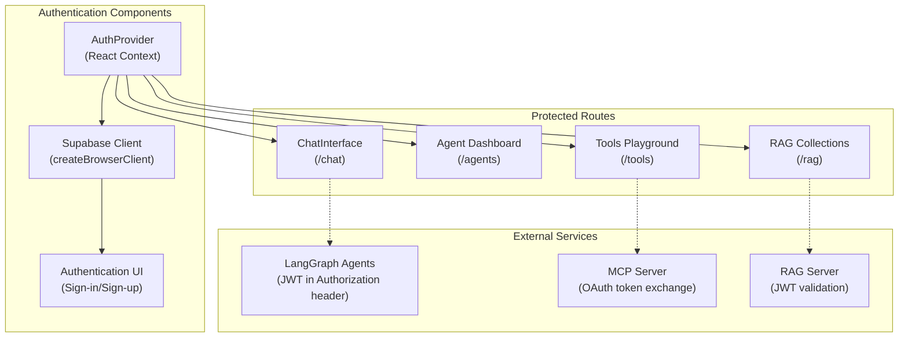

The authentication system passes Supabase JWT tokens to external services for user-scoped access control. LangGraph agents receive the token via the `Authorization` header, while MCP servers use an OAuth token exchange flow.

Sources: [apps/docs/setup/authentication.mdx:8-17](), [apps/docs/quickstart.mdx:15-33](), [apps/docs/setup/authentication.mdx:20-26]()

## External Service Integration

### RAG Server Setup (LangConnect)

The platform integrates with LangConnect for Retrieval Augmented Generation capabilities:

1. Deploy LangConnect following the [repository instructions](https://github.com/langchain-ai/langconnect)
2. Configure the RAG server URL:

```bash
NEXT_PUBLIC_RAG_API_URL="http://localhost:8080"
```

### MCP Server Setup

MCP (Model Context Protocol) servers extend agent capabilities with external tools:

**For Unauthenticated MCP Servers:**
```bash
NEXT_PUBLIC_MCP_SERVER_URL="https://api.example.com/v1/mcps/server"
# Do not include /mcp suffix - it's automatically appended
```

**For Authenticated MCP Servers:**
```bash
NEXT_PUBLIC_MCP_SERVER_URL="https://api.example.com/v1/mcps/server" 
NEXT_PUBLIC_MCP_AUTH_REQUIRED="true"
```

**MCP Integration Architecture**

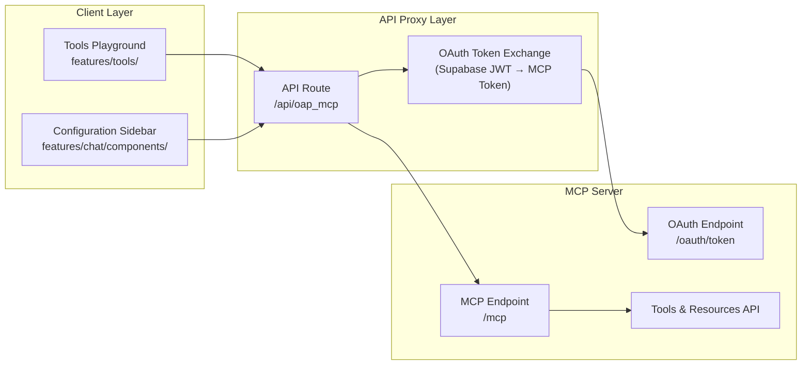

When `NEXT_PUBLIC_MCP_AUTH_REQUIRED="true"`, requests flow through `/api/oap_mcp` proxy route for authentication. The proxy exchanges Supabase JWT tokens for MCP access tokens, then forwards requests with proper authorization headers.

Sources: [apps/docs/setup/mcp-server.mdx:8-22](), [apps/docs/setup/mcp-server.mdx:24-31](), [apps/docs/setup/rag-server.mdx:12-19]()

## Running the Platform

Once all configuration is complete, start the development server:

```bash
# Navigate to web application directory
cd apps/web

# Install dependencies  
yarn install

# Start development server
yarn dev
```

The platform will be available at http://localhost:3000.

**Verification Steps**

1. **Authentication**: Visit the homepage and verify Supabase authentication works
2. **Agent Connection**: Check that configured agents appear in the Agent Dashboard at `/agents`
3. **Chat Interface**: Test agent communication through the chat interface at `/`
4. **RAG Integration**: If configured, verify document upload works at `/rag`
5. **Tools Integration**: If MCP server is configured, test tools at `/tools`

**Platform Component Structure**

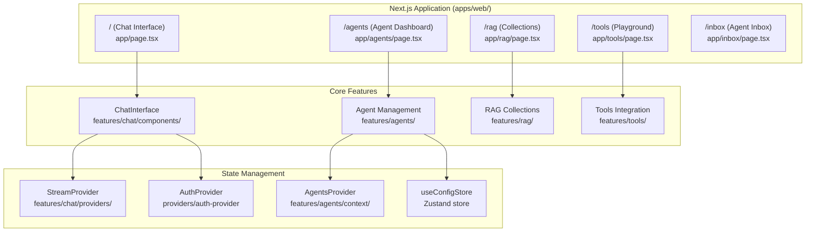

This structure shows how the main application routes connect to feature components and state management systems.

Sources: [apps/docs/quickstart.mdx:115-131](), [apps/web/src/features/agents/components/agent-card.tsx:144-152](), [apps/web/src/features/agents/components/templates-list/agent-list.tsx:32-51]()

## Next Steps

After successfully running the platform:

1. **Create Your First Agent**: Use the Agent Dashboard to create a new agent or interact with pre-configured ones
2. **Upload RAG Documents**: If RAG is configured, create collections and upload documents at `/rag` 
3. **Explore Tools**: Test available MCP tools through the Tools Playground at `/tools`
4. **Configure API Keys**: Set up model API keys through the settings interface for full functionality
5. **Build Custom Agents**: Follow the custom agent development guide to create specialized agents

For detailed information about agent configuration and management, see [Agent Management](#3). For chat interface usage, see [Chat Interface](#4).

Sources: [apps/docs/quickstart.mdx:1-131](), [apps/docs/setup/agents.mdx:21-33]()

---

# Page: Core Platform Architecture

# Core Platform Architecture

<details>
<summary>Relevant source files</summary>

The following files were used as context for generating this wiki page:

- [apps/web/src/app/(app)/layout.tsx](apps/web/src/app/(app)/layout.tsx)
- [apps/web/src/app/(auth)/auth-layout.tsx](apps/web/src/app/(auth)/auth-layout.tsx)
- [apps/web/src/app/(auth)/forgot-password/page.tsx](apps/web/src/app/(auth)/forgot-password/page.tsx)
- [apps/web/src/app/(auth)/layout.tsx](apps/web/src/app/(auth)/layout.tsx)
- [apps/web/src/app/(auth)/reset-password/page.tsx](apps/web/src/app/(auth)/reset-password/page.tsx)
- [apps/web/src/app/(auth)/signin/page.tsx](apps/web/src/app/(auth)/signin/page.tsx)
- [apps/web/src/app/(auth)/signup/page.tsx](apps/web/src/app/(auth)/signup/page.tsx)
- [apps/web/src/app/debug-auth/page.tsx](apps/web/src/app/debug-auth/page.tsx)
- [apps/web/src/app/layout.tsx](apps/web/src/app/layout.tsx)
- [apps/web/src/components/ui/resizable.tsx](apps/web/src/components/ui/resizable.tsx)
- [apps/web/src/constants.ts](apps/web/src/constants.ts)

</details>


This document explains the fundamental architectural patterns and systems that power the Open Agent Platform. It covers the overall application structure, layout hierarchy, provider system, state management patterns, and integration points with external services.

For detailed information about specific subsystems, see [Authentication System](#2.1), [Agent Configuration System](#2.2), and [MCP Integration System](#2.3).

## Application Structure Overview

The Open Agent Platform is built as a Next.js application using the App Router pattern. The core architecture follows a layered approach with clear separation between layout concerns, authentication, and business logic.

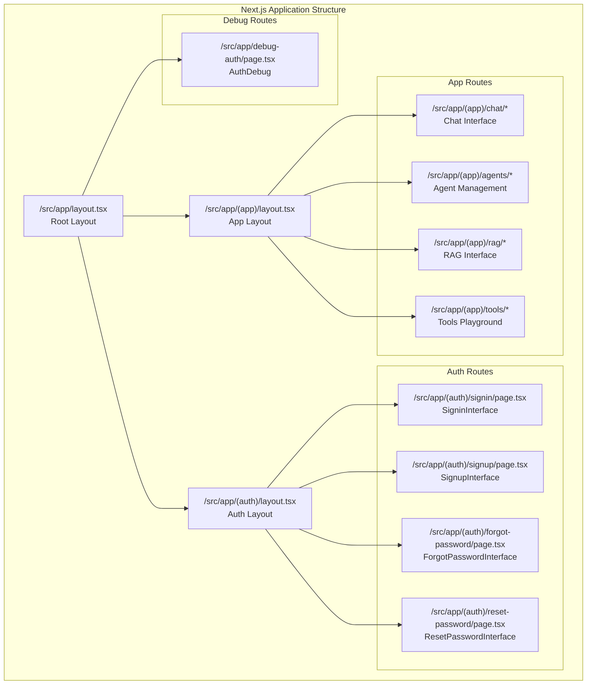

**Sources:** [apps/web/src/app/layout.tsx:1-30](), [apps/web/src/app/(app)/layout.tsx:1-61](), [apps/web/src/app/(auth)/layout.tsx:1-50]()

## Layout Hierarchy and Provider Composition

The platform uses a nested layout system where each level adds specific functionality through React providers and layout components.

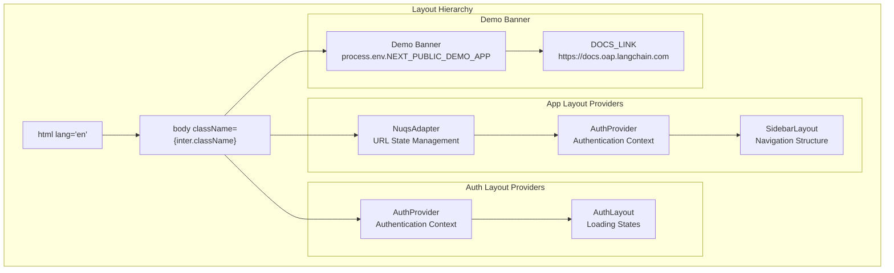

**Sources:** [apps/web/src/app/(app)/layout.tsx:26-60](), [apps/web/src/app/(auth)/layout.tsx:25-49](), [apps/web/src/constants.ts:1-4]()

## Provider Architecture Pattern

The platform extensively uses React Context providers to manage application-wide state and functionality. Each provider serves a specific architectural concern.

| Provider | Purpose | Location | Key Features |
|----------|---------|----------|--------------|
| `AuthProvider` | Authentication state management | `@/providers/Auth` | Session management, user context |
| `NuqsAdapter` | URL state synchronization | `nuqs/adapters/next/app` | Query parameter state management |
| `SidebarLayout` | Navigation and layout structure | `@/components/sidebar` | Responsive sidebar, navigation state |

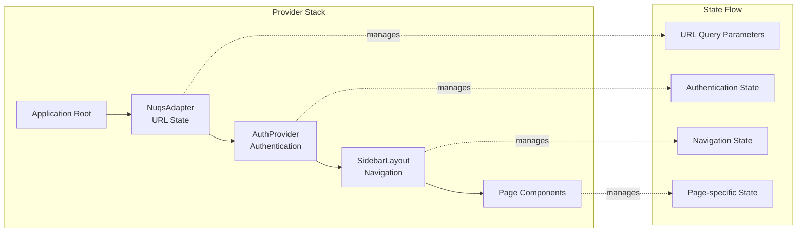

**Sources:** [apps/web/src/app/(app)/layout.tsx:52-56](), [apps/web/src/app/(auth)/layout.tsx:43-45]()

## Environment Configuration and Deployment Modes

The platform supports different deployment modes through environment variables, with special handling for demo applications.

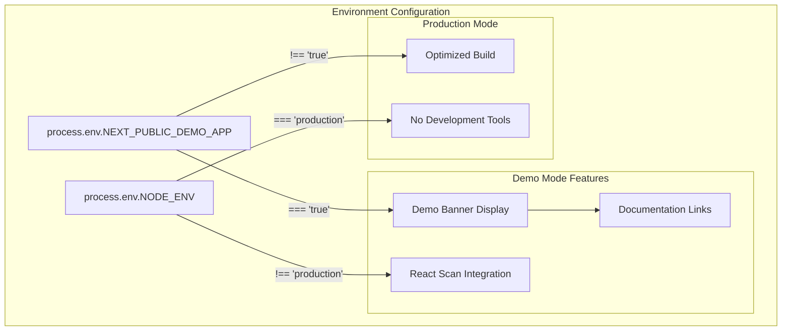

The demo mode implementation includes:
- Top banner notification with documentation links
- Development tool integration (React Scan)
- Special styling and messaging for demo users

**Sources:** [apps/web/src/app/(app)/layout.tsx:26-51](), [apps/web/src/app/(auth)/layout.tsx:25-42](), [apps/web/src/constants.ts:2]()

## Font and Asset Optimization

The platform uses Next.js font optimization with the Inter font family configured for optimal loading performance.

```typescript
const inter = Inter({
  subsets: ["latin"],
  preload: true,
  display: "swap",
});
```

This configuration is applied consistently across all layout levels to ensure typography consistency and performance optimization.

**Sources:** [apps/web/src/app/layout.tsx:6-10](), [apps/web/src/app/(app)/layout.tsx:10-14](), [apps/web/src/app/(auth)/layout.tsx:9-13]()

## Development and Debug Infrastructure

The platform includes specialized debug routes and development-time tooling for troubleshooting authentication and system state.

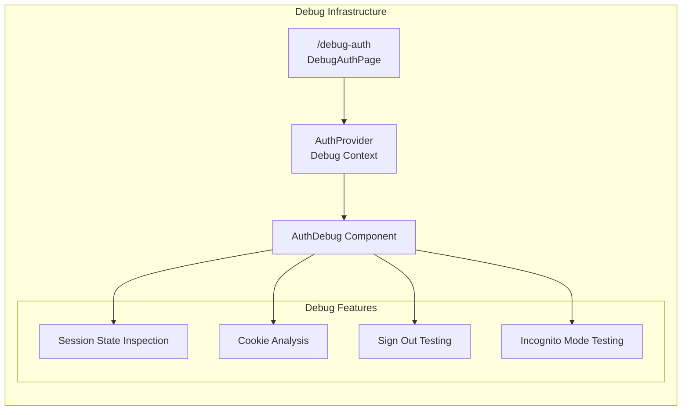

The debug page provides testing tips and tools for developers working with the authentication system, including inspection of Supabase cookies (prefixed with `sb-`) and session management utilities.

**Sources:** [apps/web/src/app/debug-auth/page.tsx:6-33]()

## Metadata and SEO Configuration

The platform uses consistent metadata configuration across all layout levels for proper SEO and social media integration.

| Layout Level | Title | Description |
|--------------|-------|-------------|
| Root | "Open Agent Platform" | "Open Agent Platform by LangChain" |
| App | "Open Agent Platform" | "Open Agent Platform by LangChain" |
| Auth | "Open Agent Platform - Auth" | "Open Agent Platform by LangChain" |

**Sources:** [apps/web/src/app/layout.tsx:12-15](), [apps/web/src/app/(app)/layout.tsx:16-19](), [apps/web/src/app/(auth)/layout.tsx:15-18]()

---

# Page: Authentication System

# Authentication System

<details>
<summary>Relevant source files</summary>

The following files were used as context for generating this wiki page:

- [apps/web/src/features/forgot-password/index.tsx](apps/web/src/features/forgot-password/index.tsx)
- [apps/web/src/features/reset-password/index.tsx](apps/web/src/features/reset-password/index.tsx)
- [apps/web/src/features/signin/index.tsx](apps/web/src/features/signin/index.tsx)
- [apps/web/src/features/signup/index.tsx](apps/web/src/features/signup/index.tsx)
- [apps/web/src/lib/utils.ts](apps/web/src/lib/utils.ts)

</details>


The Authentication System in the Open Agent Platform provides user authentication, session management, and route protection. Built on Supabase Auth, it secures both frontend routes and backend API endpoints while enabling seamless user sign-up, sign-in, and session persistence throughout the application.

## Authentication Architecture Overview

The authentication system consists of four main components:

1. **Auth Provider** - A React context provider that exposes authentication state and methods to components
2. **Authentication UI Components** - React components for sign-in, sign-up, password reset, and account management
3. **Supabase Integration** - Implements authentication using Supabase's auth services
4. **Route Protection** - Controls access to protected routes and manages sessions

### Authentication UI Component Architecture

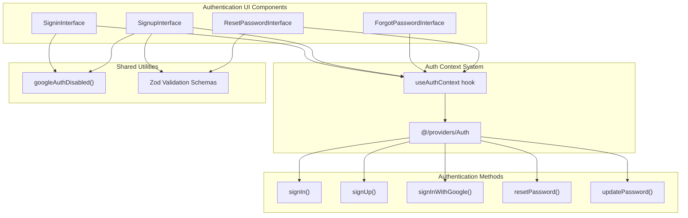

Sources: 
- [apps/web/src/features/signin/index.tsx:18-23]()
- [apps/web/src/features/signup/index.tsx:19-46]()
- [apps/web/src/features/forgot-password/index.tsx:17-20]()
- [apps/web/src/features/reset-password/index.tsx:16-36]()
- [apps/web/src/lib/utils.ts:8-13]()

## Authentication UI Components

The platform provides four main authentication interfaces, each implementing specific user flows:

### Sign-in Interface

The `SigninInterface` component handles user authentication with email/password and optional Google OAuth:

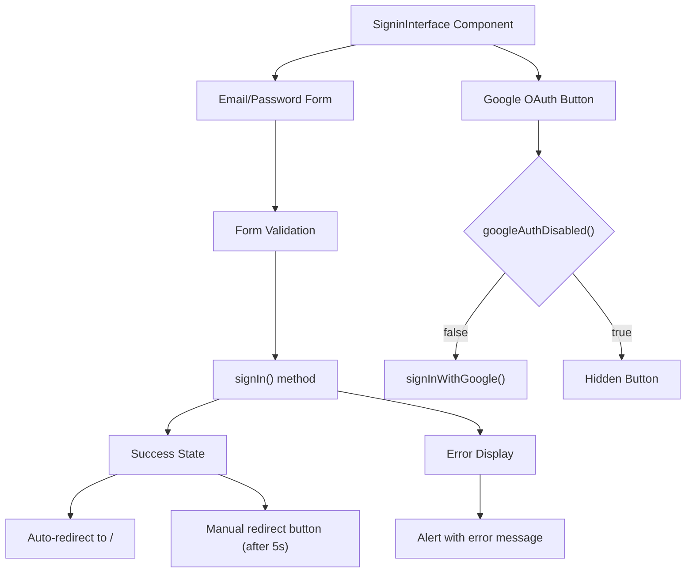

The component includes:
- Email and password input fields with validation
- "Forgot password?" link to `/forgot-password`
- Google sign-in button (conditionally displayed)
- Loading states and error handling
- Automatic redirect on successful authentication

Sources:
- [apps/web/src/features/signin/index.tsx:22-106]()
- [apps/web/src/features/signin/index.tsx:196-231]()

### Sign-up Interface

The `SignupInterface` component provides user registration with comprehensive form validation:

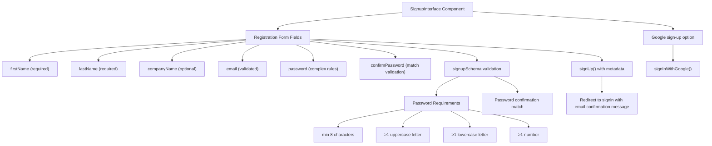

Key features:
- Comprehensive form validation using Zod schema
- Password complexity requirements
- User metadata collection (first name, last name, company)
- Email confirmation flow
- Google OAuth registration option

Sources:
- [apps/web/src/features/signup/index.tsx:24-41]()
- [apps/web/src/features/signup/index.tsx:99-126]()
- [apps/web/src/features/signup/index.tsx:163-264]()

### Password Reset Flow

The platform implements a two-step password reset process:

#### Forgot Password Interface

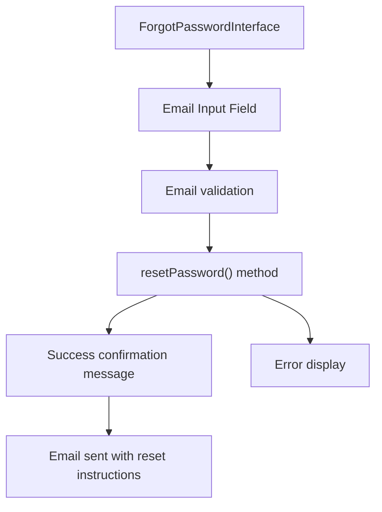

#### Reset Password Interface  

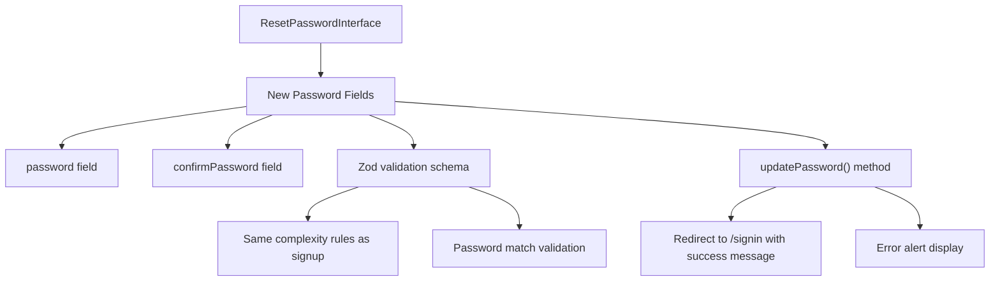

Sources:
- [apps/web/src/features/forgot-password/index.tsx:19-55]()
- [apps/web/src/features/reset-password/index.tsx:19-95]()

## Google Authentication Configuration

Google OAuth integration can be disabled via environment configuration:

| Configuration | Environment Variable | Function |
|---------------|---------------------|----------|
| Google Auth Status | `NEXT_PUBLIC_GOOGLE_AUTH_DISABLED` | `googleAuthDisabled()` |
| Disabled Value | `"true"` | Hides Google auth buttons |
| Enabled Value | `undefined` or `"false"` | Shows Google auth buttons |

Sources:
- [apps/web/src/lib/utils.ts:8-13]()
- [apps/web/src/features/signin/index.tsx:196]()
- [apps/web/src/features/signup/index.tsx:281]()

## Authentication Form Validation

The authentication system implements comprehensive client-side validation using Zod schemas:

### Sign-up Validation Schema

```mermaid
flowchart TD
    signupSchema["signupSchema (Zod)"] --> RequiredFields["Required Fields"]
    signupSchema --> OptionalFields["Optional Fields"]
    signupSchema --> PasswordValidation["Password Validation"]
    signupSchema --> CrossFieldValidation["Cross-field Validation"]
    
    RequiredFields --> firstName["firstName: min 1 char"]
    RequiredFields --> lastName["lastName: min 1 char"]
    RequiredFields --> email["email: valid email format"]
    
    OptionalFields --> companyName["companyName: optional string"]
    
    PasswordValidation --> MinLength["min 8 characters"]
    PasswordValidation --> UpperCase["≥1 uppercase letter (/[A-Z]/)"]
    PasswordValidation --> LowerCase["≥1 lowercase letter (/[a-z]/)"] 
    PasswordValidation --> Digit["≥1 number (/[0-9]/)"]
    
    CrossFieldValidation --> PasswordMatch["password === confirmPassword"]
```

### Reset Password Validation Schema

```mermaid
flowchart TD
    resetPasswordSchema["resetPasswordSchema (Zod)"] --> PasswordField["password field"]
    resetPasswordSchema --> ConfirmField["confirmPassword field"]
    resetPasswordSchema --> MatchValidation["Cross-field validation"]
    
    PasswordField --> SameRules["Same complexity rules as signup"]
    SameRules --> Min8["min 8 characters"]
    SameRules --> Upper["≥1 uppercase (/[A-Z]/)"]
    SameRules --> Lower["≥1 lowercase (/[a-z]/)"]
    SameRules --> Number["≥1 number (/[0-9]/)"]
    
    MatchValidation --> PasswordsMatch["password === confirmPassword"]
```

Sources:
- [apps/web/src/features/signup/index.tsx:24-41]()
- [apps/web/src/features/reset-password/index.tsx:20-33]()

## Authentication State Management

All authentication components use the `useAuthContext` hook to access authentication methods:

| Method | Used By | Purpose |
|--------|---------|---------|
| `signIn` | `SigninInterface` | Email/password authentication |
| `signUp` | `SignupInterface` | User registration with metadata |
| `signInWithGoogle` | `SigninInterface`, `SignupInterface` | Google OAuth authentication |
| `resetPassword` | `ForgotPasswordInterface` | Initiate password reset |
| `updatePassword` | `ResetPasswordInterface` | Set new password |
| `isAuthenticated` | `SigninInterface` | Check auth status for redirects |

Sources:
- [apps/web/src/features/signin/index.tsx:23]()
- [apps/web/src/features/signup/index.tsx:46]()
- [apps/web/src/features/forgot-password/index.tsx:20]()
- [apps/web/src/features/reset-password/index.tsx:36]()

## Route Structure

The authentication system uses dedicated routes for each authentication flow:

| Route | Component | Purpose |
|-------|-----------|---------|
| `/signin` | `SigninInterface` | User login |
| `/signup` | `SignupInterface` | User registration |
| `/forgot-password` | `ForgotPasswordInterface` | Password reset initiation |
| `/reset-password` | `ResetPasswordInterface` | Password reset completion |

These routes are publicly accessible and redirect authenticated users to the main application.

Sources:
- [apps/web/src/features/signin/index.tsx:50-55]()
- [apps/web/src/features/signup/index.tsx:117-119]()

## Supabase Auth Provider Implementation

The `SupabaseAuthProvider` class implements the authentication interface, providing methods for user management:

| Method | Purpose |
|--------|---------|
| `signUp` | Register new users with email and password |
| `signIn` | Authenticate existing users |
| `signInWithGoogle` | OAuth sign-in with Google |
| `signOut` | Log users out of the application |
| `getSession` | Retrieve the current session |
| `refreshSession` | Refresh an expiring token |
| `getCurrentUser` | Get the currently authenticated user |
| `updateUser` | Update user profile information |
| `resetPassword` | Initiate password reset flow |
| `updatePassword` | Change user password |
| `onAuthStateChange` | Subscribe to auth state changes |

Sources:
- [apps/web/src/lib/auth/supabase.ts:87-305]()

## Backend API Authentication

The application also handles authentication for backend API requests, particularly to the MCP (Model Control Panel) server:

```mermaid
sequenceDiagram
    participant Client
    participant ProxyAPI as "API Route Proxy"
    participant Supabase
    participant MCP as "MCP Server"
    
    Client->>ProxyAPI: Request with cookies
    ProxyAPI->>Supabase: Get Supabase token
    Supabase-->>ProxyAPI: Return access token
    
    alt Token in Header/Cookie
        ProxyAPI->>ProxyAPI: Use existing MCP token
    else Token in Environment
        ProxyAPI->>ProxyAPI: Use MCP_TOKENS env variable
    else Token Exchange Required
        ProxyAPI->>MCP: Exchange Supabase token
        MCP-->>ProxyAPI: Return MCP access token
    end
    
    ProxyAPI->>MCP: Forward request with MCP token
    MCP-->>ProxyAPI: Return response
    ProxyAPI-->>Client: Return data and set cookie
```

Sources:
- [apps/web/src/app/api/oap_mcp/proxy-request.ts:90-237]()

### Proxy Authentication Flow

The proxy request handler follows this process:

1. Extracts the target path and constructs the MCP server URL
2. Attempts to obtain an MCP access token through:
   - A cookie (`X-MCP-Access-Token`)
   - Environment variables (`MCP_TOKENS`)
   - Token exchange with Supabase JWT
3. Adds the token to the request via `Authorization: Bearer <token>`
4. Forwards the request to the MCP server
5. Returns the response and sets a cookie for future requests

Sources:
- [apps/web/src/app/api/oap_mcp/proxy-request.ts:43-79]()
- [apps/web/src/app/api/oap_mcp/proxy-request.ts:127-163]()

## Integration Points

The authentication system is integrated at multiple points in the application:

1. **Root Layouts**: Both the main app layout and auth layout wrap their children with the `AuthProvider`
2. **Middleware**: Applied to all routes except static assets and auth API endpoints
3. **Components**: Access auth state using the `useAuthContext` hook
4. **API Routes**: Proxy requests use authentication for backend services

Sources:
- [apps/web/src/app/(app)/layout.tsx:52-56]()
- [apps/web/src/app/(auth)/layout.tsx:43-45]()
- [apps/web/src/middleware.ts:8-26]()

## Debug Utilities

During development, the platform provides an `AuthDebug` component for troubleshooting authentication issues:

```jsx
<AuthDebug />
```

This component displays:
- Current authentication status
- User information
- Full session details (when expanded)
- Sign-out functionality

Sources:
- [apps/web/src/components/auth/debug.tsx:19-99]()

## Conclusion

The Authentication System provides a secure, flexible framework for user authentication throughout the Open Agent Platform. By integrating with Supabase Auth and implementing comprehensive middleware, it ensures that users can only access authorized resources while enabling seamless authentication flows.

---

# Page: Agent Configuration System

# Agent Configuration System

<details>
<summary>Relevant source files</summary>

The following files were used as context for generating this wiki page:

- [apps/web/eslint.config.js](apps/web/eslint.config.js)
- [apps/web/src/components/agent-inbox/utils/logger.ts](apps/web/src/components/agent-inbox/utils/logger.ts)
- [apps/web/src/components/ui/sidebar.tsx](apps/web/src/components/ui/sidebar.tsx)
- [apps/web/src/features/chat/components/configuration-sidebar/config-field.tsx](apps/web/src/features/chat/components/configuration-sidebar/config-field.tsx)
- [apps/web/src/features/chat/components/thread/messages/tool-calls.tsx](apps/web/src/features/chat/components/thread/messages/tool-calls.tsx)
- [apps/web/src/features/chat/hooks/use-config-store.tsx](apps/web/src/features/chat/hooks/use-config-store.tsx)
- [apps/web/src/lib/ui-config.ts](apps/web/src/lib/ui-config.ts)
- [apps/web/src/types/configurable.ts](apps/web/src/types/configurable.ts)

</details>


## Purpose and Scope

The Agent Configuration System provides dynamic UI generation and state management for agent parameters based on LangGraph schemas. This system automatically processes agent configuration metadata and renders appropriate form controls, enabling real-time configuration of AI agents without manual UI development.

This document covers the schema processing pipeline, configuration field types, state management, and UI components. For information about the chat interface that uses these configurations, see [Chat Interface](#4). For agent deployment and management workflows, see [Agent Management](#3).

## System Architecture

The Agent Configuration System operates through a schema-driven pipeline that transforms LangGraph configuration schemas into interactive UI components:

```mermaid
graph TB
    subgraph "Schema Processing Layer"
        GraphSchema["GraphSchema.config_schema"]
        extractConfigs["extractConfigurationsFromAgent()"]
        getUiConfig["getUiConfig()"]
    end
    
    subgraph "Configuration Types"
        UIMetadata["ConfigurableFieldUIMetadata[]"]
        MCPMetadata["ConfigurableFieldMCPMetadata[]"]
        RAGMetadata["ConfigurableFieldRAGMetadata[]"]
        AgentsMetadata["ConfigurableFieldAgentsMetadata[]"]
    end
    
    subgraph "State Management"
        ConfigStore["useConfigStore"]
        ZustandState["configsByAgentId: Record<string, Record<string, any>>"]
    end
    
    subgraph "UI Components"
        ConfigField["ConfigField"]
        ConfigFieldTool["ConfigFieldTool"]
        ConfigFieldRAG["ConfigFieldRAG"]
        ConfigFieldAgents["ConfigFieldAgents"]
    end
    
    subgraph "Configuration Sidebar"
        ConfigSidebar["ConfigurationSidebar"]
        DynamicForm["Dynamic Form Rendering"]
    end
    
    GraphSchema --> extractConfigs
    extractConfigs --> getUiConfig
    getUiConfig --> UIMetadata
    getUiConfig --> MCPMetadata
    getUiConfig --> RAGMetadata
    getUiConfig --> AgentsMetadata
    
    UIMetadata --> ConfigStore
    MCPMetadata --> ConfigStore
    RAGMetadata --> ConfigStore
    AgentsMetadata --> ConfigStore
    
    ConfigStore --> ZustandState
    
    ZustandState --> ConfigField
    ZustandState --> ConfigFieldTool
    ZustandState --> ConfigFieldRAG
    ZustandState --> ConfigFieldAgents
    
    ConfigField --> ConfigSidebar
    ConfigFieldTool --> ConfigSidebar
    ConfigFieldRAG --> ConfigSidebar
    ConfigFieldAgents --> ConfigSidebar
    
    ConfigSidebar --> DynamicForm
```

Sources: [apps/web/src/lib/ui-config.ts:179-260](), [apps/web/src/features/chat/hooks/use-config-store.tsx:28-102](), [apps/web/src/features/chat/components/configuration-sidebar/config-field.tsx:75-332]()

## Schema Processing Pipeline

The system processes LangGraph configuration schemas through a series of extraction functions that identify and categorize different configuration field types:

### Schema Extraction Process

```mermaid
graph LR
    subgraph "Input Schema"
        ConfigSchema["GraphSchema.config_schema"]
        Properties["schema.properties"]
        Metadata["x_oap_ui_config metadata"]
    end
    
    subgraph "Processing Functions"
        configSchemaToConfigurableFields["configSchemaToConfigurableFields()"]
        configSchemaToToolsConfig["configSchemaToToolsConfig()"]
        configSchemaToRagConfig["configSchemaToRagConfig()"]
        configSchemaToAgentsConfig["configSchemaToAgentsConfig()"]
    end
    
    subgraph "Extracted Configurations"
        StandardFields["Standard UI Fields"]
        MCPTools["MCP Tool Configuration"]
        RAGCollections["RAG Collection Configuration"]
        AgentHierarchy["Agent Hierarchy Configuration"]
    end
    
    ConfigSchema --> Properties
    Properties --> Metadata
    
    Metadata --> configSchemaToConfigurableFields
    Metadata --> configSchemaToToolsConfig
    Metadata --> configSchemaToRagConfig
    Metadata --> configSchemaToAgentsConfig
    
    configSchemaToConfigurableFields --> StandardFields
    configSchemaToToolsConfig --> MCPTools
    configSchemaToRagConfig --> RAGCollections
    configSchemaToAgentsConfig --> AgentHierarchy
```

The `getUiConfig` function examines each schema property for the `x_oap_ui_config` metadata field, which contains type information and UI rendering hints. Properties without this metadata default to text input fields.

Sources: [apps/web/src/lib/ui-config.ts:10-41](), [apps/web/src/lib/ui-config.ts:57-87](), [apps/web/src/lib/ui-config.ts:89-122]()

### Configuration Field Types

The system supports multiple configuration field types, each mapped to specific UI components:

| Field Type | UI Component | Use Case | Metadata Requirements |
|------------|--------------|----------|----------------------|
| `text` | `Input` | String values, API keys | Optional placeholder |
| `textarea` | `Textarea` | Multi-line text, prompts | Optional placeholder |
| `number` | `Input[type="number"]` | Numeric parameters | Optional min/max/step |
| `switch` | `Switch` | Boolean toggles | None |
| `slider` | `Slider` | Ranged numeric values | Required min/max, optional step |
| `select` | `Select` | Dropdown choices | Required options array |
| `json` | `Textarea` with validation | Complex object configuration | JSON parsing/formatting |
| `mcp` | `ConfigFieldTool` | MCP tool selection | Tool metadata |
| `rag` | `ConfigFieldRAG` | RAG collection selection | Collection metadata |
| `agents` | `ConfigFieldAgents` | Agent hierarchy setup | Agent metadata |

Sources: [apps/web/src/types/configurable.ts:3-10](), [apps/web/src/types/configurable.ts:23-69]()

## State Management Architecture

The configuration state is managed through a Zustand store that provides persistent storage and multi-agent configuration support:

### ConfigStore Structure

```mermaid
graph TB
    subgraph "useConfigStore Structure"
        State["ConfigState"]
        ConfigsByAgent["configsByAgentId: Record<string, Record<string, any>>"]
        
        subgraph "Agent Configuration Keys"
            BaseConfig["agentId: base configuration"]
            ToolsConfig["agentId:selected-tools: MCP tools"]
            RAGConfig["agentId:rag: RAG collections"]
            AgentsConfig["agentId:agents: sub-agents"]
        end
        
        subgraph "Store Methods"
            GetConfig["getAgentConfig(agentId)"]
            UpdateConfig["updateConfig(agentId, key, value)"]
            ResetConfig["resetConfig(agentId)"]
            SetDefaults["setDefaultConfig(agentId, configurations)"]
        end
    end
    
    subgraph "Persistence Layer"
        ZustandPersist["zustand/middleware/persist"]
        LocalStorage["Browser localStorage"]
        StorageKey["ai-config-storage"]
    end
    
    State --> ConfigsByAgent
    ConfigsByAgent --> BaseConfig
    ConfigsByAgent --> ToolsConfig
    ConfigsByAgent --> RAGConfig
    ConfigsByAgent --> AgentsConfig
    
    State --> GetConfig
    State --> UpdateConfig
    State --> ResetConfig
    State --> SetDefaults
    
    State --> ZustandPersist
    ZustandPersist --> LocalStorage
    LocalStorage --> StorageKey
```

The store uses namespaced keys to separate different configuration types for each agent, enabling complex multi-layered configuration management.

Sources: [apps/web/src/features/chat/hooks/use-config-store.tsx:12-26](), [apps/web/src/features/chat/hooks/use-config-store.tsx:33-47]()

## Dynamic UI Component System

The `ConfigField` component serves as the primary interface for rendering configuration fields, with specialized variants for complex configuration types:

### ConfigField Component Hierarchy

```mermaid
graph TB
    subgraph "Base Component"
        ConfigField["ConfigField"]
        Props["ConfigFieldProps"]
        
        subgraph "Field Types"
            TextInput["text/textarea rendering"]
            NumberInput["number/slider rendering"]
            BooleanInput["switch rendering"]
            SelectInput["select rendering"]
            JSONInput["json rendering with validation"]
        end
    end
    
    subgraph "Specialized Components"
        ConfigFieldTool["ConfigFieldTool<br/>MCP tool selection"]
        ConfigFieldRAG["ConfigFieldRAG<br/>RAG collection management"]
        ConfigFieldAgents["ConfigFieldAgents<br/>Agent hierarchy setup"]
    end
    
    subgraph "State Integration"
        useConfigStore["useConfigStore()"]
        ExternalState["External state management<br/>via props"]
        StateToggle["isExternallyManaged logic"]
    end
    
    subgraph "UI Libraries"
        ShadcnComponents["@/components/ui/*<br/>Input, Select, Slider, etc."]
        AgentsCombobox["AgentsCombobox"]
        CommandPalette["Command/Popover components"]
    end
    
    ConfigField --> Props
    Props --> TextInput
    Props --> NumberInput
    Props --> BooleanInput
    Props --> SelectInput
    Props --> JSONInput
    
    ConfigField --> useConfigStore
    ConfigField --> ExternalState
    useConfigStore --> StateToggle
    ExternalState --> StateToggle
    
    ConfigFieldTool --> useConfigStore
    ConfigFieldRAG --> useConfigStore
    ConfigFieldAgents --> useConfigStore
    
    TextInput --> ShadcnComponents
    NumberInput --> ShadcnComponents
    BooleanInput --> ShadcnComponents
    SelectInput --> ShadcnComponents
    
    ConfigFieldRAG --> CommandPalette
    ConfigFieldAgents --> AgentsCombobox
```

Each component supports both internal state management through `useConfigStore` and external state management via props, enabling flexible integration patterns.

Sources: [apps/web/src/features/chat/components/configuration-sidebar/config-field.tsx:51-107](), [apps/web/src/features/chat/components/configuration-sidebar/config-field.tsx:334-415]()

## Integration with External Systems

The configuration system integrates with multiple external services and data sources to provide comprehensive agent configuration capabilities:

### External Service Integration

```mermaid
graph TB
    subgraph "Configuration Sources"
        LangGraphSDK["LangGraph SDK<br/>Agent schemas"]
        MCPServer["MCP Server<br/>Tool metadata"]
        RAGContext["useRagContext<br/>Collection data"]
        AgentsContext["useAgentsContext<br/>Available agents"]
    end
    
    subgraph "Configuration Processing"
        SchemaExtraction["Schema extraction pipeline"]
        DefaultsInjection["Environment defaults injection"]
        ValidationLayer["Configuration validation"]
    end
    
    subgraph "Runtime Integration"
        StreamProvider["StreamProvider<br/>Chat integration"]
        ConfigSidebar["ConfigurationSidebar<br/>Real-time updates"]
        AgentDeployment["Agent deployment<br/>with configurations"]
    end
    
    subgraph "Environment Configuration"
        MCPServerURL["NEXT_PUBLIC_MCP_SERVER_URL"]
        MCPAuthRequired["NEXT_PUBLIC_MCP_AUTH_REQUIRED"]
        RAGApiURL["NEXT_PUBLIC_RAG_API_URL"]
    end
    
    LangGraphSDK --> SchemaExtraction
    MCPServer --> SchemaExtraction
    RAGContext --> SchemaExtraction
    AgentsContext --> SchemaExtraction
    
    SchemaExtraction --> DefaultsInjection
    DefaultsInjection --> ValidationLayer
    
    MCPServerURL --> DefaultsInjection
    MCPAuthRequired --> DefaultsInjection
    RAGApiURL --> DefaultsInjection
    
    ValidationLayer --> StreamProvider
    ValidationLayer --> ConfigSidebar
    ValidationLayer --> AgentDeployment
```

The system automatically injects environment-specific defaults and validates configurations against service requirements before deployment.

Sources: [apps/web/src/lib/ui-config.ts:103-108](), [apps/web/src/lib/ui-config.ts:216-233](), [apps/web/src/features/chat/components/configuration-sidebar/config-field.tsx:428-443]()

### JSON Configuration Handling

The system provides sophisticated JSON configuration support with real-time validation and formatting:

```mermaid
graph LR
    subgraph "JSON Input Flow"
        JSONTextarea["Textarea input"]
        ValidationLogic["handleJsonChange()"]
        ParseAttempt["JSON.parse() validation"]
        
        subgraph "Validation Results"
            ValidJSON["Valid JSON<br/>Clear error state"]
            InvalidJSON["Invalid JSON<br/>Set error message"]
        end
        
        FormatButton["Format button"]
        FormattedOutput["JSON.stringify(parsed, null, 2)"]
    end
    
    subgraph "Error Display"
        JSONError["jsonError state"]
        AlertComponent["Alert with AlertCircle"]
        ErrorStyling["Red border styling"]
    end
    
    JSONTextarea --> ValidationLogic
    ValidationLogic --> ParseAttempt
    ParseAttempt --> ValidJSON
    ParseAttempt --> InvalidJSON
    
    ValidJSON --> FormatButton
    FormatButton --> FormattedOutput
    
    InvalidJSON --> JSONError
    JSONError --> AlertComponent
    JSONError --> ErrorStyling
```

The JSON handling includes automatic formatting, validation feedback, and error recovery mechanisms to ensure robust configuration input.

Sources: [apps/web/src/features/chat/components/configuration-sidebar/config-field.tsx:109-145](), [apps/web/src/features/chat/components/configuration-sidebar/config-field.tsx:279-329]()

---

# Page: MCP Integration System

# MCP Integration System

<details>
<summary>Relevant source files</summary>

The following files were used as context for generating this wiki page:

- [apps/web/src/app/api/oap_mcp/proxy-request.ts](apps/web/src/app/api/oap_mcp/proxy-request.ts)
- [apps/web/src/hooks/use-mcp.tsx](apps/web/src/hooks/use-mcp.tsx)

</details>


This document covers the Model Context Protocol (MCP) integration system within the Open Agent Platform. The MCP integration enables the platform to connect with external MCP servers to access and execute external tools, extending agent capabilities beyond the core platform features.

The system implements a proxy-based architecture that handles authentication, request forwarding, and tool execution between the web application and external MCP servers. For information about the broader tool management interface, see [Tools System](#6). For details about how MCP tools are configured within agents, see [Agent Configuration System](#2.2).

## Architecture Overview

The MCP integration consists of three main components: a Next.js API proxy route, a React hook for client-side MCP interactions, and an authentication flow that supports multiple token sources.

### MCP Integration Architecture

```mermaid
graph TB
    subgraph "Open Agent Platform"
        WebApp[Web Application]
        McpHook[useMCP Hook]
        ProxyRoute["/api/oap_mcp/*"]
    end
    
    subgraph "Authentication Sources"
        SupabaseAuth[Supabase JWT Token]
        McpTokensEnv[MCP_TOKENS env var]
        McpCookie[X-MCP-Access-Token cookie]
    end
    
    subgraph "External MCP Server"
        McpEndpoint["/mcp/* endpoints"]
        OAuthEndpoint["/oauth/token"]
        McpTools[MCP Tools]
    end
    
    WebApp --> McpHook
    McpHook --> ProxyRoute
    ProxyRoute --> McpEndpoint
    
    ProxyRoute --> SupabaseAuth
    ProxyRoute --> McpTokensEnv
    ProxyRoute --> McpCookie
    
    SupabaseAuth --> OAuthEndpoint
    OAuthEndpoint --> ProxyRoute
    
    McpEndpoint --> McpTools
    
    style ProxyRoute fill:#f9f,stroke:#333,stroke-width:2px
    style McpHook fill:#bbf,stroke:#333,stroke-width:2px
```

Sources: [apps/web/src/app/api/oap_mcp/proxy-request.ts:1-242](), [apps/web/src/hooks/use-mcp.tsx:1-103]()

### MCP Request Flow

```mermaid
sequenceDiagram
    participant Client as "React Component"
    participant Hook as "useMCP Hook"
    participant Proxy as "proxyRequest Function"
    participant Auth as "Authentication Layer"
    participant MCP as "MCP Server"
    
    Client->>Hook: getTools() or callTool()
    Hook->>Hook: getMCPUrlOrThrow()
    Hook->>Proxy: HTTP Request to /api/oap_mcp/*
    
    alt MCP_AUTH_REQUIRED = true
        Proxy->>Auth: getSupabaseToken(req)
        Auth-->>Proxy: supabase token
        Proxy->>MCP: getMcpAccessToken()
        MCP-->>Proxy: mcp access token
    end
    
    Proxy->>MCP: Forward request with Bearer token
    MCP-->>Proxy: MCP response
    Proxy-->>Hook: Proxied response
    Hook-->>Client: Tool data or execution result
```

Sources: [apps/web/src/hooks/use-mcp.tsx:38-48](), [apps/web/src/app/api/oap_mcp/proxy-request.ts:91-241]()

## Proxy System Implementation

The MCP proxy is implemented as a Next.js API route that forwards requests from the client to external MCP servers while handling authentication and request transformation.

### Proxy Route Configuration

The proxy system uses several environment variables for configuration:

| Variable | Purpose | Required |
|----------|---------|----------|
| `MCP_SERVER_URL` | Target MCP server URL | Yes |
| `NEXT_PUBLIC_MCP_SERVER_URL` | Public MCP server URL for direct access | Optional |
| `MCP_TOKENS` | JSON object containing access tokens | Optional |
| `NEXT_PUBLIC_MCP_AUTH_REQUIRED` | Enable authentication requirement | Optional |

The `proxyRequest` function extracts the path after `/api/oap_mcp/` and constructs the target URL by appending `/mcp` to the configured MCP server URL.

Sources: [apps/web/src/app/api/oap_mcp/proxy-request.ts:5-7](), [apps/web/src/app/api/oap_mcp/proxy-request.ts:102-110]()

### Request Transformation

The proxy performs several transformations on incoming requests:

1. **Path Rewriting**: Removes `/api/oap_mcp` prefix and prepends `/mcp` to the target URL
2. **Header Forwarding**: Copies all headers except `host` to avoid routing conflicts
3. **Body Forwarding**: Preserves request body for POST, PUT, PATCH, and DELETE methods
4. **Response Cloning**: Creates new responses while preserving status codes and headers

Sources: [apps/web/src/app/api/oap_mcp/proxy-request.ts:104-120](), [apps/web/src/app/api/oap_mcp/proxy-request.ts:171-210]()

## Authentication Flow

The MCP integration supports multiple authentication mechanisms with a defined priority order to accommodate different deployment scenarios.

### Authentication Priority Order

```mermaid
graph TD
    AuthStart[Authentication Required?]
    CheckCookie[Check X-MCP-Access-Token Cookie]
    CheckEnvTokens[Check MCP_TOKENS Environment]
    CheckSupabase[Get Supabase Token]
    TokenExchange[OAuth Token Exchange]
    SetBearer[Set Authorization: Bearer token]
    Error[Return 401 Error]
    
    AuthStart -->|Yes| CheckCookie
    AuthStart -->|No| SetBearer
    
    CheckCookie -->|Found| SetBearer
    CheckCookie -->|Not Found| CheckEnvTokens
    
    CheckEnvTokens -->|Found| SetBearer
    CheckEnvTokens -->|Not Found| CheckSupabase
    
    CheckSupabase -->|Token Available| TokenExchange
    CheckSupabase -->|No Token| Error
    
    TokenExchange -->|Success| SetBearer
    TokenExchange -->|Failed| Error
```

Sources: [apps/web/src/app/api/oap_mcp/proxy-request.ts:122-167]()

### Token Exchange Implementation

The `getMcpAccessToken` function implements OAuth 2.0 token exchange to convert Supabase JWT tokens into MCP-specific access tokens:

- **Grant Type**: `urn:ietf:params:oauth:grant-type:token-exchange`
- **Client ID**: `mcp_default`
- **Subject Token Type**: `urn:ietf:params:oauth:token-type:access_token`
- **Resource**: The MCP server URL with `/mcp` suffix

The exchanged token is cached as an HTTP-only cookie with a 1-hour expiration for subsequent requests.

Sources: [apps/web/src/app/api/oap_mcp/proxy-request.ts:44-80](), [apps/web/src/app/api/oap_mcp/proxy-request.ts:212-226]()

## Client-Side Integration

The `useMCP` hook provides React components with methods to interact with MCP servers through the proxy architecture.

### Hook Interface

```mermaid
classDiagram
    class useMCP {
        +name: string
        +version: string
        +tools: Tool[]
        +cursor: string
        +getTools(nextCursor?: string): Promise~Tool[]~
        +callTool(params): Promise~any~
        +createAndConnectMCPClient(): Promise~Client~
        +setTools(tools: Tool[]): void
    }
    
    class StreamableHTTPClientTransport {
        +constructor(url: URL)
    }
    
    class Client {
        +constructor(options)
        +connect(transport): Promise~void~
        +listTools(options): Promise~ListToolsResult~
        +callTool(options): Promise~CallToolResult~
    }
    
    useMCP --> StreamableHTTPClientTransport
    useMCP --> Client
```

Sources: [apps/web/src/hooks/use-mcp.tsx:20-102]()

### MCP Client Creation

The `createAndConnectMCPClient` function establishes connections to MCP servers using the `@modelcontextprotocol/sdk`:

1. Constructs the MCP URL using `getMCPUrlOrThrow()` which builds the proxy URL
2. Creates a `StreamableHTTPClientTransport` with the proxy endpoint
3. Initializes a `Client` with the provided name and version
4. Connects the client to the transport

Sources: [apps/web/src/hooks/use-mcp.tsx:38-48](), [apps/web/src/hooks/use-mcp.tsx:6-14]()

## Tool Execution Flow

The MCP integration supports both tool discovery and execution through standardized MCP protocol methods.

### Tool Discovery Process

```mermaid
graph LR
    Component[React Component]
    GetTools[getTools Function]
    McpClient[MCP Client]
    ListTools[listTools Method]
    ToolsArray[Tool[] Response]
    
    Component --> GetTools
    GetTools --> McpClient
    McpClient --> ListTools
    ListTools --> ToolsArray
    ToolsArray --> Component
    
    GetTools -.->|Pagination| GetTools
```

The `getTools` function supports pagination through cursor-based iteration:
- Accepts optional `nextCursor` parameter for pagination
- Updates internal cursor state for subsequent requests
- Returns array of `Tool` objects with metadata

Sources: [apps/web/src/hooks/use-mcp.tsx:58-67]()

### Tool Execution Process

The `callTool` function executes specific tools on the MCP server:

**Parameters:**
- `name`: Tool identifier
- `args`: Argument object for tool parameters  
- `version`: Optional tool version specification

**Process:**
1. Creates new MCP client connection
2. Calls `mcp.callTool()` with structured parameters
3. Returns raw response from MCP server

Sources: [apps/web/src/hooks/use-mcp.tsx:76-92]()

### Error Handling

The system implements comprehensive error handling at multiple levels:

- **Proxy Level**: Returns 500/502 errors for server/configuration issues
- **Authentication Level**: Returns 401 errors for authentication failures  
- **Client Level**: Throws exceptions for connection and protocol errors
- **Transport Level**: Handles network failures and timeouts

Sources: [apps/web/src/app/api/oap_mcp/proxy-request.ts:229-241](), [apps/web/src/app/api/oap_mcp/proxy-request.ts:92-100](), [apps/web/src/app/api/oap_mcp/proxy-request.ts:156-163]()

---

# Page: Agent Management

# Agent Management

<details>
<summary>Relevant source files</summary>

The following files were used as context for generating this wiki page:

- [apps/web/src/lib/agent-utils.ts](apps/web/src/lib/agent-utils.ts)
- [apps/web/src/providers/Agents.tsx](apps/web/src/providers/Agents.tsx)
- [apps/web/src/types/deployment.ts](apps/web/src/types/deployment.ts)

</details>


This document covers the comprehensive agent lifecycle management system in the Open Agent Platform, including agent discovery, classification, loading, and state management. The system handles multiple agent types across different deployments and provides a unified interface for managing AI agents.

For information about the agent dashboard interface, see [Agent Dashboard](#3.1). For details about agent configuration forms, see [Agent Forms and Dialogs](#3.2). For information about the chat interface with agents, see [Chat Interface](#4).

## Core Architecture

The agent management system consists of several key components that work together to provide agent discovery, classification, and state management across multiple deployments.

```mermaid
graph TD
    subgraph "Agent Management Architecture"
        AgentsProvider["AgentsProvider Context"]
        useAgentsContext["useAgentsContext Hook"]
        getAgents["getAgents Function"]
        getOrCreateDefaultAssistants["getOrCreateDefaultAssistants"]
    end
    
    subgraph "Agent Classification"
        isUserCreatedDefaultAssistant["isUserCreatedDefaultAssistant"]
        isSystemCreatedDefaultAssistant["isSystemCreatedDefaultAssistant"]
        isPrimaryAssistant["isPrimaryAssistant"]
        groupAgentsByGraphs["groupAgentsByGraphs"]
    end
    
    subgraph "External Dependencies"
        LangGraphSDK["LangGraph SDK Client"]
        createClient["createClient"]
        getDeployments["getDeployments"]
        useAuthContext["useAuthContext"]
        extractConfigurationsFromAgent["extractConfigurationsFromAgent"]
    end
    
    subgraph "Data Sources"
        DefaultAssistantsAPI["/langgraph/defaults API"]
        AssistantsSearchAPI["client.assistants.search"]
        ConfigSchemaAPI["getAgentConfigSchema"]
    end
    
    AgentsProvider --> getAgents
    getAgents --> getOrCreateDefaultAssistants
    getAgents --> groupAgentsByGraphs
    getAgents --> extractConfigurationsFromAgent
    
    getAgents --> createClient
    createClient --> LangGraphSDK
    LangGraphSDK --> AssistantsSearchAPI
    
    getOrCreateDefaultAssistants --> DefaultAssistantsAPI
    
    groupAgentsByGraphs --> isUserCreatedDefaultAssistant
    groupAgentsByGraphs --> isSystemCreatedDefaultAssistant
    
    AgentsProvider --> useAuthContext
    AgentsProvider --> getDeployments
    
    useAgentsContext --> AgentsProvider
```

The system provides a React context-based architecture for managing agent state across the application, with automatic loading, classification, and configuration detection.

**Sources:** [apps/web/src/providers/Agents.tsx:1-245](), [apps/web/src/lib/agent-utils.ts:1-172]()

## Agent Types and Classification

The platform distinguishes between several types of agents based on their origin, purpose, and role within the system.

| Agent Type | Identifier Function | Description | Visibility |
|------------|-------------------|-------------|------------|
| User-Created Default | `isUserCreatedDefaultAssistant` | Default agent created by users for a specific graph | Visible to users |
| System-Created Default | `isSystemCreatedDefaultAssistant` | Platform-generated default agents | Hidden from users |
| Primary Assistant | `isPrimaryAssistant` | The main default assistant across all graphs | Special designation |

```mermaid
graph TD
    subgraph "Agent Classification System"
        AgentInput["Agent or Assistant"]
        
        UserDefault["User-Created Default<br/>metadata._x_oap_is_default = true"]
        SystemDefault["System-Created Default<br/>metadata.created_by = 'system'"]
        Primary["Primary Assistant<br/>metadata._x_oap_is_primary = true"]
        Regular["Regular Agent"]
    end
    
    AgentInput --> isUserCreatedDefaultAssistant
    AgentInput --> isSystemCreatedDefaultAssistant  
    AgentInput --> isPrimaryAssistant
    
    isUserCreatedDefaultAssistant -->|true| UserDefault
    isSystemCreatedDefaultAssistant -->|true| SystemDefault
    isPrimaryAssistant -->|true| Primary
    isUserCreatedDefaultAssistant -->|false| Regular
```

The classification system uses metadata fields to determine agent types and controls their visibility and behavior in the user interface.

**Sources:** [apps/web/src/lib/agent-utils.ts:18-55]()

## Agent Discovery and Loading Process

The agent loading process involves fetching agents from multiple deployments, combining different assistant types, and extracting configuration capabilities.

```mermaid
sequenceDiagram
    participant AgentsProvider
    participant getAgents
    participant getOrCreateDefaultAssistants
    participant LangGraphClient
    participant extractConfigurationsFromAgent
    
    AgentsProvider->>getAgents: Load agents for deployments
    
    loop For each deployment
        getAgents->>getOrCreateDefaultAssistants: Fetch default assistants
        getOrCreateDefaultAssistants->>LangGraphClient: GET /langgraph/defaults
        LangGraphClient-->>getOrCreateDefaultAssistants: Default assistants
        
        getAgents->>LangGraphClient: client.assistants.search()
        LangGraphClient-->>getAgents: User assistants
        
        getAgents->>getAgents: Merge assistants in Map
        getAgents->>groupAgentsByGraphs: Group by graph_id
        
        loop For each graph group
            getAgents->>extractConfigurationsFromAgent: Extract config schema
            extractConfigurationsFromAgent-->>getAgents: Supported configs
        end
    end
    
    getAgents-->>AgentsProvider: Combined agents array
```

The loading process handles multiple deployments concurrently and ensures proper merging of default and user-created assistants while avoiding duplicates.

**Sources:** [apps/web/src/providers/Agents.tsx:67-146](), [apps/web/src/providers/Agents.tsx:26-65]()

## Agent State Management

The `AgentsProvider` component manages global agent state using React Context and provides methods for loading and refreshing agent data.

```mermaid
graph LR
    subgraph "AgentsProvider State Management"
        AgentsState["agents: Agent[]"]
        LoadingState["loading: boolean"]
        RefreshLoadingState["refreshAgentsLoading: boolean"]
        RefreshFunction["refreshAgents: () => Promise<void>"]
    end
    
    subgraph "State Updates"
        InitialLoad["Initial Load on Mount"]
        RefreshAction["Manual Refresh Action"]
        AuthChange["Auth Token Change"]
    end
    
    subgraph "Dependencies"
        useAuthContext["useAuthContext"]
        useAgents["useAgents Hook"]
        getDeployments["getDeployments"]
    end
    
    InitialLoad --> AgentsState
    RefreshAction --> RefreshFunction
    RefreshFunction --> AgentsState
    AuthChange --> InitialLoad
    
    AgentsState --> useAuthContext
    AgentsState --> useAgents
    AgentsState --> getDeployments
```

The context provides reactive state management with automatic loading on authentication changes and manual refresh capabilities for real-time updates.

**Sources:** [apps/web/src/providers/Agents.tsx:148-168](), [apps/web/src/providers/Agents.tsx:170-243]()

## Agent Grouping and Organization

Agents are organized by their `graph_id` and sorted within groups to prioritize default agents and recent updates.

```mermaid
graph TD
    subgraph "Agent Organization System"
        AllAgents["All Agents Array"]
        groupAgentsByGraphs["groupAgentsByGraphs"]
        AgentGroups["Agent Groups by graph_id"]
        sortAgentGroup["sortAgentGroup"]
        SortedGroups["Sorted Agent Groups"]
    end
    
    subgraph "Sorting Logic"
        DefaultFirst["Default Agents First"]
        UpdatedAtDesc["Sort by updated_at DESC"]
        ValidateTime["Handle Invalid Dates"]
    end
    
    AllAgents --> groupAgentsByGraphs
    groupAgentsByGraphs --> AgentGroups
    AgentGroups --> sortAgentGroup
    
    sortAgentGroup --> DefaultFirst
    sortAgentGroup --> UpdatedAtDesc
    sortAgentGroup --> ValidateTime
    
    sortAgentGroup --> SortedGroups
```

The grouping system ensures that related agents (same graph) are organized together, with default agents prominently displayed and recent updates prioritized.

**Sources:** [apps/web/src/lib/agent-utils.ts:104-117](), [apps/web/src/lib/agent-utils.ts:76-97]()

## Configuration Schema Integration

The agent management system integrates with the configuration system to determine which features each agent supports based on its schema.

```mermaid
graph LR
    subgraph "Configuration Detection"
        AgentSchema["Agent Config Schema"]
        extractConfigurationsFromAgent["extractConfigurationsFromAgent"]
        ConfigTypes["Configuration Types"]
    end
    
    subgraph "Supported Configurations"
        ToolsConfig["tools"]
        RAGConfig["rag"] 
        SupervisorConfig["supervisor"]
    end
    
    subgraph "Agent Enhancement"
        BaseAgent["Base Agent Data"]
        EnhancedAgent["Agent + supportedConfigs"]
    end
    
    AgentSchema --> extractConfigurationsFromAgent
    extractConfigurationsFromAgent --> ConfigTypes
    
    ConfigTypes --> ToolsConfig
    ConfigTypes --> RAGConfig
    ConfigTypes --> SupervisorConfig
    
    BaseAgent --> EnhancedAgent
    ConfigTypes --> EnhancedAgent
```

Each agent is enhanced with a `supportedConfigs` array that indicates which configuration panels should be available in the user interface.

**Sources:** [apps/web/src/providers/Agents.tsx:114-138]()

## API Key Management Integration

The system includes validation for deployments that require API keys and provides user warnings when keys are missing.

```mermaid
graph TD
    subgraph "API Key Validation System"
        Deployment["Deployment Config"]
        requiresApiKeys["requiresApiKeys: boolean"]
        hasApiKeys["User API Keys Status"]
        requiresApiKeysButNotSet["requiresApiKeysButNotSet"]
    end
    
    subgraph "User Experience"
        checkApiKeysWarning["checkApiKeysWarning"]
        ToastWarning["Toast Warning Message"]
        SettingsLink["Link to Settings Page"]
    end
    
    subgraph "Deployment Configuration"
        requiresApiKeysFlag["requiresApiKeys: boolean"]
        apiKeysRequiredMessage["apiKeysRequiredMessage: string"]
    end
    
    Deployment --> requiresApiKeys
    requiresApiKeys --> requiresApiKeysButNotSet
    hasApiKeys --> requiresApiKeysButNotSet
    
    requiresApiKeysButNotSet --> checkApiKeysWarning
    checkApiKeysWarning --> ToastWarning
    ToastWarning --> SettingsLink
    
    requiresApiKeysFlag --> Deployment
    apiKeysRequiredMessage --> ToastWarning
```

The validation system helps ensure users are properly configured before attempting to use agents that require external API access.

**Sources:** [apps/web/src/lib/agent-utils.ts:125-171](), [apps/web/src/types/deployment.ts:30-37]()

---

# Page: Agent Dashboard

# Agent Dashboard

<details>
<summary>Relevant source files</summary>

The following files were used as context for generating this wiki page:

- [apps/web/src/components/ui/tool-search.tsx](apps/web/src/components/ui/tool-search.tsx)
- [apps/web/src/features/agents/index.tsx](apps/web/src/features/agents/index.tsx)

</details>


The Agent Dashboard provides the primary interface for browsing, searching, and managing all available agents within the Open Agent Platform. This system serves as the central hub where users can view deployed agents, search through available options, and access agent management functions.

This page covers the dashboard interface specifically. For information about creating and editing agents through forms and dialogs, see [Agent Forms and Dialogs](#3.2). For details about the underlying agent configuration system, see [Agent Configuration System](#2.2).

## Overview

The Agent Dashboard is implemented as part of a tabbed interface within the agents feature, providing users with a comprehensive view of all deployed agents. It operates as the "All Agents" view, distinct from the templates-focused interface, and integrates directly with the LangGraph Platform to display real-time agent deployment information.

**Agent Interface Structure**
```mermaid
graph TD
    AgentsInterface["AgentsInterfaceV2"] --> TabsContainer["Tabs Container"]
    TabsContainer --> TemplatesTab["Templates Tab"]
    TabsContainer --> AllAgentsTab["All Agents Tab"]
    
    TemplatesTab --> TemplatesList["TemplatesList"]
    AllAgentsTab --> AgentDashboard["AgentDashboard"]
    
    AgentDashboard --> SearchInterface["Search Interface"]
    AgentDashboard --> AgentGrid["Agent Grid Display"]
    AgentDashboard --> AgentActions["Agent Actions"]
    
    PageHeader["PageHeader"] --> AgentsInterface
```

Sources: [apps/web/src/features/agents/index.tsx:1-44]()

## Component Architecture

The Agent Dashboard is structured as a React component that leverages the platform's agent management infrastructure. The dashboard integrates with the `AgentsProvider` context to access deployment data and provides a user interface for agent discovery and management.

**Component Hierarchy and Data Flow**
```mermaid
graph TB
    AgentsProvider["AgentsProvider Context"] --> AgentDashboard["AgentDashboard Component"]
    
    AgentDashboard --> SearchComponent["Search Component"]
    AgentDashboard --> FilterControls["Filter Controls"]
    AgentDashboard --> AgentList["Agent List Display"]
    
    SearchComponent --> SearchInput["tool-search Input"]
    SearchInput --> onSearchChange["onSearchChange Handler"]
    
    AgentList --> AgentCard["Individual Agent Cards"]
    AgentCard --> AgentMetadata["Agent Metadata Display"]
    AgentCard --> AgentActions["Agent Action Buttons"]
    
    getDeployments["getDeployments API"] --> AgentsProvider
    LangGraphPlatform["LangGraph Platform"] --> getDeployments
```

Sources: [apps/web/src/features/agents/index.tsx:37-39]()

## Search and Filtering System

The dashboard incorporates a search interface that allows users to filter and locate specific agents efficiently. The search functionality is built using a reusable search component that provides real-time filtering capabilities.

**Search Component Implementation**
```mermaid
graph LR
    SearchInterface["Search Interface"] --> SearchComponent["Search Component"]
    
    SearchComponent --> SearchIcon["SearchIcon (lucide-react)"]
    SearchComponent --> InputField["Input Field"]
    
    InputField --> handleInputChange["handleInputChange"]
    handleInputChange --> setSearchTerm["setSearchTerm State"]
    handleInputChange --> onSearchChange["onSearchChange Callback"]
    
    onSearchChange --> AgentFiltering["Agent Filtering Logic"]
    AgentFiltering --> FilteredResults["Filtered Agent Results"]
```

The search component implements the following key features:

| Feature | Implementation | Purpose |
|---------|---------------|---------|
| Real-time Search | `handleInputChange` event handler | Provides immediate feedback as users type |
| Search State | `useState` hook for `searchTerm` | Maintains current search input |
| Callback Integration | `onSearchChange` prop | Allows parent components to handle search logic |
| Visual Feedback | Search icon and styled input | Clear visual indication of search functionality |

Sources: [apps/web/src/components/ui/tool-search.tsx:1-41]()

## Integration with Agent Management

The Agent Dashboard integrates with the broader agent management system through several key interfaces and data sources. This integration ensures that the dashboard displays current deployment status and provides access to agent management functions.

**Agent Management Integration**
```mermaid
graph TB
    subgraph "Agent Discovery System"
        getDeployments["getDeployments"]
        AgentsProvider["AgentsProvider"]
        DeploymentData["Deployment Data"]
    end
    
    subgraph "Agent Dashboard"
        AgentDashboard["AgentDashboard"]
        SearchFilter["Search & Filter"]
        AgentDisplay["Agent Display"]
    end
    
    subgraph "External Services"
        LangGraphAPI["LangGraph Platform API"]
        AgentSchemas["Agent Schemas"]
    end
    
    LangGraphAPI --> getDeployments
    AgentSchemas --> getDeployments
    getDeployments --> DeploymentData
    DeploymentData --> AgentsProvider
    
    AgentsProvider --> AgentDashboard
    AgentDashboard --> SearchFilter
    AgentDashboard --> AgentDisplay
    
    AgentDisplay --> ConfigurationAccess["Configuration Access"]
    AgentDisplay --> ChatInterface["Chat Interface Access"]
```

## Dashboard State Management

The Agent Dashboard maintains its state through a combination of React context providers and local component state. This architecture ensures efficient data flow and responsive user interactions while maintaining consistency with the broader application state.

**State Management Architecture**
```mermaid
graph TD
    subgraph "Global State"
        AgentsContext["AgentsContext"]
        AuthContext["AuthContext"] 
        ConfigStore["useConfigStore (Zustand)"]
    end
    
    subgraph "Local Dashboard State"
        SearchState["Search Term State"]
        FilterState["Filter State"]
        ViewState["View Configuration State"]
    end
    
    subgraph "Agent Dashboard Component"
        DashboardComponent["AgentDashboard"]
        SearchComponent["Search Component"]
        AgentGrid["Agent Grid"]
    end
    
    AgentsContext --> DashboardComponent
    AuthContext --> DashboardComponent
    ConfigStore --> DashboardComponent
    
    DashboardComponent --> SearchState
    DashboardComponent --> FilterState
    DashboardComponent --> ViewState
    
    SearchState --> SearchComponent
    FilterState --> AgentGrid
    ViewState --> AgentGrid
```

The dashboard coordinates with several state management systems:

- **Global Agent State**: Accessed through `AgentsProvider` for deployment information
- **Authentication State**: Used for access control and user-specific agent visibility
- **Configuration State**: Integrates with the configuration system for agent parameters
- **Local Search State**: Maintains search terms and filter criteria locally

Sources: [apps/web/src/features/agents/index.tsx:7-44](), [apps/web/src/components/ui/tool-search.tsx:12-23]()

---

# Page: Agent Forms and Dialogs

# Agent Forms and Dialogs

<details>
<summary>Relevant source files</summary>

The following files were used as context for generating this wiki page:

- [apps/web/src/features/agents/components/create-edit-agent-dialogs/agent-form.tsx](apps/web/src/features/agents/components/create-edit-agent-dialogs/agent-form.tsx)
- [apps/web/src/features/agents/components/create-edit-agent-dialogs/create-agent-dialog.tsx](apps/web/src/features/agents/components/create-edit-agent-dialogs/create-agent-dialog.tsx)
- [apps/web/src/features/agents/components/create-edit-agent-dialogs/edit-agent-dialog.tsx](apps/web/src/features/agents/components/create-edit-agent-dialogs/edit-agent-dialog.tsx)
- [apps/web/src/hooks/use-agent-config.tsx](apps/web/src/hooks/use-agent-config.tsx)
- [apps/web/src/hooks/use-fetch-preselected-tools.tsx](apps/web/src/hooks/use-fetch-preselected-tools.tsx)
- [apps/web/src/hooks/use-search-tools.tsx](apps/web/src/hooks/use-search-tools.tsx)
- [apps/web/src/types/agent.ts](apps/web/src/types/agent.ts)

</details>


This document covers the dynamic form system that enables creation and editing of AI agents through schema-driven configuration dialogs. The system automatically generates form interfaces based on agent schemas, supporting various configuration types including UI parameters, tool selection, RAG collections, and supervisor agent relationships.

For information about the broader agent management dashboard, see [Agent Dashboard](#3.1). For details about the configuration system used during chat interactions, see [Configuration Sidebar](#4.2).

## Dialog Components Architecture

The agent forms system consists of two primary dialog components that share a common form infrastructure:

```mermaid
graph TD
    subgraph "Dialog Components"
        CreateAgentDialog["CreateAgentDialog"]
        EditAgentDialog["EditAgentDialog"]
        GraphSelect["GraphSelect"]
    end
    
    subgraph "Shared Form System"
        AgentFieldsForm["AgentFieldsForm"]
        AgentFieldsFormLoading["AgentFieldsFormLoading"]
        CreateAgentFormContent["CreateAgentFormContent"]
        EditAgentDialogContent["EditAgentDialogContent"]
    end
    
    subgraph "React Hook Form"
        FormProvider["FormProvider"]
        useForm["useForm"]
        Controller["Controller"]
    end
    
    subgraph "Configuration Hooks"
        useAgentConfig["useAgentConfig"]
        useSearchTools["useSearchTools"]
        useFetchPreselectedTools["useFetchPreselectedTools"]
    end
    
    CreateAgentDialog --> CreateAgentFormContent
    EditAgentDialog --> EditAgentDialogContent
    CreateAgentDialog --> GraphSelect
    
    CreateAgentFormContent --> AgentFieldsForm
    EditAgentDialogContent --> AgentFieldsForm
    AgentFieldsForm --> AgentFieldsFormLoading
    
    AgentFieldsForm --> FormProvider
    AgentFieldsForm --> Controller
    CreateAgentFormContent --> useForm
    EditAgentDialogContent --> useForm
    
    AgentFieldsForm --> useAgentConfig
    AgentFieldsForm --> useSearchTools
    AgentFieldsForm --> useFetchPreselectedTools
```

Sources: [apps/web/src/features/agents/components/create-edit-agent-dialogs/create-agent-dialog.tsx:1-242](), [apps/web/src/features/agents/components/create-edit-agent-dialogs/edit-agent-dialog.tsx:1-193](), [apps/web/src/features/agents/components/create-edit-agent-dialogs/agent-form.tsx:1-265]()

Both dialogs follow a consistent pattern where the main dialog component handles state management and routing, while delegating form rendering to shared content components that utilize the `AgentFieldsForm`.

## Dynamic Form Generation System

The form generation system processes agent schemas to create dynamic configuration interfaces:

```mermaid
graph LR
    subgraph "Schema Processing"
        getAgentConfigSchema["getAgentConfigSchema"]
        extractConfigurationsFromAgent["extractConfigurationsFromAgent"]
        getConfigurableDefaults["getConfigurableDefaults"]
    end
    
    subgraph "Configuration Types"
        ConfigurableFieldUIMetadata["ConfigurableFieldUIMetadata[]"]
        ConfigurableFieldMCPMetadata["ConfigurableFieldMCPMetadata[]"]
        ConfigurableFieldRAGMetadata["ConfigurableFieldRAGMetadata[]"]
        ConfigurableFieldAgentsMetadata["ConfigurableFieldAgentsMetadata[]"]
    end
    
    subgraph "Form Components"
        ConfigField["ConfigField"]
        ConfigFieldTool["ConfigFieldTool"]
        ConfigFieldRAG["ConfigFieldRAG"]
        ConfigFieldAgents["ConfigFieldAgents"]
    end
    
    getAgentConfigSchema --> extractConfigurationsFromAgent
    extractConfigurationsFromAgent --> ConfigurableFieldUIMetadata
    extractConfigurationsFromAgent --> ConfigurableFieldMCPMetadata
    extractConfigurationsFromAgent --> ConfigurableFieldRAGMetadata
    extractConfigurationsFromAgent --> ConfigurableFieldAgentsMetadata
    
    ConfigurableFieldUIMetadata --> ConfigField
    ConfigurableFieldMCPMetadata --> ConfigFieldTool
    ConfigurableFieldRAGMetadata --> ConfigFieldRAG
    ConfigurableFieldAgentsMetadata --> ConfigFieldAgents
    
    extractConfigurationsFromAgent --> getConfigurableDefaults
```

Sources: [apps/web/src/hooks/use-agent-config.tsx:51-133](), [apps/web/src/features/agents/components/create-edit-agent-dialogs/agent-form.tsx:50-264]()

The `useAgentConfig` hook orchestrates this process through its `getSchemaAndUpdateConfig` method, which fetches the agent schema and transforms it into typed configuration metadata that drives form field generation.

## Configuration Field Types

The system supports four distinct configuration categories, each with specialized form components:

| Configuration Type | Component | Purpose | Schema Source |
|-------------------|-----------|---------|---------------|
| UI Parameters | `ConfigField` | Standard form inputs (text, number, boolean, select) | Agent schema configurable fields |
| Tool Selection | `ConfigFieldTool` | MCP tool selection with search and pagination | MCP server metadata |
| RAG Collections | `ConfigFieldRAG` | Document collection selection | LangConnect server |
| Supervisor Agents | `ConfigFieldAgents` | Agent-to-agent relationships | Agent deployment metadata |

The form dynamically renders these sections based on the presence of corresponding configuration metadata:

```mermaid
graph TD
    subgraph "Agent Details Section"
        NameField["name: Input"]
        DescriptionField["description: Textarea"]
    end
    
    subgraph "Conditional Sections"
        ConfigSection["Agent Configuration"]
        ToolSection["Agent Tools"]
        RAGSection["Agent RAG"]
        SupervisorSection["Supervisor Agents"]
    end
    
    subgraph "Section Rendering Logic"
        ConfigCheck["configurations.length > 0"]
        ToolCheck["toolConfigurations.length > 0"]
        RAGCheck["ragConfigurations.length > 0"]
        AgentsCheck["agentsConfigurations.length > 0"]
    end
    
    ConfigCheck -->|true| ConfigSection
    ToolCheck -->|true| ToolSection
    RAGCheck -->|true| RAGSection
    AgentsCheck -->|true| SupervisorSection
    
    ConfigSection --> ConfigField
    ToolSection --> ConfigFieldTool
    RAGSection --> ConfigFieldRAG
    SupervisorSection --> ConfigFieldAgents
```

Sources: [apps/web/src/features/agents/components/create-edit-agent-dialogs/agent-form.tsx:78-264]()

## Tool Selection System

The tool selection system provides sophisticated search and pagination capabilities for MCP tool configuration:

```mermaid
graph TD
    subgraph "Tool Data Flow"
        MCPContext["useMCPContext"]
        tools["tools: Tool[]"]
        getTools["getTools(cursor)"]
        cursor["cursor: string"]
    end
    
    subgraph "Search System"
        Search["Search Component"]
        useSearchTools["useSearchTools"]
        toolSearchTerm["toolSearchTerm"]
        debouncedSetSearchTerm["debouncedSetSearchTerm"]
        displayTools["displayTools: Tool[]"]
    end
    
    subgraph "Preselection System"
        useFetchPreselectedTools["useFetchPreselectedTools"]
        preSelectedTools["preSelectedTools: string[]"]
        loadingMore["loadingMore: boolean"]
        fetchedAllPreSelectedTools["fetchedAllPreSelectedTools"]
    end
    
    subgraph "UI Components"
        ToolContainer["Tool Container with Scroll"]
        ConfigFieldTool["ConfigFieldTool[]"]
        LoadMoreButton["Load More Tools Button"]
    end
    
    MCPContext --> tools
    MCPContext --> getTools
    MCPContext --> cursor
    
    tools --> useSearchTools
    useSearchTools --> toolSearchTerm
    useSearchTools --> displayTools
    Search --> debouncedSetSearchTerm
    debouncedSetSearchTerm --> toolSearchTerm
    
    tools --> useFetchPreselectedTools
    preSelectedTools --> useFetchPreselectedTools
    useFetchPreselectedTools --> loadingMore
    
    displayTools --> ConfigFieldTool
    loadingMore --> LoadMoreButton
    cursor --> LoadMoreButton
```

Sources: [apps/web/src/features/agents/components/create-edit-agent-dialogs/agent-form.tsx:141-216](), [apps/web/src/hooks/use-search-tools.tsx:1-71](), [apps/web/src/hooks/use-fetch-preselected-tools.tsx:1-112]()

The tool selection interface includes:

- **Search Functionality**: Real-time filtering with debounced input at [apps/web/src/hooks/use-search-tools.tsx:14-17]()
- **Preselection Priority**: Tools specified in agent defaults are shown first at [apps/web/src/hooks/use-search-tools.tsx:42-51]()
- **Lazy Loading**: Automatic fetching of preselected tools and manual "Load More" pagination at [apps/web/src/hooks/use-fetch-preselected-tools.tsx:56-104]()

## Schema Processing and State Management

The system integrates with multiple external services to populate form fields with appropriate configuration options:

```mermaid
graph TD
    subgraph "External Schema Sources"
        LangGraphAgent["LangGraph Agent Schema"]
        MCPServer["MCP Server Tool Metadata"]
        LangConnect["LangConnect RAG Collections"]
        AgentDeployments["Agent Deployment Metadata"]
    end
    
    subgraph "Processing Pipeline"
        getAgentConfigSchema["getAgentConfigSchema(assistantId, deploymentId)"]
        extractConfigurationsFromAgent["extractConfigurationsFromAgent(agent, schema)"]
        setDefaultConfig["setDefaultConfig(agentId, configFields)"]
        getConfigurableDefaults["getConfigurableDefaults(...)"]
    end
    
    subgraph "State Management"
        useConfigStore["useConfigStore"]
        FormProvider["FormProvider"]
        useForm["useForm defaultValues"]
        Controller["Controller render props"]
    end
    
    subgraph "Query Parameters"
        chatWithCollectionId["chatWithCollectionId"]
        setChatWithCollectionId["setChatWithCollectionId(null)"]
    end
    
    LangGraphAgent --> getAgentConfigSchema
    getAgentConfigSchema --> extractConfigurationsFromAgent
    MCPServer --> extractConfigurationsFromAgent
    LangConnect --> extractConfigurationsFromAgent
    AgentDeployments --> extractConfigurationsFromAgent
    
    extractConfigurationsFromAgent --> setDefaultConfig
    setDefaultConfig --> useConfigStore
    extractConfigurationsFromAgent --> getConfigurableDefaults
    getConfigurableDefaults --> useForm
    
    chatWithCollectionId --> extractConfigurationsFromAgent
    extractConfigurationsFromAgent --> setChatWithCollectionId
    
    useForm --> FormProvider
    FormProvider --> Controller
```

Sources: [apps/web/src/hooks/use-agent-config.tsx:51-133](), [apps/web/src/features/agents/components/create-edit-agent-dialogs/agent-form.tsx:106-137]()

The state management system handles:

- **Schema Fetching**: Retrieves configuration schema from LangGraph Platform at [apps/web/src/hooks/use-agent-config.tsx:63-66]()
- **Default Value Processing**: Populates form with schema-defined defaults at [apps/web/src/hooks/use-agent-config.tsx:116-121]()
- **Query Parameter Integration**: Pre-selects RAG collections from URL parameters at [apps/web/src/hooks/use-agent-config.tsx:97-104]()
- **Global State Synchronization**: Updates `useConfigStore` for consistency with chat configuration at [apps/web/src/hooks/use-agent-config.tsx:86-114]()

---

# Page: Chat Interface

# Chat Interface

<details>
<summary>Relevant source files</summary>

The following files were used as context for generating this wiki page:

- [apps/docs/package.json](apps/docs/package.json)
- [apps/web/package.json](apps/web/package.json)
- [apps/web/src/features/chat/components/thread/index.tsx](apps/web/src/features/chat/components/thread/index.tsx)
- [apps/web/src/features/chat/components/thread/messages/human.tsx](apps/web/src/features/chat/components/thread/messages/human.tsx)
- [yarn.lock](yarn.lock)

</details>


The Chat Interface is the primary user interaction system for communicating with AI agents in the Open Agent Platform. It provides a real-time streaming chat experience with support for multimodal content, agent configuration, and conversation management through the `Thread` component and its associated message handling system.

For information about specific message types and thread management details, see [Thread and Messages](#4.1). For agent parameter configuration during chat, see [Configuration Sidebar](#4.2). For browsing previous conversations, see [Thread History Sidebar](#4.3).

## Architecture Overview

The Chat Interface is built around a central streaming architecture that connects user input to AI agents through the LangGraph SDK. The system maintains real-time bidirectional communication while managing conversation state, agent configuration, and multimodal content.

```mermaid
graph TB
    subgraph "Chat Interface Core"
        Thread["Thread Component"]
        StreamProvider["StreamProvider Context"]
        StreamContext["useStreamContext Hook"]
    end
    
    subgraph "Message System"
        HumanMessage["HumanMessage Component"]
        AssistantMessage["AssistantMessage Component"]
        MessageLoading["AssistantMessageLoading"]
    end
    
    subgraph "State Management"
        URLState["URL Query State (nuqs)"]
        ConfigStore["useConfigStore (Zustand)"]
        AuthContext["useAuthContext"]
    end
    
    subgraph "External Integration"
        LangGraphSDK["@langchain/langgraph-sdk"]
        FileUpload["useFileUpload Hook"]
        ApiKeys["useApiKeys Hook"]
    end
    
    Thread --> StreamProvider
    StreamProvider --> StreamContext
    StreamContext --> HumanMessage
    StreamContext --> AssistantMessage
    StreamContext --> MessageLoading
    
    Thread --> URLState
    Thread --> ConfigStore
    Thread --> AuthContext
    
    StreamContext --> LangGraphSDK
    Thread --> FileUpload
    Thread --> ApiKeys
    
    URLState --> ConfigStore
    ConfigStore --> LangGraphSDK
    AuthContext --> LangGraphSDK
```

**Sources:** [apps/web/src/features/chat/components/thread/index.tsx:1-581](), [apps/web/src/features/chat/components/thread/messages/human.tsx:1-168]()

## Core Components

### Thread Component

The `Thread` component serves as the main orchestrator for chat functionality, managing message display, user input, and streaming communication with AI agents.

| Component | Purpose | Key Props/State |
|-----------|---------|-----------------|
| `Thread` | Main chat interface container | Messages, loading state, error handling |
| `StickyToBottomContent` | Scroll management wrapper | Content, footer, className |
| `NewThreadButton` | Agent selection and thread creation | hasMessages, agent selection |
| `ScrollToBottom` | Auto-scroll functionality | isAtBottom state |

The component uses several key hooks and contexts:

```mermaid
graph LR
    subgraph "Thread Component Hooks"
        useStreamContext["useStreamContext()"]
        useQueryState["useQueryState('agentId')"]
        useAuthContext["useAuthContext()"]
        useFileUpload["useFileUpload()"]
        useConfigStore["useConfigStore()"]
    end
    
    subgraph "State Variables"
        agentId["agentId"]
        threadId["threadId"]
        messages["stream.messages"]
        isLoading["stream.isLoading"]
        contentBlocks["contentBlocks"]
    end
    
    useStreamContext --> messages
    useStreamContext --> isLoading
    useQueryState --> agentId
    useQueryState --> threadId
    useFileUpload --> contentBlocks
```

**Sources:** [apps/web/src/features/chat/components/thread/index.tsx:216-581]()

### Message Handling System

The chat interface supports multiple message types with different rendering strategies:

```mermaid
graph TB
    subgraph "Message Types"
        HumanMsg["Human Messages"]
        AssistantMsg["Assistant Messages"]
        ToolMsg["Tool Messages"]
        SystemMsg["System Messages"]
    end
    
    subgraph "Message Components"
        HumanMessageComp["HumanMessage Component"]
        AssistantMessageComp["AssistantMessage Component"]
        LoadingComp["AssistantMessageLoading"]
    end
    
    subgraph "Message Features"
        EditMode["Editable Content"]
        BranchSwitch["Branch Switching"]
        CommandBar["Command Bar"]
        MultiModal["Multimodal Preview"]
    end
    
    HumanMsg --> HumanMessageComp
    AssistantMsg --> AssistantMessageComp
    AssistantMsg --> LoadingComp
    
    HumanMessageComp --> EditMode
    HumanMessageComp --> BranchSwitch
    HumanMessageComp --> CommandBar
    HumanMessageComp --> MultiModal
```

**Sources:** [apps/web/src/features/chat/components/thread/index.tsx:389-426](), [apps/web/src/features/chat/components/thread/messages/human.tsx:40-167]()

## Streaming Architecture

The chat interface implements real-time streaming through the LangGraph SDK with optimistic updates and error handling:

```mermaid
sequenceDiagram
    participant User
    participant Thread
    participant StreamContext
    participant LangGraphSDK
    participant Agent
    
    User->>Thread: Submit message via handleSubmit()
    Thread->>StreamContext: stream.submit() with optimisticValues
    StreamContext->>LangGraphSDK: Submit with config and metadata
    LangGraphSDK->>Agent: Stream request
    
    loop Streaming Response
        Agent-->>LangGraphSDK: Streaming chunks
        LangGraphSDK-->>StreamContext: Real-time updates
        StreamContext-->>Thread: Update messages state
        Thread-->>User: Display streaming content
    end
    
    alt Error Occurs
        LangGraphSDK-->>StreamContext: Error event
        StreamContext-->>Thread: Update error state
        Thread-->>User: Display error toast
    end
```

**Sources:** [apps/web/src/features/chat/components/thread/index.tsx:277-332](), [apps/web/src/features/chat/components/thread/index.tsx:334-359]()

## Input and File Handling

The chat interface supports rich input including text, file uploads, and multimodal content:

```mermaid
graph TB
    subgraph "Input System"
        TextArea["Textarea Input"]
        FileInput["File Input"]
        ContentBlocks["ContentBlocksPreview"]
    end
    
    subgraph "File Processing"
        useFileUpload["useFileUpload Hook"]
        handleFileUpload["handleFileUpload()"]
        handlePaste["handlePaste()"]
        dropRef["Drop Reference"]
    end
    
    subgraph "Content Types"
        TextContent["Text Content"]
        ImageContent["Image Files (JPEG, PNG, GIF, WebP)"]
        PDFContent["PDF Documents"]
        Base64Content["Base64 Encoded Content"]
    end
    
    TextArea --> TextContent
    FileInput --> handleFileUpload
    handlePaste --> handleFileUpload
    dropRef --> handleFileUpload
    
    handleFileUpload --> useFileUpload
    useFileUpload --> ContentBlocks
    
    ContentBlocks --> ImageContent
    ContentBlocks --> PDFContent
    ContentBlocks --> Base64Content
```

**Sources:** [apps/web/src/features/chat/components/thread/index.tsx:225-233](), [apps/web/src/features/chat/components/thread/index.tsx:451-513]()

## State Management Integration

The Chat Interface integrates with multiple state management systems to maintain consistency across the application:

| State System | Purpose | Key Values |
|--------------|---------|------------|
| URL Query State (`nuqs`) | Navigation and persistence | `agentId`, `threadId`, `deploymentId`, `hideToolCalls` |
| Config Store (`zustand`) | Agent configuration | `getAgentConfig()` method |
| Auth Context | User session | `session.accessToken` |
| Stream Context | Real-time messaging | `messages`, `isLoading`, `error`, `interrupt` |

```mermaid
graph LR
    subgraph "State Flow"
        URLParams["URL Parameters"]
        ConfigStore["Config Store"]
        AuthContext["Auth Context"]
        StreamState["Stream State"]
    end
    
    subgraph "Chat Operations"
        Submit["Message Submit"]
        Regenerate["Message Regenerate"]
        NewThread["New Thread"]
    end
    
    URLParams --> Submit
    ConfigStore --> Submit
    AuthContext --> Submit
    StreamState --> Submit
    
    URLParams --> Regenerate
    ConfigStore --> Regenerate
    AuthContext --> Regenerate
    
    URLParams --> NewThread
```

**Sources:** [apps/web/src/features/chat/components/thread/index.tsx:217-223](), [apps/web/src/features/chat/components/thread/index.tsx:302-328]()

## Error Handling and Loading States

The chat interface implements comprehensive error handling with user feedback mechanisms:

```mermaid
graph TB
    subgraph "Error Detection"
        StreamError["stream.error"]
        ErrorRef["lastError.current"]
        ErrorMessage["errorMessage state"]
    end
    
    subgraph "Error Display"
        Toast["toast.error()"]
        Alert["Alert Component"]
        LoadingState["LoaderCircle Animation"]
    end
    
    subgraph "Recovery Actions"
        StopButton["Cancel Button"]
        RetryAction["Regenerate Action"]
        NewThreadAction["New Thread Action"]
    end
    
    StreamError --> ErrorRef
    ErrorRef --> ErrorMessage
    ErrorMessage --> Toast
    ErrorMessage --> Alert
    
    StreamError --> StopButton
    ErrorMessage --> RetryAction
    ErrorMessage --> NewThreadAction
```

**Sources:** [apps/web/src/features/chat/components/thread/index.tsx:244-275](), [apps/web/src/features/chat/components/thread/index.tsx:418-424]()

## Integration with External Services

The Chat Interface connects to multiple external services through standardized interfaces:

| Service | Integration Point | Configuration |
|---------|-------------------|---------------|
| LangGraph Platform | `@langchain/langgraph-sdk` | Agent deployment IDs |
| Supabase Auth | `session.accessToken` | User authentication |
| API Keys | `useApiKeys()` hook | Service-specific keys |
| MCP Tools | Agent configuration | Tool execution context |

**Sources:** [apps/web/package.json:17-18](), [apps/web/src/features/chat/components/thread/index.tsx:235-236](), [apps/web/src/features/chat/components/thread/index.tsx:317-324]()

---

# Page: Thread and Messages

# Thread and Messages

<details>
<summary>Relevant source files</summary>

The following files were used as context for generating this wiki page:

- [apps/docs/package.json](apps/docs/package.json)
- [apps/web/package.json](apps/web/package.json)
- [apps/web/src/features/chat/components/thread/index.tsx](apps/web/src/features/chat/components/thread/index.tsx)
- [apps/web/src/features/chat/components/thread/messages/human.tsx](apps/web/src/features/chat/components/thread/messages/human.tsx)
- [yarn.lock](yarn.lock)

</details>


This document covers the Thread and Messages system, which forms the core of the chat interface in the Open Agent Platform. It details how messages are rendered, how user interactions are processed, how the system handles streaming responses from agents, and how multimodal content is supported.

For information about configuring agents through the sidebar, see [Configuration Sidebar](#4.2).

## Overview

The Thread and Messages system provides a chat interface where users can send messages to agents and view responses. The system supports:

- Rendering both human and AI messages
- Streaming responses in real-time
- Editing and regenerating messages
- Managing tool calls and their responses
- Maintaining proper scroll behavior
- Creating new chat threads

### Thread Component Architecture

```mermaid
graph TD
    subgraph "Thread System"
        Thread["Thread Component"]
        Thread --> StickToBottom["StickToBottom Container"]
        StickToBottom --> StickyToBottomContent["StickyToBottomContent"]
        
        StickyToBottomContent --> MessagesArea["Messages Area"]
        StickyToBottomContent --> InputArea["Input Form Area"]
        
        MessagesArea --> HumanMessage["HumanMessage"]
        MessagesArea --> AssistantMessage["AssistantMessage"]
        MessagesArea --> AssistantMessageLoading["AssistantMessageLoading"]
        
        InputArea --> AgentsCombobox["AgentsCombobox"]
        InputArea --> InputField["Message Input Field"]
        InputArea --> SendButton["Send Button"]
        InputArea --> ToolCallToggle["Hide Tool Calls Toggle"]
    end
    
    HumanMessage --> EditableContent["EditableContent"]
    HumanMessage --> CommandBar["CommandBar"]
    HumanMessage --> BranchSwitcher["BranchSwitcher"]
    
    AssistantMessage --> ToolCalls["Tool Calls"]
    AssistantMessage --> RegenerateButton["Regenerate Button"]
```

Sources: [apps/web/src/features/chat/components/thread/index.tsx:197-456](), [apps/web/src/features/chat/components/thread/messages/human.tsx:38-138]()

## Core Components

### Thread Component

The `Thread` component is the main container for the chat interface. It manages:

1. The message list
2. Input form for user messages
3. Streaming state management
4. Error handling
5. Scroll behavior

The component uses the `StickToBottom` library to ensure that the chat automatically scrolls to the newest messages, while allowing users to scroll up to review conversation history.

Sources: [apps/web/src/features/chat/components/thread/index.tsx:197-456]()

### Message Components

#### HumanMessage

The `HumanMessage` component renders messages from the user. Features include:

- Message content display
- Editable mode for modifying sent messages
- Branch switching for alternative conversation paths
- Command bar with actions

```mermaid
flowchart LR
    subgraph "HumanMessage Component"
        HumanMsg["HumanMessage"]
        ContentDisplay["Content Display"]
        EditMode["Edit Mode"]
        Controls["Message Controls"]
        
        HumanMsg --> ContentDisplay
        HumanMsg --> EditMode
        HumanMsg --> Controls
        
        Controls --> CommandBar["CommandBar"]
        Controls --> BranchSwitcher["BranchSwitcher"]
        
        EditMode --> EditableContent["EditableContent"]
        EditMode --> SubmitEdit["Submit Edit"]
    end
    
    StreamContext["useStreamContext"] --> HumanMsg
    ConfigStore["useConfigStore"] --> SubmitEdit
```

Sources: [apps/web/src/features/chat/components/thread/messages/human.tsx:38-138]()

#### AssistantMessage

The `AssistantMessage` component renders responses from AI agents. It supports:

- Streaming responses
- Tool call visualization
- Regenerating responses
- Error states

The component is referenced in the Thread component but not directly shown in the provided files.

Sources: [apps/web/src/features/chat/components/thread/index.tsx:354-359]()

### Navigation and Control Components

#### NewThreadButton

The `NewThreadButton` component allows users to start a new conversation. It integrates with the `AgentsCombobox` to allow selecting different agents for the new thread.

#### ScrollToBottom

The `ScrollToBottom` button appears when users have scrolled up in the conversation, allowing them to quickly return to the most recent messages.

Sources: [apps/web/src/features/chat/components/thread/index.tsx:61-75](), [apps/web/src/features/chat/components/thread/index.tsx:77-195]()

## Data Flow and State Management

The Thread system integrates with several state providers to manage data flow:

```mermaid
flowchart TD
    subgraph "State Providers"
        StreamContext["StreamContext"]
        ConfigStore["ConfigStore"]
        AuthContext["AuthContext"]
        AgentsContext["AgentsContext"]
    end
    
    subgraph "Thread Component"
        ThreadComponent["Thread"]
        InputForm["Input Form"]
        MessageList["Message List"]
        
        ThreadComponent --> InputForm
        ThreadComponent --> MessageList
    end
    
    StreamContext --> ThreadComponent
    StreamContext --> MessageList
    ConfigStore --> InputForm
    AuthContext --> ThreadComponent
    AgentsContext --> InputForm
    
    subgraph "User Actions"
        SendMessage["Send Message"]
        EditMessage["Edit Message"]
        RegenerateResponse["Regenerate Response"]
        SwitchBranch["Switch Branch"]
    end
    
    SendMessage --> InputForm
    EditMessage --> MessageList
    RegenerateResponse --> MessageList
    SwitchBranch --> MessageList
    
    InputForm --> StreamContext
    MessageList --> StreamContext
```

Sources: [apps/web/src/features/chat/components/thread/index.tsx:208-210](), [apps/web/src/features/chat/components/thread/messages/human.tsx:48-50]()

### Message Submission Process

When a user submits a message:

1. The form data is collected and validated
2. A new `Message` object is created with a unique ID
3. The message is submitted to the stream context
4. The stream context sends the message to the backend with agent configuration
5. The backend processes the message and begins streaming a response
6. The UI updates to show the streaming response

This process uses optimistic updates to immediately show the user's message in the UI before receiving confirmation from the backend.

Sources: [apps/web/src/features/chat/components/thread/index.tsx:256-299]()

### Message Regeneration

The Thread system supports regenerating AI responses from a specific checkpoint:

1. User clicks the regenerate button on an AI message
2. The system identifies the checkpoint to restore
3. The request is sent to the backend with the checkpoint identifier
4. The backend regenerates the response from that point
5. The new response replaces the previous one in the UI

Sources: [apps/web/src/features/chat/components/thread/index.tsx:302-325]()

## Message Format and Types

The Thread system works with the following message types:

| Message Type | Component       | Description                           |
|--------------|-----------------|---------------------------------------|
| human        | HumanMessage    | Messages from the user                |
| ai           | AssistantMessage| Responses from the AI agent           |
| tool         | (Internal)      | Tool call messages (can be hidden)    |

Each message includes:
- `id`: Unique identifier (UUID)
- `type`: Message type (human, ai, tool)
- `content`: The message content (text or structured content)

For assistant messages, additional properties may include tool calls and execution details.

Sources: [apps/web/src/features/chat/components/thread/index.tsx:269-273](), [apps/web/src/features/chat/components/thread/messages/human.tsx:61-62]()

## UI States and Interactions

### Loading States

The Thread system has several loading states:

1. Initial loading before any messages
2. Loading while waiting for the first token of a response
3. Streaming state as tokens are being received

These states control what UI elements are shown, such as loading indicators or cancel buttons.

Sources: [apps/web/src/features/chat/components/thread/index.tsx:203-204](), [apps/web/src/features/chat/components/thread/index.tsx:372]()

### Error Handling

The Thread system handles errors by:

1. Detecting errors from the stream context
2. Deduplicating errors to prevent multiple notifications
3. Displaying toast notifications with error details
4. Providing retry options through the regenerate functionality

Sources: [apps/web/src/features/chat/components/thread/index.tsx:212-240]()

### Keyboard Shortcuts

The Thread system supports keyboard shortcuts:

| Shortcut          | Action          | Component             |
|-------------------|-----------------|------------------------|
| Cmd/Ctrl+Shift+O  | New thread      | Thread                 |
| Enter             | Submit message  | Input form             |
| Shift+Enter       | New line        | Input form             |
| Cmd/Ctrl+Enter    | Submit edit     | EditableContent        |

Sources: [apps/web/src/features/chat/components/thread/index.tsx:94-108](), [apps/web/src/features/chat/components/thread/index.tsx:396-406](), [apps/web/src/features/chat/components/thread/messages/human.tsx:21-26]()

## Integration with Other Systems

The Thread system integrates with several other systems in the platform:

1. **Authentication System** - Uses `session` from `AuthContext` to include auth tokens in requests
2. **Agent Configuration** - Uses `ConfigStore` to fetch and include agent configurations
3. **Streaming** - Uses the `StreamContext` to manage message streaming
4. **Agents** - Uses the `AgentsContext` to provide agent selection

Sources: [apps/web/src/features/chat/components/thread/index.tsx:206](), [apps/web/src/features/chat/components/thread/index.tsx:276-296](), [apps/web/src/features/chat/components/thread/messages/human.tsx:45-46]()

## Configuration Options

The Thread system supports several configuration options:

| Option        | Purpose                                | Component             |
|---------------|----------------------------------------|------------------------|
| hideToolCalls | Toggle visibility of tool call details | Thread                 |
| agentId       | Selected agent for the conversation    | Thread, HumanMessage   |
| deploymentId  | Deployment version of the agent        | NewThreadButton        |
| threadId      | Identifier for the conversation thread | NewThreadButton        |

These options are managed through URL query parameters using the `nuqs` library.

Sources: [apps/web/src/features/chat/components/thread/index.tsx:198-202](), [apps/web/src/features/chat/components/thread/index.tsx:81-84]()

## Summary

The Thread and Messages system provides a robust, interactive chat interface for communicating with AI agents. It handles message rendering, streaming responses, user interactions, and integrates with other systems in the platform to provide a complete chat experience.

---

# Page: Configuration Sidebar

# Configuration Sidebar

<details>
<summary>Relevant source files</summary>

The following files were used as context for generating this wiki page:

- [apps/web/src/components/ui/agents-combobox.tsx](apps/web/src/components/ui/agents-combobox.tsx)
- [apps/web/src/features/chat/components/chat-breadcrumb/index.tsx](apps/web/src/features/chat/components/chat-breadcrumb/index.tsx)
- [apps/web/src/features/chat/components/configuration-sidebar/index.tsx](apps/web/src/features/chat/components/configuration-sidebar/index.tsx)
- [apps/web/src/features/chat/components/thread/messages/ai.tsx](apps/web/src/features/chat/components/thread/messages/ai.tsx)
- [apps/web/src/features/chat/components/thread/messages/shared.tsx](apps/web/src/features/chat/components/thread/messages/shared.tsx)
- [apps/web/src/features/chat/providers/Stream.tsx](apps/web/src/features/chat/providers/Stream.tsx)

</details>


The Configuration Sidebar provides a dynamic, schema-driven interface for adjusting agent parameters in real-time during chat sessions. It generates UI components based on agent schemas and manages persistent configuration state across the application.

For information about the broader agent configuration system architecture, see [Agent Configuration System](#2.2). For details about chat interface components, see [Thread and Messages](#4.1).

## System Architecture

The Configuration Sidebar operates as a sliding panel that appears on the right side of the chat interface when activated. It dynamically generates configuration fields based on agent schemas and provides tabbed organization for different configuration categories.

```mermaid
graph TB
    subgraph "Configuration Sidebar Component"
        ConfigSidebar["ConfigurationSidebar"]
        Tabs["Tabs Component"]
        ScrollArea["ScrollArea"]
        Header["Header with Save/Reset"]
    end
    
    subgraph "Configuration Field Types"
        ConfigField["ConfigField<br/>(General Config)"]
        ConfigFieldTool["ConfigFieldTool<br/>(Tool Selection)"]
        ConfigFieldRAG["ConfigFieldRAG<br/>(RAG Collections)"]
        ConfigFieldAgents["ConfigFieldAgents<br/>(Supervisor Agents)"]
    end
    
    subgraph "State Management"
        useConfigStore["useConfigStore<br/>(Zustand Store)"]
        useAgentConfig["useAgentConfig<br/>(Schema Processing)"]
        URLState["URL Query State<br/>(agentId, deploymentId)"]
    end
    
    subgraph "External Data Sources"
        AgentsContext["useAgentsContext"]
        MCPContext["useMCPContext<br/>(Tools)"]
        AgentsAPI["useAgents<br/>(updateAgent, createAgent)"]
    end
    
    ConfigSidebar --> Tabs
    Tabs --> ScrollArea
    ConfigSidebar --> Header
    
    Tabs --> ConfigField
    Tabs --> ConfigFieldTool
    Tabs --> ConfigFieldRAG
    Tabs --> ConfigFieldAgents
    
    ConfigSidebar --> useConfigStore
    ConfigSidebar --> useAgentConfig
    ConfigSidebar --> URLState
    
    useAgentConfig --> AgentsContext
    ConfigFieldTool --> MCPContext
    Header --> AgentsAPI
    
    useConfigStore -.->|"Persistent State"| ConfigField
    useConfigStore -.->|"Persistent State"| ConfigFieldTool
    useConfigStore -.->|"Persistent State"| ConfigFieldRAG
    useConfigStore -.->|"Persistent State"| ConfigFieldAgents
```

Sources: [apps/web/src/features/chat/components/configuration-sidebar/index.tsx:1-481]()

## Component Structure and Layout

The `ConfigurationSidebar` component implements a fixed-position sliding panel with responsive width adjustments and organized tab-based navigation.

```mermaid
graph TD
    subgraph "Sidebar Layout Structure"
        FixedContainer["Fixed Container<br/>(h-screen, right-0)"]
        FlexColumn["Flex Column Container"]
        
        subgraph "Header Section"
            HeaderDiv["Header with Border"]
            Title["Agent Configuration Title"]
            ButtonGroup["Button Group (Reset/Save)"]
        end
        
        subgraph "Pro Tip Alert"
            AlertComponent["Alert with Lightbulb Icon"]
            CloseButton["Dismissible Alert"]
        end
        
        subgraph "Tabbed Content"
            TabsList["TabsList (General/Tools/RAG/Supervisor)"]
            ScrollableArea["ScrollArea for Tab Content"]
            
            subgraph "Tab Contents"
                GeneralTab["General Tab<br/>(ConfigField components)"]
                ToolsTab["Tools Tab<br/>(ConfigFieldTool + Search)"]
                RAGTab["RAG Tab<br/>(ConfigFieldRAG)"]
                SupervisorTab["Supervisor Tab<br/>(ConfigFieldAgents)"]
            end
        end
        
        subgraph "Dialog Component"
            NameDialog["NameAndDescriptionAlertDialog"]
        end
    end
    
    FixedContainer --> FlexColumn
    FlexColumn --> HeaderDiv
    HeaderDiv --> Title
    HeaderDiv --> ButtonGroup
    FlexColumn --> AlertComponent
    FlexColumn --> TabsList
    FlexColumn --> ScrollableArea
    
    ScrollableArea --> GeneralTab
    ScrollableArea --> ToolsTab
    ScrollableArea --> RAGTab
    ScrollableArea --> SupervisorTab
    
    FixedContainer --> NameDialog
```

Sources: [apps/web/src/features/chat/components/configuration-sidebar/index.tsx:233-477]()

## Configuration Types and Tabs

The sidebar dynamically shows different tabs based on the `supportedConfigs` array returned by the `useAgentConfig` hook. Each tab renders specific configuration field types.

### General Configuration Tab

The General tab displays agent-specific parameters using the `ConfigField` component, which supports various input types:

```mermaid
graph LR
    subgraph "General Tab Rendering"
        GeneralTabContent["TabsContent value='general'"]
        ConfigSection["ConfigSection title='Configuration'"]
        LoadingState["Skeleton Loading State"]
        ConfigFields["ConfigField Components"]
    end
    
    subgraph "ConfigField Types"
        SwitchField["Switch (boolean)"]
        TextField["Text Input"]
        NumberField["Number Input"]
        SelectField["Select Dropdown"]
    end
    
    subgraph "Field Properties"
        FieldProps["label, description, placeholder<br/>min, max, step, options"]
    end
    
    GeneralTabContent --> ConfigSection
    ConfigSection --> LoadingState
    ConfigSection --> ConfigFields
    
    ConfigFields --> SwitchField
    ConfigFields --> TextField
    ConfigFields --> NumberField
    ConfigFields --> SelectField
    
    ConfigFields --> FieldProps
```

Sources: [apps/web/src/features/chat/components/configuration-sidebar/index.tsx:323-355]()

### Tools Configuration Tab

The Tools tab provides searchable tool selection with pagination support:

```mermaid
graph TD
    subgraph "Tools Tab Architecture"
        ToolsTabContent["TabsContent value='tools'"]
        SearchComponent["Search Component"]
        ToolsList["Tools List Container"]
        LoadMoreButton["Load More Tools Button"]
    end
    
    subgraph "Tool Search System"
        useSearchTools["useSearchTools Hook"]
        debouncedSearch["debouncedSetSearchTerm"]
        displayTools["displayTools Array"]
    end
    
    subgraph "Tool Fetching"
        useFetchPreselectedTools["useFetchPreselectedTools Hook"]
        MCPContext["useMCPContext"]
        getTools["getTools Function"]
        cursor["Pagination Cursor"]
    end
    
    subgraph "Tool Rendering"
        ConfigFieldTool["ConfigFieldTool Components"]
        EmptyStates["Empty/Loading States"]
    end
    
    ToolsTabContent --> SearchComponent
    ToolsTabContent --> ToolsList
    ToolsTabContent --> LoadMoreButton
    
    SearchComponent --> useSearchTools
    useSearchTools --> debouncedSearch
    useSearchTools --> displayTools
    
    ToolsList --> useFetchPreselectedTools
    useFetchPreselectedTools --> MCPContext
    MCPContext --> getTools
    getTools --> cursor
    
    ToolsList --> ConfigFieldTool
    ToolsList --> EmptyStates
```

Sources: [apps/web/src/features/chat/components/configuration-sidebar/index.tsx:357-428](), [apps/web/src/features/chat/components/configuration-sidebar/index.tsx:148-159]()

## State Management Integration

The Configuration Sidebar integrates with multiple state management systems to maintain configuration persistence and synchronization.

```mermaid
graph TB
    subgraph "Configuration State Flow"
        URLParams["URL Query State<br/>(agentId, deploymentId, threadId)"]
        ConfigStore["useConfigStore<br/>(configsByAgentId, resetConfig)"]
        AgentConfig["useAgentConfig<br/>(configurations, loading)"]
    end
    
    subgraph "Agent Selection Flow"
        AgentsContext["useAgentsContext<br/>(agents, refreshAgentsLoading)"]
        SelectedAgent["Selected Agent Object"]
        SchemaExtraction["getSchemaAndUpdateConfig"]
    end
    
    subgraph "Configuration Categories"
        GeneralConfigs["configurations"]
        ToolConfigs["toolConfigurations"]
        RAGConfigs["ragConfigurations"]
        AgentConfigs["agentsConfigurations"]
    end
    
    subgraph "Persistence Operations"
        SaveOperation["handleSave Function"]
        UpdateAgent["updateAgent API"]
        CreateAgent["createAgent API"]
        ResetOperation["resetConfig"]
    end
    
    URLParams --> AgentsContext
    AgentsContext --> SelectedAgent
    SelectedAgent --> SchemaExtraction
    SchemaExtraction --> AgentConfig
    
    AgentConfig --> GeneralConfigs
    AgentConfig --> ToolConfigs
    AgentConfig --> RAGConfigs
    AgentConfig --> AgentConfigs
    
    ConfigStore --> SaveOperation
    SaveOperation --> UpdateAgent
    SaveOperation --> CreateAgent
    ConfigStore --> ResetOperation
```

Sources: [apps/web/src/features/chat/components/configuration-sidebar/index.tsx:124-138](), [apps/web/src/features/chat/components/configuration-sidebar/index.tsx:166-185](), [apps/web/src/features/chat/components/configuration-sidebar/index.tsx:187-231]()

## User Interaction Patterns

### Save and Reset Operations

The sidebar header provides `Save` and `Reset` buttons with different behaviors based on agent type:

| Operation | Default Assistant | Custom Assistant | Result |
|-----------|------------------|------------------|---------|
| Save (new) | Opens name dialog | Updates existing | Creates new agent or updates config |
| Save (existing) | Updates config | Updates config | Saves to LangGraph Platform |
| Reset | Restores last saved | Restores last saved | Calls `resetConfig(agentId)` |

Sources: [apps/web/src/features/chat/components/configuration-sidebar/index.tsx:187-231](), [apps/web/src/features/chat/components/configuration-sidebar/index.tsx:253-256]()

### Agent Creation Flow

For user-created default assistants, the save operation triggers a specialized flow:

```mermaid
graph TD
    subgraph "Save Button Click Flow"
        SaveClick["handleSave Called"]
        AgentCheck["Check Agent Type"]
        DefaultCheck["isUserCreatedDefaultAssistant?"]
    end
    
    subgraph "Default Assistant Flow"
        NameDialog["Open NameAndDescriptionAlertDialog"]
        UserInput["User Enters Name & Description"]
        CreateNewAgent["createAgent API Call"]
        PageRedirect["Redirect to New Agent"]
    end
    
    subgraph "Existing Agent Flow"
        UpdateExisting["updateAgent API Call"]
        SuccessToast["Success Toast Message"]
    end
    
    SaveClick --> AgentCheck
    AgentCheck --> DefaultCheck
    DefaultCheck -->|"Yes, no name"| NameDialog
    DefaultCheck -->|"Yes, has name"| CreateNewAgent
    DefaultCheck -->|"No"| UpdateExisting
    
    NameDialog --> UserInput
    UserInput --> CreateNewAgent
    CreateNewAgent --> PageRedirect
    
    UpdateExisting --> SuccessToast
```

Sources: [apps/web/src/features/chat/components/configuration-sidebar/index.tsx:199-220](), [apps/web/src/features/chat/components/configuration-sidebar/index.tsx:50-113]()

## Integration with Chat Interface

The Configuration Sidebar operates within the broader chat interface ecosystem and coordinates with other UI components:

```mermaid
graph LR
    subgraph "Chat Interface Components"
        ChatInterface["Chat Interface"]
        ThreadComponent["Thread Component"]
        ConfigSidebar["Configuration Sidebar"]
        HistorySidebar["Thread History Sidebar"]
    end
    
    subgraph "Shared State Systems"
        StreamContext["StreamContext<br/>(Real-time Messages)"]
        AgentsProvider["AgentsProvider<br/>(Available Agents)"]
        ConfigStore["useConfigStore<br/>(Agent Configuration)"]
    end
    
    subgraph "URL State Management"
        QueryParams["URL Query Parameters<br/>(agentId, deploymentId, threadId)"]
    end
    
    ChatInterface --> ThreadComponent
    ChatInterface --> ConfigSidebar
    ChatInterface --> HistorySidebar
    
    ThreadComponent --> StreamContext
    ConfigSidebar --> AgentsProvider
    ConfigSidebar --> ConfigStore
    
    StreamContext --> QueryParams
    ConfigStore --> QueryParams
    AgentsProvider --> QueryParams
```

Sources: [apps/web/src/features/chat/components/configuration-sidebar/index.tsx:126-128](), [apps/web/src/features/chat/providers/Stream.tsx:79-92]()

---

# Page: Thread History Sidebar

# Thread History Sidebar

<details>
<summary>Relevant source files</summary>

The following files were used as context for generating this wiki page:

- [apps/web/src/features/chat/components/sidebar-buttons/index.tsx](apps/web/src/features/chat/components/sidebar-buttons/index.tsx)
- [apps/web/src/features/chat/components/thread-history-sidebar/index.tsx](apps/web/src/features/chat/components/thread-history-sidebar/index.tsx)
- [apps/web/src/features/chat/index.tsx](apps/web/src/features/chat/index.tsx)

</details>


This document covers the thread history sidebar system that allows users to browse and select previous chat conversations. The sidebar displays a chronological list of threads for the current agent, enabling users to switch between different conversation contexts.

For information about the main chat thread display, see [Thread and Messages](#4.1). For details about the configuration sidebar, see [Configuration Sidebar](#4.2).

## Purpose and Scope

The Thread History Sidebar provides a user interface for browsing historical chat threads associated with a specific agent. It fetches thread data from the LangGraph Platform, displays thread summaries with timestamps, and manages thread selection through URL query parameters. The system handles loading states, error conditions, and integrates with the platform's authentication and navigation systems.

## Architecture Overview

The thread history sidebar operates as a slide-out panel that fetches and displays thread data from the LangGraph Platform API.

```mermaid
graph TB
    subgraph "Thread History Sidebar System"
        ThreadHistorySidebar["ThreadHistorySidebar Component"]
        SidebarButtons["SidebarButtons Component"]
        ChatInterface["ChatInterface Parent"]
    end
    
    subgraph "State Management"
        URLParams["nuqs useQueryState"]
        LocalState["React useState"]
        AuthContext["useAuthContext"]
    end
    
    subgraph "Data Layer"
        LangGraphClient["createClient"]
        ThreadsAPI["client.threads.search"]
        ThreadData["Thread[]"]
    end
    
    subgraph "Utility Functions"
        getFirstHumanMessageContent["getFirstHumanMessageContent"]
        formatDate["formatDate"]
        getMessageStringContent["getMessageStringContent"]
    end
    
    ChatInterface --> ThreadHistorySidebar
    ChatInterface --> SidebarButtons
    SidebarButtons --> |"setHistoryOpen"| ThreadHistorySidebar
    
    ThreadHistorySidebar --> URLParams
    ThreadHistorySidebar --> LocalState
    ThreadHistorySidebar --> AuthContext
    
    ThreadHistorySidebar --> LangGraphClient
    LangGraphClient --> ThreadsAPI
    ThreadsAPI --> ThreadData
    
    ThreadHistorySidebar --> getFirstHumanMessageContent
    ThreadHistorySidebar --> formatDate
    getFirstHumanMessageContent --> getMessageStringContent
```

Sources: [apps/web/src/features/chat/components/thread-history-sidebar/index.tsx:1-188](), [apps/web/src/features/chat/components/sidebar-buttons/index.tsx:1-115](), [apps/web/src/features/chat/index.tsx:1-108]()

## Data Flow and Thread Fetching

The sidebar implements a data fetching pipeline that retrieves thread information based on the current agent and deployment context.

```mermaid
graph LR
    subgraph "Input Parameters"
        agentId["agentId (URL param)"]
        deploymentId["deploymentId (URL param)"]
        accessToken["session.accessToken"]
    end
    
    subgraph "Fetch Process"
        useEffect["useEffect trigger"]
        getAgentThreads["getAgentThreads function"]
        createClient["createClient(deploymentId, accessToken)"]
        threadsSearch["client.threads.search()"]
    end
    
    subgraph "Search Parameters"
        SearchConfig["{ limit: 100, metadata: { assistant_id: agentId } }"]
    end
    
    subgraph "State Updates"
        setLoading["setLoading(true/false)"]
        setThreads["setThreads(Thread[])"]
        ErrorHandling["toast.error + console.error"]
    end
    
    subgraph "Thread Processing"
        ThreadList["threads.map()"]
        getFirstHumanMessageContent["getFirstHumanMessageContent(thread)"]
        formatDate["formatDate(thread.created_at)"]
    end
    
    agentId --> useEffect
    deploymentId --> useEffect
    accessToken --> useEffect
    
    useEffect --> getAgentThreads
    getAgentThreads --> createClient
    createClient --> threadsSearch
    threadsSearch --> SearchConfig
    
    threadsSearch --> setLoading
    threadsSearch --> setThreads
    threadsSearch --> ErrorHandling
    
    setThreads --> ThreadList
    ThreadList --> getFirstHumanMessageContent
    ThreadList --> formatDate
```

Sources: [apps/web/src/features/chat/components/thread-history-sidebar/index.tsx:80-109](), [apps/web/src/features/chat/components/thread-history-sidebar/index.tsx:31-52](), [apps/web/src/features/chat/components/thread-history-sidebar/index.tsx:54-61]()

## Thread Content Processing

The system extracts meaningful display information from thread data using specialized utility functions.

| Function | Purpose | Input | Output |
|----------|---------|--------|--------|
| `getFirstHumanMessageContent` | Extracts first user message for thread title | `Thread` object | String content or thread ID fallback |
| `getMessageStringContent` | Converts message content to display string | `MessageContent` | Concatenated text content |
| `formatDate` | Formats creation timestamp | ISO date string | "MM/dd/yyyy - h:mm a" format |

The `getFirstHumanMessageContent` function implements error-safe message extraction:

```mermaid
graph TD
    ThreadInput["Thread object"]
    ValidateValues["Validate thread.values structure"]
    ExtractMessages["Cast to Message[] array"]
    FindHuman["Find first msg.type === 'human'"]
    ExtractContent["getMessageStringContent(msg.content)"]
    FallbackID["Return thread.thread_id"]
    
    ThreadInput --> ValidateValues
    ValidateValues --> |"Valid"| ExtractMessages
    ValidateValues --> |"Invalid"| FallbackID
    ExtractMessages --> FindHuman
    FindHuman --> |"Found"| ExtractContent
    FindHuman --> |"Not found"| FallbackID
    ExtractContent --> |"Success"| Return["Return content string"]
    ExtractContent --> |"Error"| FallbackID
```

Sources: [apps/web/src/features/chat/components/thread-history-sidebar/index.tsx:31-52](), [apps/web/src/features/chat/components/thread-history-sidebar/index.tsx:15-24](), [apps/web/src/features/chat/components/thread-history-sidebar/index.tsx:54-61]()

## State Management and Navigation

The sidebar uses a combination of URL query parameters and local component state for managing thread selection and UI visibility.

| State Variable | Type | Source | Purpose |
|----------------|------|--------|---------|
| `threadId` | string | URL query (`useQueryState`) | Currently selected thread |
| `agentId` | string | URL query (`useQueryState`) | Current agent context |
| `deploymentId` | string | URL query (`useQueryState`) | Current deployment context |
| `threads` | `Thread[]` | Local state (`useState`) | Fetched thread list |
| `loading` | boolean | Local state (`useState`) | Loading indicator |
| `open` | boolean | Props from parent | Sidebar visibility |

The thread selection process updates URL state and closes the sidebar:

```mermaid
graph LR
    UserClick["User clicks thread item"]
    handleChangeThread["handleChangeThread(id)"]
    CheckCurrent["id === threadId?"]
    setThreadId["setThreadId(id)"]
    setOpen["setOpen(false)"]
    URLUpdate["URL updates with new threadId"]
    
    UserClick --> handleChangeThread
    handleChangeThread --> CheckCurrent
    CheckCurrent --> |"Different"| setThreadId
    CheckCurrent --> |"Same"| Return["Return early"]
    setThreadId --> setOpen
    setThreadId --> URLUpdate
```

Sources: [apps/web/src/features/chat/components/thread-history-sidebar/index.tsx:111-116](), [apps/web/src/features/chat/components/thread-history-sidebar/index.tsx:75-78]()

## User Interface Components

The sidebar renders as a fixed-position overlay with smooth animations and responsive design.

### Layout Structure

The component uses a three-tier layout hierarchy:

```mermaid
graph TD
    Container["Fixed positioned container"]
    FlexCol["Flex column layout"]
    Header["Header with 'History' title"]
    Content["Scrollable content area"]
    
    Container --> FlexCol
    FlexCol --> Header
    FlexCol --> Content
    
    subgraph "Content States"
        LoadingState["Skeleton loading (10 items)"]
        EmptyState["FileClock icon + 'No threads found'"]
        ThreadList["Thread items list"]
    end
    
    Content --> LoadingState
    Content --> EmptyState
    Content --> ThreadList
```

### Thread Item Display

Each thread item renders with the following structure:

| Element | Content | Styling |
|---------|---------|---------|
| Status dot | Gray circle indicator | `size-2 rounded-full bg-gray-200` |
| Title | First human message or thread ID | `line-clamp-1 truncate text-sm font-medium` |
| Timestamp | Formatted creation date | `text-sm text-gray-500` |
| Selection state | Background highlight | `bg-gray-100` when selected |

Sources: [apps/web/src/features/chat/components/thread-history-sidebar/index.tsx:117-184](), [apps/web/src/features/chat/components/thread-history-sidebar/index.tsx:132-148](), [apps/web/src/features/chat/components/thread-history-sidebar/index.tsx:149-178]()

## Integration with Chat System

The Thread History Sidebar integrates with the broader chat system through several key interfaces:

### Parent Component Integration

The `ChatInterface` component manages sidebar visibility and click-outside behavior:

```mermaid
graph TB
    ChatInterface["ChatInterface Component"]
    SidebarButtons["SidebarButtons"]
    ThreadHistorySidebar["ThreadHistorySidebar"]
    ConfigurationSidebar["ConfigurationSidebar"]
    
    subgraph "State Management"
        historyOpen["historyOpen state"]
        configOpen["configOpen state"]
        Refs["historyRef, configRef, buttonRef"]
    end
    
    subgraph "Event Handling"
        ClickOutside["handleClickOutside"]
        PortalCheck["Portal element detection"]
    end
    
    ChatInterface --> SidebarButtons
    ChatInterface --> ThreadHistorySidebar
    ChatInterface --> ConfigurationSidebar
    ChatInterface --> historyOpen
    ChatInterface --> configOpen
    ChatInterface --> Refs
    
    ChatInterface --> ClickOutside
    ClickOutside --> PortalCheck
```

### Button Control Integration

The `SidebarButtons` component manages mutual exclusivity between history and configuration sidebars:

| Action | History Sidebar | Config Sidebar | Button State |
|--------|----------------|----------------|--------------|
| History button click | Opens | Closes | Shows close chevron |
| Config button click | Closes | Opens | Shows close chevron |
| Close button click | Closes | Closes | Shows ellipsis |

Sources: [apps/web/src/features/chat/index.tsx:13-107](), [apps/web/src/features/chat/components/sidebar-buttons/index.tsx:21-112](), [apps/web/src/features/chat/components/sidebar-buttons/index.tsx:26-40]()

## Error Handling and Loading States

The system implements comprehensive error handling and user feedback mechanisms:

### Loading State Management

The component displays skeleton loaders during data fetching:

```mermaid
graph LR
    FetchStart["Fetch begins"]
    setLoadingTrue["setLoading(true)"]
    SkeletonRender["Render 10 Skeleton components"]
    FetchComplete["Fetch completes"]
    setLoadingFalse["setLoading(false)"]
    ContentRender["Render actual content"]
    
    FetchStart --> setLoadingTrue
    setLoadingTrue --> SkeletonRender
    FetchComplete --> setLoadingFalse
    setLoadingFalse --> ContentRender
```

### Error Scenarios

| Error Type | Handling | User Feedback |
|------------|----------|---------------|
| Network failure | `console.error` + `toast.error` | "Failed to fetch threads" |
| Authentication failure | Implicit (no fetch attempted) | No threads displayed |
| Date formatting error | `console.error` + fallback | Empty date string |
| Message parsing error | `console.error` + fallback | Thread ID as title |

Sources: [apps/web/src/features/chat/components/thread-history-sidebar/index.tsx:88-105](), [apps/web/src/features/chat/components/thread-history-sidebar/index.tsx:132-140](), [apps/web/src/features/chat/components/thread-history-sidebar/index.tsx:45-51]()

---

# Page: RAG (Retrieval Augmented Generation)

# RAG (Retrieval Augmented Generation)

<details>
<summary>Relevant source files</summary>

The following files were used as context for generating this wiki page:

- [apps/web/src/features/rag/hooks/use-rag.tsx](apps/web/src/features/rag/hooks/use-rag.tsx)
- [apps/web/src/features/rag/index.tsx](apps/web/src/features/rag/index.tsx)
- [apps/web/src/features/rag/providers/RAG.tsx](apps/web/src/features/rag/providers/RAG.tsx)

</details>


The RAG system provides document management and retrieval capabilities for enhancing AI agent interactions with user-provided knowledge. This system enables users to upload, organize, and manage documents in collections that can be referenced by agents during conversations. The RAG implementation integrates with LangConnect as the backend server and provides a React-based frontend interface for document and collection management.

For detailed information about the UI components for managing collections and documents, see [Collections and Documents](#5.1). For backend integration and state management patterns, see [Collection Management](#5.2).

## System Architecture

The RAG system follows a client-server architecture where the Next.js frontend manages user interactions while LangConnect handles document processing, storage, and retrieval operations.

```mermaid
graph TB
    subgraph "Frontend_Components" ["Frontend Components"]
        RAGInterface["RAGInterface"]
        CollectionsCard["CollectionsCard"]  
        DocumentsCard["DocumentsCard"]
        EmptyCollectionsState["EmptyCollectionsState"]
    end
    
    subgraph "State_Management" ["State Management"]
        useRag["useRag Hook"]
        RagProvider["RagProvider"]
        RagContext["RagContext"]
        AuthContext["AuthContext"]
    end
    
    subgraph "API_Layer" ["API Layer"]
        uploadDocuments["uploadDocuments()"]
        getCollections["getCollections()"]
        listDocuments["listDocuments()"]
        deleteDocument["deleteDocument()"]
        createCollection["createCollection()"]
    end
    
    subgraph "External_Services" ["External Services"]
        LangConnect["LangConnect Server<br/>NEXT_PUBLIC_RAG_API_URL"]
        SupabaseAuth["Supabase Authentication"]
    end
    
    RAGInterface --> CollectionsCard
    RAGInterface --> DocumentsCard
    RAGInterface --> EmptyCollectionsState
    
    CollectionsCard --> RagProvider
    DocumentsCard --> RagProvider
    RagProvider --> useRag
    RagProvider --> RagContext
    
    useRag --> uploadDocuments
    useRag --> getCollections
    useRag --> listDocuments
    useRag --> deleteDocument
    useRag --> createCollection
    useRag --> AuthContext
    
    uploadDocuments -.->|"POST /collections/{id}/documents"| LangConnect
    getCollections -.->|"GET /collections"| LangConnect
    listDocuments -.->|"GET /collections/{id}/documents"| LangConnect
    deleteDocument -.->|"DELETE /collections/{id}/documents/{docId}"| LangConnect
    createCollection -.->|"POST /collections"| LangConnect
    
    AuthContext -.->|"Bearer Token"| SupabaseAuth
    
    LangConnect -.->|"POST /admin/initialize-database"| LangConnect
```

**Sources:** [apps/web/src/features/rag/index.tsx:1-61](), [apps/web/src/features/rag/hooks/use-rag.tsx:1-629](), [apps/web/src/features/rag/providers/RAG.tsx:1-36]()

## Data Flow and Operations

The RAG system manages two primary data entities: Collections and Documents. The data flow follows a typical CRUD pattern with authentication-protected API calls to the LangConnect backend.

```mermaid
graph LR
    subgraph "User_Actions" ["User Actions"]
        FileUpload["File Upload"]
        TextUpload["Text Input"]
        CollectionCreate["Create Collection"]
        DocumentDelete["Delete Document"]
    end
    
    subgraph "Hook_Operations" ["useRag Hook Operations"]
        handleFileUpload["handleFileUpload()"]
        handleTextUpload["handleTextUpload()"]
        createCollection_func["createCollection()"]
        deleteDocument_func["deleteDocument()"]
        initialFetch["initialFetch()"]
    end
    
    subgraph "State_Updates" ["State Updates"]
        setDocuments["setDocuments()"]
        setCollections["setCollections()"]
        setSelectedCollection["setSelectedCollection()"]
        setDocumentsLoading["setDocumentsLoading()"]
    end
    
    subgraph "API_Endpoints" ["LangConnect API"]
        POST_docs["/collections/{id}/documents"]
        GET_collections["/collections"]
        GET_docs["/collections/{id}/documents"]  
        DELETE_doc["/collections/{id}/documents/{docId}"]
        POST_init["/admin/initialize-database"]
    end
    
    FileUpload --> handleFileUpload
    TextUpload --> handleTextUpload
    CollectionCreate --> createCollection_func
    DocumentDelete --> deleteDocument_func
    
    handleFileUpload --> POST_docs
    handleTextUpload --> POST_docs
    createCollection_func --> GET_collections
    deleteDocument_func --> DELETE_doc
    initialFetch --> POST_init
    initialFetch --> GET_collections
    initialFetch --> GET_docs
    
    POST_docs --> setDocuments
    GET_collections --> setCollections
    GET_docs --> setDocuments
    DELETE_doc --> setDocuments
    createCollection_func --> setSelectedCollection
    
    handleFileUpload --> setDocumentsLoading
    handleTextUpload --> setDocumentsLoading
```

**Sources:** [apps/web/src/features/rag/hooks/use-rag.tsx:308-383](), [apps/web/src/features/rag/hooks/use-rag.tsx:414-463](), [apps/web/src/features/rag/hooks/use-rag.tsx:274-306]()

## Core Components

### useRag Hook

The `useRag` hook serves as the central state management and API integration point for all RAG operations. It combines collection and document management into a single interface.

| Function | Purpose | Return Type |
|----------|---------|-------------|
| `initialFetch` | Loads initial collections and documents on authentication | `Promise<void>` |
| `getCollections` | Fetches all user collections from LangConnect | `Promise<Collection[]>` |
| `createCollection` | Creates new collection with validation | `Promise<Collection \| undefined>` |
| `updateCollection` | Updates collection name and metadata | `Promise<Collection \| undefined>` |
| `deleteCollection` | Removes collection and updates state | `Promise<string \| undefined>` |
| `listDocuments` | Fetches documents for a specific collection | `Promise<Document[]>` |
| `handleFileUpload` | Processes file uploads via FormData | `Promise<void>` |
| `handleTextUpload` | Creates document from text input | `Promise<void>` |
| `deleteDocument` | Removes document from collection | `Promise<void>` |

The hook maintains several key state variables:

```typescript
// Collection state
collections: Collection[]
selectedCollection: Collection | undefined
collectionsLoading: boolean

// Document state  
documents: Document[]
documentsLoading: boolean

// Initialization tracking
initialSearchExecuted: boolean
```

**Sources:** [apps/web/src/features/rag/hooks/use-rag.tsx:100-145](), [apps/web/src/features/rag/hooks/use-rag.tsx:151-162]()

### RAG Provider and Context

The `RagProvider` component wraps the `useRag` hook in a React context to provide global access to RAG functionality across the application.

```typescript
type RagContextType = ReturnType<typeof useRag>;
const RagContext = createContext<RagContextType | null>(null);
```

The provider automatically triggers `initialFetch` when a user session becomes available:

- Checks if collections are already loaded or initial search has been executed
- Calls `ragState.initialFetch(session?.accessToken)` on authentication
- Provides context value to all child components

**Sources:** [apps/web/src/features/rag/providers/RAG.tsx:6-8](), [apps/web/src/features/rag/providers/RAG.tsx:15-24]()

### Main RAG Interface

The `RAGInterface` component provides the main UI layout for the RAG system, organizing collections and documents into a responsive grid layout.

| Component | Purpose | Props |
|-----------|---------|--------|
| `CollectionsCard` | Displays collection list with selection | `collections`, `selectedCollection`, `setSelectedCollection` |
| `DocumentsCard` | Shows documents for selected collection | `selectedCollection`, `currentPage`, `setCurrentPage` |
| `EmptyCollectionsState` | Renders when no collections exist | None |
| `CollectionsCardLoading` | Loading state for collections | None |
| `DocumentsCardLoading` | Loading state for documents | None |

The interface uses conditional rendering based on `initialSearchExecuted` to show loading states during initial data fetching.

**Sources:** [apps/web/src/features/rag/index.tsx:16-27](), [apps/web/src/features/rag/index.tsx:29-60]()

## API Integration

### LangConnect Backend Integration

The RAG system integrates with LangConnect through RESTful API calls. The base URL is configured via the `NEXT_PUBLIC_RAG_API_URL` environment variable.

| Endpoint | Method | Purpose | Authentication |
|----------|--------|---------|----------------|
| `/collections` | GET | List all collections | Bearer token |
| `/collections` | POST | Create new collection | Bearer token |
| `/collections/{id}` | PATCH | Update collection | Bearer token |
| `/collections/{id}` | DELETE | Delete collection | Bearer token |
| `/collections/{id}/documents` | GET | List documents in collection | Bearer token |
| `/collections/{id}/documents` | POST | Upload documents to collection | Bearer token |
| `/collections/{id}/documents/{docId}` | DELETE | Delete specific document | Bearer token |
| `/admin/initialize-database` | POST | Initialize RAG database | Bearer token |

### Authentication Flow

All API requests require authentication through Supabase JWT tokens:

1. `useAuthContext` provides the current session
2. Access token is extracted from `session?.accessToken`
3. Token is included in `Authorization: Bearer {token}` header
4. Failed authentication triggers toast error messages

**Sources:** [apps/web/src/features/rag/hooks/use-rag.tsx:17-24](), [apps/web/src/features/rag/hooks/use-rag.tsx:387-412](), [apps/web/src/features/rag/hooks/use-rag.tsx:243-249]()

## File Upload Operations

### File Upload Processing

The `handleFileUpload` function processes file uploads through a multi-step workflow:

1. **Validation**: Checks for authenticated session and valid file selection
2. **Document Creation**: Creates `Document` objects with metadata for each file
3. **FormData Preparation**: Builds FormData with files and metadata JSON
4. **API Upload**: Sends POST request to `/collections/{id}/documents`
5. **State Update**: Adds new documents to local state

The `uploadDocuments` function handles the actual HTTP request with proper error handling and response parsing.

**Sources:** [apps/web/src/features/rag/hooks/use-rag.tsx:308-345](), [apps/web/src/features/rag/hooks/use-rag.tsx:41-95]()

### Text Input Processing

The `handleTextUpload` function converts text input into uploadable documents:

1. Creates a Blob from the text content
2. Generates a timestamped filename
3. Constructs a File object from the Blob
4. Builds metadata with size and creation timestamp
5. Uses the same `uploadDocuments` workflow as file uploads

**Sources:** [apps/web/src/features/rag/hooks/use-rag.tsx:347-383]()

### Default Collection Management

The system maintains a default collection for initial document uploads:

- `DEFAULT_COLLECTION_NAME` constant set to `"default_collection"`
- `getDefaultCollection` function finds or returns first available collection
- `getCollectionName` function provides display-friendly names (converts "default_collection" to "Default")

**Sources:** [apps/web/src/features/rag/hooks/use-rag.tsx:8-29]()

---

# Page: Collections and Documents

# Collections and Documents

<details>
<summary>Relevant source files</summary>

The following files were used as context for generating this wiki page:

- [apps/web/src/features/rag/components/collections-list/index.tsx](apps/web/src/features/rag/components/collections-list/index.tsx)
- [apps/web/src/features/rag/components/documents-card/documents-table.tsx](apps/web/src/features/rag/components/documents-card/documents-table.tsx)
- [apps/web/src/features/rag/components/documents-card/index.tsx](apps/web/src/features/rag/components/documents-card/index.tsx)
- [apps/web/src/types/collection.ts](apps/web/src/types/collection.ts)

</details>


This document covers the document upload, organization, and display systems within RAG collections in the Open Agent Platform. It explains how users can upload files and text to collections, view and manage documents through tabular interfaces, and integrate document collections with chat agents for retrieval-augmented generation.

For information about collection creation and backend management, see [Collection Management](#5.2).

## Collection Structure

Collections serve as organizational containers for documents in the RAG system. Each collection has a unique identifier and can contain multiple documents of various types.

### Collection Data Types

The platform defines collections using a structured type system:

| Field | Type | Description |
|-------|------|-------------|
| `name` | string | Collection identifier |
| `uuid` | string | Unique collection identifier |
| `metadata` | object | Additional collection properties including description |

**Collection Data Structure**
```mermaid
classDiagram
    class Collection {
        +string name
        +string uuid
        +CollectionMetadata metadata
    }
    
    class CollectionMetadata {
        +string description
        +any[] additionalProperties
    }
    
    class CollectionCreate {
        +string name
        +Record metadata
    }
    
    Collection --> CollectionMetadata
    Collection <-- CollectionCreate : "creates"
```

Sources: [apps/web/src/types/collection.ts:1-14]()

## Document Upload System

The document upload system supports both file uploads and direct text input through a tabbed interface. The system includes drag-and-drop functionality, file staging, and validation.

### Supported File Types

The platform accepts the following file formats:
- PDF files (`.pdf`)
- Plain text files (`.txt`) 
- HTML files (`.html`)

File type validation occurs at multiple stages: during drag-and-drop operations and file selection.

**Document Upload Flow**
```mermaid
flowchart TD
    UserAction["User Action"] --> FileTab["File Upload Tab"]
    UserAction --> TextTab["Text Input Tab"]
    
    FileTab --> DragDrop["handleDrop()"]
    FileTab --> FileSelect["handleFileSelect()"]
    
    DragDrop --> FileValidation["File Type Validation"]
    FileSelect --> FileValidation
    
    FileValidation --> StagedFiles["setStagedFiles()"]
    StagedFiles --> UploadStaged["handleUploadStagedFiles()"]
    
    TextTab --> TextInput["textInput state"]
    TextInput --> TextUpload["handleTextUpload()"]
    
    UploadStaged --> DocumentFileUpload["handleDocumentFileUpload()"]
    TextUpload --> DocumentTextUpload["handleDocumentTextUpload()"]
    
    DocumentFileUpload --> RAGContext["useRagContext()"]
    DocumentTextUpload --> RAGContext
```

Sources: [apps/web/src/features/rag/components/documents-card/index.tsx:86-182]()

### File Staging System

The upload interface implements a staging system where files are temporarily held before upload:

1. **File Addition**: Files are added to `stagedFiles` state through drag-and-drop or file selection
2. **File Display**: Staged files appear in a list with removal options
3. **Batch Upload**: All staged files are uploaded simultaneously via `handleUploadStagedFiles()`
4. **Stage Clearing**: Successfully uploaded files are removed from staging

The staging system provides users with upload control and prevents accidental uploads.

Sources: [apps/web/src/features/rag/components/documents-card/index.tsx:149-182]()

## Document Management Interface

The document management interface consists of a paginated table displaying document metadata and providing action controls.

### DocumentsTable Component

The `DocumentsTable` component renders documents in a structured table format:

| Column | Data Source | Description |
|--------|-------------|-------------|
| Document Name | `doc.metadata.name` | Original filename or text identifier |
| Collection | `selectedCollection.name` | Collection badge display |
| Date Uploaded | `doc.metadata.created_at` | Formatted upload timestamp |
| Actions | Dropdown menu | Delete and other document operations |

**Documents Interface Architecture**
```mermaid
graph TB
    DocumentsCard["DocumentsCard"] --> TabsContent["Tabs (file/text)"]
    DocumentsCard --> DocumentsTable["DocumentsTable"]
    DocumentsCard --> PaginationControls["Pagination"]
    
    TabsContent --> FileUploadTab["File Upload Interface"]
    TabsContent --> TextUploadTab["Text Input Interface"]
    
    FileUploadTab --> DragDropZone["Drag & Drop Zone"]
    FileUploadTab --> StagedFilesList["Staged Files List"]
    
    DocumentsTable --> TableHeader["Table Headers"]
    DocumentsTable --> TableBody["Document Rows"]
    
    TableBody --> DocumentRow["Document Row"]
    DocumentRow --> ActionsDropdown["DropdownMenu"]
    
    ActionsDropdown --> DeleteDialog["AlertDialog"]
    DeleteDialog --> deleteDocument["deleteDocument()"]
    
    PaginationControls --> setCurrentPage["setCurrentPage()"]
```

Sources: [apps/web/src/features/rag/components/documents-card/documents-table.tsx:44-141](), [apps/web/src/features/rag/components/documents-card/index.tsx:338-398]()

### Document Deletion

Document deletion is handled through a confirmation dialog system:

1. User clicks the actions dropdown menu
2. Delete option triggers an `AlertDialog`
3. Confirmation calls `deleteDocument()` with the document's `file_id`
4. The operation is disabled during upload states to prevent conflicts

Sources: [apps/web/src/features/rag/components/documents-card/documents-table.tsx:83-133]()

## Integration with Chat System

The documents interface provides direct integration with the chat system through the "Chat with your documents" functionality.

### Chat Integration Flow

```mermaid
sequenceDiagram
    participant User
    participant DocumentsCard
    participant AgentsContext
    participant Router
    participant ChatInterface
    
    User->>DocumentsCard: "Click 'Chat with documents'"
    DocumentsCard->>AgentsContext: "Find default agent"
    DocumentsCard->>DocumentsCard: "Validate agent.supportedConfigs includes 'rag'"
    DocumentsCard->>DocumentsCard: "Build chat query params"
    
    Note over DocumentsCard: "URLSearchParams: agentId, deploymentId, chatWithCollectionId"
    
    DocumentsCard->>Router: "router.push(chatPath)"
    Router->>ChatInterface: "Navigate with collection context"
```

The integration requires:
- A default agent that supports RAG configuration
- A selected collection with documents
- Proper URL parameter construction for chat context

Sources: [apps/web/src/features/rag/components/documents-card/index.tsx:205-229]()

## Data Flow and State Management

The documents system integrates with several context providers and state management systems to coordinate document operations.

### Context Dependencies

**State Management Architecture**
```mermaid
graph LR
    DocumentsCard --> useRagContext["useRagContext()"]
    DocumentsCard --> useAgentsContext["useAgentsContext()"]
    DocumentsCard --> useRouter["useRouter()"]
    
    useRagContext --> documents["documents[]"]
    useRagContext --> handleFileUpload["handleDocumentFileUpload()"]
    useRagContext --> handleTextUpload["handleDocumentTextUpload()"]
    useRagContext --> deleteDocument["deleteDocument()"]
    
    useAgentsContext --> agents["agents[]"]
    useAgentsContext --> defaultAgent["Default Agent Lookup"]
    
    useRouter --> navigation["Navigation Control"]
    
    LocalState["Local Component State"] --> stagedFiles["stagedFiles[]"]
    LocalState --> textInput["textInput"]
    LocalState --> isUploading["isUploading"]
    LocalState --> currentPage["currentPage"]
```

### Document Filtering and Pagination

The system implements client-side filtering and pagination:

1. **Filtering**: Documents are filtered by collection UUID using `documents.filter(doc => doc.metadata.collection === selectedCollection?.uuid)`
2. **Pagination**: Filtered documents are sliced based on `currentPage` and `itemsPerPage` (10 items per page)
3. **Page Calculation**: Total pages are calculated as `Math.ceil(filteredDocuments.length / itemsPerPage)`

Sources: [apps/web/src/features/rag/components/documents-card/index.tsx:66-83]()

### Loading States

The interface implements loading states and skeleton components to handle asynchronous operations:

- `DocumentsCardLoading` component provides skeleton placeholders
- Upload operations show loading toasts via the `sonner` toast system
- Actions are disabled during upload states to prevent conflicts

Sources: [apps/web/src/features/rag/components/documents-card/index.tsx:404-430]()

---

# Page: Collection Management

# Collection Management

<details>
<summary>Relevant source files</summary>

The following files were used as context for generating this wiki page:

- [apps/web/src/features/rag/hooks/use-rag.tsx](apps/web/src/features/rag/hooks/use-rag.tsx)
- [apps/web/src/features/rag/index.tsx](apps/web/src/features/rag/index.tsx)
- [apps/web/src/features/rag/providers/RAG.tsx](apps/web/src/features/rag/providers/RAG.tsx)

</details>


This document covers the backend integration and state management systems for RAG collections and documents within the Open Agent Platform. It focuses on the React hooks, context providers, and API integration patterns that enable CRUD operations on collections and their associated documents. For information about the UI components that display collections and documents, see [Collections and Documents](#5.1).

## Architecture Overview

The collection management system is built around a centralized React hook (`useRag`) that provides both collection and document operations, wrapped in a context provider for global state access.

### Core Components Architecture

```mermaid
graph TD
    subgraph "React Context Layer"
        RagProvider["RagProvider"]
        RagContext["RagContext"]
        useRagContext["useRagContext()"]
    end
    
    subgraph "State Management Layer"
        useRag["useRag()"]
        CollectionState["collections[]"]
        DocumentState["documents[]"]
        SelectedCollection["selectedCollection"]
        LoadingStates["collectionsLoading, documentsLoading"]
    end
    
    subgraph "Operations Layer"
        CollectionOps["getCollections()"]
        CreateCollection["createCollection()"]
        UpdateCollection["updateCollection()"]
        DeleteCollection["deleteCollection()"]
        DocumentOps["listDocuments()"]
        UploadOps["handleFileUpload(), handleTextUpload()"]
        DeleteDoc["deleteDocument()"]
    end
    
    subgraph "API Integration"
        RagApiUrl["NEXT_PUBLIC_RAG_API_URL"]
        AuthToken["session.accessToken"]
        ApiEndpoints["/collections, /collections/{id}/documents"]
    end
    
    RagProvider --> useRag
    useRag --> CollectionState
    useRag --> DocumentState
    useRag --> SelectedCollection
    useRag --> LoadingStates
    
    useRag --> CollectionOps
    useRag --> CreateCollection
    useRag --> UpdateCollection
    useRag --> DeleteCollection
    useRag --> DocumentOps
    useRag --> UploadOps
    useRag --> DeleteDoc
    
    CollectionOps --> RagApiUrl
    CollectionOps --> AuthToken
    CollectionOps --> ApiEndpoints
    
    RagContext --> useRagContext
    useRagContext --> useRag
```

Sources: [apps/web/src/features/rag/hooks/use-rag.tsx:151-629](), [apps/web/src/features/rag/providers/RAG.tsx:1-36]()

### Data Flow and State Management

```mermaid
sequenceDiagram
    participant UI as "RAG Components"
    participant Provider as "RagProvider"
    participant Hook as "useRag()"
    participant API as "RAG API Server"
    participant Auth as "AuthContext"
    
    UI->>Provider: Request RAG context
    Provider->>Hook: Initialize useRag()
    Hook->>Auth: Get session.accessToken
    
    Note over Hook: initialFetch() triggered
    Hook->>API: GET /collections
    API-->>Hook: Collection[]
    Hook->>Hook: setCollections()
    Hook->>Hook: setSelectedCollection(collections[0])
    
    Hook->>API: GET /collections/{id}/documents
    API-->>Hook: Document[]
    Hook->>Hook: setDocuments()
    
    Provider-->>UI: RagContextType state
    
    Note over UI: User creates collection
    UI->>Hook: createCollection(name, metadata)
    Hook->>API: POST /collections
    API-->>Hook: Collection
    Hook->>Hook: setCollections([...prev, new])
    
    Note over UI: User uploads document
    UI->>Hook: handleFileUpload(files, collectionId)
    Hook->>API: POST /collections/{id}/documents
    API-->>Hook: Response
    Hook->>Hook: setDocuments([...prev, ...new])
```

Sources: [apps/web/src/features/rag/providers/RAG.tsx:15-25](), [apps/web/src/features/rag/hooks/use-rag.tsx:165-204]()

## Collection State Management

The `useRag` hook manages collection state through several React state variables and provides a unified interface for all collection operations.

### State Structure

| State Variable | Type | Purpose |
|---|---|---|
| `collections` | `Collection[]` | Array of all available collections |
| `collectionsLoading` | `boolean` | Loading state for collection operations |
| `selectedCollection` | `Collection \| undefined` | Currently active collection |
| `initialSearchExecuted` | `boolean` | Tracks initial data fetch completion |

The `Collection` type includes `uuid`, `name`, and `metadata` fields, with the UUID serving as the primary identifier for API operations.

### Default Collection Handling

The system implements a special default collection concept through the `getDefaultCollection` function:

```typescript
export const DEFAULT_COLLECTION_NAME = "default_collection";

export function getDefaultCollection(collections: Collection[]): Collection {
  return (
    collections.find((c) => c.name === DEFAULT_COLLECTION_NAME) ??
    collections[0]
  );
}
```

Sources: [apps/web/src/features/rag/hooks/use-rag.tsx:8-15]()

## Collection CRUD Operations

### Collection Retrieval

The `getCollections` function fetches all collections from the RAG API server:

```typescript
const getCollections = useCallback(
  async (accessToken?: string): Promise<Collection[]> => {
    const url = getApiUrlOrThrow();
    url.pathname = "/collections";
    
    const response = await fetch(url.toString(), {
      headers: {
        Authorization: `Bearer ${accessToken || session?.accessToken}`,
      },
    });
    
    const data = await response.json();
    return data;
  },
  [session],
);
```

The function includes error handling for database initialization scenarios, automatically calling `initializeDatabase` if the collections endpoint fails.

Sources: [apps/web/src/features/rag/hooks/use-rag.tsx:387-412](), [apps/web/src/features/rag/hooks/use-rag.tsx:206-233]()

### Collection Creation

The `createCollection` function handles new collection creation with validation:

```typescript
const createCollection = useCallback(
  async (
    name: string,
    metadata: Record<string, any> = {},
    accessToken?: string,
  ): Promise<Collection | undefined> => {
    const trimmedName = name.trim();
    if (!trimmedName) {
      console.error("Collection name cannot be empty.");
      return undefined;
    }
    
    const nameExists = collections.some(
      (c) => c.name.toLowerCase() === trimmedName.toLowerCase(),
    );
    if (nameExists) {
      console.warn(`Collection with name "${trimmedName}" already exists.`);
      return undefined;
    }
    
    const newCollection: CollectionCreate = {
      name: trimmedName,
      metadata,
    };
    
    const response = await fetch(url.toString(), {
      method: "POST",
      headers: {
        "Content-Type": "application/json",
        Authorization: `Bearer ${accessToken || session?.accessToken}`,
      },
      body: JSON.stringify(newCollection),
    });
    
    const data = await response.json();
    setCollections((prevCollections) => [...prevCollections, data]);
    return data;
  },
  [collections, session],
);
```

Sources: [apps/web/src/features/rag/hooks/use-rag.tsx:414-465]()

### Collection Updates and Deletion

The `updateCollection` function supports name and metadata modifications with duplicate name validation. The `deleteCollection` function removes collections and updates the local state accordingly. Both operations use PATCH and DELETE HTTP methods respectively against the `/collections/{id}` endpoint.

Sources: [apps/web/src/features/rag/hooks/use-rag.tsx:467-554](), [apps/web/src/features/rag/hooks/use-rag.tsx:556-597]()

## Document Operations Within Collections

### Document Listing

The `listDocuments` function retrieves documents for a specific collection with pagination support:

```typescript
const listDocuments = useCallback(
  async (
    collectionId: string,
    args?: { limit?: number; offset?: number },
    accessToken?: string,
  ): Promise<Document[]> => {
    const url = getApiUrlOrThrow();
    url.pathname = `/collections/${collectionId}/documents`;
    if (args?.limit) {
      url.searchParams.set("limit", args.limit.toString());
    }
    if (args?.offset) {
      url.searchParams.set("offset", args.offset.toString());
    }
    
    const response = await fetch(url.toString(), {
      headers: {
        Authorization: `Bearer ${accessToken || session?.accessToken}`,
      },
    });
    
    const data = await response.json();
    return data;
  },
  [session],
);
```

Sources: [apps/web/src/features/rag/hooks/use-rag.tsx:237-272]()

### Document Upload Operations

The system supports two types of document uploads through dedicated handlers:

#### File Upload
The `handleFileUpload` function processes `FileList` objects and converts them to `FormData` for API transmission:

```typescript
const handleFileUpload = useCallback(
  async (files: FileList | null, collectionId: string) => {
    const newDocs: Document[] = Array.from(files).map((file) => {
      return new Document({
        id: uuidv4(),
        pageContent: `Content of ${file.name}`,
        metadata: {
          name: file.name,
          collection: collectionId,
          size: `${(file.size / (1024 * 1024)).toFixed(1)} MB`,
          created_at: new Date().toISOString(),
        },
      });
    });

    await uploadDocuments(
      collectionId,
      Array.from(files),
      session.accessToken,
      newDocs.map((d) => d.metadata),
    );
    setDocuments((prevDocs) => [...prevDocs, ...newDocs]);
  },
  [session],
);
```

#### Text Upload
The `handleTextUpload` function creates blob-based files from text input:

```typescript
const handleTextUpload = useCallback(
  async (textInput: string, collectionId: string) => {
    const textBlob = new Blob([textInput], { type: "text/plain" });
    const fileName = `Text Document ${new Date().toISOString().slice(0, 19).replace("T", " ")}.txt`;
    const textFile = new File([textBlob], fileName, { type: "text/plain" });
    
    await uploadDocuments(collectionId, [textFile], session.accessToken, [metadata]);
    setDocuments((prevDocs) => [...prevDocs, new Document({...})]);
  },
  [session],
);
```

Sources: [apps/web/src/features/rag/hooks/use-rag.tsx:308-345](), [apps/web/src/features/rag/hooks/use-rag.tsx:347-383]()

### Upload Implementation Details

The core `uploadDocuments` function handles the FormData construction and API communication:

```typescript
async function uploadDocuments(
  collectionId: string,
  files: File[],
  authorization: string,
  metadatas?: Record<string, any>[],
): Promise<any> {
  const url = `${getApiUrlOrThrow().href}collections/${encodeURIComponent(collectionId)}/documents`;
  
  const formData = new FormData();
  
  files.forEach((file) => {
    formData.append("files", file, file.name);
  });
  
  if (metadatas) {
    const metadatasJsonString = JSON.stringify(metadatas);
    formData.append("metadatas_json", metadatasJsonString);
  }
  
  const response = await fetch(url, {
    method: "POST",
    body: formData,
    headers: {
      Authorization: `Bearer ${authorization}`,
    },
  });
  
  return await response.json();
}
```

Sources: [apps/web/src/features/rag/hooks/use-rag.tsx:41-95]()

## API Integration and Configuration

### Environment Configuration

The system relies on the `NEXT_PUBLIC_RAG_API_URL` environment variable for API endpoint configuration. The `getApiUrlOrThrow` function provides centralized URL management with error handling:

```typescript
function getApiUrlOrThrow(): URL {
  if (!process.env.NEXT_PUBLIC_RAG_API_URL) {
    throw new Error(
      "Failed to upload documents: API URL not configured. Please set NEXT_PUBLIC_RAG_API_URL",
    );
  }
  return new URL(process.env.NEXT_PUBLIC_RAG_API_URL);
}
```

### Authentication Integration

All API operations integrate with the authentication system through the `useAuthContext` hook, using JWT tokens in Authorization headers. The system includes fallback patterns for both session-based and explicit token authentication.

### Error Handling Patterns

The collection management system implements consistent error handling with user-facing toast notifications through the `sonner` library. Database initialization failures trigger automatic retry patterns, while validation errors prevent invalid operations.

Sources: [apps/web/src/features/rag/hooks/use-rag.tsx:17-24](), [apps/web/src/features/rag/hooks/use-rag.tsx:1-7]()

---

# Page: Tools System

# Tools System

<details>
<summary>Relevant source files</summary>

The following files were used as context for generating this wiki page:

- [apps/web/src/features/tools/components/tool-card/index.tsx](apps/web/src/features/tools/components/tool-card/index.tsx)
- [apps/web/src/features/tools/components/tool-details-dialog/index.tsx](apps/web/src/features/tools/components/tool-details-dialog/index.tsx)
- [apps/web/src/features/tools/index.tsx](apps/web/src/features/tools/index.tsx)
- [apps/web/src/features/tools/playground/components/schema-form.tsx](apps/web/src/features/tools/playground/components/schema-form.tsx)

</details>


The Tools System provides external tool integration capabilities for AI agents through the Model Context Protocol (MCP). This system enables agents to discover, configure, and execute external tools by dynamically generating user interfaces based on tool schemas. The system consists of a tools listing interface, detailed tool inspection capabilities, and an interactive playground for testing tool execution.

For information about the interactive testing interface, see [Tool Playground](#6.1). For details about the broader MCP integration architecture, see [MCP Integration System](#2.3).

## Architecture Overview

The Tools System operates as a frontend orchestration layer that interfaces with MCP servers to provide tool discovery and execution capabilities. The system uses schema-driven UI generation to create dynamic forms for tool parameters.

### System Components Diagram

```mermaid
graph TB
    subgraph "UI Layer"
        ToolsInterface["ToolsInterface (index.tsx)"]
        ToolCard["ToolCard Component"]
        ToolDetailsDialog["ToolDetailsDialog"]
        SchemaForm["SchemaForm"]
    end
    
    subgraph "State Management"
        MCPContext["useMCPContext"]
        SearchHook["useSearchTools"]
        ToolState["Tool[] State"]
    end
    
    subgraph "Data Flow"
        GetTools["getTools() API"]
        ToolSchema["Tool.inputSchema"]
        ToolExecution["Tool execution via MCP"]
    end
    
    subgraph "External Integration"
        MCPServer["MCP Server"]
        ProxyAPI["/api/oap_mcp Proxy"]
    end
    
    ToolsInterface --> ToolCard
    ToolsInterface --> MCPContext
    ToolsInterface --> SearchHook
    
    ToolCard --> ToolDetailsDialog
    ToolDetailsDialog --> SchemaForm
    
    MCPContext --> GetTools
    MCPContext --> ToolState
    
    SchemaForm --> ToolSchema
    SchemaForm --> ToolExecution
    
    GetTools --> ProxyAPI
    ToolExecution --> ProxyAPI
    ProxyAPI --> MCPServer
    
    style ToolsInterface fill:#e1f5fe
    style MCPContext fill:#f3e5f5
    style SchemaForm fill:#fff3e0
```

Sources: [apps/web/src/features/tools/index.tsx:1-131](), [apps/web/src/features/tools/components/tool-card/index.tsx:1-74](), [apps/web/src/features/tools/components/tool-details-dialog/index.tsx:1-49](), [apps/web/src/features/tools/playground/components/schema-form.tsx:1-201]()

## Tool Discovery and Listing

The primary tools interface provides a paginated grid view of available tools with search functionality. The `ToolsInterface` component manages tool loading, search filtering, and pagination state.

### Tool Loading Flow

```mermaid
sequenceDiagram
    participant UI as "ToolsInterface"
    participant Context as "useMCPContext"
    participant Hook as "useSearchTools"
    participant API as "getTools(cursor?)"
    
    UI->>Context: Request tools, loading state
    Context->>API: getTools() initial load
    API-->>Context: Tool[] + cursor
    Context-->>UI: tools, loading, cursor
    
    UI->>Hook: tools array for filtering
    Hook-->>UI: filteredTools based on search
    
    Note over UI: User clicks "Load More"
    UI->>Context: getTools(cursor)
    Context->>API: getTools(cursor) pagination
    API-->>Context: Additional Tool[]
    Context->>Context: setTools([...prevTools, ...newTools])
    Context-->>UI: Updated tools array
```

Sources: [apps/web/src/features/tools/index.tsx:41-58]()

### Search and Filtering

The system implements debounced search functionality through the `useSearchTools` hook, which filters tools based on name and description matching.

| Component | Responsibility |
|-----------|---------------|
| `Search` | Input component with debounced onChange |
| `useSearchTools` | Filters tools array based on search term |
| `debouncedSetSearchTerm` | Prevents excessive filtering operations |

Sources: [apps/web/src/features/tools/index.tsx:42-43](), [apps/web/src/features/tools/index.tsx:74-78]()

## Tool Card System

Individual tools are displayed using the `ToolCard` component, which provides a standardized interface for tool information and actions.

### Tool Card Structure

```mermaid
graph TB
    subgraph "ToolCard Component"
        CardHeader["CardHeader"]
        CardTitle["CardTitle: _.startCase(tool.name)"]
        CardDescription["CardDescription: tool.description"]
        CardFooter["CardFooter"]
    end
    
    subgraph "Actions"
        PlaygroundLink["NextLink to /tools/playground"]
        PlaygroundButton["Playground Button"]
        DetailsDialog["ToolDetailsDialog trigger"]
        ViewButton["Eye icon button"]
    end
    
    CardHeader --> CardTitle
    CardHeader --> CardDescription
    CardFooter --> PlaygroundLink
    CardFooter --> DetailsDialog
    
    PlaygroundLink --> PlaygroundButton
    DetailsDialog --> ViewButton
    
    style CardHeader fill:#e1f5fe
    style PlaygroundLink fill:#f3e5f5
```

Sources: [apps/web/src/features/tools/components/tool-card/index.tsx:23-53]()

The card footer contains two primary actions:
- **Playground Button**: Links to `/tools/playground?tool=${tool.name}` for interactive testing
- **Details Button**: Opens `ToolDetailsDialog` for schema inspection

## Schema Rendering System

The Tools System uses dynamic schema rendering to display tool input requirements and generate interactive forms.

### Schema Processing Flow

```mermaid
graph LR
    subgraph "Schema Input"
        ToolInputSchema["tool.inputSchema"]
        Properties["schema.properties"]
        Required["schema.required[]"]
    end
    
    subgraph "SchemaRenderer"
        SchemaRenderer["SchemaRenderer Component"]
        PropertyIteration["Object.entries() iteration"]
    end
    
    subgraph "Form Generation"
        SchemaForm["SchemaForm Component"]
        FieldRendering["renderField() function"]
        FormControls["Input/Select/Switch/Slider"]
    end
    
    ToolInputSchema --> SchemaRenderer
    Properties --> PropertyIteration
    Required --> PropertyIteration
    
    PropertyIteration --> SchemaForm
    SchemaForm --> FieldRendering
    FieldRendering --> FormControls
    
    style ToolInputSchema fill:#e1f5fe
    style SchemaForm fill:#f3e5f5
```

Sources: [apps/web/src/features/tools/components/tool-details-dialog/index.tsx:38-40](), [apps/web/src/features/tools/playground/components/schema-form.tsx:24-100]()

### Dynamic Form Field Types

The `SchemaForm` component supports multiple input types based on JSON schema properties:

| Schema Type | Component | Additional Logic |
|-------------|-----------|------------------|
| `string` | `Input` | Uses `property.example` as placeholder |
| `number`/`integer` | `Input` or `Slider` | Slider if min/max defined |
| `boolean` | `Switch` | Shows "Enabled"/"Disabled" labels |
| `enum` | `Select` | Dropdown with `property.enum` options |

The form automatically handles default values and required field validation:

```typescript
// Default value initialization
if (prop.default !== undefined && formValues[key] === undefined) {
  defaults[key] = prop.default;
}

// Required field indicator
const isRequired = schema.required?.includes(name);
```

Sources: [apps/web/src/features/tools/playground/components/schema-form.tsx:102-201](), [apps/web/src/features/tools/playground/components/schema-form.tsx:30-44](), [apps/web/src/features/tools/playground/components/schema-form.tsx:63-84]()

## Integration with MCP Context

The Tools System relies on the `useMCPContext` provider for tool data management and API interactions.

### MCP Context Interface

```mermaid
graph TB
    subgraph "useMCPContext Provider"
        ToolsState["tools: Tool[]"]
        LoadingState["loading: boolean"]
        CursorState["cursor: string | null"]
        GetToolsMethod["getTools(cursor?) method"]
        SetToolsMethod["setTools() method"]
    end
    
    subgraph "Consumer Components"
        ToolsInterface["ToolsInterface"]
        ToolCard["ToolCard"]
        SearchTools["useSearchTools"]
    end
    
    ToolsInterface --> ToolsState
    ToolsInterface --> LoadingState
    ToolsInterface --> CursorState
    ToolsInterface --> GetToolsMethod
    ToolsInterface --> SetToolsMethod
    
    ToolCard --> ToolsState
    SearchTools --> ToolsState
    
    style ToolsState fill:#e1f5fe
    style GetToolsMethod fill:#f3e5f5
```

Sources: [apps/web/src/features/tools/index.tsx:41-41]()

The context provides pagination support through the `cursor` mechanism, enabling efficient loading of large tool collections through the "Load More Tools" functionality.

Sources: [apps/web/src/features/tools/index.tsx:46-58](), [apps/web/src/features/tools/index.tsx:106-118]()

---

# Page: Tool Playground

# Tool Playground

<details>
<summary>Relevant source files</summary>

The following files were used as context for generating this wiki page:

- [apps/web/src/features/tools/components/tool-list-command.tsx](apps/web/src/features/tools/components/tool-list-command.tsx)
- [apps/web/src/features/tools/playground/components/response-viewer.tsx](apps/web/src/features/tools/playground/components/response-viewer.tsx)
- [apps/web/src/features/tools/playground/index.tsx](apps/web/src/features/tools/playground/index.tsx)
- [apps/web/src/providers/MCP.tsx](apps/web/src/providers/MCP.tsx)

</details>


The Tool Playground provides an interactive interface for testing and executing individual external tools integrated through the Model Context Protocol (MCP). It allows developers and users to experiment with tool capabilities, validate input parameters, and inspect response formats before integrating tools into agent workflows.

For information about MCP integration architecture and proxy setup, see [MCP Integration System](#2.3). For general tools system overview, see [Tools System](#6).

## Overview

The Tool Playground is implemented as a split-pane interface where users can select tools, configure input parameters through dynamically generated forms, execute tools, and view formatted responses. The system handles authentication flows, error states, and provides both human-readable and raw JSON response formats.

```mermaid
graph TB
    subgraph "Tool Playground UI"
        TPInterface["ToolsPlaygroundInterface"]
        ToolSelector["ToolListCommand"]
        SchemaForm["SchemaForm"]
        ResponseViewer["ResponseViewer"]
    end
    
    subgraph "MCP Integration"
        MCPContext["useMCPContext"]
        MCPProvider["MCPProvider"]
        useMCP["useMCP hook"]
    end
    
    subgraph "External Services"
        MCPServer["MCP Server"]
        AuthServices["OAuth Services"]
    end
    
    subgraph "State Management"
        URLState["nuqs - tool query param"]
        LocalState["React State"]
    end
    
    TPInterface --> ToolSelector
    TPInterface --> SchemaForm
    TPInterface --> ResponseViewer
    TPInterface --> MCPContext
    
    ToolSelector --> MCPContext
    MCPContext --> MCPProvider
    MCPProvider --> useMCP
    
    TPInterface --> URLState
    TPInterface --> LocalState
    
    useMCP -.->|"callTool"| MCPServer
    MCPServer -.->|"Auth Required"| AuthServices
    
    URLState -.->|"selectedToolName"| TPInterface
```

Sources: [apps/web/src/features/tools/playground/index.tsx:1-194](), [apps/web/src/providers/MCP.tsx:1-47]()

## Core Components

### ToolsPlaygroundInterface

The main orchestrator component manages tool selection, form state, execution flow, and response handling. It uses URL query parameters to persist the selected tool and provides error handling for authentication and execution failures.

Key state management:
- `selectedToolName` - URL query parameter via `nuqs`
- `selectedTool` - Current tool object from MCP context
- `inputValues` - Form input state
- `response` - Tool execution response
- `isLoading` - Execution state
- `authRequiredMessage` - OAuth flow handling

The component handles tool selection validation and redirects users back to `/tools` if an invalid tool is specified in the URL.

```mermaid
graph TD
    subgraph "ToolsPlaygroundInterface State Flow"
        URLParam["selectedToolName (nuqs)"]
        ToolValidation["Tool Validation"]
        StateReset["resetState()"]
        ToolSet["setSelectedTool()"]
    end
    
    subgraph "Execution Flow"
        FormSubmit["handleSubmit()"]
        CallTool["callTool() via MCP"]
        ResponseSet["setResponse()"]
        ErrorHandle["Error Handling"]
    end
    
    subgraph "Error Types"
        AuthError["-32003: Auth Required"]
        GenericError["Generic Tool Error"]
    end
    
    URLParam --> ToolValidation
    ToolValidation --> StateReset
    StateReset --> ToolSet
    
    FormSubmit --> CallTool
    CallTool --> ResponseSet
    CallTool --> ErrorHandle
    
    ErrorHandle --> AuthError
    ErrorHandle --> GenericError
    
    AuthError -.->|"OAuth URL"| ResponseSet
    GenericError -.->|"Error Message"| ResponseSet
```

Sources: [apps/web/src/features/tools/playground/index.tsx:21-194]()

### Tool Selection System

The `ToolListCommand` component provides a searchable command palette interface for tool selection with pagination support for large tool collections.

**Key Features:**
- Fuzzy search with `_.startCase` formatting
- Pagination via cursor-based loading
- Real-time loading states
- Custom filter function for name matching

The component integrates with the MCP context to fetch available tools and supports loading additional tools when a cursor is available for pagination.

```mermaid
graph LR
    subgraph "ToolListCommand Flow"
        PopoverTrigger["Button with current tool"]
        Command["Command palette"]
        Filter["Custom filter function"]
        Results["Tool list items"]
        LoadMore["Load more button"]
    end
    
    subgraph "MCP Integration"
        MCPTools["tools from useMCPContext"]
        GetTools["getTools(cursor)"]
        SetTools["setTools() pagination"]
    end
    
    PopoverTrigger --> Command
    Command --> Filter
    Filter --> Results
    Results --> LoadMore
    
    Command --> MCPTools
    LoadMore --> GetTools
    GetTools --> SetTools
    SetTools --> MCPTools
```

Sources: [apps/web/src/features/tools/components/tool-list-command.tsx:1-122]()

## Dynamic Form Generation

The playground uses `SchemaForm` to dynamically generate input forms based on each tool's JSON schema definition. This allows tools to define their own parameter requirements and validation rules.

**Schema Processing:**
- JSON schema from `selectedTool.inputSchema` 
- Dynamic field rendering based on schema types
- Real-time validation and state updates
- Form state managed via `inputValues` object

The form system automatically handles different input types and validation constraints defined in the tool's schema, providing a consistent interface regardless of the underlying tool complexity.

Sources: [apps/web/src/features/tools/playground/index.tsx:169-173]()

## Response Handling

### ResponseViewer Component

The `ResponseViewer` handles multiple response states and provides formatted output options:

**Response States:**
- Loading with spinner animation
- Authentication required with OAuth URL
- Error messages with alert styling  
- Success responses with formatted output

**View Modes:**
- **Pretty View**: Structured, color-coded display with nested object rendering
- **Raw View**: JSON formatted with syntax highlighting

```mermaid
graph TD
    subgraph "ResponseViewer States"
        AuthRequired["authRequiredMessage"]
        ErrorState["errorMessage"]
        LoadingState["isLoading"]
        ResponseReady["response data"]
    end
    
    subgraph "View Modes"
        PrettyView["PrettyView - structured display"]
        RawView["RawView - JSON formatted"]
        TabsSwitch["Tabs component switching"]
    end
    
    subgraph "Pretty View Rendering"
        RenderValue["renderValue() recursive"]
        TypeChecking["Type-based rendering"]
        ObjectNesting["Nested object display"]
    end
    
    AuthRequired --> PrettyView
    ErrorState --> PrettyView
    LoadingState --> PrettyView
    ResponseReady --> TabsSwitch
    
    TabsSwitch --> PrettyView
    TabsSwitch --> RawView
    
    PrettyView --> RenderValue
    RenderValue --> TypeChecking
    TypeChecking --> ObjectNesting
```

Sources: [apps/web/src/features/tools/playground/components/response-viewer.tsx:1-172]()

### Authentication Flow Handling

The playground provides special handling for tools requiring OAuth authentication:

**Authentication Error Code**: `-32003` with authentication URL
**User Experience**: 
- Clear authentication prompt with warning icon
- Direct link to OAuth provider
- Instructions to re-run tool after authentication
- Preserved form state during auth flow

```typescript
if (e.code === -32003 && e.data) {
  setAuthRequiredMessage(
    <div className="flex flex-col items-center justify-center rounded-md border border-blue-200 bg-blue-50 p-6 text-blue-700">
      <AlertTriangle className="mb-3 h-8 w-8 text-blue-500" />
      <p className="mb-1 text-center text-lg font-semibold">
        {e.data?.message?.text}
      </p>
      <p className="mb-2 text-center">
        After authenticating, please run the tool again.
      </p>
      <a href={e.data?.url} target="_blank" rel="noopener noreferrer">
        {e.data?.url}
      </a>
    </div>
  );
}
```

Sources: [apps/web/src/features/tools/playground/index.tsx:89-109]()

## MCP Context Integration

The playground relies on the `MCPProvider` context for tool management and execution:

**Context Capabilities:**
- `tools` - Available tool list
- `loading` - Initial load state
- `callTool()` - Tool execution function
- `getTools()` - Pagination support
- `cursor` - Pagination cursor for more tools

**Provider Initialization:**
The `MCPProvider` automatically fetches initial tools on mount and provides loading states for the UI components.

```mermaid
graph TB
    subgraph "MCP Context Hierarchy"
        MCPProvider["MCPProvider"]
        MCPContext["MCPContext"]  
        useMCPHook["useMCP hook"]
    end
    
    subgraph "Tool Playground Components"
        PlaygroundInterface["ToolsPlaygroundInterface"]
        ToolSelector["ToolListCommand"]
    end
    
    subgraph "MCP Operations"
        GetTools["getTools()"]
        CallTool["callTool()"]
        SetTools["setTools()"]
    end
    
    MCPProvider --> MCPContext
    MCPContext --> useMCPHook
    
    PlaygroundInterface --> MCPContext
    ToolSelector --> MCPContext
    
    MCPContext --> GetTools
    MCPContext --> CallTool
    MCPContext --> SetTools
```

Sources: [apps/web/src/providers/MCP.tsx:15-39](), [apps/web/src/features/tools/playground/index.tsx:22]()

## User Interface Layout

The playground uses a resizable panel layout with header controls:

**Layout Structure:**
- Header with title and tool selector
- Tool information section with description and run button
- Resizable horizontal panels (50/50 default split)
- Left panel: Input form
- Right panel: Response viewer

**Interactive Elements:**
- `ResizablePanelGroup` for adjustable layout
- `ToolListCommand` for tool switching
- Run button with loading state
- Response tabs for view mode switching

The interface provides a clean separation between input configuration and output inspection, allowing users to efficiently test tools with different parameter combinations.

Sources: [apps/web/src/features/tools/playground/index.tsx:119-194]()

---

# Page: Agent Inbox

# Agent Inbox

<details>
<summary>Relevant source files</summary>

The following files were used as context for generating this wiki page:

- [apps/web/src/components/agent-inbox/contexts/ThreadContext.tsx](apps/web/src/components/agent-inbox/contexts/ThreadContext.tsx)
- [apps/web/src/components/agent-inbox/index.tsx](apps/web/src/components/agent-inbox/index.tsx)
- [apps/web/src/components/inbox-sidebar/index.tsx](apps/web/src/components/inbox-sidebar/index.tsx)

</details>


The Agent Inbox is a system for managing agent threads that require human intervention. It provides a centralized interface for viewing, filtering, and responding to agent conversations that have been interrupted and are waiting for human input. This system handles the complete lifecycle of interrupted agent threads, from discovery through human response submission.

For information about the general chat interface with agents, see [Chat Interface](#4). For details about agent configuration and management, see [Agent Management](#3).

## System Architecture

The Agent Inbox consists of three main components that work together to provide thread management capabilities:

```mermaid
graph TB
    subgraph "Agent Inbox Core"
        AgentInboxComponent["AgentInbox Component<br/>apps/web/src/components/agent-inbox/index.tsx"]
        InboxView["AgentInboxView<br/>List View"]
        ThreadView_["ThreadView<br/>Thread Detail View"]
    end
    
    subgraph "State Management"
        ThreadsContext["ThreadsContext<br/>apps/web/src/components/agent-inbox/contexts/ThreadContext.tsx"]
        QueryState["Query State<br/>nuqs - URL Parameters"]
        ScrollPosition["useScrollPosition<br/>Scroll State Management"]
    end
    
    subgraph "UI Components"
        InboxSidebar["InboxSidebar<br/>apps/web/src/components/inbox-sidebar/index.tsx"]
        AgentSelection["Agent Selection"]
        ThreadList["Thread List Display"]
    end
    
    subgraph "External Services"
        LangGraphSDK["LangGraph SDK<br/>client.threads.search()"]
        AuthContext["AuthContext<br/>session.accessToken"]
        AgentsContext["AgentsContext<br/>Available Agents"]
    end
    
    AgentInboxComponent --> InboxView
    AgentInboxComponent --> ThreadView_
    AgentInboxComponent --> QueryState
    AgentInboxComponent --> ScrollPosition
    
    InboxView --> ThreadsContext
    ThreadView_ --> ThreadsContext
    InboxSidebar --> ThreadsContext
    InboxSidebar --> AgentsContext
    
    ThreadsContext --> LangGraphSDK
    ThreadsContext --> AuthContext
    
    QueryState --> ThreadsContext
    
    style ThreadsContext fill:#f9f,stroke:#333,stroke-width:2px
    style AgentInboxComponent fill:#bbf,stroke:#333,stroke-width:2px
```

Sources: [apps/web/src/components/agent-inbox/index.tsx:1-210](), [apps/web/src/components/agent-inbox/contexts/ThreadContext.tsx:1-469](), [apps/web/src/components/inbox-sidebar/index.tsx:1-274]()

## Thread Management System

The thread management system handles the complete lifecycle of agent threads requiring human intervention. The system processes different thread statuses and manages their state transitions:

```mermaid
graph TB
    subgraph "Thread Processing Pipeline"
        SearchThreads["client.threads.search()<br/>ThreadsContext.fetchThreads()"]
        ProcessBatch["Promise.all()<br/>Batch Processing"]
        ClassifyThread["Thread Classification"]
        InterruptedHandler["processInterruptedThread()<br/>getInterruptFromThread()"]
        NonInterruptedHandler["processThreadWithoutInterrupts()"]
        StateHandler["client.threads.getState()<br/>Fallback Processing"]
    end
    
    subgraph "Thread States"
        Interrupted["interrupted<br/>Thread.status === 'interrupted'"]
        HumanNeeded["human_response_needed<br/>Custom Status"]
        Other["success | error | cancelled<br/>Standard Statuses"]
    end
    
    subgraph "Thread Data Structure"
        ThreadData["ThreadData<T><br/>status: EnhancedThreadStatus<br/>thread: Thread<T><br/>interrupts?: Interrupt[]<br/>invalidSchema?: boolean"]
    end
    
    SearchThreads --> ProcessBatch
    ProcessBatch --> ClassifyThread
    
    ClassifyThread --> Interrupted
    ClassifyThread --> HumanNeeded  
    ClassifyThread --> Other
    
    Interrupted --> InterruptedHandler
    Interrupted --> StateHandler
    HumanNeeded --> NonInterruptedHandler
    Other --> NonInterruptedHandler
    
    InterruptedHandler --> ThreadData
    NonInterruptedHandler --> ThreadData
    StateHandler --> ThreadData
    
    style ThreadData fill:#f9f,stroke:#333,stroke-width:2px
    style SearchThreads fill:#bbf,stroke:#333,stroke-width:2px
```

Sources: [apps/web/src/components/agent-inbox/contexts/ThreadContext.tsx:77-235](), [apps/web/src/components/agent-inbox/contexts/ThreadContext.tsx:138-215]()

### Thread Filtering and Pagination

The system supports multiple filtering modes for different thread states:

| Filter Type | Description | API Parameters |
|-------------|-------------|----------------|
| `interrupted` | Threads with status "interrupted" | `{ status: "interrupted" }` |
| `human_response_needed` | Custom filter for threads needing human input | No status filter, handled in processing |
| `all` | All threads regardless of status | No status filter |
| Other statuses | Standard LangGraph thread statuses | `{ status: <ThreadStatus> }` |

Query parameters control the filtering and pagination behavior through the `nuqs` library:

- `inbox`: Filter type (default: "interrupted")
- `offset`: Pagination offset (default: 0)  
- `limit`: Results per page (default: 10, max: 100)
- `agentInbox`: Selected agent ID in format "assistantId:deploymentId"

Sources: [apps/web/src/components/agent-inbox/contexts/ThreadContext.tsx:64-131](), [apps/web/src/components/agent-inbox/index.tsx:33-42]()

## Human Response System

The human response system enables users to provide input to interrupted agent threads and resume their execution:

```mermaid
graph LR
    subgraph "Response Submission"
        SendResponse["sendHumanResponse()<br/>ThreadsContext"]
        StreamOption["stream?: boolean<br/>Options Parameter"]
        ResponseData["HumanResponse[]<br/>Array of Responses"]
    end
    
    subgraph "LangGraph Integration"
        RunsCreate["client.runs.create()<br/>Non-streaming"]
        RunsStream["client.runs.stream()<br/>Streaming Mode"]
        ResumeCommand["command: { resume: response }<br/>Resume Configuration"]
    end
    
    subgraph "Thread State Management"
        IgnoreThread["ignoreThread()<br/>Mark as Complete"]
        UpdateState["client.threads.updateState()<br/>asNode: '__end__'"]
        RemoveFromList["Filter from threadData<br/>Update UI State"]
    end
    
    SendResponse --> StreamOption
    StreamOption --> RunsCreate
    StreamOption --> RunsStream
    ResponseData --> ResumeCommand
    
    ResumeCommand --> RunsCreate
    ResumeCommand --> RunsStream
    
    IgnoreThread --> UpdateState
    UpdateState --> RemoveFromList
    
    style SendResponse fill:#f9f,stroke:#333,stroke-width:2px
    style IgnoreThread fill:#bbf,stroke:#333,stroke-width:2px
```

The `sendHumanResponse` function supports both streaming and non-streaming modes:

```typescript
// Type signature from ThreadContext
sendHumanResponse: <TStream extends boolean = false>(
  _threadId: string,
  _response: HumanResponse[],
  _options?: { stream?: TStream; }
) => TStream extends true ? AsyncGenerator<...> : Promise<Run>
```

Sources: [apps/web/src/components/agent-inbox/contexts/ThreadContext.tsx:382-430](), [apps/web/src/components/agent-inbox/contexts/ThreadContext.tsx:341-380]()

## Agent Selection and Sidebar

The inbox sidebar provides agent selection functionality, organizing agents by deployment and allowing users to switch between different agent contexts:

```mermaid
graph TB
    subgraph "Agent Organization"
        Deployments["getDeployments()<br/>Deployment[]"]
        AgentsByDeployment["agents.filter()<br/>deploymentId match"]
        GroupByGraph["groupAgentsByGraphs()<br/>Group by graph_id"]
    end
    
    subgraph "Agent Display"
        DeploymentHeaders["Deployment Name Headers"]
        AgentMenuItems["SidebarMenuItem<br/>Agent Selection Buttons"]
        StatusIcons["UploadCloud | House<br/>Deployment Status Icons"]
        Tooltips["TooltipProvider<br/>Agent Information"]
    end
    
    subgraph "Selection Logic"
        HandleAgentSelect["handleAgentSelect()<br/>Agent Selection Handler"]
        UpdateQueryParams["setAgentInboxId()<br/>Update URL Parameters"]
        ResetPagination["setOffset(0), setLimit(10)<br/>Reset Pagination"]
        FetchThreads["fetchThreads()<br/>Load Agent Threads"]
    end
    
    Deployments --> AgentsByDeployment
    AgentsByDeployment --> GroupByGraph
    GroupByGraph --> DeploymentHeaders
    GroupByGraph --> AgentMenuItems
    
    AgentMenuItems --> StatusIcons
    AgentMenuItems --> Tooltips
    AgentMenuItems --> HandleAgentSelect
    
    HandleAgentSelect --> UpdateQueryParams
    UpdateQueryParams --> ResetPagination
    ResetPagination --> FetchThreads
    
    style HandleAgentSelect fill:#f9f,stroke:#333,stroke-width:2px
    style GroupByGraph fill:#bbf,stroke:#333,stroke-width:2px
```

The sidebar integrates with both the `AgentsContext` for available agents and the `ThreadsContext` for thread management operations.

Sources: [apps/web/src/components/inbox-sidebar/index.tsx:36-76](), [apps/web/src/components/inbox-sidebar/index.tsx:100-196]()

## State Management and Navigation

The Agent Inbox uses a sophisticated state management system that coordinates URL parameters, React context, and scroll position:

### Query Parameter Management

The system uses `nuqs` for URL-based state management with the following parameters:

| Parameter | Parser | Default | Purpose |
|-----------|--------|---------|---------|
| `agentInbox` | `parseAsString` | - | Selected agent (format: "assistantId:deploymentId") |
| `inbox` | `parseAsString` | "interrupted" | Thread filter type |
| `offset` | `parseAsInteger` | 0 | Pagination offset |
| `limit` | `parseAsInteger` | 10 | Results per page |
| `viewStateThread` | `parseAsString` | - | Selected thread ID for detail view |

### View State Transitions

The system manages transitions between list view and thread detail view with scroll position preservation:

```mermaid
stateDiagram-v2
    [*] --> ListView: "Initial Load"
    ListView --> ThreadView: "selectedThreadIdParam set"
    ThreadView --> ListView: "selectedThreadIdParam cleared"
    
    state ListView {
        [*] --> LoadingAgents
        LoadingAgents --> ShowingThreadList: "Agents loaded"
        ShowingThreadList --> SaveScrollPosition: "Thread selected"
    }
    
    state ThreadView {
        [*] --> LoadingThread
        LoadingThread --> ShowingThreadDetail: "Thread loaded"
        ShowingThreadDetail --> RestoreScrollPosition: "Back to list"
    }
    
    SaveScrollPosition --> ThreadView
    RestoreScrollPosition --> ListView
```

Sources: [apps/web/src/components/agent-inbox/index.tsx:95-156](), [apps/web/src/components/agent-inbox/index.tsx:28-51]()

## Integration Points

The Agent Inbox integrates with several external systems and contexts:

### Authentication Integration

- Uses `useAuthContext()` to access `session.accessToken`
- All LangGraph API calls require valid authentication tokens
- Displays error messages when authentication is unavailable

### LangGraph SDK Integration

Key API endpoints used:

- `client.threads.search()`: Search for threads with filters
- `client.threads.get()`: Fetch individual thread details  
- `client.threads.getState()`: Get thread state for interrupt processing
- `client.threads.updateState()`: Update thread state (for ignoring threads)
- `client.runs.create()`: Create new runs to resume threads
- `client.runs.stream()`: Create streaming runs for real-time responses

### Agent Management Integration

- Integrates with `AgentsContext` for available agent list
- Uses `groupAgentsByGraphs()` utility for agent organization
- Supports both local and deployed agent types through deployment detection

Sources: [apps/web/src/components/agent-inbox/contexts/ThreadContext.tsx:59-95](), [apps/web/src/components/inbox-sidebar/index.tsx:28-40](), [apps/web/src/components/agent-inbox/contexts/ThreadContext.tsx:409-425]()

---

# Page: Thread Management

# Thread Management

<details>
<summary>Relevant source files</summary>

The following files were used as context for generating this wiki page:

- [apps/web/src/components/agent-inbox/contexts/ThreadContext.tsx](apps/web/src/components/agent-inbox/contexts/ThreadContext.tsx)
- [apps/web/src/components/agent-inbox/index.tsx](apps/web/src/components/agent-inbox/index.tsx)
- [apps/web/src/components/inbox-sidebar/index.tsx](apps/web/src/components/inbox-sidebar/index.tsx)

</details>


This document covers the thread management system within the Agent Inbox, specifically how the platform manages agent threads that require human intervention, handles thread state, and coordinates between the UI and LangGraph Platform APIs. For information about general chat thread management in the main chat interface, see [Thread and Messages](#4.1).

## Architecture Overview

The thread management system is built around React Context providers that manage thread state, operations, and synchronization with URL parameters. The system primarily handles threads in "interrupted" and "human_response_needed" states that require human oversight or intervention.

### Thread Management Context Architecture

```mermaid
graph TB
    subgraph "React Context Layer"
        ThreadsProvider["ThreadsProvider"]
        ThreadsContext["ThreadsContext"]
        useThreadsContext["useThreadsContext()"]
    end
    
    subgraph "URL State Management"
        agentInboxParam["agentInbox query param"]
        inboxParam["inbox query param"]
        offsetParam["offset query param"] 
        limitParam["limit query param"]
    end
    
    subgraph "Thread Operations"
        fetchThreads["fetchThreads()"]
        fetchSingleThread["fetchSingleThread()"]
        sendHumanResponse["sendHumanResponse()"]
        ignoreThread["ignoreThread()"]
    end
    
    subgraph "LangGraph Integration"
        LangGraphClient["LangGraph SDK Client"]
        ThreadsAPI["threads.search()"]
        ThreadsGetAPI["threads.get()"]
        RunsAPI["runs.create/stream()"]
        StateAPI["threads.updateState()"]
    end
    
    ThreadsProvider --> ThreadsContext
    ThreadsContext --> useThreadsContext
    
    useThreadsContext --> fetchThreads
    useThreadsContext --> fetchSingleThread
    useThreadsContext --> sendHumanResponse
    useThreadsContext --> ignoreThread
    
    agentInboxParam --> fetchThreads
    inboxParam --> fetchThreads
    offsetParam --> fetchThreads
    limitParam --> fetchThreads
    
    fetchThreads --> ThreadsAPI
    fetchSingleThread --> ThreadsGetAPI
    sendHumanResponse --> RunsAPI
    ignoreThread --> StateAPI
    
    ThreadsAPI --> LangGraphClient
    ThreadsGetAPI --> LangGraphClient
    RunsAPI --> LangGraphClient
    StateAPI --> LangGraphClient
```

**Sources:** [apps/web/src/components/agent-inbox/contexts/ThreadContext.tsx:1-469]()

## Thread Data Structures

The system defines several key types for managing thread state and metadata:

### Core Thread Types

| Type | Purpose | Key Fields |
|------|---------|------------|
| `ThreadData<ThreadValues>` | Enhanced thread with processing metadata | `thread`, `status`, `interrupts`, `invalidSchema` |
| `EnhancedThreadStatus` | Extended status including custom states | `"interrupted"`, `"human_response_needed"`, standard LangGraph statuses |
| `HumanResponse` | Structure for human responses to interrupts | Response data for resuming interrupted threads |

### Thread Status Flow

```mermaid
stateDiagram-v2
    [*] --> running: "Thread starts"
    running --> interrupted: "Agent requests human input"
    running --> success: "Thread completes normally"
    running --> error: "Thread encounters error"
    
    interrupted --> human_response_needed: "Requires human intervention"
    interrupted --> processing: "Has valid interrupts"
    
    human_response_needed --> running: "sendHumanResponse()"
    processing --> running: "sendHumanResponse()"
    
    interrupted --> ignored: "ignoreThread()"
    
    ignored --> [*]: "Thread ended"
    success --> [*]: "Thread completed"
    error --> [*]: "Thread failed"
```

**Sources:** [apps/web/src/components/agent-inbox/contexts/ThreadContext.tsx:3-7](), [apps/web/src/components/agent-inbox/contexts/ThreadContext.tsx:22-49]()

## ThreadsProvider Implementation

The `ThreadsProvider` manages thread state and operations through a React Context pattern:

### Context State Management

```mermaid
graph LR
    subgraph "ThreadsProvider State"
        loading["loading: boolean"]
        threadData["threadData: ThreadData[]"]
        hasMoreThreads["hasMoreThreads: boolean"]
        isChangingThreads["isChangingThreads: boolean"]
    end
    
    subgraph "URL Query Parameters"
        agentInboxId["agentInboxId from useQueryState"]
        inboxParam["inbox filter ('interrupted', 'all', etc.)"]
        offsetParam["offset for pagination"]
        limitParam["limit for pagination"]
    end
    
    subgraph "Context Operations"
        fetchThreadsOp["fetchThreads()"]
        fetchSingleThreadOp["fetchSingleThread()"]
        sendHumanResponseOp["sendHumanResponse()"]
        ignoreThreadOp["ignoreThread()"]
    end
    
    agentInboxId --> fetchThreadsOp
    inboxParam --> fetchThreadsOp
    offsetParam --> fetchThreadsOp
    limitParam --> fetchThreadsOp
    
    fetchThreadsOp --> threadData
    fetchSingleThreadOp --> threadData
    sendHumanResponseOp --> threadData
    ignoreThreadOp --> threadData
    
    threadData --> loading
    threadData --> hasMoreThreads
```

**Sources:** [apps/web/src/components/agent-inbox/contexts/ThreadContext.tsx:56-76](), [apps/web/src/components/agent-inbox/contexts/ThreadContext.tsx:432-448]()

## Thread Fetching and Processing

The system implements sophisticated thread fetching with filtering, pagination, and concurrent processing:

### Thread Search and Processing Pipeline

```mermaid
flowchart TD
    Start["fetchThreads() called"] --> AuthCheck["Check session.accessToken"]
    AuthCheck --> ParamsValidation["Validate query parameters"]
    ParamsValidation --> BuildSearch["Build search arguments"]
    
    BuildSearch --> ThreadSearch["client.threads.search()"]
    ThreadSearch --> ProcessBatch["Process threads concurrently"]
    
    ProcessBatch --> CheckStatus{"Thread status?"}
    
    CheckStatus -->|"interrupted"| ProcessInterrupted["processInterruptedThread()"]
    CheckStatus -->|"human_response_needed"| ProcessHumanNeeded["Create human_response_needed data"]
    CheckStatus -->|"other"| ProcessNormal["Create normal thread data"]
    
    ProcessInterrupted --> HasInterrupts{"Has interrupts?"}
    HasInterrupts -->|"Yes"| ReturnWithInterrupts["Return with interrupts"]
    HasInterrupts -->|"No"| FetchState["client.threads.getState()"]
    
    FetchState --> ProcessWithoutInterrupts["processThreadWithoutInterrupts()"]
    ProcessWithoutInterrupts --> ReturnProcessed["Return processed data"]
    
    ProcessHumanNeeded --> ReturnHumanNeeded["Return human response data"]
    ProcessNormal --> ReturnNormal["Return normal thread data"]
    
    ReturnWithInterrupts --> SortResults["Sort by created_at desc"]
    ReturnProcessed --> SortResults
    ReturnHumanNeeded --> SortResults  
    ReturnNormal --> SortResults
    
    SortResults --> UpdateState["setThreadData()"]
    UpdateState --> End["Complete"]
```

**Sources:** [apps/web/src/components/agent-inbox/contexts/ThreadContext.tsx:77-235](), [apps/web/src/components/agent-inbox/contexts/ThreadContext.tsx:137-225]()

## Human Response Handling

The system provides mechanisms for humans to respond to interrupted agent threads:

### Human Response Flow

```mermaid
sequenceDiagram
    participant UI as "Agent Inbox UI"
    participant Context as "ThreadsContext"
    participant Client as "LangGraph Client"
    participant Agent as "Agent Runtime"
    
    UI->>Context: sendHumanResponse(threadId, response, options)
    Context->>Context: Validate session and agentInboxId
    Context->>Client: Parse agentInboxId to assistantId/deploymentId
    
    alt Streaming Response
        Context->>Client: client.runs.stream(threadId, assistantId, {command: {resume: response}})
        Client-->>Context: AsyncGenerator<{event, data}>
        Context-->>UI: Stream events
    else Non-streaming Response  
        Context->>Client: client.runs.create(threadId, assistantId, {command: {resume: response}})
        Client-->>Context: Promise<Run>
        Context-->>UI: Run result
    end
    
    Client->>Agent: Resume execution with human response
    Agent-->>Client: Continue processing
```

**Sources:** [apps/web/src/components/agent-inbox/contexts/ThreadContext.tsx:382-430]()

## Thread State Synchronization

The system synchronizes thread state with URL parameters using the `nuqs` library:

### URL State Management

| Parameter | Type | Default | Purpose |
|-----------|------|---------|---------|
| `agentInbox` | string | - | Agent ID and deployment ID (`assistantId:deploymentId`) |
| `inbox` | string | `"interrupted"` | Thread filter type |
| `offset` | integer | `0` | Pagination offset |
| `limit` | integer | `10` | Results per page limit |

### State Synchronization Flow

```mermaid
graph TB
    subgraph "URL Parameters (nuqs)"
        agentInboxParam["agentInbox query param"]
        inboxFilter["inbox filter param"] 
        paginationParams["offset & limit params"]
    end
    
    subgraph "React Effects"
        ParamEffect["useEffect on param changes"]
        FetchEffect["Trigger fetchThreads()"]
    end
    
    subgraph "Thread Operations"
        FetchThreads["fetchThreads()"]
        UpdateThreadData["setThreadData()"]
    end
    
    subgraph "UI Components"
        InboxSidebar["InboxSidebar agent selection"]
        AgentInboxView["AgentInboxView thread list"]
        ThreadView["ThreadView thread details"]
    end
    
    agentInboxParam --> ParamEffect
    inboxFilter --> ParamEffect
    paginationParams --> ParamEffect
    
    ParamEffect --> FetchEffect
    FetchEffect --> FetchThreads
    FetchThreads --> UpdateThreadData
    
    InboxSidebar --> agentInboxParam
    AgentInboxView --> inboxFilter
    AgentInboxView --> paginationParams
    
    UpdateThreadData --> AgentInboxView
    UpdateThreadData --> ThreadView
```

**Sources:** [apps/web/src/components/agent-inbox/contexts/ThreadContext.tsx:60-69](), [apps/web/src/components/agent-inbox/contexts/ThreadContext.tsx:238-257]()

## Integration with Inbox Components

The thread management system integrates with UI components through context consumption:

### Component Integration Architecture

```mermaid
graph TB
    subgraph "Context Layer"
        ThreadsProvider["ThreadsProvider"]
        useThreadsContext["useThreadsContext()"]
    end
    
    subgraph "UI Components"
        InboxSidebar["InboxSidebar"]
        AgentInbox["AgentInbox"]
        AgentInboxView["AgentInboxView"]
        ThreadView["ThreadView"]
    end
    
    subgraph "Operations"
        HandleAgentSelect["handleAgentSelect()"]
        FetchThreadsOp["fetchThreads()"]
        SetThreadData["setThreadData()"]
    end
    
    ThreadsProvider --> useThreadsContext
    
    InboxSidebar --> useThreadsContext
    AgentInbox --> useThreadsContext
    AgentInboxView --> useThreadsContext
    ThreadView --> useThreadsContext
    
    InboxSidebar --> HandleAgentSelect
    HandleAgentSelect --> SetThreadData
    HandleAgentSelect --> FetchThreadsOp
    
    AgentInboxView --> FetchThreadsOp
    ThreadView --> FetchThreadsOp
```

**Sources:** [apps/web/src/components/inbox-sidebar/index.tsx:33-76](), [apps/web/src/components/agent-inbox/index.tsx:24-209]()

## Error Handling and Validation

The system implements comprehensive error handling for thread operations:

### Error Handling Patterns

| Scenario | Handling Approach | User Feedback |
|----------|------------------|---------------|
| Missing access token | Early return with toast error | "No access token found" |
| Invalid query parameters | Validation with toast error | "Limit Exceeded", "Invalid parameters" |
| Thread fetch failure | Catch with logging and toast | "Failed to load threads" |
| State update failure | Catch with error logging | "Failed to ignore thread" |
| Network timeouts | SDK-level retry with user feedback | Context-specific error messages |

**Sources:** [apps/web/src/components/agent-inbox/contexts/ThreadContext.tsx:79-90](), [apps/web/src/components/agent-inbox/contexts/ThreadContext.tsx:226-232](), [apps/web/src/components/agent-inbox/contexts/ThreadContext.tsx:372-379]()

---

# Page: UI Components

# UI Components

<details>
<summary>Relevant source files</summary>

The following files were used as context for generating this wiki page:

- [apps/web/src/app/(app)/settings/page.tsx](apps/web/src/app/(app)/settings/page.tsx)
- [apps/web/src/components/sidebar/app-sidebar.tsx](apps/web/src/components/sidebar/app-sidebar.tsx)
- [apps/web/src/components/sidebar/nav-main.tsx](apps/web/src/components/sidebar/nav-main.tsx)
- [apps/web/src/components/sidebar/nav-user.tsx](apps/web/src/components/sidebar/nav-user.tsx)
- [apps/web/src/components/sidebar/sidebar-header.tsx](apps/web/src/components/sidebar/sidebar-header.tsx)
- [apps/web/src/components/ui/avatar.tsx](apps/web/src/components/ui/avatar.tsx)
- [apps/web/src/components/ui/breadcrumb.tsx](apps/web/src/components/ui/breadcrumb.tsx)
- [apps/web/src/features/settings/index.tsx](apps/web/src/features/settings/index.tsx)
- [apps/web/src/hooks/use-api-keys.tsx](apps/web/src/hooks/use-api-keys.tsx)

</details>


The Open Agent Platform utilizes a collection of reusable UI components that provide a consistent user experience across the application. This page documents these components, their organization, and how they relate to each other. For information about specific feature interfaces like the Chat Interface, see [Chat Interface](#4) or for Agent Management, see [Agent Management](#3).

## Component Organization

The UI components in the Open Agent Platform are organized into several categories:

1. **Core UI Components**: Basic, reusable UI elements like avatars, breadcrumbs, and form inputs
2. **Navigation Components**: Sidebar navigation and site header components
3. **Feature-Specific Components**: UI elements tailored to specific platform features like settings
4. **Utility Hooks**: Custom hooks that provide reusable functionality

```mermaid
graph TD
    subgraph "Component Organization"
        CoreUI["Core UI Components"]
        NavUI["Navigation Components"]
        FeatureUI["Feature-Specific Components"]
        UtilHooks["Utility Hooks"]
        
        CoreUI --> NavUI
        CoreUI --> FeatureUI
        UtilHooks --> FeatureUI
        NavUI --> FeatureUI
    end
    
    subgraph "File Structure"
        CoreFiles["src/components/ui/*"]
        SidebarFiles["src/components/sidebar/*"]
        FeatureFiles["src/features/*/"]
        HookFiles["src/hooks/*"]
        
        CoreFiles --> CoreUI
        SidebarFiles --> NavUI
        FeatureFiles --> FeatureUI
        HookFiles --> UtilHooks
    end
```

Sources: [apps/web/src/components/ui/avatar.tsx:1-52](), [apps/web/src/components/ui/breadcrumb.tsx:1-116](), [apps/web/src/components/sidebar/app-sidebar.tsx:1-64](), [apps/web/src/hooks/use-api-keys.tsx:1-41]()

## Core UI Components

The platform includes numerous atomic UI components that serve as building blocks. Here are some of the key components:

### Avatar

A customizable avatar component used for user and agent representation:

```mermaid
classDiagram
    class Avatar {
        +Root(props)
        +Image(props)
        +Fallback(props)
    }
    
    class AvatarProps {
        +className: string
        +...props: any
    }
    
    Avatar -- AvatarProps
```

Sources: `apps/web/src/components/ui/avatar.tsx`

### Breadcrumb

Navigation component showing hierarchical page structure:

```mermaid
classDiagram
    class Breadcrumb {
        +Breadcrumb(props)
        +BreadcrumbList(props)
        +BreadcrumbItem(props)
        +BreadcrumbLink(props)
        +BreadcrumbPage(props)
        +BreadcrumbSeparator(props)
        +BreadcrumbEllipsis(props)
    }
    
    class BreadcrumbProps {
        +className: string
        +...props: any
    }
    
    Breadcrumb -- BreadcrumbProps
```

Usage example:
```jsx
<Breadcrumb>
  <BreadcrumbList>
    <BreadcrumbItem>
      <BreadcrumbLink href="/">Chat</BreadcrumbLink>
    </BreadcrumbItem>
  </BreadcrumbList>
</Breadcrumb>
```

Sources: `apps/web/src/components/ui/breadcrumb.tsx`, `apps/web/src/features/chat/components/chat-breadcrumb/index.tsx`

## Navigation Components

The platform provides a comprehensive sidebar navigation system composed of several interconnected components:

### AppSidebar Architecture

```mermaid
graph TD
    subgraph "AppSidebar Component Structure"
        AppSidebar["AppSidebar"]
        SiteHeader["SiteHeader"]
        NavMain["NavMain"]
        NavUser["NavUser"]
        
        AppSidebar --> SiteHeader
        AppSidebar --> NavMain
        AppSidebar --> NavUser
        
        SiteHeader --> LangGraphLogoSVG["LangGraphLogoSVG"]
        
        NavMain --> ChatLink["Chat Link (/)"]
        NavMain --> AgentsLink["Agents Link (/agents)"]
        NavMain --> ToolsLink["Tools Link (/tools)"]
        NavMain --> RAGLink["RAG Link (/rag)"]
        
        NavUser --> DropdownMenu["DropdownMenu"]
        NavUser --> Avatar["Avatar"]
        DropdownMenu --> SettingsLink["Settings"]
        DropdownMenu --> SignOutAction["Sign Out Action"]
    end
```

The `AppSidebar` component serves as the main navigation container with these key features:
- Collapsible to icon mode using `collapsible="icon"`
- Three main sections: header, content, and footer
- Integrates with authentication system for user management

Sources: [apps/web/src/components/sidebar/app-sidebar.tsx:47-63]()

### SiteHeader Component

The `SiteHeader` renders the platform branding and main navigation entry point:

```mermaid
flowchart LR
    subgraph "SiteHeader"
        SidebarMenuButton["SidebarMenuButton"]
        NextLink["NextLink href='/'"]
        LangGraphLogoSVG["LangGraphLogoSVG"]
        PlatformTitle["'Open Agent Platform'"]
        
        SidebarMenuButton --> NextLink
        NextLink --> LangGraphLogoSVG
        NextLink --> PlatformTitle
    end
```

Key implementation details:
- Uses `NextLink` for client-side navigation to home page
- Logo scales with sidebar collapse state
- Text fades out when sidebar is in icon mode using `group-data-[collapsible=icon]:opacity-0`

Sources: [apps/web/src/components/sidebar/sidebar-header.tsx:12-35]()

### NavMain Component

The `NavMain` component renders the primary navigation links:

| Navigation Item | URL | Icon | Purpose |
|---|---|---|---|
| Chat | `/` | `MessageCircle` | Main chat interface |
| Agents | `/agents` | `Bot` | Agent management |
| Tools | `/tools` | `Wrench` | Tools playground |
| RAG | `/rag` | `Brain` | Document management |

```mermaid
flowchart TD
    subgraph "NavMain Component"
        NavMain["NavMain"]
        pathname["usePathname()"]
        items["Navigation Items Array"]
        
        NavMain --> SidebarGroup["SidebarGroup"]
        SidebarGroup --> SidebarGroupLabel["'Platform'"]
        SidebarGroup --> SidebarMenu["SidebarMenu"]
        
        pathname --> activeState["Active State Detection"]
        items --> SidebarMenuItem["SidebarMenuItem"]
        activeState --> SidebarMenuItem
        
        SidebarMenuItem --> NextLink["NextLink"]
        NextLink --> SidebarMenuButton["SidebarMenuButton"]
        SidebarMenuButton --> Icon["Lucide Icon"]
        SidebarMenuButton --> Title["Link Title"]
    end
```

Implementation features:
- Active route highlighting using `usePathname()` comparison
- Dynamic styling with `cn()` utility for active states
- Tooltip support for collapsed sidebar mode

Sources: [apps/web/src/components/sidebar/nav-main.tsx:16-52](), [apps/web/src/components/sidebar/app-sidebar.tsx:17-45]()

### NavUser Component

The `NavUser` component provides user authentication and settings access:

```mermaid
flowchart TD
    subgraph "NavUser Authentication Flow"
        NavUser["NavUser"]
        useAuthContext["useAuthContext()"]
        isAuthenticated["isAuthenticated"]
        
        NavUser --> useAuthContext
        useAuthContext --> isAuthenticated
        
        isAuthenticated -->|true| AuthenticatedUI["Authenticated UI"]
        isAuthenticated -->|false| GuestUI["Guest UI"]
        
        AuthenticatedUI --> UserAvatar["User Avatar"]
        AuthenticatedUI --> UserInfo["User Info Display"]
        AuthenticatedUI --> SettingsMenuItem["Settings MenuItem"]
        AuthenticatedUI --> SignOutMenuItem["Sign Out MenuItem"]
        
        GuestUI --> GuestAvatar["Guest Avatar"]
        GuestUI --> SignInMenuItem["Sign In MenuItem"]
        
        SettingsMenuItem --> SettingsRoute["router.push('/settings')"]
        SignOutMenuItem --> signOut["signOut()"]
        SignInMenuItem --> SignInRoute["router.push('/signin')"]
    end
```

Key functionality:
- Displays user avatar with fallback to initials
- Shows user name, email, and company information when authenticated
- Provides settings access and sign-out functionality
- Includes development-only "Clear local data" option
- Integrates with `useConfigStore` for local state management

Sources: [apps/web/src/components/sidebar/nav-user.tsx:33-192]()

## Settings Interface Components

The platform includes a comprehensive settings interface for managing API keys and user preferences.

### Settings Page Structure

```mermaid
flowchart TD
    subgraph "Settings Page Architecture"
        SettingsPage["SettingsPage"]
        SidebarTrigger["SidebarTrigger"]
        Breadcrumb["Breadcrumb Navigation"]
        SettingsInterface["Settings Component"]
        
        SettingsPage --> SidebarTrigger
        SettingsPage --> Breadcrumb
        SettingsPage --> SettingsInterface
        
        Breadcrumb --> BreadcrumbList["BreadcrumbList"]
        BreadcrumbList --> BreadcrumbItem["BreadcrumbItem"]
        BreadcrumbItem --> BreadcrumbPage["'Settings'"]
        
        SettingsInterface --> APIKeysSection["API Keys Section"]
    end
```

The settings page provides:
- Consistent header with sidebar trigger and breadcrumb navigation
- Suspense boundary for loading states
- Toast notifications through `Toaster` component

Sources: [apps/web/src/app/(app)/settings/page.tsx:14-37]()

### API Keys Management

The settings interface includes a dedicated section for managing API keys:

```mermaid
graph TD
    subgraph "API Keys Management System"
        SettingsInterface["Settings Interface"]
        useLocalStorage["useLocalStorage Hook"]
        APIKeyInputs["API Key Input Fields"]
        
        SettingsInterface --> useLocalStorage
        useLocalStorage --> OpenAIKey["OpenAI API Key"]
        useLocalStorage --> AnthropicKey["Anthropic API Key"]
        useLocalStorage --> GoogleKey["Google Gen AI API Key"]
        useLocalStorage --> TavilyKey["Tavily API Key"]
        
        OpenAIKey --> APIKeyInputs
        AnthropicKey --> APIKeyInputs
        GoogleKey --> APIKeyInputs
        TavilyKey --> APIKeyInputs
        
        APIKeyInputs --> PasswordInput["PasswordInput Components"]
        PasswordInput --> LocalStorageKeys["Local Storage Keys"]
        LocalStorageKeys --> lg_settings_openaiApiKey["lg:settings:openaiApiKey"]
        LocalStorageKeys --> lg_settings_anthropicApiKey["lg:settings:anthropicApiKey"]
        LocalStorageKeys --> lg_settings_googleApiKey["lg:settings:googleApiKey"]
        LocalStorageKeys --> lg_settings_tavilyApiKey["lg:settings:tavilyApiKey"]
    end
```

**API Key Storage Pattern:**
- Uses `useLocalStorage` hook for persistent client-side storage
- Each API key has a dedicated storage key with `lg:settings:` prefix
- Password input components hide sensitive information
- Real-time updates as users type

Sources: [apps/web/src/features/settings/index.tsx:13-93](), [apps/web/src/hooks/use-api-keys.tsx:3-29]()

### useApiKeys Hook

The platform provides a utility hook for accessing stored API keys:

```mermaid
flowchart LR
    subgraph "useApiKeys Hook"
        useApiKeys["useApiKeys()"]
        useLocalStorage["useLocalStorage calls"]
        apiKeysObject["apiKeys object"]
        
        useApiKeys --> useLocalStorage
        useLocalStorage --> OPENAI_API_KEY["OPENAI_API_KEY"]
        useLocalStorage --> ANTHROPIC_API_KEY["ANTHROPIC_API_KEY"]
        useLocalStorage --> GOOGLE_API_KEY["GOOGLE_API_KEY"]
        useLocalStorage --> TAVILY_API_KEY["TAVILY_API_KEY"]
        
        OPENAI_API_KEY --> apiKeysObject
        ANTHROPIC_API_KEY --> apiKeysObject
        GOOGLE_API_KEY --> apiKeysObject
        TAVILY_API_KEY --> apiKeysObject
    end
    
    subgraph "useHasApiKeys Helper"
        useHasApiKeys["useHasApiKeys()"]
        someCheck["Object.values().some()"]
        
        useHasApiKeys --> useApiKeys
        useApiKeys --> someCheck
        someCheck --> booleanResult["boolean result"]
    end
```

The hook provides:
- Centralized access to all stored API keys
- Consistent key naming convention
- Helper function `useHasApiKeys()` to check if any keys are configured

Sources: [apps/web/src/hooks/use-api-keys.tsx:3-40]()

## Utility Hooks and Patterns

The platform uses several utility hooks that enhance component functionality and provide reusable patterns.

### Local Storage Management

The `useLocalStorage` hook provides persistent client-side storage:

```mermaid
flowchart TD
    subgraph "Local Storage Pattern"
        useLocalStorage["useLocalStorage<T>()"]
        storageKey["Storage Key"]
        defaultValue["Default Value"]
        
        useLocalStorage --> storageKey
        useLocalStorage --> defaultValue
        
        storageKey --> readFromStorage["localStorage.getItem()"]
        readFromStorage --> parseValue["JSON.parse()"]
        parseValue --> stateValue["React State"]
        
        stateValue --> updateValue["setValue()"]
        updateValue --> writeToStorage["localStorage.setItem()"]
        writeToStorage --> serializedValue["JSON.stringify()"]
    end
```

**Usage Pattern:**
```javascript
const [apiKey, setApiKey] = useLocalStorage<string>(
  "lg:settings:openaiApiKey",
  ""
);
```

This pattern is used throughout the settings interface for:
- API key storage and retrieval
- User preference persistence
- Configuration state management

Sources: [apps/web/src/hooks/use-api-keys.tsx:4-17](), [apps/web/src/features/settings/index.tsx:15-30]()

### Authentication Integration

Components integrate with the authentication system through the `useAuthContext()` hook:

```mermaid
graph TD
    subgraph "Authentication Integration"
        useAuthContext["useAuthContext()"]
        authUser["authUser"]
        isAuthenticated["isAuthenticated"]
        signOut["signOut()"]
        
        useAuthContext --> authUser
        useAuthContext --> isAuthenticated
        useAuthContext --> signOut
        
        authUser --> displayUser["displayUser object"]
        displayUser --> name["displayName || email prefix"]
        displayUser --> email["email"]
        displayUser --> avatar["avatarUrl"]
        displayUser --> company["companyName"]
        
        isAuthenticated --> conditionalUI["Conditional UI Rendering"]
        signOut --> navigationRedirect["router.push('/signin')"]
    end
```

This pattern enables:
- User information display in navigation
- Conditional rendering based on authentication state
- Secure sign-out with navigation handling

Sources: [apps/web/src/components/sidebar/nav-user.tsx:35-76]()

## State Management Patterns

The platform employs several state management patterns for different types of data persistence and sharing.

### Configuration Store Integration

Components integrate with the configuration store for managing user settings:

```mermaid
flowchart TD
    subgraph "Configuration Store Pattern"
        useConfigStore["useConfigStore()"]
        resetStore["resetStore()"]
        NavUser["NavUser Component"]
        
        NavUser --> useConfigStore
        useConfigStore --> resetStore
        resetStore --> clearLocalData["Clear Local Data Action"]
        clearLocalData --> toastSuccess["Success Toast"]
        
        clearLocalData --> refreshPrompt["'Please refresh the page'"]
    end
```

This pattern enables:
- Centralized configuration management
- Development-time data clearing functionality
- User feedback through toast notifications

Sources: [apps/web/src/components/sidebar/nav-user.tsx:31-88]()

### Router Integration

Components use Next.js router for navigation and state management:

```mermaid
graph TD
    subgraph "Router Integration Pattern"
        useRouter["useRouter()"]
        NavUser["NavUser Component"]
        
        useRouter --> router["router object"]
        NavUser --> router
        
        router --> settingsNavigation["router.push('/settings')"]
        router --> signinNavigation["router.push('/signin')"]
        router --> homeNavigation["router.push('/')"]
        
        settingsNavigation --> SettingsPage["Settings Page"]
        signinNavigation --> SignInPage["Sign In Page"]
        homeNavigation --> HomePage["Home Page"]
    end
```

This enables:
- Programmatic navigation from component interactions
- Consistent routing behavior across the application
- Integration with authentication flows

Sources: [apps/web/src/components/sidebar/nav-user.tsx:36-81]()

## Application Layout Architecture

The application employs a consistent layout architecture built around a collapsible sidebar navigation system.

### Overall Layout Structure

```mermaid
flowchart TD
    subgraph "Application Layout Hierarchy"
        RootLayout["Root Layout"]
        AppLayout["App Layout"]
        AppSidebar["AppSidebar"]
        MainContent["Main Content Area"]
        
        RootLayout --> AppLayout
        AppLayout --> AppSidebar
        AppLayout --> MainContent
        
        AppSidebar --> SiteHeader["SiteHeader"]
        AppSidebar --> SidebarContent["SidebarContent"]
        AppSidebar --> SidebarFooter["SidebarFooter"]
        
        SiteHeader --> LangGraphLogoSVG["LangGraphLogoSVG"]
        SidebarContent --> NavMain["NavMain"]
        SidebarFooter --> NavUser["NavUser"]
        
        MainContent --> PageHeader["Page Header"]
        MainContent --> PageContent["Page Content"]
        
        PageHeader --> SidebarTrigger["SidebarTrigger"]
        PageHeader --> Breadcrumb["Breadcrumb"]
    end
```

### Layout Features and Behavior

| Feature | Implementation | Purpose |
|---|---|---|
| Collapsible Sidebar | `collapsible="icon"` | Space-efficient navigation |
| Responsive Header | `group-has-[[data-collapsible=icon]]` | Adapts to sidebar state |
| Consistent Spacing | `h-16` header, `gap-2` elements | Visual consistency |
| Rail Component | `SidebarRail` | Resize handle for sidebar |

The layout provides:
- Unified navigation across all platform features
- Responsive design that adapts to sidebar collapse state
- Consistent header and breadcrumb patterns
- User context integration in the sidebar footer

Sources: [apps/web/src/components/sidebar/app-sidebar.tsx:47-63](), [apps/web/src/app/(app)/settings/page.tsx:22-33]()

### Page Header Pattern

Each page follows a consistent header pattern:

```mermaid
flowchart LR
    subgraph "Page Header Pattern"
        header["header element"]
        SidebarTrigger["SidebarTrigger"]
        Breadcrumb["Breadcrumb"]
        
        header --> flexContainer["flex items-center gap-2"]
        flexContainer --> SidebarTrigger
        flexContainer --> Breadcrumb
        
        SidebarTrigger --> toggleSidebar["Toggle Sidebar"]
        Breadcrumb --> BreadcrumbList["BreadcrumbList"]
        BreadcrumbList --> BreadcrumbItem["BreadcrumbItem"]
        BreadcrumbItem --> BreadcrumbPage["Current Page"]
    end
```

This pattern ensures:
- Consistent sidebar toggle access across all pages
- Clear page location indication through breadcrumbs
- Responsive header sizing that adapts to sidebar state

Sources: [apps/web/src/app/(app)/settings/page.tsx:22-32]()

## Component Integration Patterns

The UI components integrate with various services and state management systems through well-defined patterns.

### Authentication Integration

```mermaid
flowchart TD
    subgraph "Authentication Flow"
        NavUser["NavUser Component"]
        useAuthContext["useAuthContext()"]
        SupabaseAuth["Supabase Authentication"]
        
        NavUser --> useAuthContext
        useAuthContext --> authUser["authUser"]
        useAuthContext --> isAuthenticated["isAuthenticated"]
        useAuthContext --> signOut["signOut()"]
        
        authUser --> displayLogic["Display Logic"]
        isAuthenticated --> conditionalUI["Conditional UI"]
        signOut --> SupabaseAuth
        
        displayLogic --> userInfo["User Info Display"]
        displayLogic --> fallback["Guest Fallback"]
        
        conditionalUI --> authenticatedMenu["Authenticated Menu Items"]
        conditionalUI --> guestMenu["Guest Menu Items"]
    end
```

The authentication integration provides:
- User state management through context
- Conditional UI rendering based on authentication status
- Secure sign-out functionality with error handling
- Graceful fallback for unauthenticated users

Sources: [apps/web/src/components/sidebar/nav-user.tsx:35-57]()

### Local Storage Integration

```mermaid
graph TD
    subgraph "Local Storage Integration"
        SettingsInterface["Settings Interface"]
        useLocalStorage["useLocalStorage Hooks"]
        browserStorage["Browser Local Storage"]
        
        SettingsInterface --> useLocalStorage
        useLocalStorage --> browserStorage
        
        browserStorage --> apiKeys["API Keys Storage"]
        apiKeys --> lg_settings_openaiApiKey["lg:settings:openaiApiKey"]
        apiKeys --> lg_settings_anthropicApiKey["lg:settings:anthropicApiKey"]
        apiKeys --> lg_settings_googleApiKey["lg:settings:googleApiKey"]
        apiKeys --> lg_settings_tavilyApiKey["lg:settings:tavilyApiKey"]
        
        useLocalStorage --> realTimeUpdates["Real-time Updates"]
        realTimeUpdates --> formInputs["Form Input Components"]
    end
```

This integration enables:
- Persistent user settings across browser sessions
- Real-time synchronization between storage and UI
- Centralized API key management
- Consistent storage key naming convention

Sources: [apps/web/src/features/settings/index.tsx:15-30](), [apps/web/src/hooks/use-api-keys.tsx:4-17]()

## Usage Patterns and Best Practices

### Component Composition Patterns

UI components follow compositional patterns that promote reusability and maintainability.

#### Breadcrumb Composition
```jsx
<Breadcrumb>
  <BreadcrumbList>
    <BreadcrumbItem>
      <BreadcrumbPage>Settings</BreadcrumbPage>
    </BreadcrumbItem>
  </BreadcrumbList>
</Breadcrumb>
```

#### Sidebar Menu Composition
```jsx
<SidebarMenu>
  <SidebarMenuItem>
    <SidebarMenuButton tooltip="Chat">
      <MessageCircle />
      <span>Chat</span>
    </SidebarMenuButton>
  </SidebarMenuItem>
</SidebarMenu>
```

Sources: [apps/web/src/app/(app)/settings/page.tsx:25-31](), [apps/web/src/components/sidebar/nav-main.tsx:42-45]()

### Hook-Based State Management

Components leverage custom hooks for state management and side effects:

```mermaid
flowchart TD
    subgraph "Hook Usage Patterns"
        Component["React Component"]
        useAuthContext["useAuthContext()"]
        useLocalStorage["useLocalStorage()"]
        useConfigStore["useConfigStore()"]
        useRouter["useRouter()"]
        
        Component --> useAuthContext
        Component --> useLocalStorage
        Component --> useConfigStore
        Component --> useRouter
        
        useAuthContext --> userState["User State"]
        useLocalStorage --> persistentData["Persistent Data"]
        useConfigStore --> configState["Configuration State"]
        useRouter --> navigation["Navigation Actions"]
    end
```

**Common Hook Patterns:**
- `useAuthContext()` for authentication state
- `useLocalStorage()` for persistent user preferences
- `useConfigStore()` for application configuration
- `useRouter()` for programmatic navigation

Sources: [apps/web/src/components/sidebar/nav-user.tsx:35-38](), [apps/web/src/features/settings/index.tsx:15-30]()

### Error Handling and User Feedback

Components implement consistent error handling and user feedback patterns:

```mermaid
graph TD
    subgraph "Error Handling Pattern"
        UserAction["User Action"]
        tryBlock["try/catch Block"]
        errorState["Error State"]
        successState["Success State"]
        
        UserAction --> tryBlock
        tryBlock --> errorState
        tryBlock --> successState
        
        errorState --> toastError["toast.error()"]
        successState --> toastSuccess["toast.success()"]
        
        toastError --> userFeedback["User Feedback"]
        toastSuccess --> userFeedback
        
        errorState --> loadingState["Reset Loading State"]
        successState --> navigationAction["Navigation Action"]
    end
```

This pattern is used for:
- Sign-out operations with error handling
- Settings updates with success feedback
- Navigation with loading states

Sources: [apps/web/src/components/sidebar/nav-user.tsx:59-77]()

## Component Design Principles

The UI components in the Open Agent Platform follow these design principles:

1. **Composition over Inheritance**: Components are designed to be composed together
2. **Context-Based State Management**: Shared state is provided through React Context
3. **Prop Flexibility**: Components accept className, style, and other standard props
4. **Accessibility**: Components include ARIA attributes for better accessibility
5. **Controlled & Uncontrolled Modes**: Many components support both controlled and uncontrolled operation

These principles make the component library flexible and maintainable as the platform evolves.

---

# Page: Development Guide

# Development Guide

<details>
<summary>Relevant source files</summary>

The following files were used as context for generating this wiki page:

- [README.md](README.md)
- [apps/web/scripts/update-agents-mcp-url.ts](apps/web/scripts/update-agents-mcp-url.ts)

</details>


This document provides comprehensive guidance for developers working on the Open Agent Platform codebase. It covers development environment setup, code architecture patterns, key workflows, and best practices for contributing to the platform.

For information about the overall platform architecture, see [Core Platform Architecture](#2). For specific component documentation, see [UI Components](#8).

## Development Environment Setup

The Open Agent Platform is built as a Next.js application with TypeScript, requiring several external services for full functionality.

### Core Dependencies and Environment

```mermaid
graph TB
    subgraph "Development Environment"
        NodeJS["Node.js Runtime"]
        NextJS["Next.js Framework"]
        TypeScript["TypeScript Compiler"]
        Tailwind["Tailwind CSS"]
    end
    
    subgraph "External Services"
        LangGraphPlatform["LangGraph Platform<br/>LANGSMITH_API_KEY"]
        SupabaseAuth["Supabase<br/>NEXT_PUBLIC_SUPABASE_*"]
        LangConnect["LangConnect Server<br/>NEXT_PUBLIC_LC_SERVER_URL"]
        MCPServer["MCP Server<br/>NEXT_PUBLIC_MCP_SERVER_URL"]
    end
    
    subgraph "Configuration Files"
        EnvLocal[".env.local"]
        PackageJson["package.json"]
        NextConfig["next.config.mjs"]
        TailwindConfig["tailwind.config.ts"]
    end
    
    NextJS --> NodeJS
    NextJS --> TypeScript
    NextJS --> Tailwind
    
    NextJS -.->|"API Calls"| LangGraphPlatform
    NextJS -.->|"Authentication"| SupabaseAuth
    NextJS -.->|"RAG Features"| LangConnect
    NextJS -.->|"Tool Integration"| MCPServer
    
    EnvLocal --> LangGraphPlatform
    EnvLocal --> SupabaseAuth
    EnvLocal --> LangConnect
    EnvLocal --> MCPServer
    
    PackageJson --> NextJS
    NextConfig --> NextJS
    TailwindConfig --> Tailwind
```

**Environment Configuration Requirements**

| Variable | Purpose | Required |
|----------|---------|----------|
| `LANGSMITH_API_KEY` | LangGraph Platform authentication | Yes |
| `NEXT_PUBLIC_SUPABASE_URL` | Supabase project URL | Yes |
| `NEXT_PUBLIC_SUPABASE_ANON_KEY` | Supabase anonymous key | Yes |
| `NEXT_PUBLIC_LC_SERVER_URL` | LangConnect RAG server | Optional |
| `NEXT_PUBLIC_MCP_SERVER_URL` | MCP tools server | Optional |

Sources: [README.md:1-68]()

## Code Architecture Overview

The platform follows a modular React architecture with context-based state management and schema-driven UI generation.

### Core Development Patterns

```mermaid
graph TB
    subgraph "State Management Layer"
        StreamProvider["StreamProvider<br/>apps/web/src/contexts/stream.tsx"]
        AgentsProvider["AgentsProvider<br/>apps/web/src/contexts/agents.tsx"]
        AuthProvider["AuthProvider<br/>apps/web/src/contexts/auth.tsx"]
        ConfigStore["useConfigStore<br/>Zustand Store"]
    end
    
    subgraph "UI Generation Layer"
        extractConfigurationsFromAgent["extractConfigurationsFromAgent<br/>lib/ui-config/index.ts"]
        ConfigurationSidebar["ConfigurationSidebar<br/>components/chat/configuration-sidebar.tsx"]
        DynamicForms["Dynamic Form Components<br/>components/forms/"]
    end
    
    subgraph "API Integration Layer"
        LangGraphSDK["@langchain/langgraph-sdk<br/>Client class"]
        getDeployments["getDeployments<br/>lib/environment/deployments.ts"]
        MCPProxy["API Route<br/>app/api/oap_mcp/route.ts"]
    end
    
    subgraph "External Services"
        LangGraphAPI["LangGraph Platform APIs"]
        SupabaseAPI["Supabase APIs"]
        MCPServerAPI["MCP Server APIs"]
    end
    
    AgentsProvider --> getDeployments
    AgentsProvider --> LangGraphSDK
    StreamProvider --> LangGraphSDK
    AuthProvider --> SupabaseAPI
    
    extractConfigurationsFromAgent --> ConfigurationSidebar
    extractConfigurationsFromAgent --> DynamicForms
    ConfigurationSidebar --> ConfigStore
    
    getDeployments --> LangGraphAPI
    LangGraphSDK --> LangGraphAPI
    MCPProxy --> MCPServerAPI
```

**Key Development Entities**

| Entity | File Path | Purpose |
|--------|-----------|---------|
| `StreamProvider` | `apps/web/src/contexts/stream.tsx` | Real-time message streaming |
| `AgentsProvider` | `apps/web/src/contexts/agents.tsx` | Agent discovery and management |
| `extractConfigurationsFromAgent` | `lib/ui-config/index.ts` | Schema-to-UI transformation |
| `getDeployments` | `lib/environment/deployments.ts` | Deployment configuration loading |
| `Client` | `@langchain/langgraph-sdk` | LangGraph Platform SDK client |

Sources: [apps/web/scripts/update-agents-mcp-url.ts:1-96]()

## Development Workflows

### Agent Configuration Development

The platform uses a schema-driven approach for generating dynamic configuration UIs. The core workflow involves extracting configuration schemas from LangGraph agents and transforming them into React components.

```mermaid
flowchart TD
    subgraph "Schema Processing Workflow"
        AgentSchema["Agent Schema<br/>from LangGraph Platform"]
        ExtractConfigs["extractConfigurationsFromAgent()<br/>lib/ui-config/index.ts"]
        ConfigTypes["Configuration Types<br/>configFields, toolConfig, ragConfig"]
        UIGeneration["Dynamic UI Generation<br/>ConfigurationSidebar"]
    end
    
    subgraph "Configuration Update Workflow"
        UserInput["User Configuration Input"]
        ConfigStore["useConfigStore<br/>Zustand State"]
        getConfigurableDefaults["getConfigurableDefaults()<br/>lib/ui-config/index.ts"]
        ClientUpdate["client.assistants.update()<br/>LangGraph SDK"]
    end
    
    AgentSchema --> ExtractConfigs
    ExtractConfigs --> ConfigTypes
    ConfigTypes --> UIGeneration
    
    UserInput --> ConfigStore
    ConfigStore --> getConfigurableDefaults
    getConfigurableDefaults --> ClientUpdate
    
    UIGeneration -.->|"User Interaction"| UserInput
    ClientUpdate -.->|"Updated Config"| AgentSchema
```

**Schema Extraction Process**

The `extractConfigurationsFromAgent` function processes agent schemas to identify configurable fields with `x_oap_ui_config` metadata. This enables automatic UI generation for agent parameters.

**Configuration Update Pattern**

1. Extract current configuration using `getConfigurableDefaults`
2. Apply user changes to the configuration object
3. Update the agent using the LangGraph SDK `client.assistants.update` method

Sources: [apps/web/scripts/update-agents-mcp-url.ts:51-90]()

### Bulk Agent Management

The platform includes utilities for programmatic agent management, as demonstrated in the MCP URL update script.

```mermaid
flowchart TD
    subgraph "Bulk Update Script Workflow"
        GetDeployments["getDeployments()<br/>lib/environment/deployments.ts"]
        CreateClient["new Client()<br/>@langchain/langgraph-sdk"]
        PaginateAgents["client.assistants.search()<br/>with pagination"]
        ProcessAgent["Process Each Agent<br/>extractConfigurationsFromAgent()"]
        UpdateAgent["client.assistants.update()<br/>with new configuration"]
    end
    
    GetDeployments --> CreateClient
    CreateClient --> PaginateAgents
    PaginateAgents --> ProcessAgent
    ProcessAgent --> UpdateAgent
    
    ProcessAgent -.->|"Skip if no MCP support"| ProcessAgent
    ProcessAgent -.->|"Skip if already updated"| ProcessAgent
```

**Pagination Pattern**

The script demonstrates proper pagination when working with large numbers of agents:

- Uses `pageSize = 100` for efficient batching
- Continues until `agents.length === 0`
- Updates `offset` for subsequent requests

**Configuration Validation**

Before updating agents, the script validates:
- Agent has MCP tool configuration support
- Current MCP URL differs from target URL
- Preserves existing configuration while updating specific fields

Sources: [apps/web/scripts/update-agents-mcp-url.ts:29-92]()

## Configuration Management

### Environment-Based Configuration

The platform uses a flexible deployment configuration system that supports multiple LangGraph Platform instances.

### Schema-Driven UI Configuration

Agent configuration UIs are generated dynamically based on agent schemas with `x_oap_ui_config` metadata. This enables:

- Type-safe configuration fields
- Custom UI components for different field types
- Validation and default value handling
- Real-time configuration updates

**Configuration Field Types**

The `extractConfigurationsFromAgent` function identifies several configuration categories:
- `configFields`: General agent parameters
- `toolConfig`: MCP server tool configurations
- `ragConfig`: RAG/LangConnect settings
- `agentsConfig`: Agent supervision settings

Sources: [apps/web/scripts/update-agents-mcp-url.ts:58-76]()

## Testing and Debugging

### Development Server Setup

For local development, the platform requires:
1. Next.js development server
2. Proper environment variable configuration
3. Access to external services (LangGraph Platform, Supabase)

### Agent Configuration Debugging

Common configuration issues and debugging approaches:

**Agent Schema Issues**
- Verify `x_oap_ui_config` metadata is present
- Ensure LangGraph Zod schema usage (for TypeScript agents)
- Check LangGraph version compatibility

**Configuration UI Problems**
- Validate schema extraction with `extractConfigurationsFromAgent`
- Verify configuration defaults with `getConfigurableDefaults`
- Check React component rendering in `ConfigurationSidebar`

Sources: [README.md:63-67]()

## Deployment and Scripts

### Utility Scripts

The platform includes maintenance scripts for common administrative tasks:

**MCP URL Update Script** - `apps/web/scripts/update-agents-mcp-url.ts`
- Updates MCP server URLs across all agents
- Handles pagination for large agent collections
- Preserves existing configuration while updating specific fields
- Validates agent compatibility before updates

**Script Execution Pattern**

```typescript
// Environment setup
import "dotenv/config";

// Core functionality imports
import { getDeployments } from "@/lib/environment/deployments";
import { Client } from "@langchain/langgraph-sdk";
import { extractConfigurationsFromAgent, getConfigurableDefaults } from "@/lib/ui-config";

// Main execution with error handling
main().catch(console.error);
```

### Authentication Configuration

The platform supports multiple authentication schemes:
- Default: Supabase-based authentication
- LangSmith API key authentication for backend operations
- Configurable authentication headers for different deployment scenarios

Sources: [apps/web/scripts/update-agents-mcp-url.ts:1-96](), [README.md:55-57]()