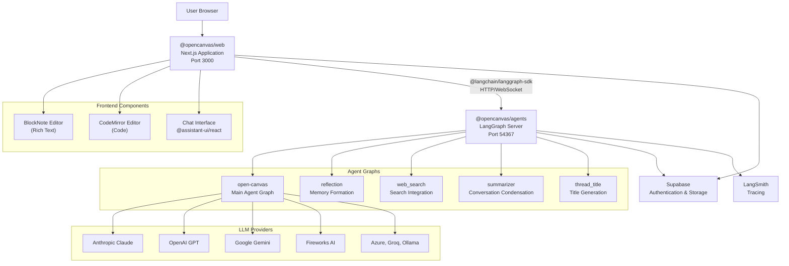
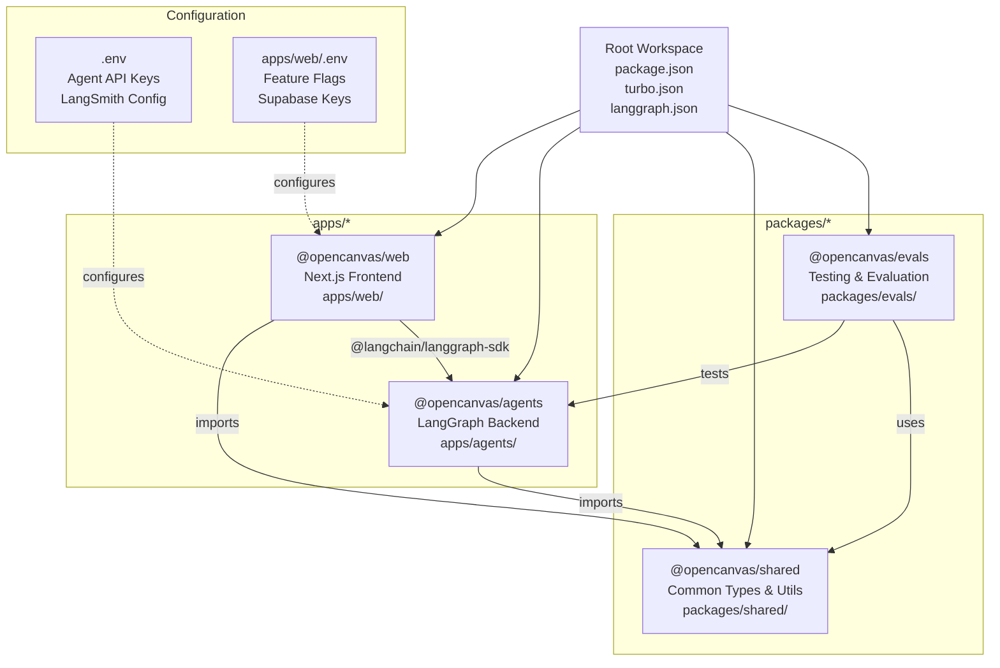
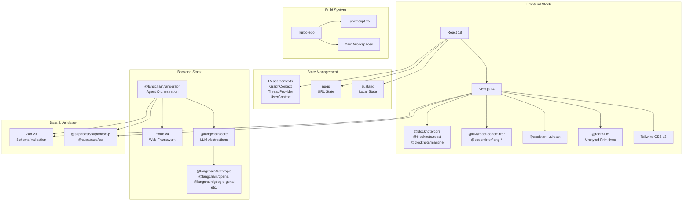
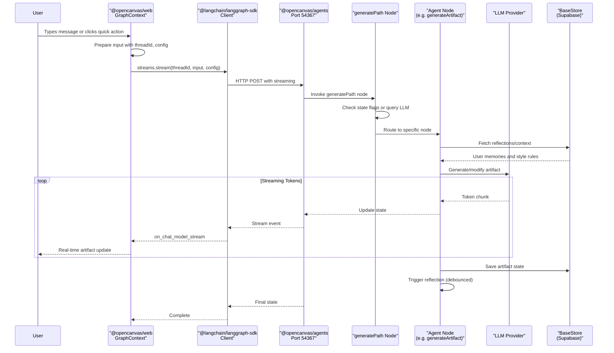

<!-- source: DeepWiki mcp.deepwiki.com · repo langchain-ai/open-canvas · page 1 Overview · fetched 2026-10-26 -->

# Overview

Relevant source files

The following files were used as context for generating this wiki page:

- [.codespellignore](.codespellignore)
- [.env.example](.env.example)
- [README.md](README.md)
- [apps/agents/package.json](apps/agents/package.json)
- [apps/web/.env.example](apps/web/.env.example)
- [apps/web/package.json](apps/web/package.json)
- [apps/web/src/hooks/useStore.tsx](apps/web/src/hooks/useStore.tsx)
- [package.json](package.json)
- [packages/evals/package.json](packages/evals/package.json)
- [packages/shared/package.json](packages/shared/package.json)
- [static/screenshot.png](static/screenshot.png)
- [yarn.lock](yarn.lock)

This document provides a high-level introduction to Open Canvas, covering its purpose, architecture, monorepo structure, key components, and technology stack. For detailed information about specific subsystems, see:
- Frontend implementation: [Frontend Application](#3)
- Backend agent system: [Backend Agents](#4)
- LLM provider integration: [Model Integration](#5)
- Build and deployment: [Development and Deployment](#7)

## Purpose and Scope

Open Canvas is an open source web application for collaborating with AI agents to write and edit documents. It functions as an AI-powered collaborative editor supporting both rich text (markdown) and code editing across multiple programming languages. The system enables conversational interaction with AI agents that can generate, rewrite, and incrementally update documents while maintaining memory of user preferences and style rules across sessions.

The application is built as a monorepo containing a Next.js frontend (`@opencanvas/web`), a LangGraph agent backend (`@opencanvas/agents`), and shared packages for common code. It integrates with seven different LLM providers (OpenAI, Anthropic, Google Gemini, Fireworks AI, Groq, Azure OpenAI, and Ollama) and uses Supabase for authentication and data persistence.

**Sources:** [README.md:1-198](), [package.json:1-31](), [apps/web/package.json:1-125](), [apps/agents/package.json:1-71]()

## Core Functionality

Open Canvas enables three primary workflows:

1. **Artifact Generation**: Users interact with AI agents via chat to generate new documents (text or code). The agent creates an artifact displayed in a side-by-side editor view alongside the chat interface.

2. **Artifact Modification**: Users can request changes to existing artifacts through chat messages or by highlighting specific sections and using quick actions. The system supports both full rewrites and targeted updates to selected text or code.

3. **Memory-Driven Personalization**: A background reflection agent analyzes conversations to extract user preferences, writing style rules, and contextual information. These reflections are stored in a shared memory store and retrieved during subsequent interactions to personalize responses.

The system maintains artifact versioning, allowing users to navigate through historical versions of their documents. All interactions stream responses in real-time, providing immediate visual feedback as the AI generates content.

**Sources:** [README.md:7-21](), [apps/agents/src/open-canvas/nodes/rewrite-artifact/update-meta.ts:1-67]()

## High-Level Architecture

**Architecture Overview**

The system follows a three-tier client-server architecture:

1. **Frontend Tier** (`@opencanvas/web`): A Next.js 14 application providing the user interface with specialized editors (BlockNote for markdown, CodeMirror for code) and a chat interface powered by `@assistant-ui/react`. The frontend communicates with the backend via the `@langchain/langgraph-sdk` client library using HTTP and WebSocket protocols.

2. **Backend Tier** (`@opencanvas/agents`): A LangGraph agent server running on port 54367, orchestrating five specialized agent graphs that handle different aspects of document generation, modification, and memory management. The server is built with the Hono web framework and processes requests through a state machine architecture.

3. **External Services Tier**: Supabase provides authentication (email/password, GitHub, Google OAuth) and data persistence. LangSmith provides tracing and observability for LLM operations. Multiple LLM providers offer model diversity and flexibility.

**Sources:** [README.md:1-198](), [apps/web/package.json:19-99](), [apps/agents/package.json:24-50](), [.env.example:1-34](), [apps/web/.env.example:1-37]()

## Monorepo Structure

**Workspace Organization**

The monorepo uses Yarn Workspaces with the following structure defined in [package.json:7]():

| Package | Path | Purpose | Key Dependencies |
|---------|------|---------|------------------|
| `@opencanvas/web` | `apps/web/` | Next.js frontend application | `next`, `@assistant-ui/react`, `@blocknote/core`, `@uiw/react-codemirror` |
| `@opencanvas/agents` | `apps/agents/` | LangGraph agent backend | `@langchain/langgraph`, `@langchain/anthropic`, `@langchain/openai` |
| `@opencanvas/shared` | `packages/shared/` | Common types and utilities | `@langchain/core` |
| `@opencanvas/evals` | `packages/evals/` | Testing and evaluation | `langsmith`, `vitest` |

**Build Orchestration**: Turborepo coordinates builds across packages as defined in [turbo.json:1-22](). The build order ensures `@opencanvas/shared` compiles first, as both frontend and backend depend on its type definitions and utility functions. The configuration in [turbo.json:5-7]() specifies build outputs and dependency relationships.

**Configuration Files**: The root `.env` file ([.env.example:1-34]()) contains secrets for the agent backend (LLM API keys, LangSmith credentials, Supabase service role). The `apps/web/.env` file ([apps/web/.env.example:1-37]()) contains frontend configuration (feature flags for model providers, public Supabase keys).

**Sources:** [package.json:1-31](), [turbo.json:1-22](), [apps/web/package.json:1-125](), [apps/agents/package.json:1-71](), [packages/shared/package.json:1-54](), [packages/evals/package.json:1-39](), [.env.example:1-34](), [apps/web/.env.example:1-37]()

## Key Features

### Artifact System

Artifacts represent the documents users create and edit. Each artifact has:
- **Type**: `text` (markdown) or `code` (with programming language specification)
- **Content**: The actual document text/code
- **Versions**: Historical snapshots enabling time-travel through edits
- **Metadata**: Title, language (for code), and creation/update timestamps

Artifacts are stored in the LangGraph state (`OpenCanvasGraphAnnotation.State`) and persisted to Supabase. The frontend renders artifacts using BlockNote for text and CodeMirror for code, with real-time updates during streaming responses.

### Memory and Personalization

The `reflection` agent graph analyzes conversations in the background (debounced by 5 minutes) to extract:
- **Style Rules**: User preferences for writing style, code patterns, formatting
- **User Insights**: Facts about the user, their projects, and domain expertise
- **Context Documents**: Uploaded PDFs and text files for reference

These memories are stored in a `BaseStore` under user-specific namespaces and retrieved during artifact generation to personalize outputs. The system uses [apps/agents/src/open-canvas/nodes/rewrite-artifact/update-meta.ts:32]() to format and inject reflections into prompts.

### Quick Actions

Users can trigger pre-built or custom quick actions on artifacts:
- **Pre-built**: Common operations like "Add comments", "Fix bugs", "Port to language"
- **Custom**: User-defined prompts tied to their account, persisting across sessions

Quick actions bypass the routing logic and directly invoke specific agent nodes with the artifact and prompt.

### Web Search Integration

The `web_search` agent graph enables agents to search the web via Firecrawl or Exa APIs when enabled. Results are displayed in a side panel and injected into the conversation context for the main agent.

**Sources:** [README.md:13-21](), [apps/agents/src/open-canvas/nodes/rewrite-artifact/update-meta.ts:1-67]()

## Technology Stack

**Frontend Technologies**

| Component | Package | Purpose |
|-----------|---------|---------|
| Framework | `next@14.2.25` | Server-side rendering, routing, API routes |
| UI Library | `react@^18` | Component architecture and state management |
| Rich Text Editor | `@blocknote/core@^0.17.1` | Block-based markdown editor with real-time rendering |
| Code Editor | `@uiw/react-codemirror@^4.23.5` | Syntax-highlighted code editing with language support |
| Chat Interface | `@assistant-ui/react@^0.7.68` | AI chat components with streaming support |
| Primitives | `@radix-ui/*` | Unstyled, accessible UI primitives (Dialog, Popover, etc.) |
| Styling | `tailwindcss@^3.4.1` | Utility-first CSS framework |

**Backend Technologies**

| Component | Package | Purpose |
|-----------|---------|---------|
| Agent Framework | `@langchain/langgraph@^0.4.4` | State machine orchestration for AI workflows |
| Web Server | Built on Hono framework | HTTP server for agent endpoints |
| LLM Abstraction | `@langchain/core@^0.3.71` | Base interfaces for language models and tools |
| LLM Providers | `@langchain/anthropic`, `@langchain/openai`, etc. | Provider-specific model integrations |
| Schema Validation | `zod@^3.23.8` | Runtime type validation across frontend and backend |

**Build and Development**

The monorepo uses:
- **Turborepo** ([turbo.json:1-22]()): Coordinates parallel builds with caching
- **TypeScript v5**: Type safety across all packages
- **Yarn Workspaces** ([package.json:7]()): Dependency management
- **esbuild**: Fast bundling for production builds

**Sources:** [apps/web/package.json:19-99](), [apps/agents/package.json:24-50](), [packages/shared/package.json:51-53](), [turbo.json:1-22](), [yarn.lock:1-100]()

## Data Flow Overview

**Message Processing Pipeline**

1. **Input Collection**: User interactions (chat messages, quick actions, text highlighting) are captured in the frontend and packaged with the current thread ID and model configuration.

2. **Request Initiation**: The `GraphContext` React Context ([apps/web/src/contexts/GraphContext.tsx]()) calls `streams.stream()` from `@langchain/langgraph-sdk` to initiate a streaming request to the LangGraph server.

3. **Routing**: The `generatePath` node examines the state for explicit routing flags (`highlightedCode`, `webSearchEnabled`, etc.) or queries an LLM to determine the appropriate processing node.

4. **Processing**: The selected agent node (e.g., `generateArtifact`, `updateArtifact`) retrieves user memories from `BaseStore`, constructs a prompt with reflections, and invokes the configured LLM.

5. **Streaming Response**: As the LLM generates tokens, they stream through all layers back to the frontend. The `GraphContext` processes stream events (`on_chat_model_stream`, `on_chain_start`, `on_chain_end`) to update the artifact display in real-time.

6. **Persistence**: Final artifact states are saved to both LangGraph's thread state and Supabase. A debounced `reflection` node (5-minute delay) analyzes the conversation in the background to update user memories.

**Sources:** [README.md:1-198](), [apps/agents/src/open-canvas/nodes/rewrite-artifact/update-meta.ts:1-67]()

## Model Integration

Open Canvas supports seven LLM providers through a unified configuration system defined in `packages/shared/src/models.ts`:

| Provider | Environment Variables | Models Supported |
|----------|----------------------|------------------|
| OpenAI | `OPENAI_API_KEY` | `gpt-4o`, `gpt-4o-mini`, `o1-preview`, `o1-mini`, `o3-mini` |
| Anthropic | `ANTHROPIC_API_KEY` | `claude-3-5-sonnet`, `claude-3-5-haiku`, `claude-3-opus` |
| Google Gemini | `GOOGLE_API_KEY` | `gemini-1.5-pro`, `gemini-1.5-flash`, `gemini-2.0-flash-exp` |
| Azure OpenAI | `_AZURE_OPENAI_API_KEY`, `_AZURE_OPENAI_API_DEPLOYMENT_NAME` | Custom deployments |
| Fireworks AI | `FIREWORKS_API_KEY` | `llama-v3p3-70b-instruct`, `llama-v3p1-405b-instruct` |
| Groq | `GROQ_API_KEY` | `llama-3.3-70b-versatile` |
| Ollama | `OLLAMA_API_URL` | Local models (e.g., `llama3.3`) |

The `getModelFromConfig()` function in `apps/agents/src/agent/utils.ts` initializes the appropriate model based on configuration parameters including `customModelName`, `temperature`, and `maxTokens`.

**Feature Flags**: Frontend model availability is controlled by environment variables in [apps/web/.env.example:1-9]() (e.g., `NEXT_PUBLIC_ANTHROPIC_ENABLED`, `NEXT_PUBLIC_OLLAMA_ENABLED`).

**Sources:** [.env.example:9-26](), [apps/web/.env.example:1-37](), [README.md:129-161]()

---

