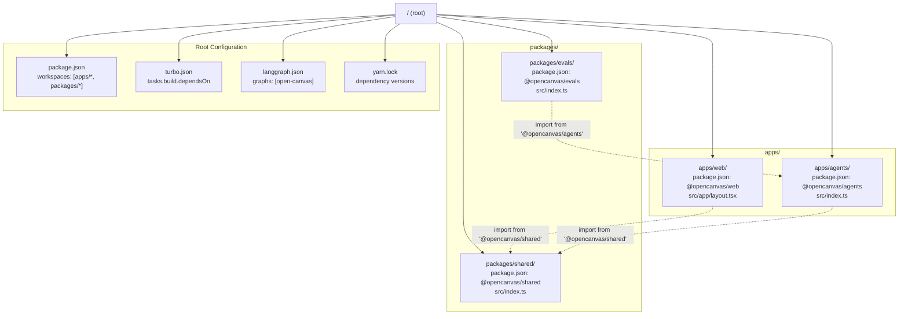
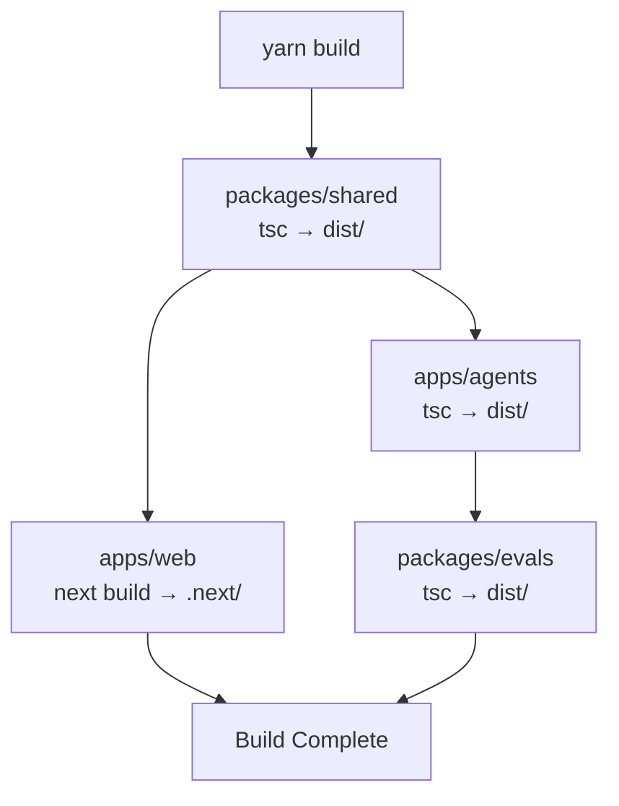
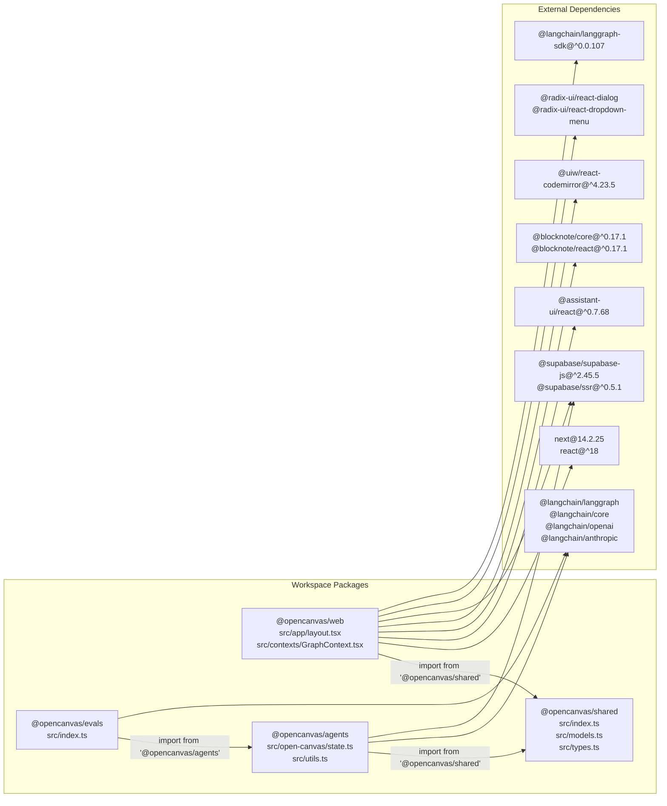

<!-- source: DeepWiki mcp.deepwiki.com · repo langchain-ai/open-canvas · page 1.1 Project Structure · fetched 2026-10-26 -->

# Project Structure

<details>
<summary>Relevant source files</summary>

The following files were used as context for generating this wiki page:

- [.codespellignore](.codespellignore)
- [apps/agents/package.json](apps/agents/package.json)
- [apps/web/package.json](apps/web/package.json)
- [apps/web/src/hooks/useStore.tsx](apps/web/src/hooks/useStore.tsx)
- [package.json](package.json)
- [packages/evals/package.json](packages/evals/package.json)
- [packages/shared/package.json](packages/shared/package.json)
- [yarn.lock](yarn.lock)

</details>


This document describes the monorepo organization, workspace structure, and build system configuration of the Open Canvas codebase. It covers the directory layout, package dependencies, and build orchestration but does not detail the implementation within each package. For information about the frontend application internals, see [Frontend Architecture](#2.1). For backend agent implementation details, see [Backend Architecture](#2.2).

---

## Monorepo Organization

Open Canvas uses a **Yarn workspaces** monorepo structure with **Turborepo** for build orchestration. The codebase is organized into two top-level directories: `apps/` for deployable applications and `packages/` for shared libraries.

### Workspace Configuration

The root [package.json:7]() defines the workspace pattern:

```json
"workspaces": ["apps/*", "packages/*"]
```

This configuration enables:
- Dependency hoisting to the root `node_modules`
- Cross-workspace dependency linking
- Unified script execution via Turborepo
- Shared development tooling (ESLint, Prettier, TypeScript)

**Sources:** [package.json:1-31]()

---

## Directory Structure

**Monorepo Structure Diagram**



**Sources:** [package.json:7](), [apps/web/package.json:1-125](), [apps/agents/package.json:1-71](), [packages/shared/package.json:1-54](), [packages/evals/package.json:1-39]()

---

## Applications

### apps/web - Frontend Application

The `apps/web` directory contains the **Next.js 14** frontend application serving the user interface.

| Attribute | Value |
|-----------|-------|
| Package Name | `@opencanvas/web` |
| Framework | Next.js 14.2.25 |
| Port | 3000 (default) |
| Build Output | `.next/` |
| Entry Point | `src/app/layout.tsx` |

**Directory Structure:**
```
apps/web/
├── src/
│   ├── app/              # Next.js App Router pages
│   ├── components/       # React components
│   ├── contexts/         # React Context providers
│   ├── hooks/            # Custom React hooks
│   └── lib/              # Utility functions
├── public/               # Static assets
├── package.json          # Package configuration
├── next.config.js        # Next.js configuration
└── tsconfig.json         # TypeScript configuration
```

**Key Dependencies:**
- `@assistant-ui/react@^0.7.68` - Chat interface primitives
- `@blocknote/core@^0.17.1`, `@blocknote/react@^0.17.1`, `@blocknote/shadcn@^0.17.1` - Rich text editing
- `@uiw/react-codemirror@^4.23.5` - Code editor with language support
- `@langchain/langgraph-sdk@^0.0.107` - Backend communication via HTTP/WebSocket
- `@opencanvas/shared@*` - Shared utilities and types (workspace dependency)
- `@supabase/supabase-js@^2.45.5`, `@supabase/ssr@^0.5.1` - Authentication and storage
- `@radix-ui/react-*` - UI component primitives (Dialog, Dropdown, Popover, etc.)
- `next@14.2.25` - React framework
- `react@^18`, `react-dom@^18` - React runtime

**Development Scripts:**
```bash
yarn dev        # Next.js dev server on port 3000
yarn build      # Production build to .next/
yarn start      # Start production server
yarn lint       # ESLint validation
yarn format     # Prettier code formatting
```

**Import Pattern Example:**
```typescript
// Importing from shared package
import { ALL_MODELS } from '@opencanvas/shared';
import { getArtifactContent } from '@opencanvas/shared/utils/artifacts';
```

**Sources:** [apps/web/package.json:1-125]()

---

### apps/agents - Backend Agent System

The `apps/agents` directory contains the **LangGraph** agent implementation that powers the AI capabilities.

| Attribute | Value |
|-----------|-------|
| Package Name | `@opencanvas/agents` |
| Framework | LangGraph 0.4.4 |
| Port | 54367 |
| Build Output | `dist/` (TypeScript compilation) |
| Registry Config | `../../langgraph.json` |
| Entry Point | `src/index.ts` |

**Directory Structure:**
```
apps/agents/
├── src/
│   ├── open-canvas/          # Main agent graph
│   │   ├── nodes/            # Graph node implementations
│   │   ├── prompts.ts        # LLM prompt templates
│   │   └── state.ts          # OpenCanvasGraphAnnotation
│   ├── reflection/           # Reflection agent graph
│   ├── summarizer/           # Summarizer agent graph
│   ├── web-search/           # Web search agent graph
│   ├── thread-title/         # Thread title agent graph
│   ├── utils.ts              # Shared utility functions
│   └── index.ts              # Agent exports
├── package.json              # Package configuration
└── tsconfig.json             # TypeScript configuration
```

**Key Dependencies:**
- `@langchain/langgraph@^0.4.4` - StateGraph and Annotation framework
- `@langchain/core@^0.3.71` - Base abstractions (BaseMessage, Runnable, etc.)
- `@langchain/openai@^0.4.2`, `@langchain/anthropic@^0.3.21`, `@langchain/google-genai@^0.2.10`, `@langchain/groq@^0.2.2`, `@langchain/ollama@^0.2.0` - LLM provider clients
- `@langchain/exa@^0.1.0` - Exa search API integration
- `@opencanvas/shared@*` - Shared model configs and types (workspace dependency)
- `@supabase/supabase-js@^2.45.5` - Database and authentication client
- `@mendable/firecrawl-js@1.10.1` - Web page scraping
- `@ffmpeg/ffmpeg@^0.12.15` - Audio/video transcoding
- `zod@^3.23.8` - Schema validation

**Development Scripts:**
```bash
yarn dev        # LangGraph dev server on port 54367
yarn build      # Compile TypeScript to dist/
yarn clean      # Remove dist/ and .turbo/
yarn lint       # ESLint validation
```

The development server command at [apps/agents/package.json:15]() explicitly specifies:
```json
"dev": "yarn langgraphjs dev --port 54367 --config ../../langgraph.json --no-browser"
```

**Import Pattern Example:**
```typescript
// Importing from shared package
import { getModelFromConfig } from '@opencanvas/shared';
import { ALL_MODELS } from '@opencanvas/shared/models';
```

**Sources:** [apps/agents/package.json:1-71]()

---

## Shared Packages

### packages/shared - Common Code Library

The `packages/shared` directory provides shared types, constants, and utilities used by both frontend and backend.

| Attribute | Value |
|-----------|-------|
| Package Name | `@opencanvas/shared` |
| Export Strategy | Dual ESM/CJS with flexible path exports |
| Build Output | `dist/` (TypeScript compilation) |
| Main Entry | `dist/index.js` |
| Types Entry | `dist/index.d.ts` |

**Directory Structure:**
```
packages/shared/
├── src/
│   ├── models.ts             # ALL_MODELS configuration
│   ├── types.ts              # TypeScript type definitions
│   ├── constants.ts          # Shared constants
│   ├── utils/
│   │   ├── artifacts.ts      # Artifact helper functions
│   │   └── formatting.ts     # Format utility functions
│   └── index.ts              # Package entry point
├── package.json              # Package configuration
└── tsconfig.json             # TypeScript configuration
```

**Module Exports Structure:**

The [packages/shared/package.json:9-20]() defines flexible export mappings:
```json
"exports": {
  ".": {
    "types": "./dist/index.d.ts",
    "import": "./dist/index.js",
    "require": "./dist/index.js"
  },
  "./*": {
    "types": "./dist/*.d.ts",
    "import": "./dist/*.js",
    "require": "./dist/*.js"
  },
  "./package.json": "./package.json"
}
```

This enables consumers to import from:
- Root: `import { ALL_MODELS } from '@opencanvas/shared'`
- Specific files: `import { getArtifactContent } from '@opencanvas/shared/utils/artifacts'`
- Package metadata: `import pkg from '@opencanvas/shared/package.json'`

**Key Exports:**
- `ALL_MODELS` - Complete model configuration catalog with provider details
- `ArtifactV3` - Current artifact data structure interface
- `ModelConfigurationParams` - Model parameter configuration interface
- `ContextDocument` - Uploaded document type definition
- `Reflections` - User memory and style rules interface
- `DEFAULT_INPUTS` - Default prompt templates
- `PROGRAMMING_LANGUAGES` - Supported language list
- `formatReflections()` - Format user memories for prompts
- `formatArtifactContent()` - Format artifacts for display
- `getArtifactContent()` - Extract content from artifact versions

**Dependencies:**
- `@langchain/core@^0.3.71` - For LangChain type compatibility

**Sources:** [packages/shared/package.json:1-54]()

---

### packages/evals - Evaluation Framework

The `packages/evals` directory contains testing and evaluation utilities for agent behavior validation using LangSmith.

| Attribute | Value |
|-----------|-------|
| Package Name | `@opencanvas/evals` |
| Build Output | `dist/` (TypeScript compilation) |
| Primary Dependency | `@opencanvas/agents` |

**Directory Structure:**
```
packages/evals/
├── src/
│   ├── evaluators/           # LangSmith evaluator functions
│   ├── datasets/             # Test dataset definitions
│   └── index.ts              # Evaluation runner
├── package.json              # Package configuration
└── tsconfig.json             # TypeScript configuration
```

**Key Dependencies:**
- `@opencanvas/agents@*` - Agent implementation to test (workspace dependency)
- `@langchain/core@^0.3.71`, `@langchain/openai@^0.4.2` - LangChain primitives
- `langsmith@^0.3.60` - Tracing, evaluation, and dataset management
- `zod@^3.24.1` - Schema validation for test cases
- `dotenv@^16.4.7` - Environment variable loading

**Development Scripts:**
```bash
yarn build      # Compile TypeScript to dist/
yarn lint       # ESLint validation
```

**Usage Pattern:**
The evals package imports agent graphs from `@opencanvas/agents` and runs them against test datasets stored in LangSmith, measuring performance metrics and validating outputs.

**Sources:** [packages/evals/package.json:1-39]()

---

## Build System and Orchestration

### Turborepo Configuration

The [turbo.json:1-22]() file defines the build pipeline orchestration using Turborepo's task dependency system.

**Configuration Structure:**

```json
{
  "$schema": "https://turbo.build/schema.json",
  "globalDependencies": ["**/.env"],
  "tasks": {
    "build": {
      "dependsOn": ["^build"],
      "outputs": ["dist/**", ".next/**", "!.next/cache/**"]
    },
    "lint": {
      "dependsOn": ["^lint"]
    },
    "lint:fix": {
      "dependsOn": ["^lint:fix"]
    },
    "format": {
      "dependsOn": ["^format"]
    },
    "format:check": {
      "dependsOn": ["^format:check"]
    }
  }
}
```

**Key Configuration Fields:**

| Field | Value | Purpose |
|-------|-------|---------|
| `globalDependencies` | `["**/.env"]` | Invalidate cache when any `.env` file changes |
| `tasks.build.dependsOn` | `["^build"]` | Build workspace dependencies first (^ = upstream deps) |
| `tasks.build.outputs` | `["dist/**", ".next/**", "!.next/cache/**"]` | Cache these directories for faster rebuilds |

**Task Execution Order:**

When running `yarn build` from the root, Turborepo executes:



1. **packages/shared** builds first (no dependencies)
2. **apps/web** and **apps/agents** build in parallel (both depend only on `shared`)
3. **packages/evals** builds last (depends on `agents`)

**Caching Behavior:**
- Turborepo hashes inputs (source files, dependencies, env vars) for each task
- If inputs haven't changed, outputs are restored from `.turbo/cache/`
- The `^build` dependency ensures upstream packages are built before downstream consumers

**Sources:** [turbo.json:1-22]()

---

**Package Dependency Graph**



**Build Order:**

| Order | Package | Reason |
|-------|---------|--------|
| 1 | `packages/shared` | No internal dependencies |
| 2 | `apps/web`, `apps/agents` | Depend only on `shared` (parallel) |
| 3 | `packages/evals` | Depends on `agents` |

**Sources:** [apps/web/package.json:19-99](), [apps/agents/package.json:24-50](), [packages/evals/package.json:16-22]()

---

## Development Tooling

### Shared Configuration Files

The root workspace provides unified development tooling for all packages:

| Tool | Configuration | Purpose |
|------|---------------|---------|
| TypeScript | `tsconfig.json` | Type checking and compilation |
| ESLint | `.eslintrc` (root) | Code linting rules |
| Prettier | `.prettierrc` | Code formatting standards |
| Yarn | `yarn.lock` | Dependency version locking |

**Root Development Dependencies:**

[package.json:17-30]() defines shared devDependencies:
- `turbo` - Build orchestration
- `typescript` - TypeScript compiler
- `eslint` - Linting framework
- `@typescript-eslint/eslint-plugin`, `@typescript-eslint/parser` - TypeScript linting
- `prettier` - Code formatter
- `eslint-config-prettier` - ESLint/Prettier integration

---

### Unified Scripts

The root [package.json:8-14]() provides workspace-wide commands that execute across all packages:

```json
{
  "scripts": {
    "build": "turbo build",
    "turbo:command": "turbo",
    "format": "turbo format",
    "format:check": "turbo format:check",
    "lint": "turbo lint",
    "lint:fix": "turbo lint:fix"
  }
}
```

**Script Behavior:**

| Script | Command | Behavior |
|--------|---------|----------|
| `build` | `turbo build` | Builds all packages in dependency order (shared → web/agents → evals) |
| `format` | `turbo format` | Runs Prettier formatting on all packages |
| `format:check` | `turbo format:check` | Validates Prettier formatting without modification |
| `lint` | `turbo lint` | Runs ESLint on all packages |
| `lint:fix` | `turbo lint:fix` | Runs ESLint with auto-fix on all packages |
| `turbo:command` | `turbo` | Direct access to Turborepo CLI |

**Execution Model:**

When running `yarn build`:
1. Turborepo reads [turbo.json:4-7]() for task configuration
2. Analyzes `package.json` dependencies to determine build order
3. Executes `build` script in each package respecting `dependsOn: ["^build"]`
4. Caches successful builds for faster subsequent runs

**Example Workflows:**

```bash
# Format all source code
yarn format

# Build entire monorepo (respects dependency graph)
yarn build

# Lint and auto-fix all packages
yarn lint:fix

# Build only a specific package and its dependencies
yarn turbo:command run build --filter=@opencanvas/web
```

**Per-package Scripts:**

Each package defines its own `build`, `format`, and `lint` scripts:
- [apps/web/package.json:8-17]() - Next.js build, ESLint, Prettier
- [apps/agents/package.json:14-22]() - TypeScript compilation, LangGraph dev server
- [packages/shared/package.json:27-33]() - TypeScript compilation
- [packages/evals/package.json:8-14]() - TypeScript compilation

**Sources:** [package.json:1-31](), [turbo.json:1-22]()

---

## Package Manager Configuration

### Yarn Version

The [package.json:16]() specifies:
```json
"packageManager": "yarn@1.22.22"
```

This pins the Yarn classic (v1) version for consistent behavior across development environments.

### Workspace Privacy

All workspace packages are marked as `"private": true`:
- [package.json:6]() - Root
- [apps/web/package.json:7]() - Web app
- [apps/agents/package.json:13]() - Agents
- [packages/shared/package.json:26]() - Shared
- [packages/evals/package.json:7]() - Evals

This prevents accidental publication to npm registries.

**Sources:** [package.json:1-31](), [apps/web/package.json:1-125](), [apps/agents/package.json:1-71](), [packages/shared/package.json:1-54](), [packages/evals/package.json:1-39]()

---

