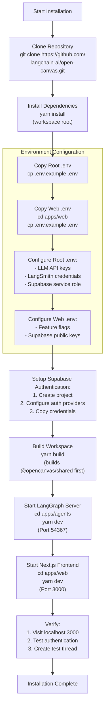
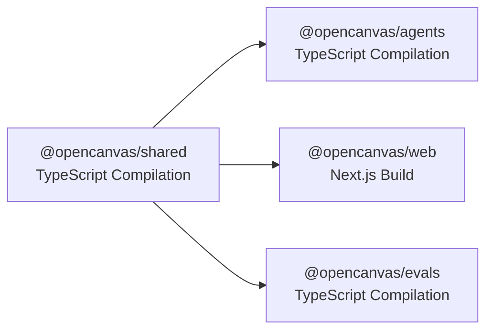
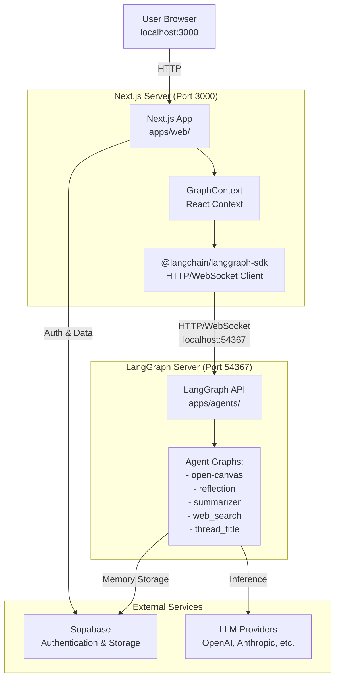

<!-- source: DeepWiki mcp.deepwiki.com · repo langchain-ai/open-canvas · page 1.2 Setup and Installation · fetched 2026-10-26 -->

# Setup and Installation

<details>
<summary>Relevant source files</summary>

The following files were used as context for generating this wiki page:

- [.env.example](.env.example)
- [.github/workflows/ci.yml](.github/workflows/ci.yml)
- [.nvmrc](.nvmrc)
- [README.md](README.md)
- [apps/agents/scripts/check-dev-server.ts](apps/agents/scripts/check-dev-server.ts)
- [apps/web/.env.example](apps/web/.env.example)
- [static/screenshot.png](static/screenshot.png)

</details>


This document provides step-by-step instructions for installing Open Canvas locally and running both the Next.js frontend and LangGraph agent server in development mode. For detailed configuration of environment variables and API keys, see [Configuration](#1.3). For understanding the monorepo structure before installation, see [Project Structure](#1.1).

## Prerequisites

Open Canvas requires specific tools and services to function correctly. All required and optional prerequisites must be configured before running the application.

### Package Manager

The monorepo uses **Yarn** for dependency management and workspace orchestration. Yarn is required (not npm or pnpm) due to workspace-specific configurations.

- [Yarn](https://yarnpkg.com/) - Install via `npm install -g yarn`

### LLM Provider API Keys

At minimum, **both OpenAI and Anthropic** API keys are required for core functionality:

| Provider | Required | Purpose | Registration Link |
|----------|----------|---------|-------------------|
| OpenAI | ✅ Yes | Primary model provider | [platform.openai.com/signup](https://platform.openai.com/signup/) |
| Anthropic | ✅ Yes | Claude models for summarization | [console.anthropic.com](https://console.anthropic.com/) |
| Google GenAI | ⚪ Optional | Gemini models | [aistudio.google.com/apikey](https://aistudio.google.com/apikey) |
| Fireworks AI | ⚪ Optional | Llama models | [fireworks.ai/login](https://fireworks.ai/login) |
| Groq | ⚪ Optional | Audio/video transcription | [groq.com](https://groq.com) |
| Azure OpenAI | ⚪ Optional | Azure-hosted OpenAI models | Requires Azure account |

### External Services

| Service | Required | Purpose |
|---------|----------|---------|
| **Supabase** | ✅ Yes | User authentication and data persistence |
| **LangSmith** | ✅ Yes | LLM tracing and observability |
| **Firecrawl** | ⚪ Optional | Web scraping for web search agent |
| **Exa** | ⚪ Optional | Semantic search API for web search agent |

### Development Tools

- **LangGraph CLI** - Required for running the agent server locally
  - Install: `pip install langgraph-cli` or use the included package

**Sources:** [README.md:26-56]()

## Installation Flow

The installation process follows a specific sequence to ensure workspace dependencies are correctly resolved.



**Sources:** [README.md:58-127]()

## Step 1: Clone Repository

Clone the Open Canvas repository from GitHub:

```bash
git clone https://github.com/langchain-ai/open-canvas.git
cd open-canvas
```

**Sources:** [README.md:59-64]()

## Step 2: Install Dependencies

Install all workspace dependencies using Yarn from the repository root:

```bash
yarn install
```

This command installs dependencies for all workspaces defined in the root [package.json](), including:
- `@opencanvas/web` - Next.js frontend
- `@opencanvas/agents` - LangGraph backend
- `@opencanvas/shared` - Shared types and utilities
- `@opencanvas/evals` - Testing and evaluation suite

The `postinstall` script in [apps/agents/package.json:22]() automatically triggers a Turborepo build after installation.

**Sources:** [README.md:66-70](), [apps/agents/package.json:22]()

## Step 3: Configure Environment Variables

Open Canvas requires two separate `.env` files:

### Root `.env` File

The root `.env` file configures the LangGraph agent server:

```bash
cp .env.example .env
```

Edit `.env` to set the following required variables:

| Variable | Purpose | Example |
|----------|---------|---------|
| `LANGSMITH_TRACING` | Enable LangSmith tracing | `"true"` |
| `LANGSMITH_API_KEY` | LangSmith API key | `"ls__..."` |
| `ANTHROPIC_API_KEY` | Anthropic Claude access | `"sk-ant-..."` |
| `OPENAI_API_KEY` | OpenAI GPT access | `"sk-..."` |
| `NEXT_PUBLIC_SUPABASE_URL` | Supabase project URL | `"https://xxx.supabase.co"` |
| `NEXT_PUBLIC_SUPABASE_ANON_KEY` | Supabase anonymous key | `"eyJ..."` |
| `SUPABASE_SERVICE_ROLE` | Supabase service role key | `"eyJ..."` |

Optional variables for additional providers:

| Variable | Purpose |
|----------|---------|
| `_AZURE_OPENAI_API_KEY` | Azure OpenAI key (note underscore prefix) |
| `_AZURE_OPENAI_API_DEPLOYMENT_NAME` | Azure deployment name |
| `_AZURE_OPENAI_API_VERSION` | Azure API version |
| `_AZURE_OPENAI_API_BASE_PATH` | Azure base path |
| `FIREWORKS_API_KEY` | Fireworks AI key |
| `GOOGLE_API_KEY` | Google Gemini key |
| `GROQ_API_KEY` | Groq API key for transcription |
| `FIRECRAWL_API_KEY` | Firecrawl web scraping key |

**Note:** Azure OpenAI variables must be prefixed with an underscore (`_`) to distinguish them from standard OpenAI configuration.

### Web `.env` File

The `apps/web/.env` file configures the Next.js frontend:

```bash
cd apps/web/
cp .env.example .env
```

Edit `apps/web/.env` to set the following required variables:

| Variable | Purpose |
|----------|---------|
| `NEXT_PUBLIC_SUPABASE_URL` | Supabase project URL (public) |
| `NEXT_PUBLIC_SUPABASE_ANON_KEY` | Supabase anonymous key (public) |

Feature flags to enable/disable model providers:

| Variable | Default | Purpose |
|----------|---------|---------|
| `NEXT_PUBLIC_FIREWORKS_ENABLED` | `true` | Show Fireworks models in UI |
| `NEXT_PUBLIC_GEMINI_ENABLED` | `true` | Show Gemini models in UI |
| `NEXT_PUBLIC_ANTHROPIC_ENABLED` | `true` | Show Anthropic models in UI |
| `NEXT_PUBLIC_OPENAI_ENABLED` | `true` | Show OpenAI models in UI |
| `NEXT_PUBLIC_AZURE_ENABLED` | `false` | Show Azure OpenAI models in UI |
| `NEXT_PUBLIC_OLLAMA_ENABLED` | `false` | Show Ollama local models in UI |
| `NEXT_PUBLIC_GROQ_ENABLED` | `false` | Show Groq models in UI |

Optional variables:

| Variable | Purpose | Default |
|----------|---------|---------|
| `OLLAMA_API_URL` | Ollama server URL | `"http://host.docker.internal:11434"` |
| `GROQ_API_KEY` | Groq transcription key | - |
| `FIRECRAWL_API_KEY` | Firecrawl web scraping key | - |

**Sources:** [README.md:72-83](), [.env.example:1-34](), [apps/web/.env.example:1-37]()

## Step 4: Setup Supabase Authentication

### Create Supabase Project

1. Visit the [Supabase dashboard](https://supabase.com/dashboard/projects)
2. Create a new project
3. Wait for the project to initialize

### Copy API Credentials

Navigate to **Project Settings** → **API** and copy:

- **Project URL** → Set as `NEXT_PUBLIC_SUPABASE_URL` in both `.env` files
- **anon public key** → Set as `NEXT_PUBLIC_SUPABASE_ANON_KEY` in both `.env` files

Navigate to **Project Settings** → **API** → **Service role** and copy:

- **service_role key** → Set as `SUPABASE_SERVICE_ROLE` in root `.env` file

### Configure Authentication Providers

Navigate to **Authentication** → **Providers**:

1. **Enable Email Provider:**
   - Toggle **Email** to enabled
   - Ensure **Confirm Email** is checked
   - Save changes

2. **Optional - Enable OAuth Providers:**
   - **GitHub**: Follow [Supabase GitHub Auth docs](https://supabase.com/docs/guides/auth/social-login/auth-github)
   - **Google**: Follow [Supabase Google Auth docs](https://supabase.com/docs/guides/auth/social-login/auth-google)

**Sources:** [README.md:85-98]()

## Step 5: Build the Workspace

Before running development servers, build all workspace packages to ensure dependencies are available:

```bash
# From repository root
yarn build
```

This command triggers Turborepo to build packages in dependency order:



The build process:

1. **`@opencanvas/shared`** compiles first (dependency for all other packages)
   - Command: `tsc` ([packages/shared/package.json:28]())
   - Output: `packages/shared/dist/`

2. **`@opencanvas/agents`** compiles TypeScript agent code
   - Command: `yarn clean && tsc` ([apps/agents/package.json:16]())
   - Output: `apps/agents/dist/`

3. **`@opencanvas/web`** builds Next.js production bundle
   - Command: `next build` ([apps/web/package.json:10]())
   - Output: `apps/web/.next/`

4. **`@opencanvas/evals`** compiles evaluation suite
   - Command: `yarn clean && tsc` ([packages/evals/package.json:9]())
   - Output: `packages/evals/dist/`

Build caching is configured in [turbo.json:5-8]() to skip rebuilding unchanged packages.

**Sources:** [README.md:101-107](), [turbo.json:5-8](), [apps/agents/package.json:16](), [apps/web/package.json:10](), [packages/shared/package.json:28]()

## Step 6: Run the LangGraph Server

The LangGraph agent server must be running before starting the frontend.

### Start the Server

From the repository root, navigate to the agents directory and start the development server:

```bash
cd apps/agents
yarn dev
```

This executes the command: `yarn langgraphjs dev --port 54367 --config ../../langgraph.json --no-browser` ([apps/agents/package.json:15]())

### Verify Server is Running

You should see output similar to:

```
Ready!
- 🚀 API: http://localhost:54367
- 🎨 Studio UI: https://smith.langchain.com/studio?baseUrl=http://localhost:54367
```

The LangGraph server exposes:
- **HTTP API** on port `54367` - Used by the frontend via `@langchain/langgraph-sdk`
- **Studio UI** - Visual graph debugging interface (requires LangSmith account)

### LangGraph Configuration

The server reads its configuration from [langgraph.json]() in the repository root, which defines:
- Agent graph entry points
- Environment variable requirements
- Dockerfile configuration

**Sources:** [README.md:109-117](), [apps/agents/package.json:15]()

## Step 7: Run the Next.js Frontend

With the LangGraph server running, start the Next.js frontend in a separate terminal.

### Start the Frontend

From the repository root, navigate to the web directory and start the development server:

```bash
cd apps/web
yarn dev
```

This executes `next dev` ([apps/web/package.json:9]()), which starts the Next.js development server on port `3000`.

### Initial Compilation

On first run, Next.js compiles all pages and components, which may take 30-60 seconds. Subsequent starts are faster due to caching.

### Access the Application

Open your browser and navigate to [http://localhost:3000](http://localhost:3000).

**Sources:** [README.md:119-127](), [apps/web/package.json:9]()

## Server Communication Architecture

The following diagram shows how the two development servers communicate:



**Key communication paths:**

1. **Frontend → Backend**: The `@langchain/langgraph-sdk` client ([apps/web/package.json:41]()) makes HTTP POST requests to `http://localhost:54367` to invoke agent graphs
2. **Backend → LLMs**: Agent nodes use `getModelFromConfig` to initialize LLM clients (OpenAI, Anthropic, etc.)
3. **Both → Supabase**: Frontend uses `@supabase/ssr` ([apps/web/package.json:62]()) for authentication; backend uses `@supabase/supabase-js` ([apps/agents/package.json:39]()) with service role key

**Sources:** [apps/web/package.json:41,62](), [apps/agents/package.json:39]()

## Verification Steps

### Test Authentication

1. Navigate to [http://localhost:3000](http://localhost:3000)
2. You should be redirected to [http://localhost:3000/auth/login](http://localhost:3000/auth/login)
3. If you configured OAuth providers (GitHub/Google):
   - Click the provider button
   - Complete OAuth flow
   - You should be redirected to the home page
4. If using email authentication:
   - Navigate to [http://localhost:3000/auth/signup](http://localhost:3000/auth/signup)
   - Create an account with email and password
   - Check your email for confirmation link
   - After confirming, you should be redirected to the home page

### Create Test Thread

1. From the home page, you should see a blank canvas with a chat interface
2. Type a message in the chat input (e.g., "Write a hello world function in Python")
3. Submit the message
4. Verify that:
   - The LangGraph server logs show activity
   - A response streams back to the chat interface
   - An artifact (code or markdown) appears in the canvas area

### Check Thread Persistence

1. Refresh the page
2. Verify the conversation and artifact persist
3. Check that the thread ID appears in the URL (e.g., `?threadId=...`)
4. Verify you can continue the conversation

**Sources:** [README.md:96-98]()

## Common Installation Issues

### Port Already in Use

**Problem:** `Error: Port 3000 (or 54367) already in use`

**Solutions:**
- Identify and kill the process using the port:
  ```bash
  # macOS/Linux
  lsof -ti:3000 | xargs kill -9
  lsof -ti:54367 | xargs kill -9
  ```
- Or specify a different port:
  ```bash
  # Next.js
  PORT=3001 yarn dev
  
  # LangGraph (modify package.json dev script)
  yarn langgraphjs dev --port 54368 --config ../../langgraph.json --no-browser
  ```

### Workspace Build Errors

**Problem:** `Error: Cannot find module '@opencanvas/shared'`

**Solution:** Ensure `@opencanvas/shared` builds before other packages:
```bash
cd packages/shared
yarn build
cd ../..
yarn build
```

### Missing Environment Variables

**Problem:** Agent server crashes with `Error: ANTHROPIC_API_KEY is not set`

**Solution:** Verify all required variables are set in root `.env` file:
```bash
# Check if variable is loaded
cd apps/agents
node -e "require('dotenv').config({path:'../../.env'}); console.log(process.env.ANTHROPIC_API_KEY)"
```

### Supabase Connection Errors

**Problem:** `Error: Invalid API key` when accessing the application

**Solution:** Verify Supabase configuration:
1. Ensure `NEXT_PUBLIC_SUPABASE_URL` and `NEXT_PUBLIC_SUPABASE_ANON_KEY` are set in `apps/web/.env`
2. Verify the keys match your Supabase project settings
3. Clear browser cookies and localStorage
4. Restart the Next.js server

**Sources:** [README.md:162-172]()

## Local Ollama Setup (Optional)

Open Canvas supports calling local LLMs via Ollama for fully offline operation.

### Prerequisites

1. Install [Ollama](https://ollama.com)
2. Pull a tool-calling capable model:
   ```bash
   ollama pull llama3.3
   ```

### Configuration

1. Start the Ollama server:
   ```bash
   ollama run llama3.3
   ```

2. Enable Ollama in `apps/web/.env`:
   ```bash
   NEXT_PUBLIC_OLLAMA_ENABLED=true
   ```

3. (Optional) Set custom Ollama URL if not using default port:
   ```bash
   OLLAMA_API_URL="http://host.docker.internal:11434"
   ```

### Limitations

Open source LLMs typically have weaker instruction following capabilities compared to proprietary models (GPT-4, Claude). You may experience:
- Errors in complex multi-step operations
- Inconsistent artifact generation
- Failure to follow custom quick actions

**Sources:** [README.md:149-161]()

## Next Steps

After successful installation:

1. **Configure models and settings**: See [Configuration](#1.3) for detailed environment variable documentation
2. **Understand the architecture**: See [System Architecture](#2) for how components interact
3. **Explore the frontend**: See [Frontend Application](#3) for UI component documentation
4. **Explore the agents**: See [Backend Agents](#4) for agent graph documentation

**Sources:** [README.md:1-198]()

---

