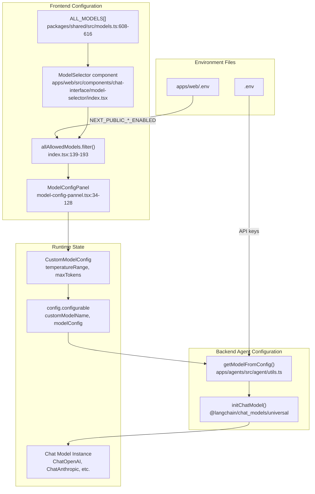
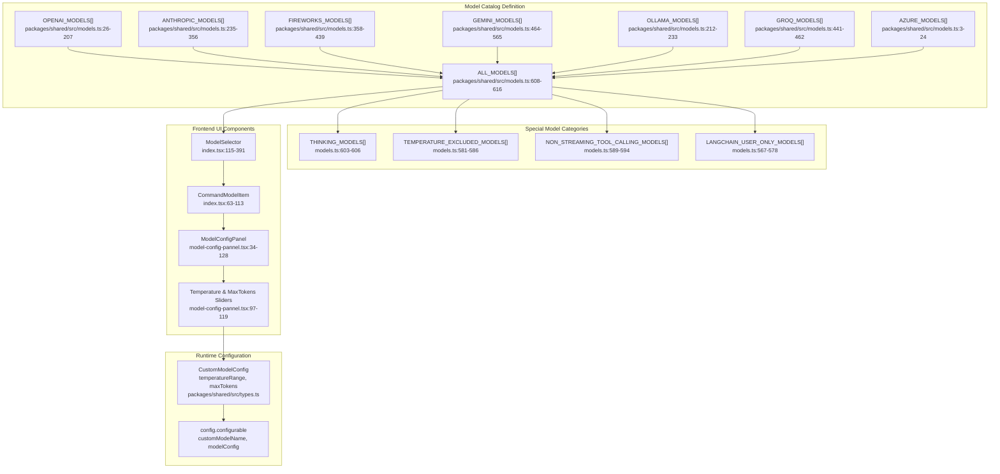

<!-- source: DeepWiki mcp.deepwiki.com · repo langchain-ai/open-canvas · page 1.3 Configuration · fetched 2026-10-26 -->

# Configuration

<details>
<summary>Relevant source files</summary>

The following files were used as context for generating this wiki page:

- [.codespellignore](.codespellignore)
- [.env.example](.env.example)
- [README.md](README.md)
- [apps/agents/package.json](apps/agents/package.json)
- [apps/web/.env.example](apps/web/.env.example)
- [apps/web/package.json](apps/web/package.json)
- [apps/web/src/hooks/useStore.tsx](apps/web/src/hooks/useStore.tsx)
- [packages/evals/package.json](packages/evals/package.json)
- [packages/shared/package.json](packages/shared/package.json)
- [static/screenshot.png](static/screenshot.png)

</details>


This page documents the environment variables and configuration options for Open Canvas, including settings for both the frontend (web application) and backend (LangGraph server) components.

For information about project structure and organization, see [Project Structure](#1.1). For setup and installation instructions, see [Setup and Installation](#1.2).

## Overview

Open Canvas uses environment variables to configure its components, with separate configuration files for the frontend and backend. The configuration determines which LLM providers are available, authentication settings, feature flags, and other system parameters.

**Configuration Files:**
- **Backend**: Root `.env` file (read by LangGraph server in `apps/agents`)
- **Frontend**: `apps/web/.env` file (read by Next.js application)

**Key Configuration Functions:**
- `getModelConfig` [apps/agents/src/utils.ts:162-302]() - Extracts model configuration from LangGraph config
- `getModelFromConfig` [apps/agents/src/utils.ts:341-409]() - Initializes chat model from configuration
- `initChatModel` from `langchain/chat_models/universal` - Universal LangChain model loader

Sources: [README.md:72-83](), [.env.example:1-34](), [apps/web/.env.example:1-37](), [apps/agents/src/utils.ts:162-409]()

## Configuration Flow

### Configuration Architecture

The following diagram shows how environment variables flow through the codebase to configure system components:



This diagram shows the complete configuration pipeline from environment variables to runtime model instances, including the frontend model selection flow and backend model initialization.

Sources: [README.md:72-83](), [.env.example:1-34](), [apps/web/.env.example:1-37](), [packages/shared/src/models.ts:608-616](), [apps/web/src/components/chat-interface/model-selector/index.tsx:139-193]()

## Backend Environment Variables

The backend configuration (root `.env` file) focuses on API keys for LLM providers, authentication, and tracing. These variables are read by the LangGraph server running in `apps/agents`.

### LangSmith Tracing

LangSmith provides observability and tracing for LangGraph execution.

| Variable | Required | Default | Description |
|----------|----------|---------|-------------|
| `LANGSMITH_TRACING` | No | `"false"` | Enable LangSmith tracing |
| `LANGSMITH_API_KEY` | Yes (if tracing) | - | LangSmith API key |
| `LANGCHAIN_PROJECT` | No | `"default"` | LangSmith project name |

**Usage in code**: The LangGraph server automatically reads these variables when initializing.

Sources: [.env.example:3-7]()

### LLM Provider API Keys

These API keys are accessed via `process.env` in `getModelConfig()` [apps/agents/src/utils.ts:162-302]() and `getModelFromConfig()` [apps/agents/src/utils.ts:341-409]().

#### OpenAI

```bash
OPENAI_API_KEY=""
```

**Used for models**: Models matching `gpt-`, `o1`, or `o3` prefixes [apps/agents/src/utils.ts:213-229]()

**Code reference**: `process.env.OPENAI_API_KEY` [apps/agents/src/utils.ts:227]()

#### Anthropic

```bash
ANTHROPIC_API_KEY=""
```

**Used for models**: Models matching `claude-` prefix [apps/agents/src/utils.ts:231-237]()

**Code reference**: `process.env.ANTHROPIC_API_KEY` [apps/agents/src/utils.ts:235]()

#### Azure OpenAI

```bash
_AZURE_OPENAI_API_KEY=""
_AZURE_OPENAI_API_DEPLOYMENT_NAME=""
_AZURE_OPENAI_API_VERSION=""
_AZURE_OPENAI_API_BASE_PATH=""
```

**Note**: Azure variables MUST be prefixed with underscore (`_`) to distinguish them from standard OpenAI configuration.

**Used for models**: Models starting with `azure/` prefix [apps/agents/src/utils.ts:186-206]()

**Code reference**: `process.env._AZURE_OPENAI_API_KEY` and related [apps/agents/src/utils.ts:196-203]()

#### Google (Gemini)

```bash
GOOGLE_API_KEY=""
```

**Used for models**: Models matching `gemini-` prefix [apps/agents/src/utils.ts:264-290]()

**Code reference**: `process.env.GOOGLE_API_KEY` [apps/agents/src/utils.ts:274]()

#### Fireworks AI

```bash
FIREWORKS_API_KEY=""
```

**Used for models**: Models matching `fireworks/` prefix [apps/agents/src/utils.ts:239-253]()

**Code reference**: `process.env.FIREWORKS_API_KEY` [apps/agents/src/utils.ts:252]()

#### Groq

```bash
GROQ_API_KEY=""
```

**Used for models**: Models starting with `groq/` prefix [apps/agents/src/utils.ts:255-262]()

**Code reference**: `process.env.GROQ_API_KEY` [apps/agents/src/utils.ts:260]()

**Additional use**: Audio/video transcription services [README.md:40]()

Sources: [.env.example:9-26](), [apps/agents/src/utils.ts:162-302]()

### Supabase Configuration

Supabase provides authentication and data storage. These variables are used by both frontend and backend.

```bash
NEXT_PUBLIC_SUPABASE_URL=""
NEXT_PUBLIC_SUPABASE_ANON_KEY=""
SUPABASE_SERVICE_ROLE=""
```

| Variable | Scope | Description |
|----------|-------|-------------|
| `NEXT_PUBLIC_SUPABASE_URL` | Both | Supabase project URL |
| `NEXT_PUBLIC_SUPABASE_ANON_KEY` | Both | Anonymous/public API key |
| `SUPABASE_SERVICE_ROLE` | Backend only | Service role key for admin operations |

**Backend usage**: Creating Supabase client in `getUserFromConfig()` [apps/agents/src/utils.ts:327-334]()

```typescript
const supabase = createClient(
  process.env.NEXT_PUBLIC_SUPABASE_URL,
  process.env.SUPABASE_SERVICE_ROLE
);
```

Sources: [.env.example:28-31](), [apps/agents/src/utils.ts:310-334]()

### External Tools

```bash
FIRECRAWL_API_KEY=""
```

**Purpose**: Web scraping via FireCrawl API for web search functionality

**Usage**: Used by web search agent for retrieving webpage content [README.md:41]()

Sources: [.env.example:33](), [README.md:41]()

### Ollama (Local Models)

Ollama enables running LLMs locally on your machine. The default model is llama3.3.

**Backend Configuration** (`.env`):
```bash
# Defaults to http://host.docker.internal:11434 if not set
# Only needs to be set if using a non-default Ollama server port
OLLAMA_API_URL="http://host.docker.internal:11434"
```

**Frontend Configuration** (`apps/web/.env`):
```bash
# Enable Ollama models in the UI
NEXT_PUBLIC_OLLAMA_ENABLED=false

# Defaults to http://host.docker.internal:11434 if not set
OLLAMA_API_URL="http://host.docker.internal:11434"
```

**Model Definition**:

Ollama models are defined in the `OLLAMA_MODELS` array [packages/shared/src/models.ts:212-233]():
```typescript
/**
 * Ollama model names _MUST_ be prefixed with `"ollama-"`
 */
const OLLAMA_MODELS = [
  {
    name: "ollama-llama3.3",
    label: "Llama 3.3 70B (local)",
    config: {
      provider: "ollama",
      temperatureRange: { min: 0, max: 1, default: 0.5, current: 0.5 },
      maxTokens: { min: 1, max: 2_048, default: 2_048, current: 2_048 },
    },
    isNew: false,
  },
];
```

**Setup Requirements**:
1. Install [Ollama](https://ollama.com)
2. Pull a tool-calling capable model: `ollama pull llama3.3`
3. Start the Ollama server: `ollama run llama3.3`
4. Set `NEXT_PUBLIC_OLLAMA_ENABLED=true` in `apps/web/.env`

**Performance Note**: Open source LLMs typically have lower instruction-following quality than proprietary models like GPT-4o or Claude Sonnet, which may result in errors or unexpected behavior [README.md:160]().

Sources: [apps/web/.env.example:8-13](), [packages/shared/src/models.ts:212-233](), [README.md:149-161]()

## Frontend Environment Variables

The frontend configuration (`apps/web/.env` file) includes feature flags, authentication, and processing settings. These variables are accessed in the Next.js application.

### Model Provider Feature Flags

These `NEXT_PUBLIC_` prefixed flags control which LLM providers are shown in the model selector UI. They are checked at runtime in the `ModelSelector` component to filter the `ALL_MODELS` array.

| Variable | Default | Description |
|----------|---------|-------------|
| `NEXT_PUBLIC_FIREWORKS_ENABLED` | `true` | Enable Fireworks AI models |
| `NEXT_PUBLIC_GEMINI_ENABLED` | `true` | Enable Google Gemini models |
| `NEXT_PUBLIC_ANTHROPIC_ENABLED` | `true` | Enable Anthropic Claude models |
| `NEXT_PUBLIC_OPENAI_ENABLED` | `true` | Enable OpenAI GPT models |
| `NEXT_PUBLIC_AZURE_ENABLED` | `false` | Enable Azure OpenAI models |
| `NEXT_PUBLIC_OLLAMA_ENABLED` | `false` | Enable local Ollama models |
| `NEXT_PUBLIC_GROQ_ENABLED` | `false` | Enable Groq models |

**Implementation**: The `ModelSelector` component filters models using `allAllowedModels` [apps/web/src/components/chat-interface/model-selector/index.tsx:139-193]():

```typescript
const allAllowedModels = ALL_MODELS.filter((model) => {
  if (
    !isLangChainUser &&
    LANGCHAIN_USER_ONLY_MODELS.some((m) => m === model.name)
  ) {
    return false;
  }

  if (
    model.name.includes("fireworks/") &&
    process.env.NEXT_PUBLIC_FIREWORKS_ENABLED === "false"
  ) {
    return false;
  }
  // ... similar checks for other providers
  return true;
});
```

The filtered models are then grouped by provider (OpenAI, Azure OpenAI, Anthropic, Google GenAI, Groq, Fireworks, Ollama) for display in the UI [apps/web/src/components/chat-interface/model-selector/index.tsx:201-221]().

Sources: [apps/web/.env.example:1-9](), [apps/web/src/components/chat-interface/model-selector/index.tsx:139-193]()

### Supabase Configuration

```bash
# Public keys for authentication
NEXT_PUBLIC_SUPABASE_URL=""
NEXT_PUBLIC_SUPABASE_ANON_KEY=""

# Optional: Separate keys for document storage
NEXT_PUBLIC_SUPABASE_URL_DOCUMENTS=""
NEXT_PUBLIC_SUPABASE_ANON_KEY_DOCUMENTS=""
```

**Frontend usage**: Creating Supabase client for authentication and document uploads.

Sources: [apps/web/.env.example:15-21]()

### Document Processing Keys

```bash
# For audio/video transcription
GROQ_API_KEY=""

# For web page scraping
FIRECRAWL_API_KEY=""
```

These keys enable optional features in the frontend:
- **Groq**: Audio/video transcription for file uploads
- **FireCrawl**: Web page content extraction for context documents

Sources: [apps/web/.env.example:23-27]()

### Azure OpenAI Configuration

Azure OpenAI requires additional configuration parameters beyond a simple API key. Variables MUST be prefixed with underscore (`_`) to distinguish them from standard OpenAI configuration.

**Backend Configuration** (`.env`):
```bash
# ENSURE THEY ARE PREFIXED WITH AN UNDERSCORE
_AZURE_OPENAI_API_KEY=""
_AZURE_OPENAI_API_DEPLOYMENT_NAME=""
_AZURE_OPENAI_API_VERSION=""
_AZURE_OPENAI_API_BASE_PATH=""  # Optional custom domain
```

**Frontend Configuration** (`apps/web/.env`):
```bash
# ENSURE THEY ARE PREFIXED WITH AN UNDERSCORE
_AZURE_OPENAI_API_KEY=""
_AZURE_OPENAI_API_INSTANCE_NAME=""
_AZURE_OPENAI_API_DEPLOYMENT_NAME=""
_AZURE_OPENAI_API_VERSION="2024-08-01-preview"
_AZURE_OPENAI_API_BASE_PATH=""  # Optional custom domain
```

**Model Definition**:

Azure models are defined in the `AZURE_MODELS` array [packages/shared/src/models.ts:3-24]():
```typescript
const AZURE_MODELS: ModelConfigurationParams[] = [
  {
    name: "azure/gpt-4o-mini",
    label: "GPT-4o mini (Azure)",
    isNew: false,
    config: {
      provider: "azure_openai",
      temperatureRange: { min: 0, max: 1, default: 0.5, current: 0.5 },
      maxTokens: { min: 1, max: 4_096, default: 4_096, current: 4_096 },
    },
  },
];
```

**Important**: The `azure/` prefix in the model name is used to identify Azure models. The default configuration has `NEXT_PUBLIC_AZURE_ENABLED=false` since Azure OpenAI is less common than standard OpenAI API [apps/web/.env.example:6-7]().

Sources: [.env.example:15-19](), [apps/web/.env.example:29-36](), [packages/shared/src/models.ts:3-24]()

### LangGraph Server URL

```bash
# Not in .env.example, but used at runtime
LANGGRAPH_API_URL="http://localhost:54367"
```

**Usage**: Frontend connects to the LangGraph server at this URL. Default is `http://localhost:54367` if not specified.

**Troubleshooting reference**: See [README.md:168-170]() for port configuration issues.

Sources: [README.md:168-170]()

## Model Configuration System

Open Canvas implements a sophisticated model configuration system that manages LLM settings across the application. The system handles model selection, parameter configuration (temperature, max tokens), and provider-specific settings.

### Model Configuration Data Flow



This diagram shows how model configuration flows from the static catalog definitions through the UI components to runtime configuration objects.

Sources: [packages/shared/src/models.ts:3-640](), [apps/web/src/components/chat-interface/model-selector/index.tsx:115-391](), [apps/web/src/components/chat-interface/model-selector/model-config-pannel.tsx:34-128]()

### Model Configuration System

#### Model Catalog Structure

Open Canvas defines all available models in `packages/shared/src/models.ts` organized by provider:

| Provider Array | Models Included | Location |
|---------------|-----------------|----------|
| `AZURE_MODELS` | Azure-hosted GPT models | [packages/shared/src/models.ts:3-24]() |
| `OPENAI_MODELS` | GPT-4.1, GPT-4.5, o1, o3, o4-mini, gpt-4o variants | [packages/shared/src/models.ts:26-207]() |
| `OLLAMA_MODELS` | llama3.3 (local) | [packages/shared/src/models.ts:212-233]() |
| `ANTHROPIC_MODELS` | Claude Sonnet 4, Opus 4, Claude 3.5/3.7 Sonnet, Haiku | [packages/shared/src/models.ts:235-356]() |
| `FIREWORKS_MODELS` | Llama 3.3, DeepSeek V3, DeepSeek R1 | [packages/shared/src/models.ts:358-439]() |
| `GROQ_MODELS` | DeepSeek R1 Llama 70b Distill | [packages/shared/src/models.ts:441-462]() |
| `GEMINI_MODELS` | Gemini 2.5 Flash/Pro, Gemini 2.0 Flash Thinking | [packages/shared/src/models.ts:464-565]() |

All provider arrays are combined into `ALL_MODELS` [packages/shared/src/models.ts:608-616]():

```typescript
export const ALL_MODELS: ModelConfigurationParams[] = [
  ...OPENAI_MODELS,
  ...ANTHROPIC_MODELS,
  ...FIREWORKS_MODELS,
  ...GEMINI_MODELS,
  ...AZURE_MODELS,
  ...OLLAMA_MODELS,
  ...GROQ_MODELS,
];
```

#### Special Model Categories

Open Canvas defines several categorization arrays for special model handling:

| Category | Purpose | Models |
|----------|---------|--------|
| `LANGCHAIN_USER_ONLY_MODELS` | Restricted to `@langchain.dev` email domains | o1, gpt-4o, gpt-4.5-preview, Claude Sonnet 4, Opus 4, Gemini 2.5 Pro, gpt-4.1 [packages/shared/src/models.ts:567-578]() |
| `TEMPERATURE_EXCLUDED_MODELS` | Do not support temperature parameter | o1-mini, o3-mini, o1, o4-mini [packages/shared/src/models.ts:581-586]() |
| `NON_STREAMING_TOOL_CALLING_MODELS` | Do not stream tool calls | gemini-2.0-flash-exp, gemini-1.5-flash, gemini-2.5-pro-preview [packages/shared/src/models.ts:589-594]() |
| `NON_STREAMING_TEXT_MODELS` | Do not stream text responses | o1, gemini-2.0-flash-thinking [packages/shared/src/models.ts:597-600]() |
| `THINKING_MODELS` | Support chain-of-thought with ` tags
  // Returns: { thinking: string, response: string }
}
```

**Use Cases**:
1. **Complete tags**: `'Hello world'` → `{ thinking: 'processing...', response: 'Hello world' }`
2. **Streaming/incomplete**: `'Hello <think>processing...'` → `{ thinking: 'processing...', response: 'Hello ' }`
3. **No tags**: `'Hello world'` → `{ thinking: '', response: 'Hello world' }`

**Artifact Rewriting**:

For artifact updates, `handleRewriteArtifactThinkingModel()` [packages/shared/src/utils/thinking.ts:89-129]() processes thinking tokens separately from response content, creating a dedicated thinking message in the UI state.

**Model Check**:

The `isThinkingModel()` helper function [packages/shared/src/utils/thinking.ts:131-133]() checks if a model name is in the `THINKING_MODELS` list.

Sources: [packages/shared/src/models.ts:603-606](), [packages/shared/src/utils/thinking.ts:1-134]()

#### `getModelFromConfig()`

**Location**: [apps/agents/src/utils.ts:341-409]()

**Purpose**: Creates a chat model instance using configuration from `getModelConfig()`

**Parameters**:
- `config: LangGraphRunnableConfig` - Runtime configuration
- `extra?: { temperature?, maxTokens?, isToolCalling? }` - Override parameters

**Returns**: `Promise<ChatModel>` - Initialized LangChain chat model instance

**Process**:
1. Calls `getModelConfig()` to extract configuration [apps/agents/src/utils.ts:349-358]()
2. Checks authorization for restricted models [apps/agents/src/utils.ts:365-380]()
3. Determines if standard parameters are supported [apps/agents/src/utils.ts:382-384]()
4. Calls `initChatModel()` with appropriate parameters [apps/agents/src/utils.ts:386-408]()

**Authorization Check**:
```typescript
const isLangChainUserModel = LANGCHAIN_USER_ONLY_MODELS.some(
  (m) => m === modelName
);
if (isLangChainUserModel) {
  const user = await getUserFromConfig(config);
  if (!user?.email?.endsWith("@langchain.dev")) {
    throw new Error("Unauthorized. Can not use LangChain only models...");
  }
}
```

**Parameter Handling**:
- Models in `TEMPERATURE_EXCLUDED_MODELS`: Use `max_completion_tokens` instead of `maxTokens` and `temperature`
- Example: OpenAI o1 models [apps/agents/src/utils.ts:382-395]()

Sources: [apps/agents/src/utils.ts:341-409](), [packages/shared/src/models.ts:380-400]()

### Configuration Type Definitions

Open Canvas defines shared TypeScript interfaces for model configuration in `packages/shared/src/types.ts`.

#### `ModelConfigurationParams`

Represents a complete model configuration with UI metadata:

| Field | Type | Description |
|-------|------|-------------|
| `name` | `string` | Internal identifier (e.g., `"openai-gpt-4o"`) |
| `label` | `string` | Display name in UI (e.g., `"GPT-4o"`) |
| `modelName?` | `string` | Optional provider-specific model name |
| `config` | `CustomModelConfig` | Model parameters and settings |
| `isNew` | `boolean` | Flag for newly added models (shows badge in UI) |

#### `CustomModelConfig`

Contains model parameters and provider-specific settings:

```typescript
interface CustomModelConfig {
  provider: string;  // "openai" | "anthropic" | "google-genai" | etc.
  
  temperatureRange: {
    min: number;      // Minimum allowed temperature
    max: number;      // Maximum allowed temperature
    default: number;  // Default temperature
    current: number;  // Currently selected temperature
  };
  
  maxTokens: {
    min: number;      // Minimum tokens
    max: number;      // Maximum tokens
    default: number;  // Default max tokens
    current: number;  // Currently selected max tokens
  };
  
  azureConfig?: {   // Only for Azure OpenAI models
    azureOpenAIApiKey: string;
    azureOpenAIApiInstanceName: string;
    azureOpenAIApiDeploymentName: string;
    azureOpenAIApiVersion: string;
    azureOpenAIBasePath?: string;
  };
}
```

**Usage in config object**:
```typescript
config.configurable = {
  customModelName: "gpt-4o",
  modelConfig: {
    temperatureRange: { min: 0, max: 2, default: 0.5, current: 0.7 },
    maxTokens: { min: 1, max: 16000, default: 8000, current: 8000 },
    // ...
  }
}
```

Sources: [packages/shared/src/types.ts:1-100]()

### Model Catalog Structure

The `ALL_MODELS` array in `packages/shared/src/models.ts` serves as the single source of truth for all available models. Each model entry contains complete configuration.

**Example model entry**:
```typescript
{
  name: "openai-gpt-4o",
  label: "GPT-4o",
  config: {
    provider: "openai",
    temperatureRange: { min: 0, max: 2, default: 0.5, current: 0.5 },
    maxTokens: { min: 1, max: 16000, default: 8000, current: 8000 }
  },
  isNew: false
}
```

**Special Model Categories**:

| Constant | Purpose | Models Included |
|----------|---------|-----------------|
| `THINKING_MODELS` | Models that support chain-of-thought with `<think>` tags | o1 models, Gemini thinking |
| `NON_STREAMING_MODELS` | Models that don't support streaming | Certain older models |
| `TEMPERATURE_EXCLUDED_MODELS` | Models that don't accept temperature parameter | o1 series |
| `LANGCHAIN_USER_ONLY_MODELS` | Restricted to `@langchain.dev` users | Special test models |

**Usage in authorization** [apps/agents/src/utils.ts:365-380]():
```typescript
const isLangChainUserModel = LANGCHAIN_USER_ONLY_MODELS.some(
  (m) => m === modelName
);
```

Sources: [packages/shared/src/models.ts:1-400](), [apps/agents/src/utils.ts:26-28]()

## Configuration Constants

Open Canvas defines shared configuration constants in `packages/shared/src/constants.ts` that are used across both frontend and backend.

### Message Keys and Flags

These constants identify special message types and metadata:

| Constant | Value | Purpose |
|----------|-------|---------|
| `OC_SUMMARIZED_MESSAGE_KEY` | `"__oc_summarized_message"` | Marks summarized conversation messages |
| `OC_HIDE_FROM_UI_KEY` | `"__oc_hide_from_ui"` | Marks messages hidden from user interface |
| `OC_WEB_SEARCH_RESULTS_MESSAGE_KEY` | `"__oc_web_search_results_message"` | Marks AI messages containing web search results |

**Usage in web search** [apps/agents/src/utils.ts:626-627]():
```typescript
additional_kwargs: {
  [OC_WEB_SEARCH_RESULTS_MESSAGE_KEY]: true,
  webSearchResults: webResults,
}
```

Sources: [packages/shared/src/constants.ts:3-6]()

### Default Input Values

The `DEFAULT_INPUTS` object defines the default state for action flags:

```typescript
export const DEFAULT_INPUTS = {
  highlightedCode: undefined,
  highlightedText: undefined,
  next: undefined,
  language: undefined,
  artifactLength: undefined,
  regenerateWithEmojis: undefined,
  readingLevel: undefined,
  addComments: undefined,
  addLogs: undefined,
  fixBugs: undefined,
  portLanguage: undefined,
  customQuickActionId: undefined,
  webSearchEnabled: undefined,
  webSearchResults: undefined,
};
```

**Usage**: Reset state flags in `cleanState` node [apps/agents/src/open-canvas/index.ts:30-34]()

Sources: [packages/shared/src/constants.ts:10-25](), [apps/agents/src/open-canvas/index.ts:30-34]()

### Programming Languages

The `PROGRAMMING_LANGUAGES` array defines supported code languages:

```typescript
export const PROGRAMMING_LANGUAGES: Array<{
  language: ProgrammingLanguageOptions;
  label: string;
}> = [
  { language: "typescript", label: "TypeScript" },
  { language: "javascript", label: "JavaScript" },
  { language: "cpp", label: "C++" },
  { language: "java", label: "Java" },
  { language: "php", label: "PHP" },
  { language: "python", label: "Python" },
  { language: "html", label: "HTML" },
  { language: "sql", label: "SQL" },
  { language: "json", label: "JSON" },
  { language: "rust", label: "Rust" },
  { language: "xml", label: "XML" },
  { language: "clojure", label: "Clojure" },
  { language: "csharp", label: "C#" },
  { language: "other", label: "Other" },
];
```

**Usage**: Displayed in language selector UI, used for code artifact generation and syntax highlighting.

Sources: [packages/shared/src/constants.ts:27-88]()

### Storage Namespaces

```typescript
export const CONTEXT_DOCUMENTS_NAMESPACE = ["context_documents"];
```

**Usage**: Namespace for storing context documents in LangGraph's key-value store [apps/agents/src/utils.ts:524]().

Sources: [packages/shared/src/constants.ts:8](), [apps/agents/src/utils.ts:515-526]()

## Setting Up Configuration

To configure Open Canvas locally:

1. Copy the example environment files:
   ```bash
   # The root `.env` file for the LangGraph server
   cp .env.example .env
   
   # The `apps/web/.env` file for the frontend
   cd apps/web/
   cp .env.example .env
   ```

2. Fill in the required environment variables with your API keys and other settings.

3. Set up Supabase authentication as described in the [Setup and Installation](#1.2) section.

Sources: [README.md:72-83](), [README.md:85-97]()

## Provider-Specific Configuration

### OpenAI Models

**Supported Models**: GPT-4o, GPT-4o Mini, o1-preview, o1-mini, o3-mini

**Configuration**:
```bash
OPENAI_API_KEY="sk-..."
```

**Detection Logic** [apps/agents/src/utils.ts:213-229]():
- Model names matching `gpt-`, `o1`, or `o3` patterns
- Special handling: o1 models fallback to `gpt-4o` for tool calling

**Provider Key**: `"openai"`

Sources: [apps/agents/src/utils.ts:213-229](), [README.md:135]()

### Anthropic Models

**Supported Models**: Claude 3.5 Sonnet, Claude 3 Haiku, Claude 3 Opus

**Configuration**:
```bash
ANTHROPIC_API_KEY="sk-ant-..."
```

**Detection Logic** [apps/agents/src/utils.ts:231-237]():
- Model names matching `claude-` pattern

**Provider Key**: `"anthropic"`

**Special Feature**: Claude 3.5 Sonnet supports native PDF document processing [apps/agents/src/utils.ts:549]()

Sources: [apps/agents/src/utils.ts:231-237](), [README.md:133]()

### Google Gemini Models

**Supported Models**: Gemini 2.0 Flash, Gemini Pro, Gemini Thinking

**Configuration**:
```bash
GOOGLE_API_KEY="AIza..."
```

**Detection Logic** [apps/agents/src/utils.ts:264-290]():
- Model names matching `gemini-` pattern
- Gemini thinking models fallback to `gemini-2.0-flash-exp` for tool calling

**Provider Key**: `"google-genai"`

Sources: [apps/agents/src/utils.ts:264-290]()

### Fireworks AI Models

**Supported Models**: Llama 3.3 70B, Mistral models

**Configuration**:
```bash
FIREWORKS_API_KEY="fw_..."
```

**Detection Logic** [apps/agents/src/utils.ts:239-253]():
- Model names matching `fireworks/` prefix
- Non-tool-calling models fallback to `llama-v3p3-70b-instruct`

**Provider Key**: `"fireworks"`

Sources: [apps/agents/src/utils.ts:239-253](), [README.md:134]()

### Groq Models

**Supported Models**: Fast inference models

**Configuration**:
```bash
GROQ_API_KEY="gsk_..."
```

**Detection Logic** [apps/agents/src/utils.ts:255-262]():
- Model names starting with `groq/` prefix
- Prefix is stripped when instantiating model

**Provider Key**: `"groq"`

Sources: [apps/agents/src/utils.ts:255-262]()

### Azure OpenAI Models

**Supported Models**: Any OpenAI model deployed to Azure

**Configuration**:
```bash
_AZURE_OPENAI_API_KEY="..."
_AZURE_OPENAI_API_INSTANCE_NAME="your-instance"
_AZURE_OPENAI_API_DEPLOYMENT_NAME="your-deployment"
_AZURE_OPENAI_API_VERSION="2024-08-01-preview"
_AZURE_OPENAI_API_BASE_PATH="https://..."  # Optional
```

**Detection Logic** [apps/agents/src/utils.ts:186-206]():
- Model names starting with `azure/` prefix
- Prefix is stripped to get actual model name
- o1 models fallback to `gpt-4o` for tool calling

**Provider Key**: `"azure_openai"`

**Important**: All Azure variables MUST be prefixed with underscore (`_`)

Sources: [apps/agents/src/utils.ts:186-206](), [apps/web/.env.example:29-36]()

### Ollama (Local Models)

**Supported Models**: Any Ollama-compatible model (llama3.3 recommended)

**Configuration**:
```bash
# Backend
OLLAMA_API_URL="http://host.docker.internal:11434"

# Frontend
NEXT_PUBLIC_OLLAMA_ENABLED=true
```

**Detection Logic** [apps/agents/src/utils.ts:292-299]():
- Model names starting with `ollama-` prefix
- Prefix is stripped when instantiating model
- Base URL defaults to `http://host.docker.internal:11434`

**Provider Key**: `"ollama"`

**Setup Requirements**:
1. Install Ollama locally
2. Pull a tool-calling capable model: `ollama pull llama3.3`
3. Start server: `ollama run llama3.3`
4. Enable in frontend config

**Performance Note**: Open source models may have lower instruction-following quality than proprietary models [README.md:160]()

Sources: [apps/agents/src/utils.ts:292-299](), [README.md:149-161]()

## Adding New Model Providers

To integrate a new LLM provider into Open Canvas:

### Step 1: Define Models in Catalog

Create a new provider array in `packages/shared/src/models.ts`:

```typescript
const NEWPROVIDER_MODELS: ModelConfigurationParams[] = [
  {
    name: "newprovider-model-name",
    label: "New Provider Model",
    config: {
      provider: "newprovider",
      temperatureRange: { min: 0, max: 1, default: 0.5, current: 0.5 },
      maxTokens: { min: 1, max: 4096, default: 4096, current: 4096 }
    },
    isNew: true
  }
];
```

Then add to `ALL_MODELS` array [packages/shared/src/models.ts:608-616]():
```typescript
export const ALL_MODELS: ModelConfigurationParams[] = [
  ...OPENAI_MODELS,
  ...ANTHROPIC_MODELS,
  ...FIREWORKS_MODELS,
  ...GEMINI_MODELS,
  ...AZURE_MODELS,
  ...OLLAMA_MODELS,
  ...GROQ_MODELS,
  ...NEWPROVIDER_MODELS,  // Add here
];
```

### Step 2: Install LangChain Provider Package

```bash
cd apps/agents
yarn add @langchain/newprovider
```

### Step 3: Update Backend Configuration

Add provider API key to `.env.example` and `.env`:

```bash
# New Provider
NEWPROVIDER_API_KEY=""
```

Update `getModelFromConfig()` in `apps/agents/src/agent/utils.ts` to handle the new provider.

### Step 4: Add Frontend Feature Flag

Add to `apps/web/.env.example`:

```bash
# Enable/disable New Provider models in UI
NEXT_PUBLIC_NEWPROVIDER_ENABLED=true
```

Add filtering logic to `ModelSelector` [apps/web/src/components/chat-interface/model-selector/index.tsx:139-193]():

```typescript
const allAllowedModels = ALL_MODELS.filter((model) => {
  // ... existing filters
  
  if (
    model.name.includes("newprovider-") &&
    process.env.NEXT_PUBLIC_NEWPROVIDER_ENABLED === "false"
  ) {
    return false;
  }
  
  return true;
});
```

### Step 5: Add Model Group to UI

Add a new `CommandGroup` in the `ModelSelector` component [apps/web/src/components/chat-interface/model-selector/index.tsx:247-385]():

```typescript
const newproviderModelGroup = allAllowedModels.filter(
  (m) => m.config.provider === "newprovider"
);

// In the render:
{newproviderModelGroup.length > 0 && (
  <CommandGroup heading="New Provider" className="w-full">
    {newproviderModelGroup.map((model) => {
      const config = modelConfigs[model.name];
      return (
        <CommandModelItem
          key={model.name}
          model={model}
          handleModelChange={handleModelChange}
          config={config}
          selectedModelName={modelName}
          openConfigModelId={openConfigModelId}
          setOpenConfigModelId={setOpenConfigModelId}
          setModelConfig={setModelConfig}
        />
      );
    })}
  </CommandGroup>
)}
```

### Step 6: Testing Checklist

Test the following operations with your new model [README.md:142-147]():

| Test | Description |
|------|-------------|
| ✓ Generate new text artifact | Prompt the model to create a markdown document |
| ✓ Generate new code artifact | Prompt the model to create a code file |
| ✓ Generate followup message | Verify followup questions appear after artifact creation |
| ✓ Update artifact via chat | Send a message requesting changes to the artifact |
| ✓ Update artifact via quick action | Use a built-in quick action (e.g., "Make it longer") |
| ✓ Custom quick actions | Create and test a custom quick action |

Sources: [README.md:137-147](), [packages/shared/src/models.ts:608-616](), [apps/web/src/components/chat-interface/model-selector/index.tsx:139-385]()

## Troubleshooting Configuration Issues

Common configuration issues and solutions:

| Issue | Solution |
|-------|----------|
| LangGraph server connection issues | Clear `oc_thread_id_v2` cookie and refresh the page |
| 500 network errors | Ensure LangGraph server is running on the correct port specified by `LANGGRAPH_API_URL` |
| "thread ID not found" errors | Verify LangGraph server port configuration |
| "Model name is missing in config" error | Ensure `customModelName` is specified in the config when invoking the graph |

Sources: [README.md:164-173]()

---

