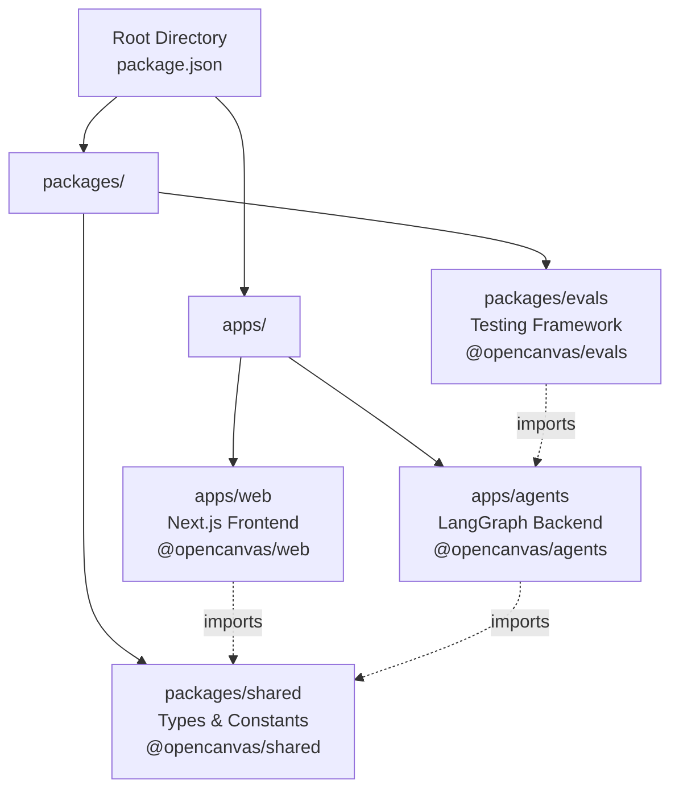
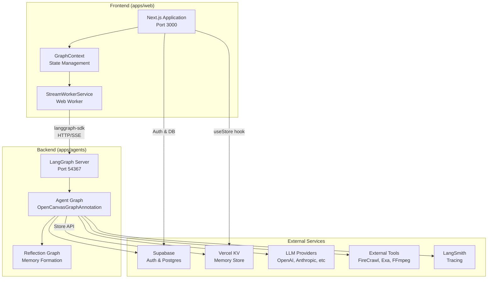
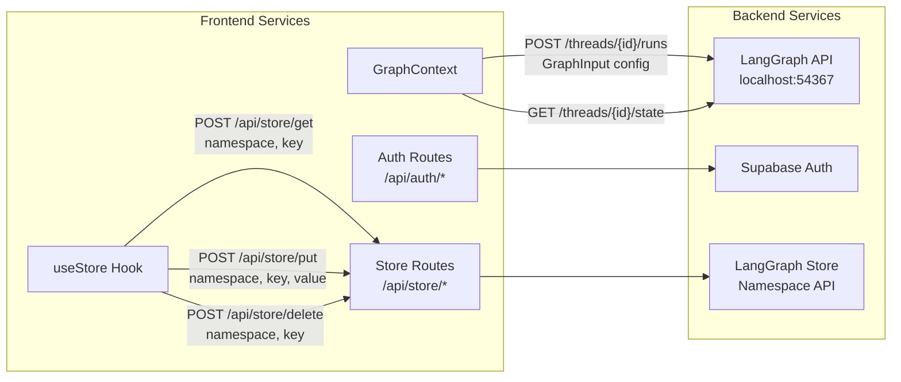
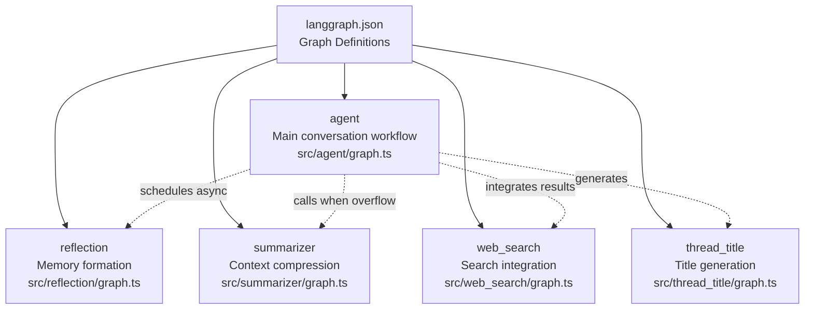
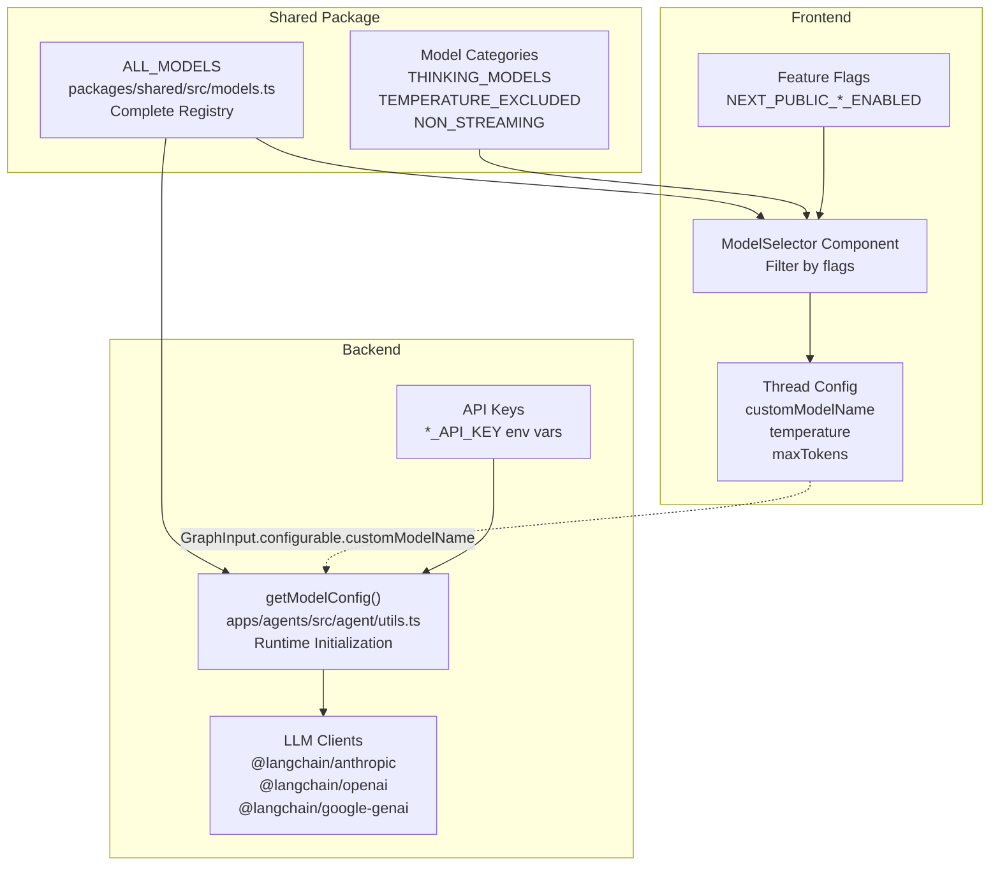
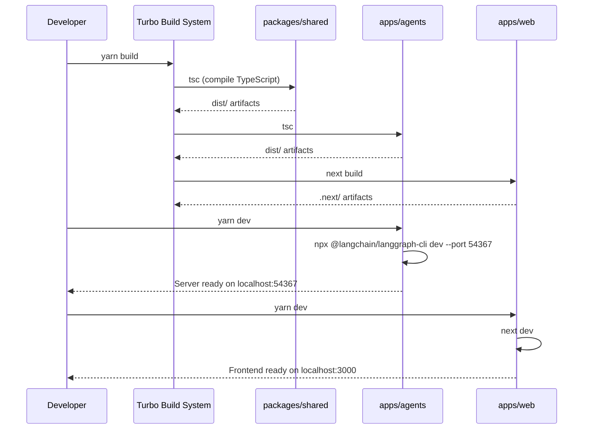

<!-- source: DeepWiki mcp.deepwiki.com · repo langchain-ai/open-canvas · page 2 System Architecture · fetched 2026-10-26 -->

# System Architecture

<details>
<summary>Relevant source files</summary>

The following files were used as context for generating this wiki page:

- [.codespellignore](.codespellignore)
- [.env.example](.env.example)
- [README.md](README.md)
- [apps/agents/package.json](apps/agents/package.json)
- [apps/web/.env.example](apps/web/.env.example)
- [apps/web/package.json](apps/web/package.json)
- [apps/web/src/hooks/useStore.tsx](apps/web/src/hooks/useStore.tsx)
- [package.json](package.json)
- [packages/evals/package.json](packages/evals/package.json)
- [packages/shared/package.json](packages/shared/package.json)
- [static/screenshot.png](static/screenshot.png)
- [yarn.lock](yarn.lock)

</details>


This document provides a high-level technical overview of Open Canvas's system architecture, explaining how the monorepo structure, frontend application, backend agent system, and external services interact to enable collaborative document editing with AI agents. The architecture is designed to support real-time streaming, multi-model LLM integration, persistent memory, and artifact versioning.

For detailed information about specific subsystems, see:
- Frontend implementation details: [Frontend Architecture](#2.1)
- Backend agent implementation: [Backend Architecture](#2.2)
- Message streaming mechanics: [Data Flow](#2.3)
- Authentication and persistence: [Authentication and Storage](#2.4)

---

## Monorepo Structure

Open Canvas is organized as a Yarn workspaces monorepo with Turbo for build orchestration. The repository contains two primary applications and two shared packages.

**Monorepo Organization**



**Sources:** [package.json:1-40](), [apps/web/package.json:1-126](), [apps/agents/package.json:1-71](), [packages/shared/package.json:1-54](), [packages/evals/package.json:1-39]()

| Directory | Purpose | Key Dependencies |
|-----------|---------|------------------|
| `apps/web` | Next.js frontend application serving the user interface | `next`, `@assistant-ui/react`, `@blocknote/*`, `@radix-ui/*`, `@uiw/react-codemirror` |
| `apps/agents` | LangGraph agent backend implementing AI workflows | `@langchain/langgraph`, `@langchain/anthropic`, `@langchain/openai`, `@langchain/google-genai` |
| `packages/shared` | Shared TypeScript types, constants, and model definitions | `@langchain/core` |
| `packages/evals` | Evaluation framework for testing agent behavior | `langsmith`, `@langchain/openai` |

**Sources:** [apps/web/package.json:19-100](), [apps/agents/package.json:24-50](), [packages/shared/package.json:51-53]()

The build system uses Turbo to orchestrate compilation across workspace dependencies. The `@opencanvas/shared` package must be built first as it provides types consumed by both frontend and backend.

**Sources:** [package.json:8-14](), [apps/agents/package.json:14-22](), [packages/shared/package.json:27-33]()

---

## High-Level System Interaction

The system follows a client-server architecture where the Next.js frontend communicates with a LangGraph backend via the `@langchain/langgraph-sdk`. Both applications maintain independent connections to Supabase for authentication and data persistence.

**System Component Communication**



**Sources:** [README.md:1-198](), [apps/web/package.json:42](), [apps/agents/package.json:33-34]()

The frontend initiates conversations by sending messages to the LangGraph server, which executes agent workflows and streams responses back via Server-Sent Events (SSE). Both applications share a common type system defined in `@opencanvas/shared` to ensure consistency across the stack.

**Sources:** [packages/shared/package.json:1-54]()

---

## Frontend-Backend Integration Points

The frontend and backend communicate through several distinct interfaces, each serving a specific purpose in the application flow.

**API Integration Architecture**



**Sources:** [apps/web/src/hooks/useStore.tsx:1-304]()

| Integration Point | Frontend Component | Backend Endpoint | Purpose |
|-------------------|-------------------|------------------|---------|
| Graph Execution | `GraphContext` | `POST /threads/{threadId}/runs` | Invoke agent graph with streaming |
| State Retrieval | `GraphContext` | `GET /threads/{threadId}/state` | Fetch current conversation state |
| Memory Storage | `useStore.getReflections()` | Store API `namespace: ["memories", assistantId]` | Retrieve user reflections |
| Quick Actions | `useStore.getCustomQuickActions()` | Store API `namespace: ["custom_actions", userId]` | Manage custom prompts |
| Context Documents | `useStore.getContextDocuments()` | Store API `namespace: CONTEXT_DOCUMENTS_NAMESPACE` | Upload reference materials |

**Sources:** [apps/web/src/hooks/useStore.tsx:19-93](), [apps/web/src/hooks/useStore.tsx:95-192](), [apps/web/src/hooks/useStore.tsx:228-289]()

---

## LangGraph Server Configuration

The LangGraph backend is configured via `langgraph.json`, which defines multiple graph entry points. The server runs on port 54367 and exposes a REST API for graph execution.

**Graph Entry Points**



**Sources:** [apps/agents/package.json:15]()

The main `agent` graph is invoked for user messages, while supporting graphs run independently or are called by the main workflow. The `reflection` graph executes asynchronously with a debounced strategy to extract memories from conversations.

**Sources:** [README.md:99-117]()

---

## Environment Configuration

Open Canvas requires extensive environment configuration across both frontend and backend applications. Configuration is split between API keys (backend), feature flags (frontend), and shared authentication credentials.

**Environment Variable Distribution**

| Variable | Location | Purpose |
|----------|----------|---------|
| `ANTHROPIC_API_KEY` | Root `.env` | Anthropic Claude API access |
| `OPENAI_API_KEY` | Root `.env` | OpenAI GPT models access |
| `GOOGLE_API_KEY` | Root `.env` | Google Gemini API access |
| `FIREWORKS_API_KEY` | Root `.env` | Fireworks AI Llama models |
| `GROQ_API_KEY` | Root `.env` & `apps/web/.env` | Audio transcription |
| `FIRECRAWL_API_KEY` | Root `.env` & `apps/web/.env` | Web scraping |
| `NEXT_PUBLIC_SUPABASE_URL` | `apps/web/.env` | Supabase project URL |
| `NEXT_PUBLIC_SUPABASE_ANON_KEY` | `apps/web/.env` | Supabase public API key |
| `SUPABASE_SERVICE_ROLE` | Root `.env` | Supabase admin access |
| `NEXT_PUBLIC_FIREWORKS_ENABLED` | `apps/web/.env` | Show/hide Fireworks models |
| `NEXT_PUBLIC_GEMINI_ENABLED` | `apps/web/.env` | Show/hide Gemini models |
| `NEXT_PUBLIC_ANTHROPIC_ENABLED` | `apps/web/.env` | Show/hide Anthropic models |
| `NEXT_PUBLIC_OPENAI_ENABLED` | `apps/web/.env` | Show/hide OpenAI models |
| `NEXT_PUBLIC_OLLAMA_ENABLED` | `apps/web/.env` | Enable local Ollama models |
| `OLLAMA_API_URL` | `apps/web/.env` | Ollama server URL |
| `LANGSMITH_API_KEY` | Root `.env` | LangSmith tracing |

**Sources:** [.env.example:1-34](), [apps/web/.env.example:1-37]()

Feature flags prefixed with `NEXT_PUBLIC_` control model visibility in the frontend `ModelSelector` component, while actual API keys remain server-side only.

**Sources:** [apps/web/.env.example:1-9]()

---

## Model Provider Architecture

The system abstracts multiple LLM providers through a unified interface defined in `packages/shared`. The `ALL_MODELS` registry serves as the single source of truth for available models, and `getModelConfig()` initializes the appropriate provider at runtime.

**Model Configuration Flow**



**Sources:** [README.md:129-148](), [apps/web/.env.example:1-9]()

The frontend filters visible models based on feature flags, while the backend `getModelConfig()` function validates the selected model and initializes the corresponding `@langchain/*` client with the appropriate API key.

**Sources:** [README.md:138-143]()

---

## Data Persistence Strategy

Open Canvas uses a hybrid persistence strategy combining Supabase (relational database for auth and threads) with Vercel KV (fast key-value store for memories and quick actions). The LangGraph server automatically persists thread state, while the `useStore` hook manages application-level data.

**Storage Namespace Organization**

| Namespace | Key | Value Type | Purpose |
|-----------|-----|------------|---------|
| `["memories", assistantId]` | `"reflection"` | `Reflections` | User style rules and insights |
| `["custom_actions", userId]` | `"actions"` | `Record<string, CustomQuickAction>` | User-defined prompts |
| `CONTEXT_DOCUMENTS_NAMESPACE` | `assistantId` | `{ documents: ContextDocument[] }` | Reference materials |
| Thread state | `threadId` | LangGraph state | Conversation history and artifacts |

**Sources:** [apps/web/src/hooks/useStore.tsx:9](), [apps/web/src/hooks/useStore.tsx:19-93](), [apps/web/src/hooks/useStore.tsx:95-192](), [apps/web/src/hooks/useStore.tsx:228-289]()

The `useStore` hook provides a unified interface for storage operations:

```typescript
// Reflections: namespace ["memories", assistantId], key "reflection"
await getReflections(assistantId)
await deleteReflections(assistantId)

// Custom Quick Actions: namespace ["custom_actions", userId], key "actions"
await getCustomQuickActions(userId)
await createCustomQuickAction(newAction, rest, userId)
await editCustomQuickAction(editedAction, rest, userId)
await deleteCustomQuickAction(id, rest, userId)

// Context Documents: namespace CONTEXT_DOCUMENTS_NAMESPACE, key assistantId
await putContextDocuments({ assistantId, documents })
await getContextDocuments(assistantId)
```

**Sources:** [apps/web/src/hooks/useStore.tsx:11-304]()

---

## External Service Dependencies

Open Canvas integrates with multiple external services to provide authentication, model access, web scraping, search, and observability.

**External Service Integration**

```mermaid
graph TB
    subgraph "Authentication & Storage"
        Supabase["Supabase<br/>Auth: Email/OAuth<br/>DB: Postgres"]
        VercelKV["Vercel KV<br/>Redis-based Store"]
    end
    
    subgraph "LLM Providers"
        OpenAI["OpenAI<br/>GPT-4o, GPT-4o-mini"]
        Anthropic["Anthropic<br/>Claude 3.5 Sonnet"]
        Google["Google<br/>Gemini Pro/Flash"]
        Fireworks["Fireworks<br/>Llama 3 variants"]
        Groq["Groq<br/>Fast inference"]
        Ollama["Ollama<br/>Local models"]
    end
    
    subgraph "External Tools"
        FireCrawl["FireCrawl<br/>Web scraping"]
        Exa["Exa Search<br/>Semantic search"]
        FFmpeg["FFmpeg<br/>Media processing"]
    end
    
    subgraph "Observability"
        LangSmith["LangSmith<br/>Tracing & Monitoring"]
    end
    
    WebApp["apps/web"] --> Supabase
    WebApp --> VercelKV
    WebApp --> FireCrawl
    WebApp --> FFmpeg
    
    AgentsApp["apps/agents"] --> Supabase
    AgentsApp --> VercelKV
    AgentsApp --> OpenAI
    AgentsApp --> Anthropic
    AgentsApp --> Google
    AgentsApp --> Fireworks
    AgentsApp --> Groq
    AgentsApp --> Ollama
    AgentsApp --> FireCrawl
    AgentsApp --> Exa
    AgentsApp --> LangSmith
```



**Sources:** [README.md:28-56](), [.env.example:1-34](), [apps/web/.env.example:1-37]()

| Service | Frontend Use | Backend Use | Configuration |
|---------|-------------|-------------|---------------|
| Supabase | Authentication, session management | Thread persistence | `NEXT_PUBLIC_SUPABASE_URL`, `NEXT_PUBLIC_SUPABASE_ANON_KEY`, `SUPABASE_SERVICE_ROLE` |
| Vercel KV | Store API proxy | Memory storage | Configured via LangGraph SDK |
| OpenAI | N/A | GPT model access | `OPENAI_API_KEY` |
| Anthropic | N/A | Claude model access | `ANTHROPIC_API_KEY` |
| Google | N/A | Gemini model access | `GOOGLE_API_KEY` |
| Fireworks | N/A | Llama model access | `FIREWORKS_API_KEY` |
| Groq | Audio transcription | N/A | `GROQ_API_KEY` |
| Ollama | N/A | Local model access | `OLLAMA_API_URL` |
| FireCrawl | Document uploading | Web scraping | `FIRECRAWL_API_KEY` |
| Exa | N/A | Semantic search | Via `@langchain/exa` |
| FFmpeg | Media processing | N/A | `@ffmpeg/ffmpeg`, `@ffmpeg/util` |
| LangSmith | N/A | Tracing, observability | `LANGSMITH_API_KEY`, `LANGSMITH_TRACING` |

**Sources:** [apps/web/package.json:38-43](), [apps/agents/package.json:25-42](), [.env.example:3-33]()

---

## Development Workflow

The development workflow requires running both the LangGraph server and the Next.js frontend simultaneously. The monorepo build system ensures workspace dependencies are compiled before starting development servers.

**Development Server Startup Sequence**



**Sources:** [README.md:99-127](), [package.json:9](), [apps/agents/package.json:15](), [apps/web/package.json:9]()

The LangGraph CLI (`@langchain/langgraph-cli`) automatically watches for changes and reloads the agent code. The Next.js development server provides hot module replacement for frontend changes.

**Sources:** [apps/agents/package.json:15](), [apps/agents/package.json:54]()

---

