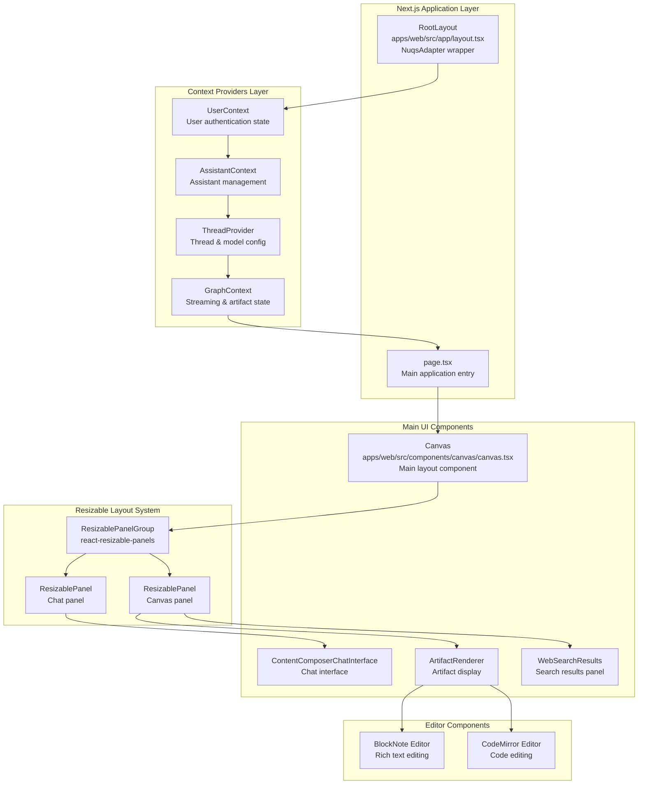
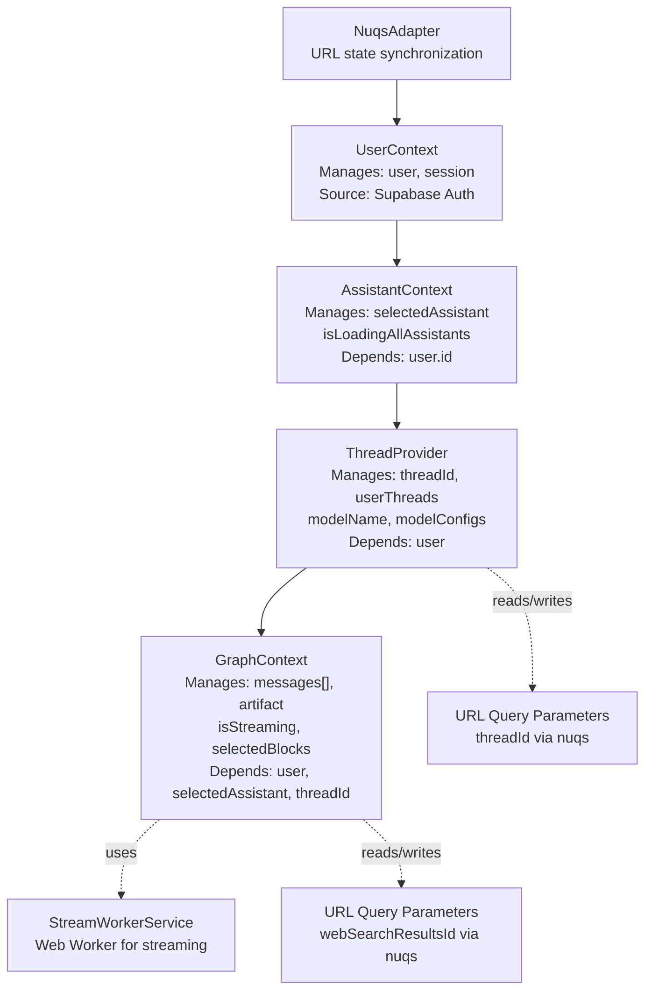
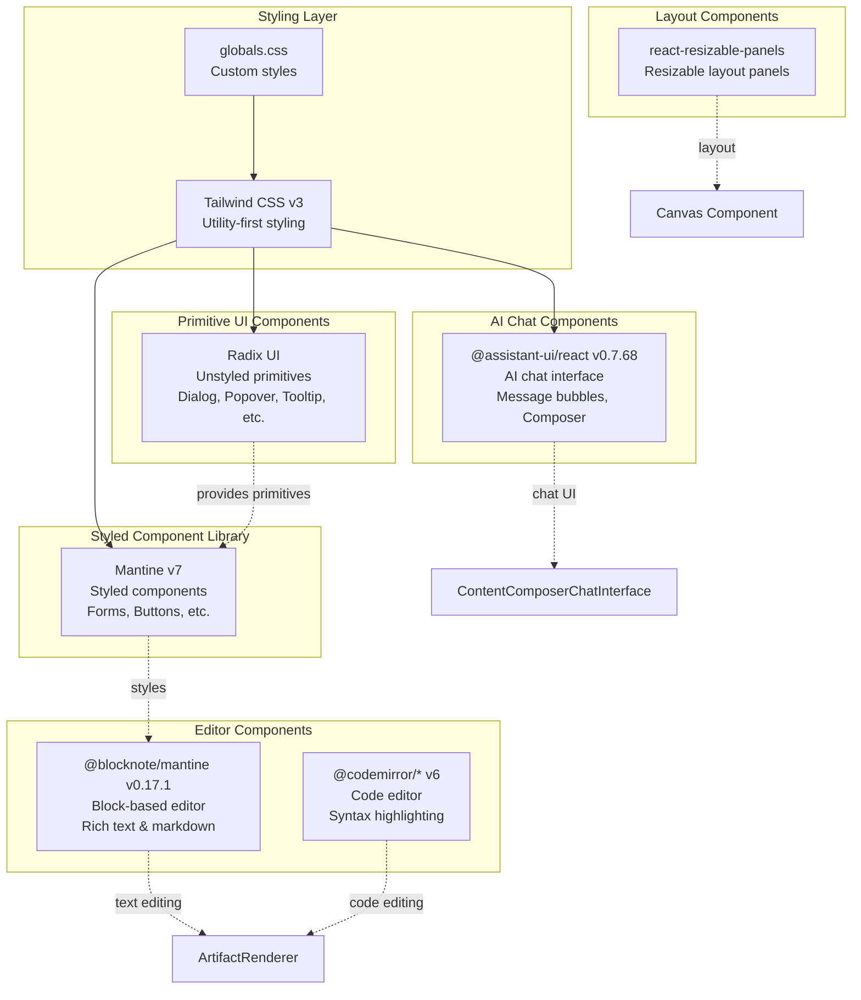
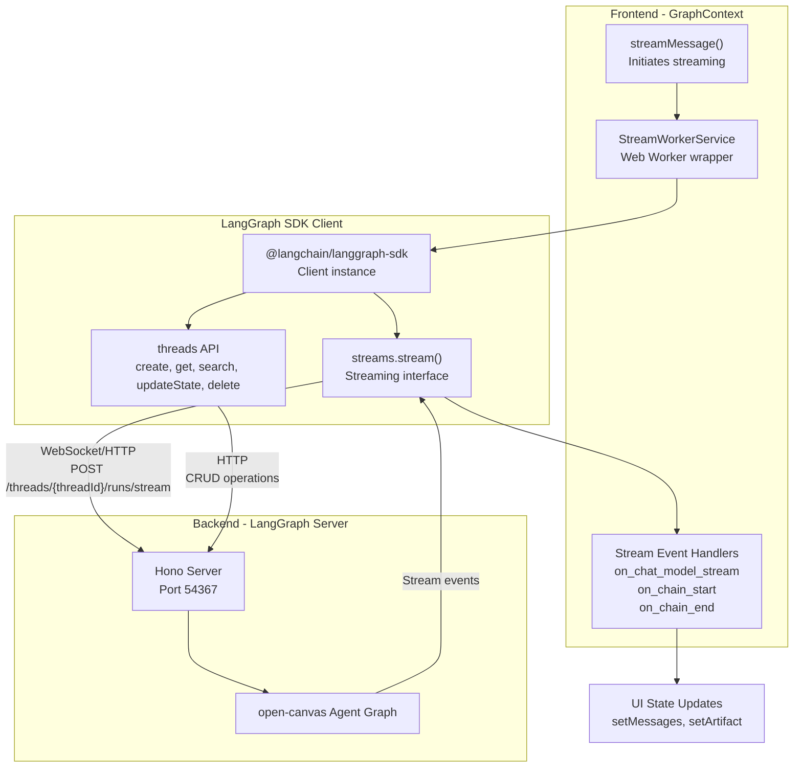
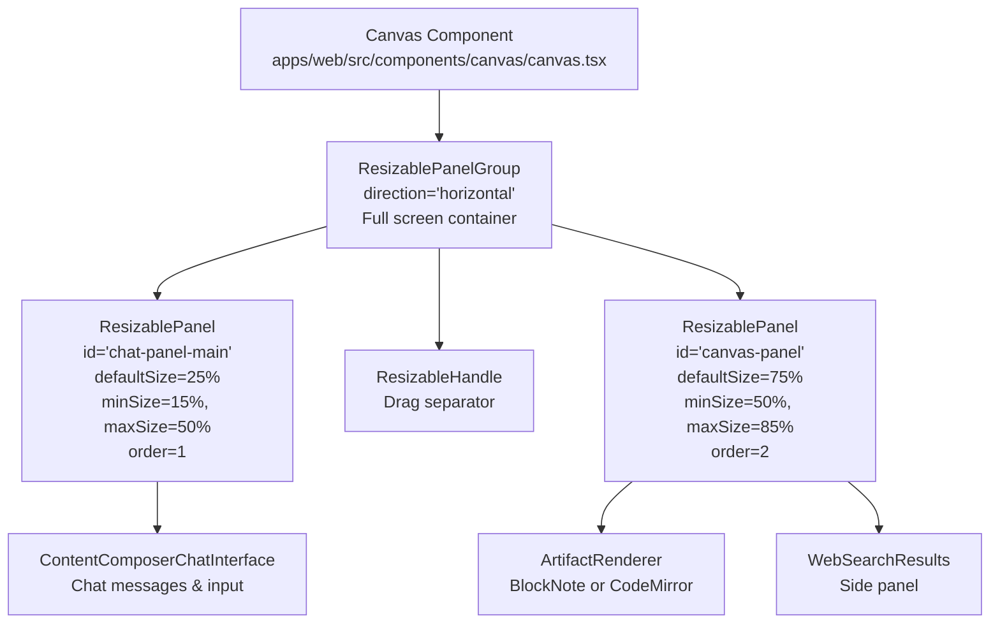
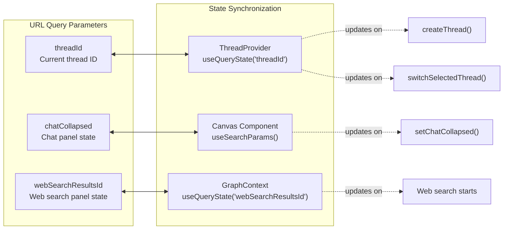

<!-- source: DeepWiki mcp.deepwiki.com · repo langchain-ai/open-canvas · page 2.1 Frontend Architecture · fetched 2026-10-26 -->

# Frontend Architecture

<details>
<summary>Relevant source files</summary>

The following files were used as context for generating this wiki page:

- [.codespellignore](.codespellignore)
- [apps/agents/package.json](apps/agents/package.json)
- [apps/web/package.json](apps/web/package.json)
- [apps/web/src/app/layout.tsx](apps/web/src/app/layout.tsx)
- [apps/web/src/components/canvas/canvas.tsx](apps/web/src/components/canvas/canvas.tsx)
- [apps/web/src/components/ui/resizable.tsx](apps/web/src/components/ui/resizable.tsx)
- [apps/web/src/contexts/GraphContext.tsx](apps/web/src/contexts/GraphContext.tsx)
- [apps/web/src/contexts/ThreadProvider.tsx](apps/web/src/contexts/ThreadProvider.tsx)
- [apps/web/src/hooks/useStore.tsx](apps/web/src/hooks/useStore.tsx)
- [package.json](package.json)
- [packages/evals/package.json](packages/evals/package.json)
- [packages/shared/package.json](packages/shared/package.json)
- [yarn.lock](yarn.lock)

</details>


## Purpose and Scope

This document describes the architecture of the Next.js frontend application located at `apps/web/`. It covers the component hierarchy, state management patterns using React Context, UI library integrations (BlockNote, CodeMirror, Radix UI, Mantine), and the communication layer with the LangGraph backend. 

For information about the backend agent system, see [Backend Architecture](#2.2). For details on the data flow between frontend and backend, see [Data Flow](#2.3).

---

## Application Structure

The frontend follows a layered architecture built on Next.js 14 with React 18, organized around specialized contexts for state management and modular UI components for different editing experiences.



**Sources:** [apps/web/src/app/layout.tsx:1-28](), [apps/web/src/components/canvas/canvas.tsx:1-241](), [apps/web/src/contexts/GraphContext.tsx:1-1100](), [apps/web/src/contexts/ThreadProvider.tsx:1-291]()

---

## Context Provider Architecture

The frontend uses a layered Context architecture where each provider manages a specific domain of state. Providers are nested to enforce dependency ordering and data flow.

### Provider Hierarchy and Dependencies



**Sources:** [apps/web/src/app/layout.tsx:1-28](), [apps/web/src/contexts/GraphContext.tsx:99-178](), [apps/web/src/contexts/ThreadProvider.tsx:35-82]()

### GraphContext - Core State Management

The `GraphContext` is the most complex provider, managing real-time streaming, artifact state, and message handling. It implements debounced API updates to optimize performance.

**Key State Variables:**

| State Variable | Type | Purpose |
|----------------|------|---------|
| `messages` | `BaseMessage[]` | Full message history including AI responses |
| `artifact` | `ArtifactV3 \| undefined` | Current artifact with versioning |
| `selectedBlocks` | `TextHighlight \| undefined` | User-selected text/code blocks |
| `isStreaming` | `boolean` | Whether LLM is currently streaming |
| `updateRenderedArtifactRequired` | `boolean` | Signals UI to re-render artifact |
| `isArtifactSaved` | `boolean` | Tracks save state for UI indicators |
| `runId` | `string \| undefined` | LangSmith run ID for current operation |
| `searchEnabled` | `boolean` | Whether web search is enabled |

**Key Functions:**

| Function | Signature | Purpose |
|----------|-----------|---------|
| `streamMessage` | `(params: GraphInput) => Promise<void>` | Initiates LLM streaming and processes responses |
| `setArtifactContent` | `(index: number, content: string) => void` | Updates artifact content at specific version |
| `switchSelectedThread` | `(thread: Thread) => void` | Loads thread state and switches context |
| `clearState` | `() => void` | Resets all context state |

**Debounced Updates:**

The context implements debounced artifact updates to avoid overwhelming the API:

```
debouncedAPIUpdate = debounce(
  (artifact: ArtifactV3, threadId: string) => updateArtifact(artifact, threadId),
  5000
)
```

This ensures artifact state is saved 5 seconds after the last change, reducing API calls during rapid edits.

**Sources:** [apps/web/src/contexts/GraphContext.tsx:66-93](), [apps/web/src/contexts/GraphContext.tsx:116-178](), [apps/web/src/contexts/GraphContext.tsx:240-259]()

### ThreadProvider - Thread and Model Management

The `ThreadProvider` manages conversation threads and model configuration state. It maintains a per-model configuration registry.

**Key State Variables:**

| State Variable | Type | Purpose |
|----------------|------|---------|
| `threadId` | `string \| null` | Current active thread ID (synced to URL) |
| `userThreads` | `Thread[]` | List of user's threads |
| `modelName` | `ALL_MODEL_NAMES` | Currently selected model |
| `modelConfig` | `CustomModelConfig` | Configuration for current model |
| `modelConfigs` | `Record<ALL_MODEL_NAMES, CustomModelConfig>` | Configuration registry for all models |

**Key Functions:**

| Function | Signature | Purpose |
|----------|-----------|---------|
| `createThread` | `() => Promise<Thread \| undefined>` | Creates new thread with metadata |
| `getUserThreads` | `() => Promise<void>` | Fetches user's threads from API |
| `deleteThread` | `(id: string, clearMessages: () => void) => Promise<void>` | Deletes thread and handles cleanup |
| `getThread` | `(id: string) => Promise<Thread \| undefined>` | Fetches specific thread by ID |
| `setModelConfig` | `(modelName: ALL_MODEL_NAMES, config: CustomModelConfig) => void` | Updates model configuration |

**Model Configuration Initialization:**

The provider initializes configurations for all available models on mount, pulling default configs from `ALL_MODELS` and handling provider-specific settings like Azure OpenAI credentials.

**Sources:** [apps/web/src/contexts/ThreadProvider.tsx:15-33](), [apps/web/src/contexts/ThreadProvider.tsx:37-82](), [apps/web/src/contexts/ThreadProvider.tsx:139-184]()

---

## UI Component Libraries

The frontend integrates multiple specialized UI libraries, each serving a distinct purpose in the editing experience.

### Component Library Integration Map



**Sources:** [yarn.lock:97-200](), [apps/web/src/app/layout.tsx:1-28](), [apps/web/src/components/canvas/canvas.tsx:1-50]()

### Editor Integration Details

**BlockNote Configuration:**

The frontend uses `@blocknote/mantine` which provides Mantine-styled UI components for the BlockNote editor. BlockNote is used for markdown/rich text artifacts and provides:
- Block-based editing (paragraphs, headings, lists, code blocks)
- Toolbar and formatting menus styled with Mantine
- Emoji picker integration via `@emoji-mart/data`
- Collaboration support via Y.js integration

**CodeMirror Configuration:**

CodeMirror v6 is used for code artifacts with multiple language support:

| Language Package | Version | Purpose |
|------------------|---------|---------|
| `@codemirror/lang-javascript` | v6.2.2 | JavaScript/TypeScript support |
| `@codemirror/lang-python` | v6.1.7 | Python syntax |
| `@codemirror/lang-cpp` | v6.0.2 | C++ syntax |
| `@codemirror/lang-java` | v6.0.1 | Java syntax |
| `@codemirror/lang-rust` | v6.0.1 | Rust syntax |
| `@codemirror/lang-sql` | v6.8.0 | SQL syntax |
| `@codemirror/lang-html` | v6.4.9 | HTML syntax |
| `@codemirror/lang-css` | v6.3.1 | CSS syntax |
| `@codemirror/lang-json` | v6.0.1 | JSON syntax |
| `@codemirror/lang-php` | v6.0.1 | PHP syntax |
| `@codemirror/lang-xml` | v6.1.0 | XML syntax |

Additional CodeMirror features:
- `@codemirror/commands` - Keyboard shortcuts and commands
- `@codemirror/autocomplete` - Autocomplete functionality
- `@codemirror/search` - Find/replace functionality
- `@codemirror/lint` - Linting and error detection
- `@codemirror/theme-one-dark` - Dark theme support

**Sources:** [yarn.lock:97-343](), [yarn.lock:206-398]()

---

## Communication Layer

The frontend communicates with the LangGraph backend using the `@langchain/langgraph-sdk` client library, which provides both HTTP and WebSocket support for streaming.

### LangGraph SDK Integration



**Sources:** [apps/web/src/contexts/GraphContext.tsx:267-410](), [apps/web/src/contexts/GraphContext.tsx:351-358]()

### Stream Event Processing

The `GraphContext.streamMessage()` function processes various stream events to update the UI in real-time:

**Stream Event Types:**

| Event Type | Nodes | Processing Logic |
|------------|-------|------------------|
| `on_chain_start` | `updateHighlightedText`, `queryGenerator` | Initialize state for node execution |
| `on_chat_model_stream` | `generateFollowup`, `replyToGeneralInput` | Update chat messages in real-time |
| `on_chat_model_stream` | `generateArtifact` | Accumulate tool call JSON and parse incrementally |
| `on_chat_model_stream` | `updateHighlightedText` | Update highlighted text blocks in artifact |
| `on_chat_model_stream` | `updateArtifact` | Update highlighted code blocks in artifact |
| `on_chat_model_stream` | `rewriteArtifact` | Stream rewritten artifact content with thinking token handling |
| `on_chain_end` | `rewriteArtifact`, `generateArtifact` | Finalize artifact state and clean up |
| `error` | Any | Display error toast and halt streaming |

**Chunk Processing Example:**

For the `generateArtifact` node, the stream handler accumulates partial JSON from tool calls:

```
if (message?.tool_call_chunks?.length > 0 && 
    typeof message?.tool_call_chunks?.[0]?.args === "string") {
  generateArtifactToolCallStr += message.tool_call_chunks[0].args;
}

const result = handleGenerateArtifactToolCallChunk(generateArtifactToolCallStr);
if (result && typeof result === "object") {
  setArtifact(result);
}
```

This enables real-time artifact preview as the LLM generates content.

**Sources:** [apps/web/src/contexts/GraphContext.tsx:398-754](), [apps/web/src/contexts/GraphContext.tsx:456-503]()

### Thread State Management

The SDK's `threads` API provides CRUD operations for conversation threads:

**Thread Operations:**

| Operation | Method | Purpose |
|-----------|--------|---------|
| Create | `client.threads.create({ metadata })` | Creates new thread with user ID and model config |
| Get | `client.threads.get(id)` | Retrieves thread by ID |
| Search | `client.threads.search({ metadata, limit })` | Searches threads by metadata (e.g., user ID) |
| Update State | `client.threads.updateState(id, { values })` | Updates thread state (e.g., artifact) |
| Delete | `client.threads.delete(id)` | Permanently deletes thread |

**Thread Metadata Structure:**

When creating a thread, the following metadata is stored:

```
metadata: {
  supabase_user_id: user.id,
  customModelName: modelName,
  modelConfig: {
    ...modelConfig,
    ...(modelConfig.provider === "azure_openai" && {
      azureConfig: modelConfig.azureConfig
    })
  }
}
```

This ensures thread state includes model configuration for resuming conversations.

**Sources:** [apps/web/src/contexts/ThreadProvider.tsx:139-184](), [apps/web/src/contexts/ThreadProvider.tsx:186-219](), [apps/web/src/contexts/GraphContext.tsx:240-259]()

---

## Layout System

The application uses a resizable panel layout built on `react-resizable-panels` to provide flexible workspace organization.

### Canvas Layout Structure



**Sources:** [apps/web/src/components/canvas/canvas.tsx:100-236](), [apps/web/src/components/ui/resizable.tsx:1-45]()

### Chat Collapse Functionality

The layout supports collapsing the chat panel to maximize canvas space. This state is synchronized to URL parameters for persistence:

**State Management:**

```
const [chatCollapsed, setChatCollapsed] = useState(false);
const chatCollapsedSearchParam = searchParams.get(CHAT_COLLAPSED_QUERY_PARAM);

// Sync from URL on mount
useEffect(() => {
  if (chatCollapsedSearchParam) {
    setChatCollapsed(JSON.parse(chatCollapsedSearchParam));
  }
}, [chatCollapsedSearchParam]);

// Update URL when state changes
setChatCollapsed((c) => {
  const queryParams = new URLSearchParams(searchParams.toString());
  queryParams.set(CHAT_COLLAPSED_QUERY_PARAM, JSON.stringify(c));
  router.replace(`?${queryParams.toString()}`, { scroll: false });
});
```

When collapsed, the canvas panel expands to 100% width while the chat panel is hidden from the DOM entirely.

**Sources:** [apps/web/src/components/canvas/canvas.tsx:32-55](), [apps/web/src/components/canvas/canvas.tsx:144-196]()

---

## URL State Management

The frontend uses `nuqs` for type-safe URL state management, enabling shareable application states and browser history integration.

### URL Parameters



**Query Parameter Usage:**

| Parameter | Type | Managed By | Purpose |
|-----------|------|------------|---------|
| `threadId` | `string \| null` | `ThreadProvider` | Persists current conversation thread |
| `chatCollapsed` | `boolean` | `Canvas` | Persists chat panel collapse state |
| `webSearchResultsId` | `string \| null` | `GraphContext` | Controls web search results panel visibility |

**Integration with NuqsAdapter:**

The root layout wraps the application with `NuqsAdapter` to enable URL state synchronization:

```
<html lang="en" className="h-screen">
  <body className={cn("min-h-full", inter.className)}>
    <NuqsAdapter>{children}</NuqsAdapter>
  </body>
</html>
```

This enables:
- Type-safe query parameter access via `useQueryState()`
- Automatic URL updates when state changes
- Browser back/forward button support
- Shareable URLs with embedded application state

**Sources:** [apps/web/src/app/layout.tsx:21-27](), [apps/web/src/contexts/ThreadProvider.tsx:40-40](), [apps/web/src/contexts/GraphContext.tsx:146-148](), [apps/web/src/components/canvas/canvas.tsx:41-55]()

---

## Key File Reference

### Core Context Files

| File Path | Primary Exports | Lines of Code | Purpose |
|-----------|----------------|---------------|---------|
| `apps/web/src/contexts/GraphContext.tsx` | `GraphProvider`, `useGraphContext` | ~1100 | Manages streaming, artifact state, messages |
| `apps/web/src/contexts/ThreadProvider.tsx` | `ThreadProvider`, `useThreadContext` | ~291 | Manages threads and model configuration |
| `apps/web/src/contexts/UserContext.tsx` | `UserProvider`, `useUserContext` | Not shown | Manages user authentication state |
| `apps/web/src/contexts/AssistantContext.tsx` | `AssistantProvider`, `useAssistantContext` | Not shown | Manages assistant selection |

### Core Component Files

| File Path | Primary Components | Purpose |
|-----------|-------------------|---------|
| `apps/web/src/components/canvas/canvas.tsx` | `Canvas`, `CanvasComponent` | Main layout with resizable panels |
| `apps/web/src/components/canvas/content-composer.tsx` | `ContentComposerChatInterface` | Chat interface and message input |
| `apps/web/src/components/artifacts/ArtifactRenderer.tsx` | `ArtifactRenderer` | Renders BlockNote or CodeMirror based on artifact type |
| `apps/web/src/components/web-search-results.tsx` | `WebSearchResults` | Web search results side panel |
| `apps/web/src/components/ui/resizable.tsx` | `ResizablePanel`, `ResizableHandle`, `ResizablePanelGroup` | Resizable layout primitives |

### Application Entry Points

| File Path | Purpose |
|-----------|---------|
| `apps/web/src/app/layout.tsx` | Root layout, context provider nesting, global styles |
| `apps/web/src/app/page.tsx` | Main page component (not shown but referenced) |
| `apps/web/src/app/globals.css` | Global CSS and Tailwind imports |

**Sources:** [apps/web/src/contexts/GraphContext.tsx:1-1100](), [apps/web/src/contexts/ThreadProvider.tsx:1-291](), [apps/web/src/components/canvas/canvas.tsx:1-241](), [apps/web/src/app/layout.tsx:1-28]()

---

