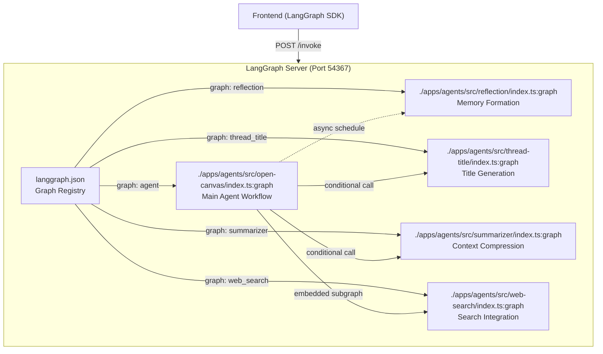
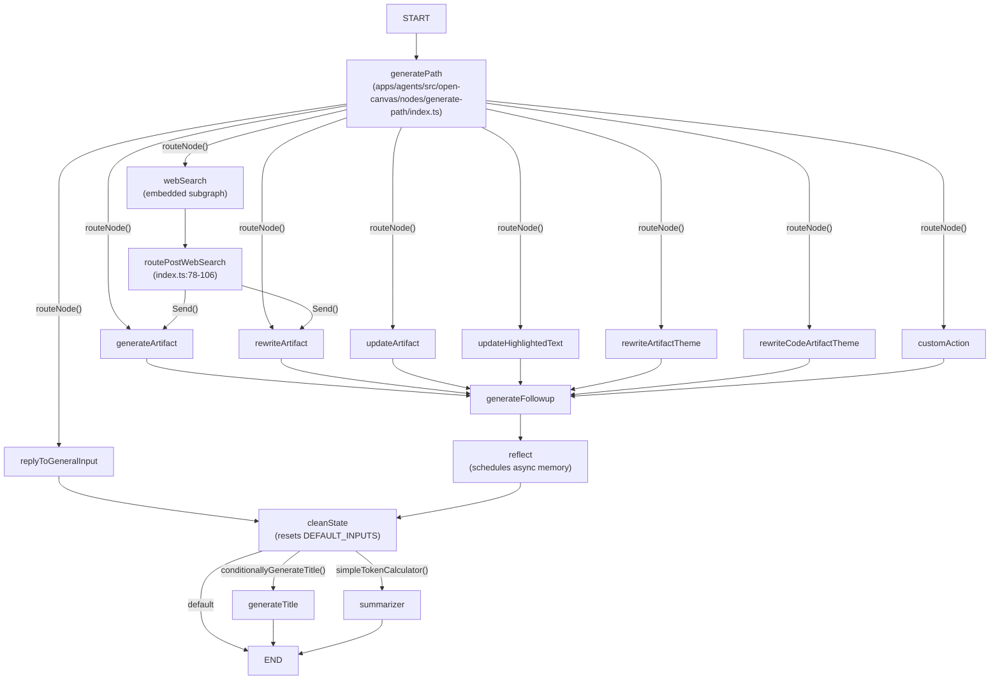
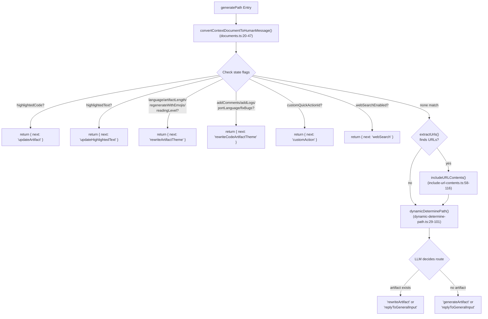
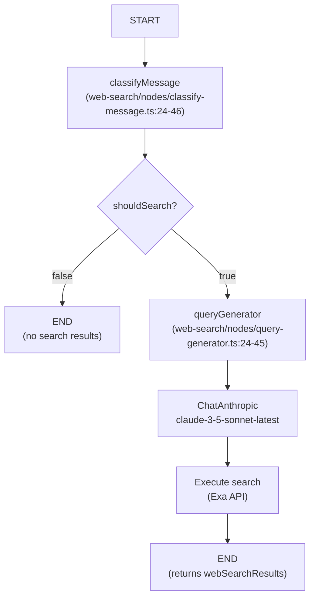
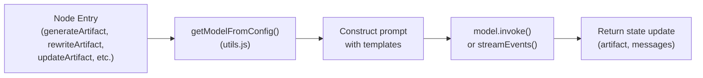
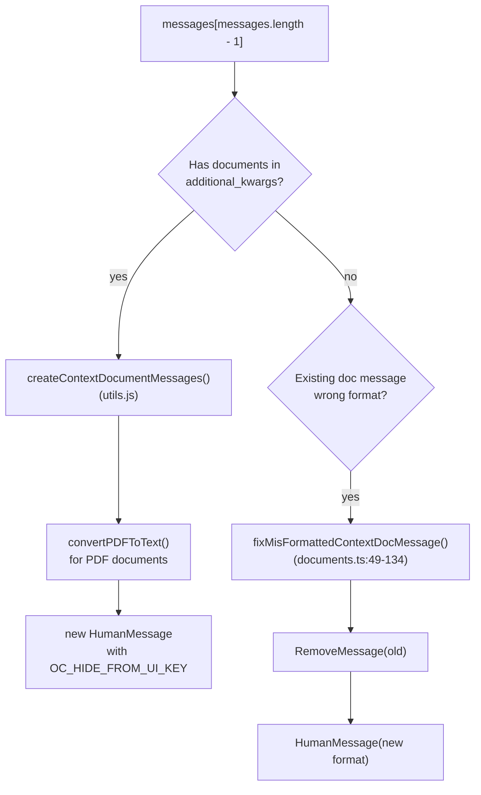

<!-- source: DeepWiki mcp.deepwiki.com · repo langchain-ai/open-canvas · page 2.2 Backend Architecture · fetched 2026-10-26 -->

# Backend Architecture

<details>
<summary>Relevant source files</summary>

The following files were used as context for generating this wiki page:

- [.codespellignore](.codespellignore)
- [apps/agents/package.json](apps/agents/package.json)
- [apps/agents/src/open-canvas/index.ts](apps/agents/src/open-canvas/index.ts)
- [apps/agents/src/open-canvas/nodes/generate-path/documents.ts](apps/agents/src/open-canvas/nodes/generate-path/documents.ts)
- [apps/agents/src/open-canvas/nodes/generate-path/dynamic-determine-path.ts](apps/agents/src/open-canvas/nodes/generate-path/dynamic-determine-path.ts)
- [apps/agents/src/open-canvas/nodes/generate-path/include-url-contents.ts](apps/agents/src/open-canvas/nodes/generate-path/include-url-contents.ts)
- [apps/agents/src/open-canvas/nodes/generate-path/index.ts](apps/agents/src/open-canvas/nodes/generate-path/index.ts)
- [apps/agents/src/summarizer/index.ts](apps/agents/src/summarizer/index.ts)
- [apps/agents/src/web-search/nodes/classify-message.ts](apps/agents/src/web-search/nodes/classify-message.ts)
- [apps/agents/src/web-search/nodes/query-generator.ts](apps/agents/src/web-search/nodes/query-generator.ts)
- [apps/agents/tsconfig.json](apps/agents/tsconfig.json)
- [apps/web/package.json](apps/web/package.json)
- [apps/web/src/hooks/useStore.tsx](apps/web/src/hooks/useStore.tsx)
- [langgraph.json](langgraph.json)
- [packages/evals/package.json](packages/evals/package.json)
- [packages/shared/package.json](packages/shared/package.json)
- [packages/shared/src/types.ts](packages/shared/src/types.ts)
- [packages/shared/src/utils/urls.ts](packages/shared/src/utils/urls.ts)

</details>


## Purpose and Scope

This document describes the backend architecture of Open Canvas, which is built on LangGraph and implements a multi-graph agent system. The backend is located in the `apps/agents` directory and handles all AI-powered content generation, routing, and memory formation. For information about how the frontend communicates with the backend, see [Data Flow](#2.3). For details on model configuration and provider integration, see [Model Integration](#5).

The backend operates as a standalone LangGraph service that exposes multiple graphs via HTTP API endpoints on port 54367 (configurable via `PORT` environment variable).

---

## Graph Configuration and Entry Points

The backend defines five distinct LangGraph graphs in [langgraph.json:6-11](), which serves as the configuration manifest for the LangGraph server:



**Sources:** [langgraph.json:1-14](), [apps/agents/package.json:15]()

### Graph Definitions

| Graph Name | File Path | Purpose |
|------------|-----------|---------|
| `agent` | `./apps/agents/src/open-canvas/index.ts:graph` | Primary workflow for generating, rewriting, and updating artifacts |
| `reflection` | `./apps/agents/src/reflection/index.ts:graph` | Asynchronous extraction of style rules and user insights |
| `thread_title` | `./apps/agents/src/thread-title/index.ts:graph` | Generates concise thread titles for conversation history |
| `summarizer` | `./apps/agents/src/summarizer/index.ts:graph` | Compresses message history when character limits are exceeded |
| `web_search` | `./apps/agents/src/web-search/index.ts:graph` | Performs web searches and enriches context |

The server is started via [apps/agents/package.json:15]() with the command `langgraphjs dev --port 54367 --config ../../langgraph.json`.

**Sources:** [langgraph.json:6-11](), [apps/agents/package.json:15]()

---

## Main Agent Graph Structure

The primary `agent` graph implements the `OpenCanvasGraphAnnotation` state machine in [apps/agents/src/open-canvas/index.ts:108-162](). The graph uses a hub-and-spoke architecture with `generatePath` as the central routing node.



**Sources:** [apps/agents/src/open-canvas/index.ts:108-162]()

### Routing Logic

The `routeNode` function at [apps/agents/src/open-canvas/index.ts:20-28]() uses the `Send` primitive to dynamically route based on `state.next`:

```typescript
const routeNode = (state: typeof OpenCanvasGraphAnnotation.State) => {
  if (!state.next) {
    throw new Error("'next' state field not set.");
  }
  return new Send(state.next, { ...state });
};
```

**Sources:** [apps/agents/src/open-canvas/index.ts:20-28](), [apps/agents/src/open-canvas/index.ts:129-139]()

---

## Path Generation and Routing

The `generatePath` node at [apps/agents/src/open-canvas/nodes/generate-path/index.ts:26-168]() serves as the intelligent router for the entire system. It performs several preprocessing steps before determining the route:

### Routing Decision Flow



**Sources:** [apps/agents/src/open-canvas/nodes/generate-path/index.ts:26-168](), [apps/agents/src/open-canvas/nodes/generate-path/include-url-contents.ts:58-116](), [apps/agents/src/open-canvas/nodes/generate-path/dynamic-determine-path.ts:29-101]()

### State-Based Routing

The routing follows a priority order defined in [apps/agents/src/open-canvas/nodes/generate-path/index.ts:56-117]():

1. **Highlighted Code** (`state.highlightedCode`) → `updateArtifact`
2. **Highlighted Text** (`state.highlightedText`) → `updateHighlightedText`
3. **Theme Options** (`state.language`, `state.artifactLength`, `state.regenerateWithEmojis`, `state.readingLevel`) → `rewriteArtifactTheme`
4. **Code Options** (`state.addComments`, `state.addLogs`, `state.portLanguage`, `state.fixBugs`) → `rewriteCodeArtifactTheme`
5. **Custom Actions** (`state.customQuickActionId`) → `customAction`
6. **Web Search** (`state.webSearchEnabled`) → `webSearch`
7. **Dynamic Routing** → LLM-based decision via `dynamicDeterminePath`

**Sources:** [apps/agents/src/open-canvas/nodes/generate-path/index.ts:56-117]()

### URL Content Enrichment

When URLs are detected via `extractUrls()` from [packages/shared/src/utils/urls.ts:6-22](), the system:

1. Calls `includeURLContents()` at [apps/agents/src/open-canvas/nodes/generate-path/include-url-contents.ts:58-116]()
2. Uses an LLM to determine if the user wants URL contents included
3. Scrapes content using FireCrawlLoader if affirmative
4. Replaces URLs in the message with `<page-contents>` blocks

**Sources:** [apps/agents/src/open-canvas/nodes/generate-path/index.ts:121-128](), [apps/agents/src/open-canvas/nodes/generate-path/include-url-contents.ts:58-116](), [packages/shared/src/utils/urls.ts:6-22]()

### Dynamic Path Determination

The `dynamicDeterminePath` function at [apps/agents/src/open-canvas/nodes/generate-path/dynamic-determine-path.ts:29-101]() uses structured output from an LLM to choose between:

- `replyToGeneralInput` - For chat-only responses
- `generateArtifact` - When no artifact exists
- `rewriteArtifact` - When an artifact exists

The function constructs a prompt with:
- Recent messages (last 3)
- Current artifact content (if present)
- Context document messages
- Route-specific options from prompts

**Sources:** [apps/agents/src/open-canvas/nodes/generate-path/dynamic-determine-path.ts:29-101]()

---

## Supporting Graphs

### Summarizer Graph

The summarizer graph at [apps/agents/src/summarizer/index.ts:25-75]() compresses message history when the character count exceeds `CHARACTER_MAX` (300,000 characters, defined at [apps/agents/src/open-canvas/index.ts:37]()).

```mermaid
graph LR
    Trigger["simpleTokenCalculator()<br/>(index.ts:39-57)"] -->|"totalChars > 300,000"| Summarizer["summarizer node<br/>(summarizer/index.ts:25-69)"]
    
    Summarizer --> ClaudeModel["ChatAnthropic<br/>claude-3-5-sonnet-latest"]
    ClaudeModel --> CreateSummary["formatMessages() + SUMMARIZER_PROMPT"]
    CreateSummary --> UpdateThread["Client.threads.updateState()<br/>replaces _messages"]
    UpdateThread --> NewMessage["HumanMessage with<br/>OC_SUMMARIZED_MESSAGE_KEY"]
```



The summarizer:
1. Formats all messages using `formatMessages()` from [apps/agents/src/utils.js]()
2. Invokes Claude with `SUMMARIZER_PROMPT` at [apps/agents/src/summarizer/index.ts:10-23]()
3. Creates a new `HumanMessage` with `OC_SUMMARIZED_MESSAGE_KEY` in `additional_kwargs`
4. Uses the LangGraph SDK `Client` to directly update thread state

**Sources:** [apps/agents/src/summarizer/index.ts:25-75](), [apps/agents/src/open-canvas/index.ts:37-57]()

### Web Search Graph

The web search graph performs multi-step search operations when `state.webSearchEnabled` is true:



**Key Steps:**

1. **Classification** ([apps/agents/src/web-search/nodes/classify-message.ts:24-46]()): Determines if the message warrants a search
2. **Query Generation** ([apps/agents/src/web-search/nodes/query-generator.ts:24-45]()): Converts the user message into a search-engine-friendly query
3. **Search Execution**: Uses Exa or other search tools (via `@langchain/exa` dependency)

The results flow back through `routePostWebSearch()` at [apps/agents/src/open-canvas/index.ts:78-106](), which creates an AI message containing search results and routes to either `generateArtifact` or `rewriteArtifact`.

**Sources:** [apps/agents/src/web-search/nodes/classify-message.ts:24-46](), [apps/agents/src/web-search/nodes/query-generator.ts:24-45](), [apps/agents/src/open-canvas/index.ts:78-106](), [langgraph.json:11]()

### Reflection Graph

The reflection graph is invoked asynchronously by the `reflect` node. Details about the reflection system, including debounced scheduling and memory formation, are covered in [Reflection and Memory System](#4.5).

**Sources:** [langgraph.json:8](), [apps/agents/src/open-canvas/index.ts:123]()

### Thread Title Graph

The `generateTitle` node is conditionally invoked by `conditionallyGenerateTitle()` at [apps/agents/src/open-canvas/index.ts:64-72]() when:
- `state.messages.length <= 2` (first human-AI exchange)
- Character count is below `CHARACTER_MAX`

This generates concise titles for display in the thread history UI.

**Sources:** [apps/agents/src/open-canvas/index.ts:64-72](), [langgraph.json:9]()

---

## Node Implementation Patterns

### Artifact Operations

All artifact operation nodes follow a common pattern:



Common utilities used across nodes:

- **`getModelFromConfig(config, options)`**: Initializes LLM from thread configuration
- **`getModelConfig(config)`**: Extracts model provider and settings
- **`formatArtifactContentWithTemplate(template, content)`**: Injects artifact into prompts
- **`createContextDocumentMessages(config, documents?)`**: Converts context docs to messages

**Sources:** [apps/agents/src/utils.js]()

### State Updates

Nodes return partial state updates that are merged by LangGraph. Common return patterns:

```typescript
// Routing nodes
return { next: "nodeName", messages: [...], _messages: [...] };

// Content generation nodes
return { artifact: updatedArtifact, messages: [newMessage] };

// Terminal nodes
return {}; // No state updates
```

**Sources:** [apps/agents/src/open-canvas/nodes/generate-path/index.ts:57-168]()

---

## Dependencies and Runtime

### Core Dependencies

The backend relies on several LangChain ecosystem packages from [apps/agents/package.json:24-50]():

| Package | Purpose |
|---------|---------|
| `@langchain/langgraph` | Graph execution engine and state management |
| `@langchain/langgraph-sdk` | Client for thread state updates (used in summarizer) |
| `@langchain/core` | Base message types and abstractions |
| `@langchain/anthropic` | Claude model integration |
| `@langchain/google-genai` | Gemini model integration |
| `@langchain/openai` | OpenAI/Azure OpenAI integration |
| `@langchain/groq` | Groq inference integration |
| `@langchain/ollama` | Local model integration |
| `@langchain/exa` | Exa search tool integration |
| `@langchain/community` | FireCrawl and other loaders |

**Sources:** [apps/agents/package.json:24-50]()

### External Tools

Additional tools integrated via [apps/agents/package.json:25-48]():

- **FFmpeg** (`@ffmpeg/ffmpeg`): Media processing
- **FireCrawl** (`@mendable/firecrawl-js`): Web scraping for URL content
- **PDF Parser** (`pdf-parse`): Document text extraction
- **Exa** (`exa-js`): Web search capabilities

**Sources:** [apps/agents/package.json:25-48]()

### Build and Development

Build configuration from [apps/agents/tsconfig.json:1-34]():

- **Target**: ES2021
- **Module**: NodeNext (ESM with `.js` extensions)
- **Output**: `./dist` directory
- **Entry**: `./src` directory

Development server: `yarn langgraphjs dev --port 54367 --config ../../langgraph.json --no-browser`

**Sources:** [apps/agents/tsconfig.json:1-34](), [apps/agents/package.json:15]()

### Shared Package Integration

The agents package depends on `@opencanvas/shared` ([apps/agents/package.json:38]()), which provides:

- Type definitions (`GraphInput`, `ArtifactV3`, `Reflections`, `ContextDocument`)
- Constants (`DEFAULT_INPUTS`, `OC_SUMMARIZED_MESSAGE_KEY`, `CONTEXT_DOCUMENTS_NAMESPACE`)
- Utility functions (`extractUrls`, `getArtifactContent`)

See [Shared Code](#6) for complete details on shared types and utilities.

**Sources:** [apps/agents/package.json:38](), [packages/shared/src/types.ts:1-230]()

---

## Context Management

### Document Processing

Context documents are processed through [apps/agents/src/open-canvas/nodes/generate-path/documents.ts:20-46]():



The system handles three document formats:
- **Anthropic**: `{ type: "document", source: { type: "base64", data: ... } }`
- **Google Gemini**: `{ type: "application/pdf", data: ... }`
- **OpenAI**: Converts PDFs to text using `pdf-parse`

**Sources:** [apps/agents/src/open-canvas/nodes/generate-path/documents.ts:20-134]()

### Storage Integration

The backend retrieves context documents and reflections from storage via the `getModelConfig()` utility, which extracts configuration from LangGraph's `RunnableConfig`. The actual storage operations are handled by the frontend's `useStore` hook, documented in [Authentication and Storage](#2.4).

**Sources:** [apps/web/src/hooks/useStore.tsx:228-289](), [apps/web/src/hooks/useStore.tsx:19-65]()

---

