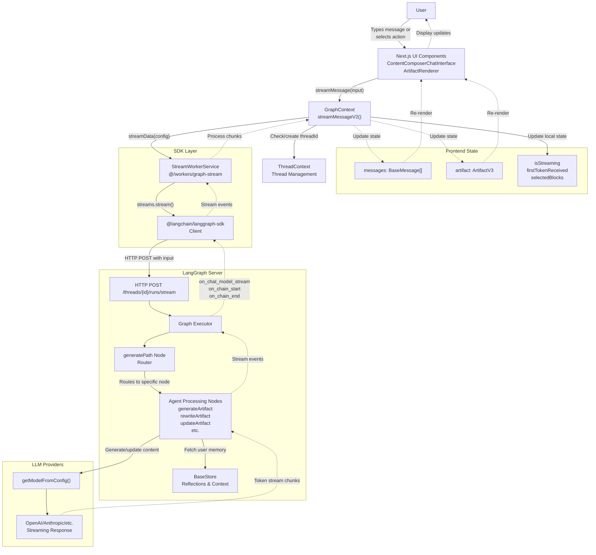
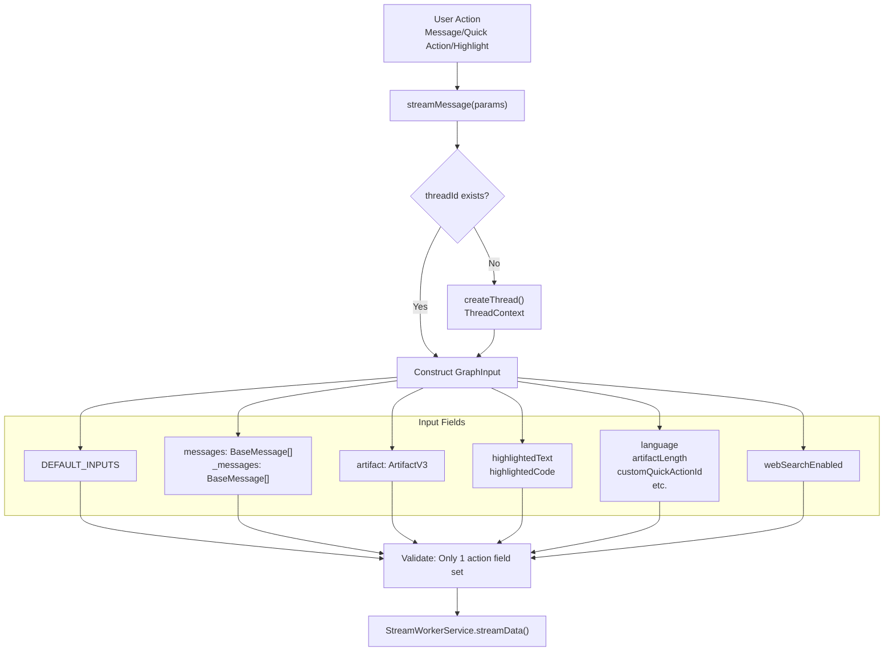
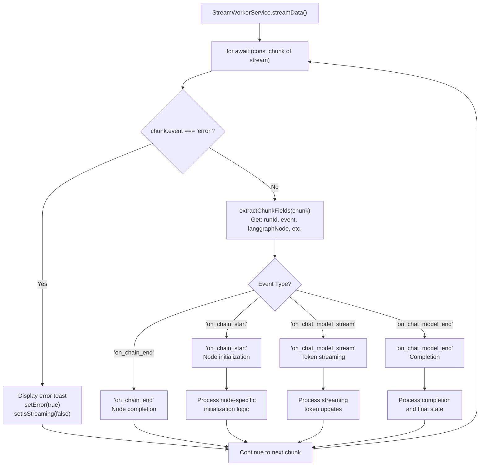
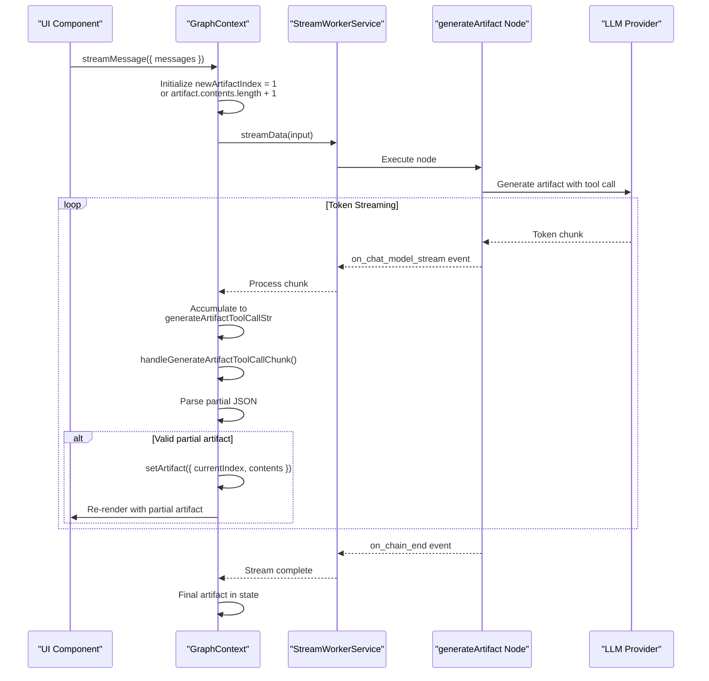
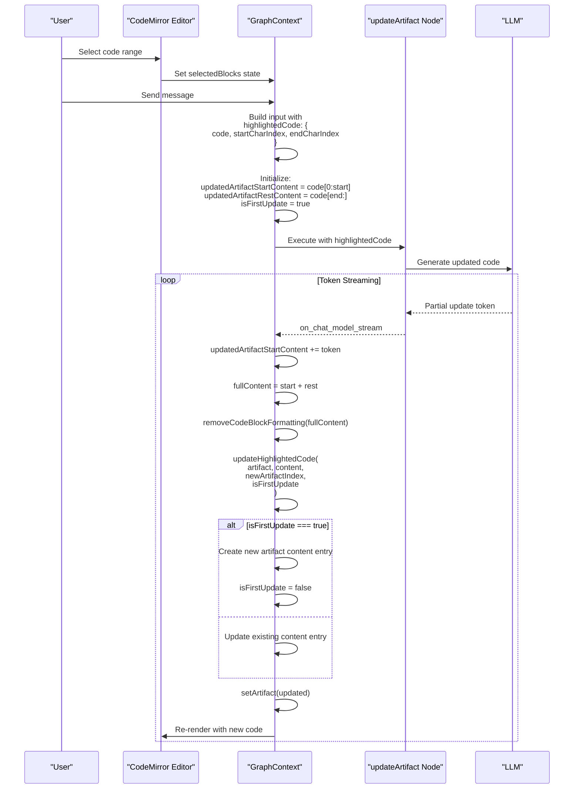
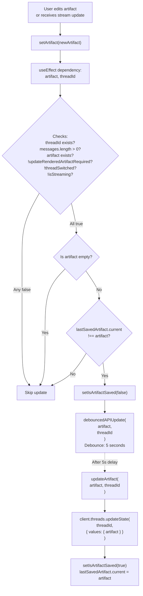
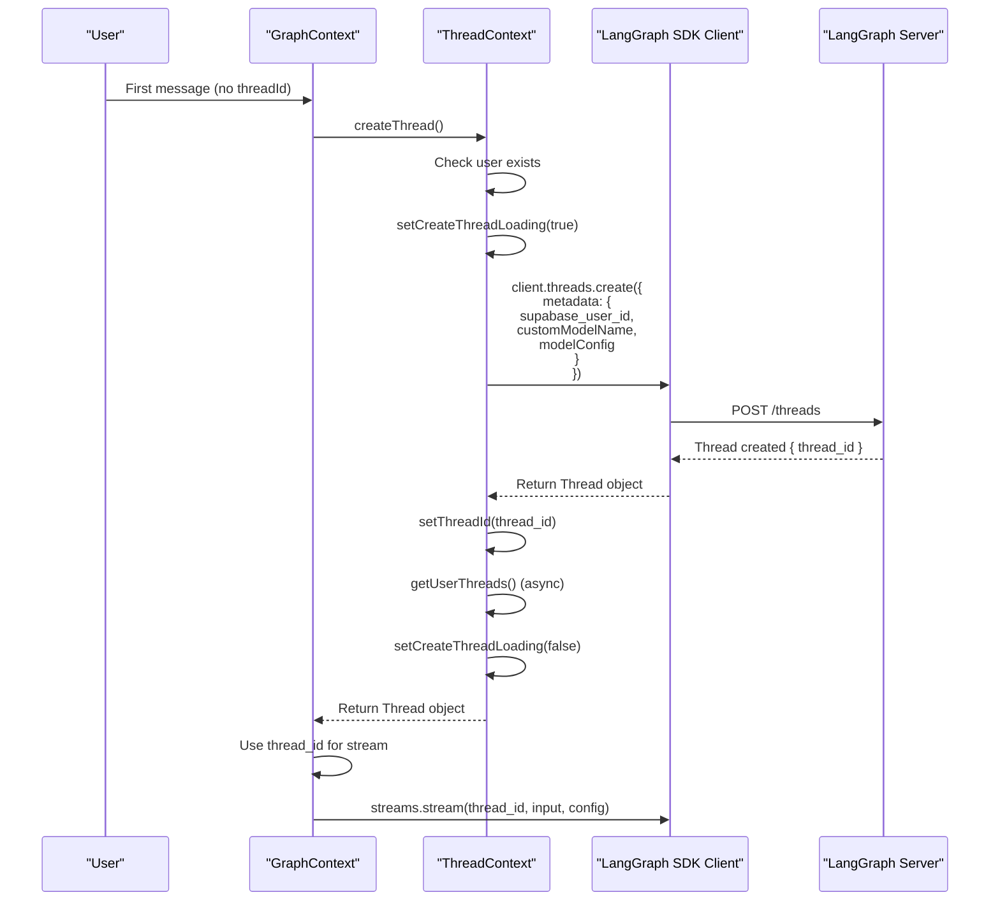
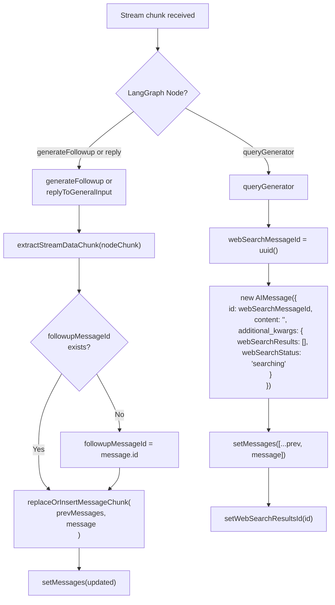
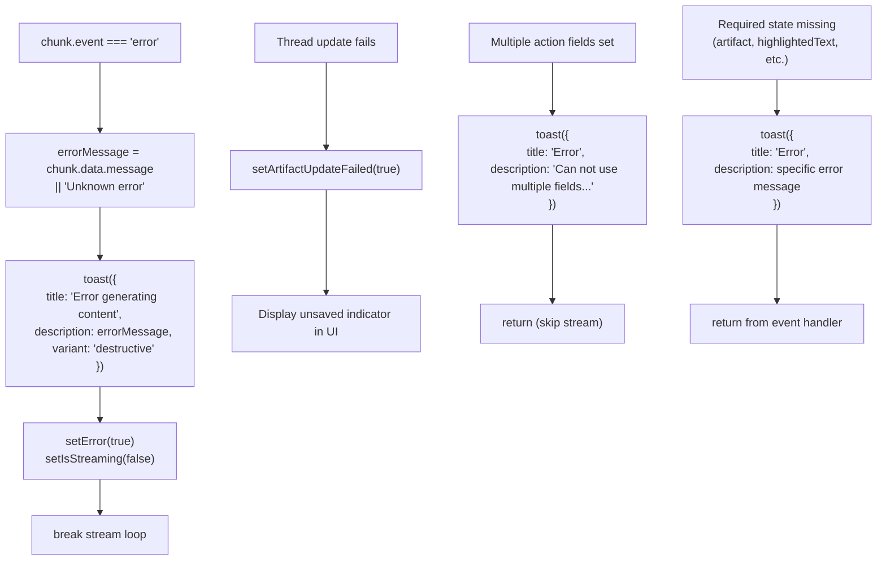
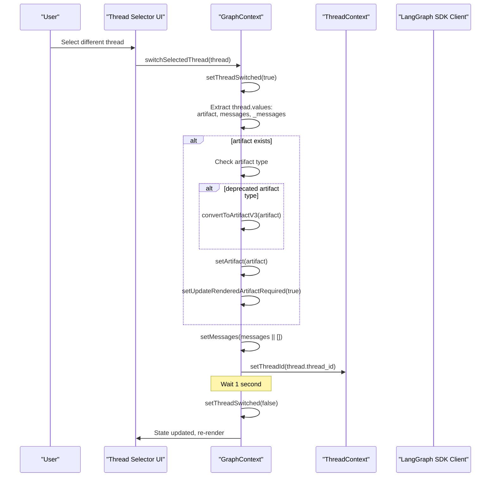

<!-- source: DeepWiki mcp.deepwiki.com · repo langchain-ai/open-canvas · page 2.3 Data Flow · fetched 2026-10-26 -->

# Data Flow

<details>
<summary>Relevant source files</summary>

The following files were used as context for generating this wiki page:

- [.codespellignore](.codespellignore)
- [apps/agents/package.json](apps/agents/package.json)
- [apps/web/package.json](apps/web/package.json)
- [apps/web/src/app/layout.tsx](apps/web/src/app/layout.tsx)
- [apps/web/src/components/canvas/canvas.tsx](apps/web/src/components/canvas/canvas.tsx)
- [apps/web/src/components/canvas/content-composer.tsx](apps/web/src/components/canvas/content-composer.tsx)
- [apps/web/src/components/chat-interface/thread.tsx](apps/web/src/components/chat-interface/thread.tsx)
- [apps/web/src/components/ui/resizable.tsx](apps/web/src/components/ui/resizable.tsx)
- [apps/web/src/constants.ts](apps/web/src/constants.ts)
- [apps/web/src/contexts/GraphContext.tsx](apps/web/src/contexts/GraphContext.tsx)
- [apps/web/src/contexts/ThreadProvider.tsx](apps/web/src/contexts/ThreadProvider.tsx)
- [apps/web/src/hooks/useLocalStorage.tsx](apps/web/src/hooks/useLocalStorage.tsx)
- [apps/web/src/hooks/useStore.tsx](apps/web/src/hooks/useStore.tsx)
- [packages/evals/package.json](packages/evals/package.json)
- [packages/shared/package.json](packages/shared/package.json)

</details>


This page describes the complete data flow through the Open Canvas system, from user input through streaming agent execution, LLM interaction, and back to UI updates. It covers the message processing pipeline, artifact generation and updates, and state management patterns.

For information about the agent graph structure and routing logic, see [Agent Graph Structure](#4.1). For details on state management contexts, see [State Management](#3.1). For authentication and data persistence, see [Authentication and Storage](#2.4).

---

## Overview

Open Canvas implements a bidirectional streaming architecture where data flows through multiple layers, from the React frontend through LangGraph agents to LLM providers and back. The system handles real-time streaming of tokens, partial artifact updates, and asynchronous state persistence.

**Sources:** [README.md:1-198](), [apps/web/src/contexts/GraphContext.tsx:1-1866]()

---

## Data Flow Architecture

The following diagram illustrates the complete data flow from user interaction to UI update:



**Key Flow Stages:**

1. **User Input**: User types a message, selects highlighted text/code, or triggers a quick action
2. **State Preparation**: `GraphContext` checks for existing thread or creates new one
3. **Stream Initiation**: `streamMessageV2()` constructs input with current artifact, messages, and action flags
4. **HTTP Request**: `StreamWorkerService` sends streaming request to LangGraph server
5. **Agent Processing**: Server routes request through `generatePath`, executes appropriate agent nodes
6. **LLM Streaming**: Agent nodes stream tokens from LLM providers
7. **Event Processing**: Frontend processes stream events (`on_chat_model_stream`, `on_chain_start`, `on_chain_end`)
8. **UI Updates**: React state updates trigger re-renders with new content
9. **Persistence**: Debounced updates save artifacts and state to Supabase

**Sources:** [apps/web/src/contexts/GraphContext.tsx:267-410](), [apps/web/src/workers/graph-stream/streamWorker.ts]()

---

## Stream Initiation and Input Construction

The data flow begins when the user interacts with the UI. The `GraphContext` component manages the initiation of streaming requests.

### Input Construction



**Input Construction Logic** [apps/web/src/contexts/GraphContext.tsx:295-339]():

1. **Thread Management**: Check if `threadId` exists; if not, call `threadData.createThread()` and wait for response
2. **Message Preparation**: Construct `messagesInput` with two arrays:
   - `messages`: Full unfiltered message list
   - `_messages`: LLM context messages (includes summarization messages)
3. **Artifact State**: Include current `artifact` object if one exists
4. **Highlight Selection**: Add `highlightedText` or `highlightedCode` if user has selected content
5. **Action Flags**: Include any quick action parameters (`language`, `artifactLength`, `customQuickActionId`, etc.)
6. **Web Search**: Set `webSearchEnabled` flag from `searchEnabled` state
7. **Validation**: Ensure only one action field is defined (prevents conflicting operations)

**Sources:** [apps/web/src/contexts/GraphContext.tsx:267-339](), [packages/shared/src/constants.ts]()

---

## Stream Event Processing

Once the stream starts, the frontend processes various event types from the LangGraph server. The main processing loop handles chunks asynchronously.

### Event Processing Loop



**Event Types and Processing** [apps/web/src/contexts/GraphContext.tsx:398-1044]():

### `on_chain_start` Events

Triggered when a LangGraph node begins execution. Used for initialization:

- **`updateHighlightedText`** [apps/web/src/contexts/GraphContext.tsx:430-432](): Captures `highlightedText` input
- **`queryGenerator`** [apps/web/src/contexts/GraphContext.tsx:434-453](): Creates web search message placeholder, generates unique `webSearchMessageId`, sets `webSearchResultsId` query parameter

### `on_chat_model_stream` Events

Processes streaming tokens from the LLM. Different handling per node:

| Node | Processing Logic | State Updates |
|------|-----------------|---------------|
| `generateFollowup` | Insert/update AI message chunks | `setMessages()` with `replaceOrInsertMessageChunk()` |
| `replyToGeneralInput` | Insert/update AI message chunks | `setMessages()` with `replaceOrInsertMessageChunk()` |
| `generateArtifact` | Accumulate tool call args, parse partial JSON | `setArtifact()` with `handleGenerateArtifactToolCallChunk()` result |
| `updateHighlightedText` | Stream updated markdown blocks | `setArtifact()` with `updateHighlightedMarkdown()` |
| `updateArtifact` | Stream updated code | `setArtifact()` with `updateHighlightedCode()` |
| `rewriteArtifact` | Stream full artifact rewrite | `setArtifact()` with `updateRewrittenArtifact()` |
| `rewriteArtifactTheme` | Stream themed rewrite | `setArtifact()` with `updateRewrittenArtifact()` |
| `rewriteCodeArtifactTheme` | Stream code themed rewrite | `setArtifact()` with `updateRewrittenArtifact()` |
| `customAction` | Stream custom action result | `setArtifact()` with `updateRewrittenArtifact()` |

### `on_chat_model_end` Events

Handles non-streaming models [apps/web/src/contexts/GraphContext.tsx:847-1044]():

- **Non-streaming text models**: Models in `NON_STREAMING_TEXT_MODELS` list receive full response in `nodeOutput`
- Same update logic as streaming, but processes complete content at once
- Supports models like `o1-mini` and `o1-preview` that don't support streaming

**Sources:** [apps/web/src/contexts/GraphContext.tsx:398-1044](), [apps/web/src/contexts/utils.ts]()

---

## Artifact Generation and Updates

Artifact operations follow different patterns depending on the operation type. All operations update the `artifact` state incrementally during streaming.

### Artifact Generation Flow



**Generation Process** [apps/web/src/contexts/GraphContext.tsx:472-504]():

1. **Initialize Index**: Calculate `newArtifactIndex = artifact?.contents.length + 1 || 1`
2. **Accumulate Tokens**: Add each chunk to `generateArtifactToolCallStr`
3. **Parse Incrementally**: Call `handleGenerateArtifactToolCallChunk()` with accumulated string
4. **Update State**: If valid partial artifact parsed, call `setArtifact()` with new content
5. **First Token**: Set `firstTokenReceived = true` on first valid parse

**Sources:** [apps/web/src/contexts/GraphContext.tsx:472-504](), [apps/web/src/contexts/utils.ts:1-100]()

### Artifact Update Flow (Highlighted Code)



**Update Process** [apps/web/src/contexts/GraphContext.tsx:594-672]():

1. **Input Construction**: User selects code range, system captures `startCharIndex` and `endCharIndex`
2. **Initialize Buffers** (first chunk):
   - `updatedArtifactStartContent = prevContent.code.slice(0, startCharIndex)`
   - `updatedArtifactRestContent = prevContent.code.slice(endCharIndex)`
3. **Stream Tokens**: Append each token to `updatedArtifactStartContent`
4. **Combine Content**: `fullContent = updatedArtifactStartContent + updatedArtifactRestContent`
5. **Format**: Call `removeCodeBlockFormatting()` to strip markdown code fences
6. **Update Artifact**: Call `updateHighlightedCode()` which:
   - On `isFirstUpdate = true`: Create new content entry at `newArtifactIndex`
   - On subsequent updates: Update content at `newArtifactIndex`
7. **Version Management**: Original content remains at `prevCurrentContent.index`, new version at `newArtifactIndex`

**Sources:** [apps/web/src/contexts/GraphContext.tsx:594-672](), [apps/web/src/contexts/utils.ts:200-250]()

### Artifact Rewrite Flow

```mermaid
graph TB
    RewriteStart["rewriteArtifact Node"]
    MetaToolCall["rewrite_artifact_metadata<br/>Tool Call"]
    RewriteMeta["rewriteArtifactMeta:<br/>{ type, title, language }"]
    
    CheckThinking{"isThinkingModel()?"}
    ThinkingProcess["handleRewriteArtifactThinkingModel()<br/>Extract thinking tokens"]
    DirectContent["Use fullNewArtifactContent<br/>directly"]
    
    ModelStreamStart["rewrite_artifact_model_call<br/>Task"]
    
    loop Token Streaming
        TokenChunk["Token chunk from LLM"]
        Accumulate["fullNewArtifactContent += chunk"]
        ProcessContent["Extract actual content<br/>(thinking vs non-thinking)"]
        FormatCode{"type === 'code'?"}
        RemoveFormatting["removeCodeBlockFormatting()"]
        UpdateArtifact["updateRewrittenArtifact({<br/>  prevArtifact,<br/>  newArtifactContent,<br/>  rewriteArtifactMeta,<br/>  newArtifactIndex,<br/>  isFirstUpdate<br/>})"]
        SetState["setArtifact(updated)"]
    end
    
    RewriteStart --> MetaToolCall
    MetaToolCall --> RewriteMeta
    RewriteMeta --> ModelStreamStart
    ModelStreamStart --> TokenChunk
    TokenChunk --> Accumulate
    Accumulate --> CheckThinking
    CheckThinking -->|"Yes"| ThinkingProcess
    CheckThinking -->|"No"| DirectContent
    ThinkingProcess --> ProcessContent
    DirectContent --> ProcessContent
    ProcessContent --> FormatCode
    FormatCode -->|"Yes"| RemoveFormatting
    FormatCode -->|"No"| UpdateArtifact
    RemoveFormatting --> UpdateArtifact
    UpdateArtifact --> SetState
    SetState --> TokenChunk
```

**Rewrite Process** [apps/web/src/contexts/GraphContext.tsx:674-754]():

1. **Metadata Extraction**: First tool call returns `rewriteArtifactMeta` with `type`, `title`, `language`
2. **Content Streaming**: Second task `rewrite_artifact_model_call` streams new content
3. **Accumulation**: All tokens accumulated into `fullNewArtifactContent`
4. **Thinking Models**: For models in thinking model list:
   - Create separate message with ID `thinking-${uuid}`
   - Extract `<think>` tags with `handleRewriteArtifactThinkingModel()`
   - Display thinking in separate UI element
   - Use only content outside `<think>` tags for artifact
5. **Code Formatting**: Call `removeCodeBlockFormatting()` for code artifacts
6. **Artifact Update**: Call `updateRewrittenArtifact()`:
   - On first update: Create new version at `newArtifactIndex`
   - Subsequent updates: Update content at `newArtifactIndex`
   - Preserve metadata from `rewriteArtifactMeta`

**Sources:** [apps/web/src/contexts/GraphContext.tsx:674-754](), [packages/shared/src/utils/thinking.ts]()

---

## State Management and Persistence

The system uses multiple layers of state management with debounced persistence to minimize API calls.

### State Update Flow



**Persistence Logic** [apps/web/src/contexts/GraphContext.tsx:174-208]():

1. **Trigger**: `useEffect` monitors changes to `artifact` and `threadId`
2. **Validation Checks**:
   - `threadId` must exist
   - `messages.length > 0` and `artifact` must be defined
   - Must not be in special states: `updateRenderedArtifactRequired`, `threadSwitched`, `isStreaming`
   - Artifact must not be empty (single empty text or code content)
3. **Change Detection**: Compare current `artifact` with `lastSavedArtifact.current`
4. **Debouncing**: Call `debouncedAPIUpdate(artifact, threadId)` with 5-second delay
5. **API Update**: Call `client.threads.updateState()` to persist to LangGraph thread state
6. **Success**: Update `lastSavedArtifact.current` and set `isArtifactSaved = true`
7. **Failure**: Set `artifactUpdateFailed = true` for UI notification

**Debounce Configuration** [apps/web/src/contexts/GraphContext.tsx:130-136]():

```typescript
const debouncedAPIUpdate = useRef(
  debounce(
    (artifact: ArtifactV3, threadId: string) =>
      updateArtifact(artifact, threadId),
    5000  // 5 second delay
  )
).current;
```

**Sources:** [apps/web/src/contexts/GraphContext.tsx:130-260]()

---

## Thread and Message Management

Thread management is handled by `ThreadContext`, which integrates with the data flow for thread creation and state synchronization.

### Thread Creation Flow



**Thread Creation** [apps/web/src/contexts/ThreadProvider.tsx:139-184]():

1. **Pre-conditions**: User must be authenticated
2. **Metadata**: Include `supabase_user_id`, `customModelName`, `modelConfig` (with Azure config if needed)
3. **SDK Call**: `client.threads.create()`
4. **Update State**: Set `threadId` in URL query parameters
5. **Async Fetch**: Call `getUserThreads()` to refresh thread list (non-blocking)
6. **Error Handling**: Show toast notification on failure

**Sources:** [apps/web/src/contexts/ThreadProvider.tsx:139-184]()

### Message Flow



**Message Operations**:

| Operation | Function | Purpose |
|-----------|----------|---------|
| Insert new message | `replaceOrInsertMessageChunk()` [apps/web/src/contexts/utils.ts:100-150]() | Add AI response during streaming; merge partial chunks by ID |
| Web search placeholder | `new AIMessage()` [apps/web/src/contexts/GraphContext.tsx:440-449]() | Create message with `webSearchResults` in `additional_kwargs` |
| Thinking message | `new AIMessage()` [apps/web/src/contexts/GraphContext.tsx:693-700]() | Separate message for thinking model output with special ID |

**Sources:** [apps/web/src/contexts/GraphContext.tsx:456-470](), [apps/web/src/contexts/utils.ts]()

---

## Error Handling and Recovery

The data flow includes multiple layers of error handling to ensure graceful degradation.

### Error Handling Flow



**Error Categories**:

1. **Stream Errors** [apps/web/src/contexts/GraphContext.tsx:399-411]():
   - Detected via `chunk.event === "error"`
   - Display toast with error message
   - Set `error = true` and `isStreaming = false`
   - Break stream loop

2. **Validation Errors** [apps/web/src/contexts/GraphContext.tsx:330-339]():
   - Check multiple action fields set simultaneously
   - Show toast and return early before starting stream

3. **State Errors** [apps/web/src/contexts/GraphContext.tsx:595-635]():
   - Missing required state (artifact, highlightedText, etc.)
   - Display specific error toast
   - Return from event handler (graceful skip)

4. **Persistence Errors** [apps/web/src/contexts/GraphContext.tsx:256-258]():
   - Thread update fails
   - Set `artifactUpdateFailed = true`
   - Display unsaved indicator in UI
   - User can retry by editing artifact

**Sources:** [apps/web/src/contexts/GraphContext.tsx:240-260](), [apps/web/src/contexts/GraphContext.tsx:399-635]()

---

## Thread State Synchronization

When switching threads, the system loads thread state and synchronizes with the UI.

### Thread Switch Flow



**Switch Process** [apps/web/src/contexts/GraphContext.tsx:1779-1813]():

1. **Flag Set**: `setThreadSwitched(true)` prevents premature state updates
2. **Extract Values**: Read `artifact`, `messages`, `_messages` from `thread.values`
3. **Artifact Migration**: Check `isDeprecatedArtifactType()` and convert if needed using `convertToArtifactV3()`
4. **State Updates**:
   - `setArtifact()` with thread's artifact
   - `setUpdateRenderedArtifactRequired(true)` to trigger editor re-render
   - `setMessages()` with thread's messages
5. **Thread ID**: Call `threadData.setThreadId()` to update URL query parameter
6. **Debounce Reset**: Wait 1 second, then `setThreadSwitched(false)` to allow state updates
7. **Model Config**: Extract and apply `customModelName` and `modelConfig` from thread metadata

**Sources:** [apps/web/src/contexts/GraphContext.tsx:1779-1813](), [packages/shared/src/utils/artifacts.ts]()

---

## Streaming Optimization

The system implements several optimizations to handle high-frequency streaming updates efficiently.

### Optimization Techniques

| Technique | Implementation | Purpose |
|-----------|----------------|---------|
| **Debounced Artifact Updates** | `debounce(updateArtifact, 5000)` [apps/web/src/contexts/GraphContext.tsx:131-135]() | Reduce API calls for state persistence |
| **Rate-Limited Rendering** | `handleGenerateArtifactToolCallChunk()` returns `"continue"` [apps/web/src/contexts/utils.ts]() | Skip invalid partial JSON parses |
| **Stream Worker** | `StreamWorkerService` [apps/web/src/workers/graph-stream/streamWorker.ts]() | Offload stream processing to web worker |
| **Memoized Components** | `React.memo(Canvas)` [apps/web/src/components/canvas/canvas.tsx:240]() | Prevent unnecessary re-renders |
| **Conditional State Updates** | Check `isFirstUpdate` flag | Create version once, update incrementally |
| **Debounced Reflection** | 5-minute delay on `reflect` node | Background memory formation without blocking |

**Stream Processing Pattern** [apps/web/src/contexts/GraphContext.tsx:488-503]():

```typescript
// Accumulate all chunks
generateArtifactToolCallStr += message.content;

// Try to parse incrementally
const result = handleGenerateArtifactToolCallChunk(
  generateArtifactToolCallStr
);

if (result === "continue") {
  continue; // Skip this chunk, wait for more data
} else if (typeof result === "object") {
  if (!firstTokenReceived) {
    setFirstTokenReceived(true);
  }
  setArtifact(result); // Valid partial artifact
}
```

**Sources:** [apps/web/src/contexts/GraphContext.tsx:131-503](), [apps/web/src/contexts/utils.ts]()

---

## Data Flow Summary

The Open Canvas data flow implements a sophisticated streaming architecture with the following key characteristics:

1. **Bidirectional Streaming**: Real-time token streaming from LLM providers to UI with immediate visual feedback
2. **Event-Driven Processing**: Multiple event types (`on_chain_start`, `on_chat_model_stream`, `on_chain_end`) handled differently per node
3. **Incremental Updates**: Artifacts updated token-by-token during streaming with version management
4. **Debounced Persistence**: State changes saved with 5-second debounce to minimize API calls
5. **Graceful Error Handling**: Multiple error categories with specific recovery strategies
6. **Optimized Rendering**: Rate limiting, memoization, and conditional updates reduce unnecessary renders
7. **Thread Synchronization**: Clean state management when switching threads with migration support

The system balances real-time responsiveness with efficient resource usage through strategic debouncing, validation, and incremental updates.

**Sources:** [apps/web/src/contexts/GraphContext.tsx:1-1866](), [README.md:1-198]()

---

