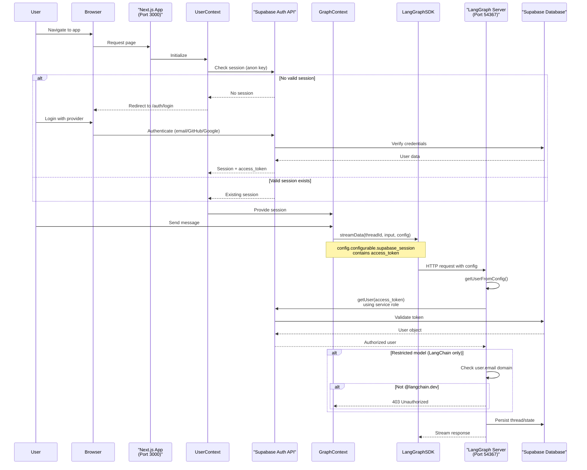
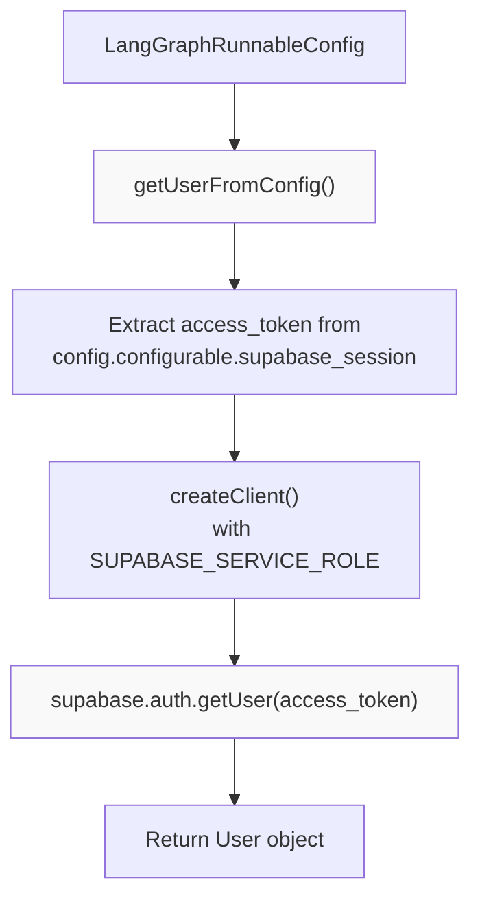
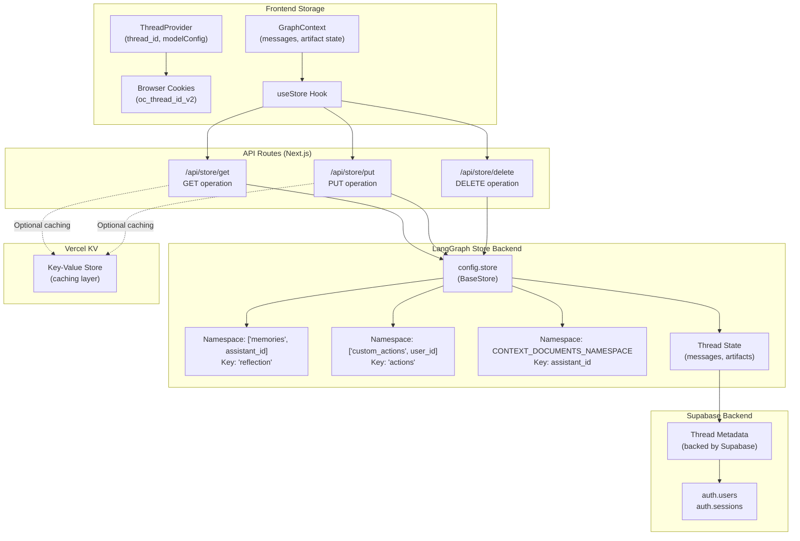
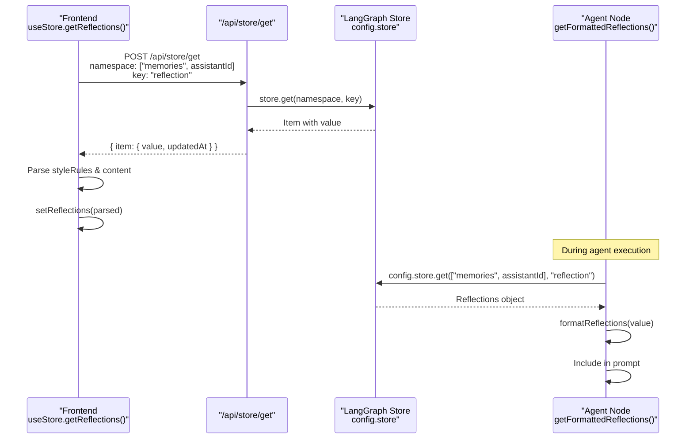
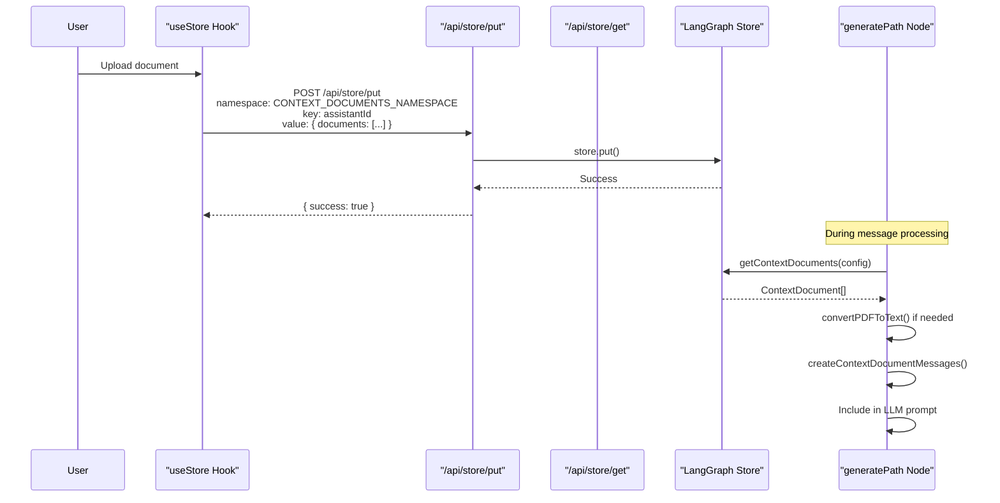
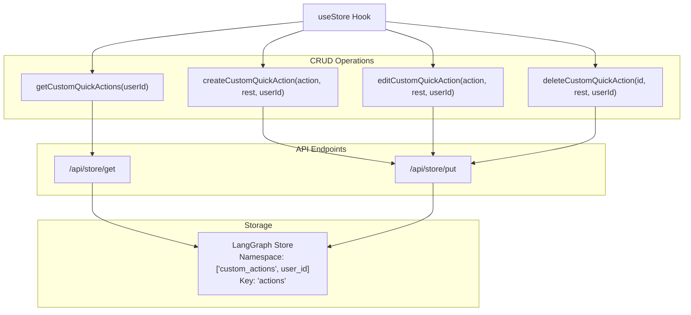
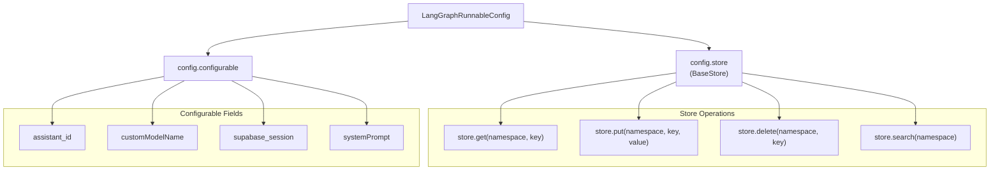

<!-- source: DeepWiki mcp.deepwiki.com · repo langchain-ai/open-canvas · page 2.4 Authentication and Storage · fetched 2026-10-26 -->

# Authentication and Storage

<details>
<summary>Relevant source files</summary>

The following files were used as context for generating this wiki page:

- [.codespellignore](.codespellignore)
- [.env.example](.env.example)
- [README.md](README.md)
- [apps/agents/package.json](apps/agents/package.json)
- [apps/web/.env.example](apps/web/.env.example)
- [apps/web/package.json](apps/web/package.json)
- [apps/web/src/hooks/useStore.tsx](apps/web/src/hooks/useStore.tsx)
- [packages/evals/package.json](packages/evals/package.json)
- [packages/shared/package.json](packages/shared/package.json)
- [static/screenshot.png](static/screenshot.png)

</details>


## Purpose and Scope

This document covers the authentication and data persistence mechanisms in Open Canvas. It explains how users authenticate via Supabase, how sessions are managed across frontend and backend, and how various types of data (threads, memories, context documents) are stored and retrieved.

For information about the overall system architecture and how authentication fits into the request flow, see [System Architecture](#2). For details on state management in the frontend, see [State Management](#3.1).

---

## Overview

Open Canvas uses **Supabase** as its authentication provider and primary data store. The system maintains a clear separation between frontend authentication (using public keys) and backend authorization (using service role keys). User sessions are propagated from the frontend to the backend via access tokens embedded in LangGraph configuration.

**Key Components:**
- **Frontend**: Manages user authentication UI and session state via `UserContext`
- **Backend**: Validates access tokens and performs authorized operations via Supabase service role
- **LangGraph Store**: Persists graph state, memories, and context documents
- **Supabase Database**: Stores thread metadata and user information

---

## Authentication System

### Supabase Authentication Setup

Open Canvas supports multiple authentication providers configured through Supabase:

| Provider | Configuration Required | Frontend Variable | Backend Variable |
|----------|----------------------|-------------------|------------------|
| Email/Password | Supabase Email Auth enabled | `NEXT_PUBLIC_SUPABASE_URL`<br>`NEXT_PUBLIC_SUPABASE_ANON_KEY` | `SUPABASE_SERVICE_ROLE` |
| GitHub OAuth | GitHub OAuth App credentials in Supabase | Same as above | Same as above |
| Google OAuth | Google OAuth Client credentials in Supabase | Same as above | Same as above |

**Configuration Sources:**
- Frontend: [apps/web/.env.example:16-18]()
- Backend: [.env.example:28-31]()
- Setup instructions: [README.md:85-94]()

Sources: [README.md:85-94](), [apps/web/.env.example:15-21](), [.env.example:28-31]()

### Authentication Flow Diagram



**Key Authentication Steps:**

1. **Initial Session Check**: `UserContext` uses `NEXT_PUBLIC_SUPABASE_ANON_KEY` to check for existing sessions
2. **Provider Authentication**: User authenticates via Email/GitHub/Google through Supabase
3. **Session Propagation**: Access token from session is included in `config.configurable.supabase_session`
4. **Backend Validation**: Backend uses `SUPABASE_SERVICE_ROLE` to validate the access token and retrieve user data

Sources: [README.md:85-98](), [apps/agents/src/utils.ts:310-334]()

### Frontend Authentication

The frontend authentication is managed through a React Context that wraps the entire application:

**UserContext Integration:**
```
apps/web/src/app/layout.tsx
├── NuqsAdapter
└── UserContext  ← Provides authentication state
    └── AssistantContext
        └── ThreadProvider
            └── GraphContext
```

The `UserContext` provider:
- Initializes Supabase client with `NEXT_PUBLIC_SUPABASE_URL` and `NEXT_PUBLIC_SUPABASE_ANON_KEY`
- Manages authentication state (logged in/out, user info)
- Provides sign-in/sign-out methods to child components
- Redirects unauthenticated users to `/auth/login`

**Authentication Pages:**
- Login: `http://localhost:3000/auth/login`
- Signup: `http://localhost:3000/auth/signup`
- Email confirmation handled by Supabase

Sources: [README.md:95-97]()

### Backend Authorization

The backend validates user access tokens and enforces authorization policies:

#### Token Validation



**Implementation:** [apps/agents/src/utils.ts:310-334]()

Key details:
- Access token extracted from `config.configurable.supabase_session.access_token`
- Supabase client created with `NEXT_PUBLIC_SUPABASE_URL` and `SUPABASE_SERVICE_ROLE`
- `supabase.auth.getUser(accessToken)` validates token and returns user data
- Returns `undefined` if environment variables not set or token invalid

Sources: [apps/agents/src/utils.ts:310-334]()

#### Model Authorization

Certain models are restricted to LangChain employees:

**Authorization Check:** [apps/agents/src/utils.ts:365-380]()

```
getModelFromConfig()
├── Check if model in LANGCHAIN_USER_ONLY_MODELS
├── Call getUserFromConfig() to get user
├── Validate user.email ends with "@langchain.dev"
└── Throw error if unauthorized
```

**Restricted Models:**
- Defined in `LANGCHAIN_USER_ONLY_MODELS` array: [packages/shared/src/models.ts]()
- Checked during model initialization: [apps/agents/src/utils.ts:365-380]()
- Error thrown: `"Unauthorized. Can not use LangChain only models without a user with a @langchain.dev email."`

Sources: [apps/agents/src/utils.ts:365-380](), [packages/shared/src/models.ts]()

---

## Storage Architecture

### Storage Layers Overview



**Storage Layer Responsibilities:**

| Layer | Purpose | Access Pattern |
|-------|---------|----------------|
| **GraphContext/ThreadProvider** | Transient UI state | Direct React state |
| **useStore Hook** | Client-side API for persistence | HTTP calls to `/api/store/*` |
| **API Routes** | Server-side proxy layer | Forwards to LangGraph Store |
| **LangGraph Store** | Primary persistence backend | Namespaced key-value operations |
| **Supabase** | Authentication and thread metadata | Direct database access |
| **Vercel KV** | Fast caching layer | Optional, configuration-dependent |

Sources: [apps/web/src/hooks/useStore.tsx:1-304](), [apps/web/package.json:68]()

### Thread Storage

Threads represent conversation sessions and are stored with the following structure:

**Thread Lifecycle:**

1. **Creation**: When user sends first message
   - `ThreadProvider.createThread()` calls LangGraph server
   - LangGraph server creates thread in Supabase
   - Returns `thread_id` stored in cookie `oc_thread_id_v2`

2. **State Persistence**: After each agent execution
   - Messages array updated incrementally
   - Artifact versions added to `artifact.contents`
   - Final state persisted to Supabase via LangGraph
   - State accessible via `config.store` in agent nodes

3. **Retrieval**: On page load
   - Thread ID from URL parameter or `oc_thread_id_v2` cookie
   - `ThreadProvider` loads thread metadata
   - `GraphContext` initializes with loaded state
   - LangGraph loads full state from Supabase

**Thread State Structure:**
```typescript
{
  messages: BaseMessage[],           // Conversation history
  artifact: {
    currentIndex: number,            // Active version
    contents: ArtifactV3[]          // All versions
  },
  _messages: BaseMessage[],          // Internal message buffer
  // ... other state fields
}
```

**Cookie Reference:** Thread ID stored in `oc_thread_id_v2` cookie enables session persistence across page refreshes.

Sources: [README.md:166]()

### Memory Store (Reflections)

The reflection system stores personalized memories and style rules using the LangGraph store:

#### Memory Store Access Pattern



**Memory Storage Implementation:**

- **Storage location**: `config.store` (LangGraph BaseStore)
- **Namespace**: `["memories", assistant_id]`
- **Key**: `"reflection"`
- **Value structure**:
  ```typescript
  {
    styleRules: string[],    // Writing/coding style guidelines
    content: string[]        // Facts about the user
  }
  ```

**Frontend Retrieval:** [apps/web/src/hooks/useStore.tsx:19-65]()

The `useStore.getReflections()` method:
- Calls `POST /api/store/get` with namespace `["memories", assistantId]`
- Parses `styleRules` and `content` (may be JSON strings)
- Handles parsing errors with console logging
- Sets state with `updatedAt` timestamp

**Backend Retrieval:** [apps/agents/src/utils.ts:112-131]()

The `getFormattedReflections()` function:
- Accesses `config.store.get(["memories", assistantId], "reflection")`
- Calls `formatReflections()` to create prompt-friendly text
- Returns formatted string or "No reflections found."

**Formatting Function:** [apps/agents/src/utils.ts:31-101]()

The `formatReflections()` function:
- Parses `styleRules` and `content` arrays
- Formats into XML-like sections: `<style-guidelines>` and `<user-facts>`
- Supports filtering: `onlyStyle` or `onlyContent` options
- Handles parsing errors gracefully

**Deletion:** [apps/web/src/hooks/useStore.tsx:67-93]()

```typescript
deleteReflections(assistantId) → POST /api/store/delete
  → namespace: ["memories", assistantId]
  → key: "reflection"
```

Sources: [apps/web/src/hooks/useStore.tsx:19-93](), [apps/agents/src/utils.ts:31-131]()

### Context Documents Store

Uploaded documents (PDFs, text files) are stored in the LangGraph store for retrieval during artifact generation:

**Storage Pattern:**

- **Namespace**: `CONTEXT_DOCUMENTS_NAMESPACE` (imported from `@opencanvas/shared/constants`)
- **Key**: `assistant_id`
- **Value structure**:
  ```typescript
  {
    documents: ContextDocument[]
  }
  ```

**ContextDocument Type:**
```typescript
{
  type: "application/pdf" | "text/plain" | "text",
  data: string  // Base64 encoded or plain text
}
```

#### Document Storage and Retrieval Flow



**Frontend Storage:** [apps/web/src/hooks/useStore.tsx:228-258]()

```typescript
putContextDocuments({ assistantId, documents }) {
  POST /api/store/put
    → namespace: CONTEXT_DOCUMENTS_NAMESPACE
    → key: assistantId
    → value: { documents }
}
```

**Frontend Retrieval:** [apps/web/src/hooks/useStore.tsx:260-289]()

```typescript
getContextDocuments(assistantId) {
  POST /api/store/get
    → namespace: CONTEXT_DOCUMENTS_NAMESPACE
    → key: assistantId
  ← { item: { value: { documents } } }
}
```

**Backend Retrieval:** [apps/agents/src/utils.ts:515-526]()

```typescript
async function getContextDocuments(config: LangGraphRunnableConfig) {
  const store = config.store;
  const assistantId = config.configurable?.assistant_id;
  const result = await store.get(CONTEXT_DOCUMENTS_NAMESPACE, assistantId);
  return result?.value?.documents || [];
}
```

**Document Processing:**

The system converts documents to text for LLM consumption based on model provider:

| Provider | Native PDF Support | Conversion Required |
|----------|-------------------|---------------------|
| OpenAI | No | Yes (via pdf-parse) |
| Anthropic | Yes (Claude 3.5 Sonnet) | Conditional |
| Google GenAI | Yes | No |
| Others | No | Yes |

**Conversion Functions:**
- [apps/agents/src/utils.ts:434-466]() - `createContextDocumentMessagesAnthropic()`
- [apps/agents/src/utils.ts:468-490]() - `createContextDocumentMessagesGemini()`
- [apps/agents/src/utils.ts:492-513]() - `createContextDocumentMessagesOpenAI()`
- [apps/agents/src/utils.ts:415-432]() - `convertPDFToText()` (uses pdf-parse library)

Sources: [apps/web/src/hooks/useStore.tsx:228-289](), [apps/agents/src/utils.ts:415-582](), [packages/shared/src/constants.ts:8]()

### Custom Quick Actions Store

Custom quick actions are user-defined shortcuts that persist across sessions:

**Storage Pattern:**

- **Namespace**: `["custom_actions", user_id]`
- **Key**: `"actions"`
- **Value structure**:
  ```typescript
  {
    [actionId: string]: CustomQuickAction
  }
  ```

**CustomQuickAction Type:**
```typescript
{
  id: string,
  label: string,
  prompt: string
}
```

#### Quick Actions CRUD Operations



**Frontend Operations:** [apps/web/src/hooks/useStore.tsx:95-226]()

| Method | API Call | Description |
|--------|----------|-------------|
| `getCustomQuickActions(userId)` | `POST /api/store/get` | Retrieves all actions for user |
| `createCustomQuickAction(action, rest, userId)` | `POST /api/store/put` | Adds new action to existing set |
| `editCustomQuickAction(action, rest, userId)` | `POST /api/store/put` | Updates existing action |
| `deleteCustomQuickAction(id, rest, userId)` | `POST /api/store/put` | Removes action from set |

**Implementation Notes:**

- All mutation operations rebuild the entire actions object
- Actions stored as key-value map with `action.id` as key
- Empty set returns `undefined` rather than empty array
- Loading states tracked via `isLoadingQuickActions`

Sources: [apps/web/src/hooks/useStore.tsx:95-226]()

### Vercel KV Integration

Vercel KV provides an optional fast caching layer for the application:

**Configuration:**

The application includes Vercel KV as a dependency: [apps/web/package.json:68]()

```json
"@vercel/kv": "^2.0.0"
```

**Purpose:**

Vercel KV serves as a Redis-compatible key-value store that can be used for:
- Caching frequently accessed data
- Rate limiting
- Session storage (supplementing Supabase)
- Temporary state management

**Integration Point:**

While Vercel KV is included in the project dependencies, its specific usage patterns in the API routes are not fully visible in the provided codebase. The storage architecture diagram shows it as an optional caching layer for the `/api/store/*` endpoints.

**Deployment Context:**

Vercel KV is primarily beneficial when deploying to Vercel's platform, where it provides low-latency access to cached data across edge functions.

Sources: [apps/web/package.json:68]()

---

## Configuration

### Environment Variables

#### Frontend Configuration

**File:** [apps/web/.env.example]()

| Variable | Purpose | Required |
|----------|---------|----------|
| `NEXT_PUBLIC_SUPABASE_URL` | Supabase project URL | Yes |
| `NEXT_PUBLIC_SUPABASE_ANON_KEY` | Supabase anonymous/public key | Yes |
| `NEXT_PUBLIC_SUPABASE_URL_DOCUMENTS` | Alternative Supabase URL for documents | Optional |
| `NEXT_PUBLIC_SUPABASE_ANON_KEY_DOCUMENTS` | Alternative anon key for documents | Optional |

**Usage in Frontend:**
- Initialize Supabase client for authentication
- Access public APIs (auth, storage)
- Safe to expose in browser (public key)

Sources: [apps/web/.env.example:15-21]()

#### Backend Configuration

**File:** [.env.example]()

| Variable | Purpose | Required |
|----------|---------|----------|
| `NEXT_PUBLIC_SUPABASE_URL` | Supabase project URL | Yes |
| `NEXT_PUBLIC_SUPABASE_ANON_KEY` | Supabase public key (for token validation) | Yes |
| `SUPABASE_SERVICE_ROLE` | Supabase service role key (admin access) | Yes |

**Usage in Backend:**
- Validate user access tokens: [apps/agents/src/utils.ts:327-330]()
- Perform privileged operations (read/write any data)
- Must be kept secret (full database access)

Sources: [.env.example:28-31](), [apps/agents/src/utils.ts:327-330]()

### Supabase Setup Steps

**1. Create Supabase Project:**
- Visit [Supabase Dashboard](https://supabase.com/dashboard/projects)
- Create new project
- Note the project URL and API keys

**2. Configure Authentication Providers:**

Navigate to `Authentication` → `Providers`:

| Provider | Setup Required |
|----------|---------------|
| Email | Enable provider<br/>Enable "Confirm Email" |
| GitHub | Create OAuth App<br/>Add Client ID/Secret to Supabase<br/>See [GitHub setup docs](https://supabase.com/docs/guides/auth/social-login/auth-github) |
| Google | Create OAuth Client<br/>Add Client ID/Secret to Supabase<br/>See [Google setup docs](https://supabase.com/docs/guides/auth/social-login/auth-google) |

**3. Copy API Keys:**

Navigate to `Project Settings` → `API`:

- Copy `Project URL` → `NEXT_PUBLIC_SUPABASE_URL`
- Copy `anon public` key → `NEXT_PUBLIC_SUPABASE_ANON_KEY`
- Copy `service_role` key → `SUPABASE_SERVICE_ROLE`

**4. Set Environment Variables:**

```bash
# Frontend (apps/web/.env)
NEXT_PUBLIC_SUPABASE_URL="https://xxxxx.supabase.co"
NEXT_PUBLIC_SUPABASE_ANON_KEY="eyJhbGc..."

# Backend (root .env)
NEXT_PUBLIC_SUPABASE_URL="https://xxxxx.supabase.co"
NEXT_PUBLIC_SUPABASE_ANON_KEY="eyJhbGc..."
SUPABASE_SERVICE_ROLE="eyJhbGc..."
```

**5. Test Authentication:**

```bash
yarn dev  # Start frontend
# Visit http://localhost:3000
# Should redirect to /auth/login
# Test login with configured provider
```

Sources: [README.md:85-97]()

---

## Integration Points

### useStore Hook Implementation

The `useStore` hook provides a unified interface for frontend components to interact with the LangGraph store:

**Hook Structure:** [apps/web/src/hooks/useStore.tsx:11-304]()

```mermaid
graph TB
    useStore["useStore() Hook"]
    
    subgraph "State Management"
        LoadingRefl["isLoadingReflections"]
        LoadingActions["isLoadingQuickActions"]
        ReflState["reflections state"]
    end
    
    subgraph "Reflection Methods"
        GetRefl["getReflections(assistantId)"]
        DelRefl["deleteReflections(assistantId)"]
    end
    
    subgraph "Quick Action Methods"
        GetActions["getCustomQuickActions(userId)"]
        CreateAction["createCustomQuickAction(action, rest, userId)"]
        EditAction["editCustomQuickAction(action, rest, userId)"]
        DelAction["deleteCustomQuickAction(id, rest, userId)"]
    end
    
    subgraph "Context Document Methods"
        PutDocs["putContextDocuments({ assistantId, documents })"]
        GetDocs["getContextDocuments(assistantId)"]
    end
    
    subgraph "API Endpoints"
        GetAPI["/api/store/get"]
        PutAPI["/api/store/put"]
        DelAPI["/api/store/delete"]
    end
    
    useStore --> LoadingRefl
    useStore --> LoadingActions
    useStore --> ReflState
    
    useStore --> GetRefl
    useStore --> DelRefl
    useStore --> GetActions
    useStore --> CreateAction
    useStore --> EditAction
    useStore --> DelAction
    useStore --> PutDocs
    useStore --> GetDocs
    
    GetRefl --> GetAPI
    DelRefl --> DelAPI
    GetActions --> GetAPI
    CreateAction --> PutAPI
    EditAction --> PutAPI
    DelAction --> PutAPI
    PutDocs --> PutAPI
    GetDocs --> GetAPI
```



**Return Interface:**

```typescript
{
  // State
  isLoadingReflections: boolean,
  reflections: Reflections & { assistantId: string; updatedAt: Date },
  isLoadingQuickActions: boolean,
  
  // Reflection methods
  getReflections: (assistantId: string) => Promise<void>,
  deleteReflections: (assistantId: string) => Promise<boolean>,
  
  // Quick action methods
  getCustomQuickActions: (userId: string) => Promise<CustomQuickAction[]>,
  createCustomQuickAction: (action, rest, userId) => Promise<boolean>,
  editCustomQuickAction: (action, rest, userId) => Promise<boolean>,
  deleteCustomQuickAction: (id, rest, userId) => Promise<boolean>,
  
  // Context document methods
  putContextDocuments: ({ assistantId, documents }) => Promise<void>,
  getContextDocuments: (assistantId: string) => Promise<ContextDocument[]>
}
```

**Usage Pattern:**

Components import and destructure needed methods:

```typescript
const { 
  reflections, 
  getReflections, 
  deleteReflections 
} = useStore();
```

Sources: [apps/web/src/hooks/useStore.tsx:1-304]()

### Store Access in Config

All agent nodes receive a `LangGraphRunnableConfig` object that provides access to the store:



**Utility Function:** [apps/agents/src/utils.ts:103-110]()

```typescript
export const ensureStoreInConfig = (config: LangGraphRunnableConfig): BaseStore => {
  if (!config.store) {
    throw new Error("`store` not found in config");
  }
  return config.store;
};
```

**Usage Example (from reflection node):**

```typescript
const store = ensureStoreInConfig(config);
const assistantId = config.configurable?.assistant_id;
const namespace = ["memories", assistantId];
await store.put(namespace, "reflection", reflections);
```

Sources: [apps/agents/src/utils.ts:103-131](), [apps/web/src/hooks/useStore.tsx:1-304]()

### Session Propagation

The user session flows from frontend to backend through the LangGraph SDK configuration:

**GraphContext Setup:**

When `streamMessage()` is called in the frontend:
1. Retrieve current session from `UserContext`
2. Build configuration object with session
3. Pass to `LangGraphSDK.streamData()`

**Configuration Structure:**
```typescript
config: {
  configurable: {
    customModelName: string,
    modelConfig: CustomModelConfig,
    assistant_id: string,
    supabase_session: Session,  // ← Contains access_token
    systemPrompt?: string
  },
  store: BaseStore
}
```

**Backend Extraction:**

The backend extracts the session in `getUserFromConfig()`: [apps/agents/src/utils.ts:320-323]()

```typescript
const accessToken = (
  config.configurable?.supabase_session as Session | undefined
)?.access_token;
```

Sources: [apps/agents/src/utils.ts:310-334]()

### Error Handling

Common authentication and storage errors:

#### Thread Not Found Error

**Cause:** Making requests to a LangGraph server that doesn't have the thread in its database

**Solution:**
- Clear `oc_thread_id_v2` cookie
- Refresh page to create new thread
- Ensure using consistent LangGraph server (same port)

**Reference:** [README.md:166-167]()

#### Model Name Missing Error

**Error Message:** `"Model name is missing in config."`

**Cause:** `customModelName` not set in `config.configurable`

**Solution:**
- Ensure `ModelSelector` is setting model name correctly
- Verify `ThreadProvider` includes model name in configuration
- Check `config.configurable.customModelName` exists

**Reference:** [README.md:172](), [apps/agents/src/utils.ts:182]()

#### Unauthorized Model Access

**Error Message:** `"Unauthorized. Can not use LangChain only models without a user with a @langchain.dev email."`

**Cause:** Attempting to use restricted model without proper credentials

**Solution:**
- Use non-restricted model
- Ensure proper Supabase session configuration
- Verify user email domain for LangChain employees

**Reference:** [apps/agents/src/utils.ts:368-379]()

Sources: [README.md:162-172](), [apps/agents/src/utils.ts:182,368-379]()

---

## Summary

The Open Canvas authentication and storage system follows a clear separation of concerns:

| Component | Authentication Role | Storage Role |
|-----------|-------------------|--------------|
| **Frontend** | Manages login UI<br/>Uses public keys<br/>Maintains session state | Temporary state in React Context<br/>Persists via backend calls |
| **Backend** | Validates access tokens<br/>Uses service role key<br/>Enforces authorization | Writes to LangGraph store<br/>Writes to Supabase DB<br/>Manages memories and documents |
| **Supabase** | Provides auth APIs<br/>Issues access tokens<br/>Verifies credentials | Stores threads<br/>Stores user data<br/>Backs LangGraph store |

**Key Takeaways:**

1. **Dual-Key System**: Frontend uses `NEXT_PUBLIC_SUPABASE_ANON_KEY`, backend uses `SUPABASE_SERVICE_ROLE`
2. **Session Propagation**: Access tokens flow through `config.configurable.supabase_session`
3. **Namespaced Storage**: Memories, documents, and threads use distinct namespaces in the store
4. **Authorization Layers**: Model restrictions enforced at runtime using email domain checks
5. **Flexible Providers**: Support for Email, GitHub, and Google OAuth through Supabase

Sources: [README.md:85-98](), [apps/agents/src/utils.ts:103-582](), [.env.example:28-31](), [apps/web/.env.example:15-21]()

---

