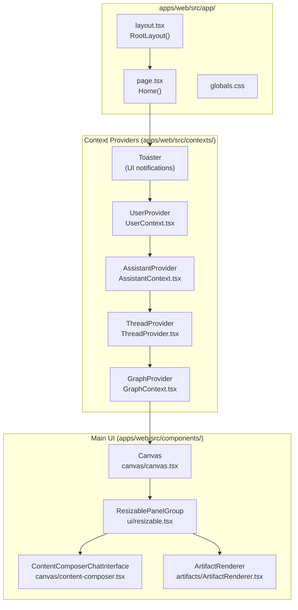
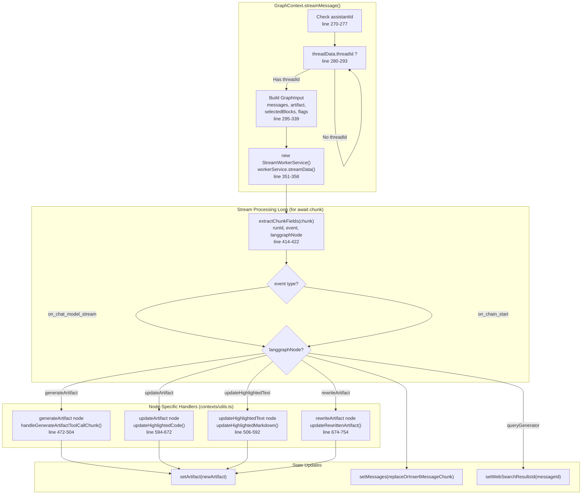
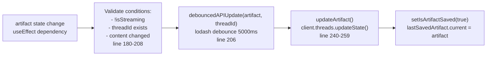
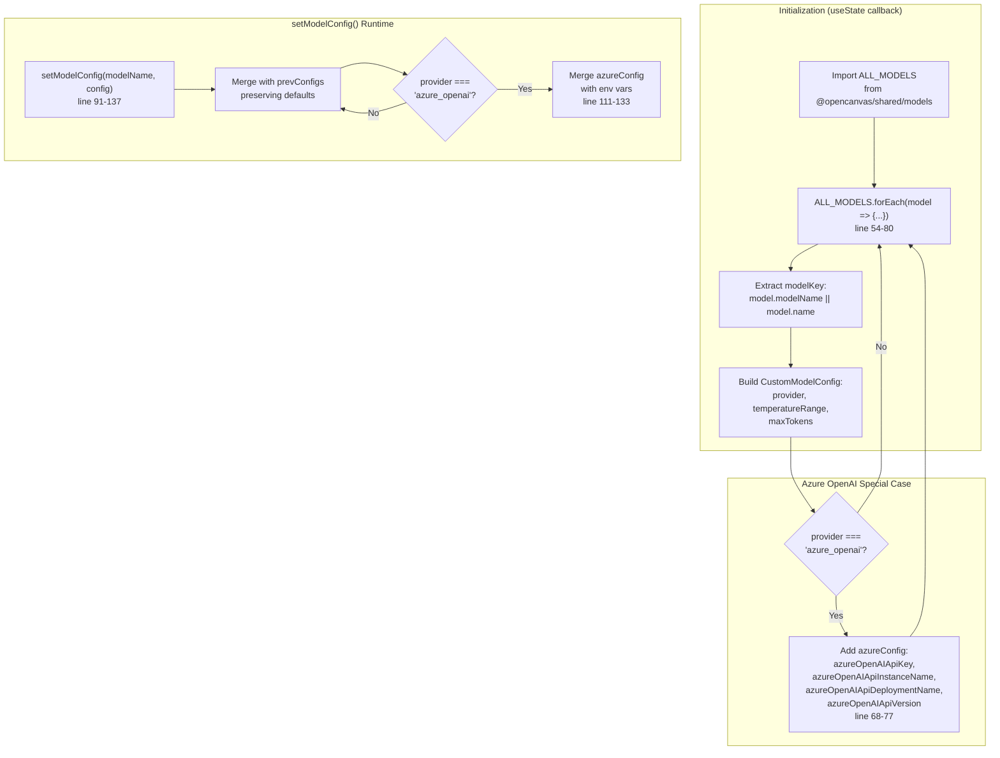
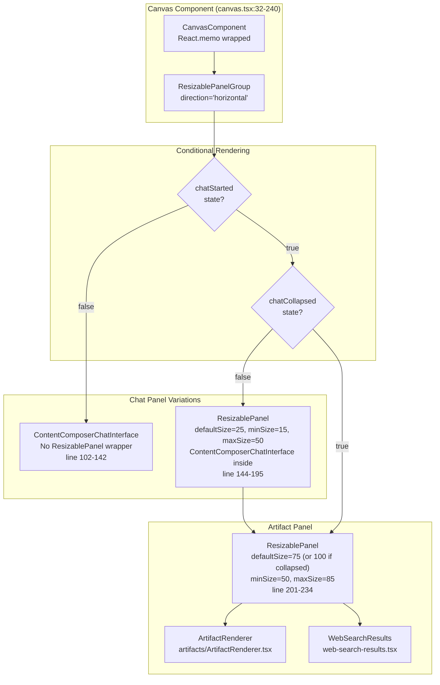
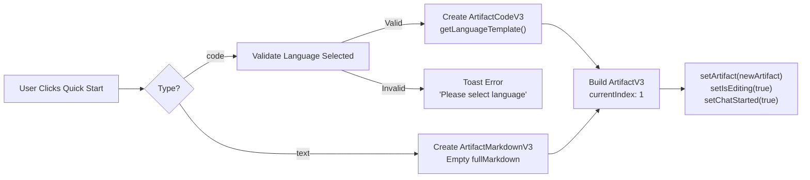
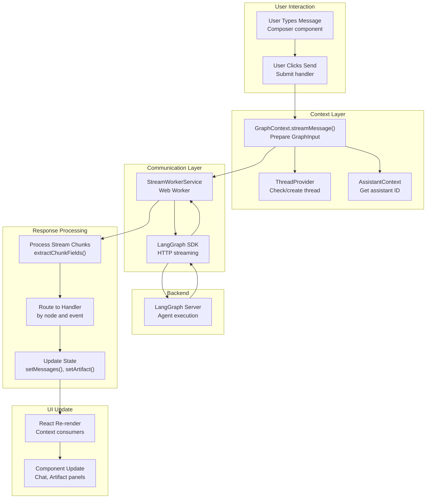

<!-- source: DeepWiki mcp.deepwiki.com · repo langchain-ai/open-canvas · page 3 Frontend Application · fetched 2026-10-26 -->

# Frontend Application

<details>
<summary>Relevant source files</summary>

The following files were used as context for generating this wiki page:

- [.codespellignore](.codespellignore)
- [apps/agents/package.json](apps/agents/package.json)
- [apps/web/package.json](apps/web/package.json)
- [apps/web/src/app/layout.tsx](apps/web/src/app/layout.tsx)
- [apps/web/src/components/canvas/canvas.tsx](apps/web/src/components/canvas/canvas.tsx)
- [apps/web/src/components/ui/resizable.tsx](apps/web/src/components/ui/resizable.tsx)
- [apps/web/src/contexts/GraphContext.tsx](apps/web/src/contexts/GraphContext.tsx)
- [apps/web/src/contexts/ThreadProvider.tsx](apps/web/src/contexts/ThreadProvider.tsx)
- [apps/web/src/hooks/useStore.tsx](apps/web/src/hooks/useStore.tsx)
- [packages/evals/package.json](packages/evals/package.json)
- [packages/shared/package.json](packages/shared/package.json)

</details>


The Frontend Application is the Next.js web interface located at `apps/web/` that provides the primary user experience for Open Canvas. It implements a dual-panel layout with a chat interface and an artifact editor, supporting real-time streaming of AI responses, artifact versioning, and rich text/code editing capabilities.

**Key Technologies:**
- **React 18** with Next.js 14 App Router
- **State Management:** React Context API with hierarchical provider pattern
- **UI Libraries:** Radix UI primitives, Mantine components, @assistant-ui/react
- **Editors:** BlockNote (markdown/rich text), CodeMirror 6 (code)
- **Backend Communication:** LangGraph SDK with Web Worker-based streaming
- **Styling:** Tailwind CSS with custom component library

The application is organized as a monorepo package that depends on `@opencanvas/shared` for common types and utilities. For backend integration details, see page #4. For model configuration, see page #5.

---

## Application Entry Points

The frontend application is located in `apps/web/` and follows Next.js 14 App Router conventions. The entry point is [apps/web/src/app/layout.tsx:1-28](), which establishes:

- **NuqsAdapter:** Wraps the application for URL query state synchronization via `nuqs/adapters/next/app`
- **Inter font:** Google Fonts integration from `next/font/google`
- **Global styles:** Tailwind CSS via `./globals.css`
- **HTML structure:** Full-height layout with `className="h-screen"`

The main page component then wraps the application in a hierarchical context provider stack, culminating in the `Canvas` component that renders the chat and artifact panels.

### Application Component Hierarchy



**Sources:** [apps/web/src/app/layout.tsx:1-28](), [apps/web/src/components/canvas/canvas.tsx:32-240]()

---

## State Management Architecture

The application uses a hierarchical React Context pattern where each provider manages a specific domain and can access parent contexts via hooks like `useUserContext()`, `useThreadContext()`, etc.

### Context Provider Stack

| Provider | File | Key State | Primary Operations |
|----------|------|-----------|-------------------|
| `UserContext` | `contexts/UserContext.tsx` | `user: User`, `session: Session` | Supabase authentication, user profile |
| `AssistantContext` | `contexts/AssistantContext.tsx` | `selectedAssistant: Assistant`, `allAssistants: Assistant[]` | Assistant CRUD, selection |
| `ThreadProvider` | `contexts/ThreadProvider.tsx` | `threadId: string`, `modelName: ALL_MODEL_NAMES`, `modelConfig: CustomModelConfig` | Thread lifecycle, model configuration |
| `GraphContext` | `contexts/GraphContext.tsx` | `messages: BaseMessage[]`, `artifact: ArtifactV3`, `isStreaming: boolean` | Message streaming, artifact management |

### GraphContext Interface (`GraphData`)

The `GraphContext` exposes a `GraphData` interface defined at [apps/web/src/contexts/GraphContext.tsx:66-93]():

```typescript
interface GraphData {
  runId: string | undefined;
  isStreaming: boolean;
  error: boolean;
  selectedBlocks: TextHighlight | undefined;
  messages: BaseMessage[];
  artifact: ArtifactV3 | undefined;
  updateRenderedArtifactRequired: boolean;
  isArtifactSaved: boolean;
  firstTokenReceived: boolean;
  feedbackSubmitted: boolean;
  artifactUpdateFailed: boolean;
  chatStarted: boolean;
  searchEnabled: boolean;
  // ... setter and operation functions
}
```

**Key Operations:**
- `streamMessage(params: GraphInput)` - Initiates streaming from LangGraph backend at [apps/web/src/contexts/GraphContext.tsx:267-817]()
- `setArtifactContent(index: number, content: string)` - Manual artifact editing
- `switchSelectedThread(thread: Thread)` - Loads thread state
- `clearState()` - Resets messages and artifacts
- `setSelectedBlocks(blocks: TextHighlight)` - Sets highlighted text for editing

**Sources:** [apps/web/src/contexts/GraphContext.tsx:66-93](), [apps/web/src/contexts/ThreadProvider.tsx:15-33]()

---

## Message Streaming with GraphContext

The `GraphContext` ([apps/web/src/contexts/GraphContext.tsx:1-1164]()) is the primary state manager for real-time message streaming and artifact updates. It coordinates between the UI, the LangGraph SDK, and a Web Worker for efficient stream processing.

### `streamMessage()` Workflow

The `streamMessage()` function at [apps/web/src/contexts/GraphContext.tsx:267-817]() implements the core streaming logic:



**Sources:** [apps/web/src/contexts/GraphContext.tsx:267-817](), [apps/web/src/contexts/utils.ts:1-400]()

### Event Processing by LangGraph Node

The stream loop processes chunks based on `langgraphNode` and `event` fields:

| Node | Event | Handler | Purpose |
|------|-------|---------|---------|
| `generateArtifact` | `on_chat_model_stream` | `handleGenerateArtifactToolCallChunk()` ([apps/web/src/contexts/utils.ts:200-250]()) | Accumulates tool call JSON, incrementally parses artifact |
| `updateArtifact` | `on_chat_model_stream` | `updateHighlightedCode()` ([apps/web/src/contexts/utils.ts:150-190]()) | Replaces code segment between `startCharIndex` and `endCharIndex` |
| `updateHighlightedText` | `on_chat_model_stream` | `updateHighlightedMarkdown()` ([apps/web/src/contexts/utils.ts:100-140]()) | Replaces markdown block within full document |
| `rewriteArtifact` | `on_chat_model_stream` | `updateRewrittenArtifact()` ([apps/web/src/contexts/utils.ts:250-320]()) | Full artifact regeneration with streaming |
| `generateFollowup` | `on_chat_model_stream` | `replaceOrInsertMessageChunk()` ([apps/web/src/contexts/utils.ts:50-80]()) | Inserts/updates AI message in chat |
| `queryGenerator` | `on_chain_start` | Creates message with `OC_WEB_SEARCH_RESULTS_MESSAGE_KEY` | Triggers web search UI ([apps/web/src/contexts/GraphContext.tsx:434-453]()) |

**Thinking Model Handling:**  
For models like `o1` or `o3`, the system extracts `<think>` tags using `handleRewriteArtifactThinkingModel()` at [apps/web/src/contexts/GraphContext.tsx:692-700](), which calls `@opencanvas/shared/utils/thinking` helpers to separate thinking content from response content.

**Sources:** [apps/web/src/contexts/GraphContext.tsx:398-817](), [apps/web/src/contexts/utils.ts:1-400]()

### Artifact Persistence Strategy

The `GraphContext` implements automatic artifact saving with a 5-second debounce to minimize API calls:



**Implementation Details:**
- Debounce created at [apps/web/src/contexts/GraphContext.tsx:130-136]() using `lodash.debounce`
- `useEffect` hook monitors `artifact` state at [apps/web/src/contexts/GraphContext.tsx:180-208]()
- Empty artifacts (e.g., first content with empty text/code) are skipped at [apps/web/src/contexts/GraphContext.tsx:189-197]()
- Updates are blocked during streaming to prevent race conditions

**Sources:** [apps/web/src/contexts/GraphContext.tsx:130-136](), [apps/web/src/contexts/GraphContext.tsx:180-208](), [apps/web/src/contexts/GraphContext.tsx:240-259]()

---

## Thread and Model Management with ThreadProvider

The `ThreadProvider` at [apps/web/src/contexts/ThreadProvider.tsx:1-291]() manages thread lifecycle operations and model configuration state. It uses `nuqs` for URL-synchronized state and communicates with the LangGraph backend via the SDK client.

### ThreadContentType Interface

The context exposes operations defined at [apps/web/src/contexts/ThreadProvider.tsx:15-33]():

| Property | Type | Description |
|----------|------|-------------|
| `threadId` | `string \| null` | Current thread ID (synced to URL via `useQueryState`) |
| `userThreads` | `Thread[]` | User's threads from `client.threads.search()` |
| `isUserThreadsLoading` | `boolean` | Loading state for thread list |
| `modelName` | `ALL_MODEL_NAMES` | Currently selected model name |
| `modelConfig` | `CustomModelConfig` | Config for current model |
| `modelConfigs` | `Record<ALL_MODEL_NAMES, CustomModelConfig>` | All model configs |
| `createThreadLoading` | `boolean` | Loading state for thread creation |
| `createThread()` | `() => Promise<Thread \| undefined>` | Creates thread with user ID and model metadata |
| `getUserThreads()` | `() => Promise<void>` | Fetches threads filtered by `supabase_user_id` |
| `deleteThread()` | `(id: string, clearMessages: () => void) => Promise<void>` | Deletes thread, creates new if active |
| `setModelName()` | `(name: ALL_MODEL_NAMES) => void` | Updates selected model |
| `setModelConfig()` | `(modelName: ALL_MODEL_NAMES, config: CustomModelConfig) => void` | Updates config for specific model |

### Model Configuration Initialization

The `ThreadProvider` initializes configurations for all models at [apps/web/src/contexts/ThreadProvider.tsx:47-82]():



**Sources:** [apps/web/src/contexts/ThreadProvider.tsx:47-137]()

### Thread Lifecycle Operations

**Thread Creation** - `createThread()` at [apps/web/src/contexts/ThreadProvider.tsx:139-184]():
1. Validates `user` is authenticated
2. Calls `client.threads.create()` with metadata:
   - `supabase_user_id`: `user.id`
   - `customModelName`: `modelName` state
   - `modelConfig`: Current `modelConfig` including `azureConfig` if provider is `azure_openai`
3. Sets `threadId` via `setThreadId(thread.thread_id)` (synced to URL)
4. Calls `getUserThreads()` asynchronously to refresh list

**Thread Fetching** - `getUserThreads()` at [apps/web/src/contexts/ThreadProvider.tsx:186-219]():
1. Calls `client.threads.search({ metadata: { supabase_user_id: user.id }, limit: 100 })`
2. Filters threads: keeps last thread always, filters empty threads from others
3. Sets `userThreads` state with filtered results

**Thread Deletion** - `deleteThread()` at [apps/web/src/contexts/ThreadProvider.tsx:221-241]():
1. Immediately removes thread from `userThreads` state
2. If deleting active thread (`id === threadId`):
   - Calls `clearMessages()` callback
   - Calls `createThread()` to create replacement
3. Calls `client.threads.delete(id)` to remove from backend

**Sources:** [apps/web/src/contexts/ThreadProvider.tsx:139-241]()

---

## Main UI Layout: Canvas Component

The `Canvas` component at [apps/web/src/components/canvas/canvas.tsx:32-240]() implements the dual-panel layout using `react-resizable-panels`.

### Canvas Rendering Logic



**Sources:** [apps/web/src/components/canvas/canvas.tsx:32-240]()

### Resizable Panel Configuration

The `Canvas` uses `react-resizable-panels` primitives wrapped in [apps/web/src/components/ui/resizable.tsx:1-45]():

| Panel | Component Props | Purpose |
|-------|----------------|---------|
| Chat Panel | `defaultSize={25}`, `minSize={15}`, `maxSize={50}` | Message history, composer, thread list |
| Artifact Panel | `defaultSize={75}` (or `100` if `chatCollapsed`), `minSize={50}`, `maxSize={85}` | Artifact editor and web search sidebar |

**State Synchronization:**
- `chatCollapsed` state is read from/written to URL query parameter `CHAT_COLLAPSED_QUERY_PARAM` at [apps/web/src/components/canvas/canvas.tsx:43-54]()
- Updates call `router.replace(\`?\${queryParams.toString()}\`, { scroll: false })` to update URL without page reload
- On mount, `useEffect` parses query param and calls `setChatCollapsed()` at [apps/web/src/components/canvas/canvas.tsx:44-55]()

**Sources:** [apps/web/src/components/canvas/canvas.tsx:38-55](), [apps/web/src/components/ui/resizable.tsx:1-45]()

### Quick Start Functionality

The `handleQuickStart` function ([apps/web/src/components/canvas/canvas.tsx:57-98]()) creates initial artifacts:



**Sources:** [apps/web/src/components/canvas/canvas.tsx:57-98]()

---

## Integration with External Services

The frontend integrates with several external services through specialized clients and SDKs.

### LangGraph SDK Integration

The frontend uses the LangGraph SDK to communicate with the backend agent system. Stream processing is delegated to a Web Worker for performance:

**StreamWorkerService** ([apps/web/src/contexts/GraphContext.tsx:351-358]()):
- Instantiates worker: `new StreamWorkerService()`
- Calls `streamData()` with thread ID, assistant ID, input, and model config
- Returns async iterable of streaming events
- Worker handles the actual HTTP streaming connection

**Client Creation** ([apps/web/src/hooks/utils:createClient]()):
- Creates LangGraph client instance
- Configures base URL and authentication
- Used for thread CRUD operations and state updates

### Supabase Integration

Authentication and user data are managed through Supabase, accessed via `UserContext`:

**Thread Metadata:**
- All threads include `supabase_user_id` in metadata
- Enables thread search and filtering by user
- Persists user-specific model preferences

**Sources:** [apps/web/src/contexts/GraphContext.tsx:351-358](), [apps/web/src/contexts/ThreadProvider.tsx:139-219]()

---

## Data Flow Summary

The complete data flow through the frontend follows this pattern:



**Sources:** [apps/web/src/contexts/GraphContext.tsx:267-817](), High-level system diagrams (Diagram 2)

---

